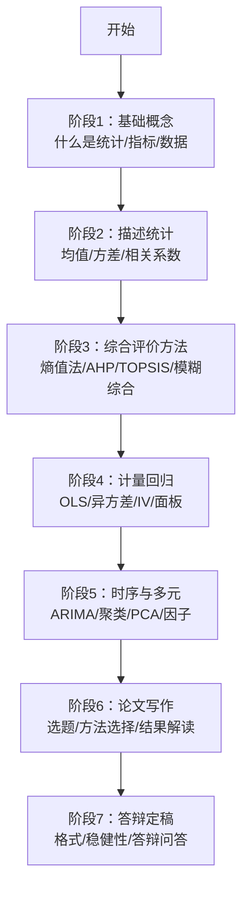

# 00 学习导航 · 经济统计学全学科总入口

> 从0基础到论文大牛的完整学习路径。覆盖综合评价、计量经济学、时间序列、多元统计、统计学原理五门课，以及毕业论文写作全流程。

---

## 顶层结构

```
综合评价/
├── 教材笔记/              ← 五门课的教材笔记
│   ├── 01_综合评价/
│   ├── 02_计量经济学/
│   ├── 03_时间序列/
│   ├── 04_多元统计/
│   └── 05_统计学原理/     ← 🩵 韩兆洲《统计学原理》11章111个KP
├── 论文写作/              ← 毕业论文写作指南（已融合）
│   └── 06_毕业论文指南/
├── 经济统计学论文从0基础到精通/  ← 独立最终版教程（自包含）
├── 原文件/               ← 教材原始Markdown
├── assets/                ← 总览SVG图
└── 00_学习导航.md         ← 本文件
```

---

## 学习路径（7个阶段）



---

## 各目录定位

| 目录 | 是什么 | 学它解决什么 | 建议阶段 |
|------|--------|-------------|---------|
| [[教材笔记/01_综合评价/README|教材笔记/01_综合评价/]]] | 陈正伟《综合评价技术》笔记 | 给对象打分排序（城市竞争力、数字经济水平） | 阶段3 |
| [[教材笔记/02_计量经济学/README|教材笔记/02_计量经济学/]]] | 陈强《计量经济学及Stata应用》笔记 | X对Y有什么因果影响 | 阶段4 |
| [[教材笔记/03_时间序列/README|教材笔记/03_时间序列/]]] | 王燕《时间序列分析——基于R》笔记 | 用过去预测未来（GDP、股价、销量） | 阶段5 |
| [[教材笔记/04_多元统计/README|教材笔记/04_多元统计/]]] | 何晓群《多元统计分析》笔记 | 变量太多要降维/对象要分类 | 阶段5 |
| [[教材笔记/05_统计学原理/README|教材笔记/05_统计学原理/]] | 韩兆洲《统计学原理（第7版）》笔记，11章111个KP+11张SVG | 统计语言入门：描述统计→抽样推断→相关回归→时序指数 | 阶段1-2 |
| `论文写作/06_毕业论文指南/` | 本科毕业论文全流程指南（35个文件） | 选题/方法/写作/格式/答辩/模板全覆盖 | 阶段6-7 |
| [[经济统计学论文从0基础到精通/README|经济统计学论文从0基础到精通/]]] | 独立自包含教程 | 0基础到论文大牛一站式 | 全程 |
| `原文件/` | 教材原始Markdown | 核对原文、追溯依据 | 随时查阅 |

---

## 按需求选路径

### 我要写毕业论文
→ 从 `论文写作/06_毕业论文指南/` 开始
- 先看 `02_选题库.md` 选题目
- 再看 `04_方法选择决策树.md` 选方法
- 然后看 `05_方法组合大全.md` 看怎么组合

### 我要学综合评价
→ [[教材笔记/01_综合评价/README|教材笔记/01_综合评价/]]]
- 重点：第4章赋权方法（[[06_熵值法-TOPSIS组合|熵值法]]/[[04_AHP层次分析法|AHP]]）、第5章合成方法、第8章模糊综合

### 我要学计量回归
→ [[教材笔记/02_计量经济学/README|教材笔记/02_计量经济学/]]]
- 重点：第3章[[04_OLS截距和拟合值|OLS]]、第6章[[02_异方差|异方差]]、第9章[[03_工具变量IV|工具变量]]、第11章面板

### 我要做预测
→ [[教材笔记/03_时间序列/README|教材笔记/03_时间序列/]]]
- 重点：第3章[[04_ARMA模型|ARMA]]、第5章[[05_ARIMA建模流程|ARIMA]]、第6章协整

### 我要降维/分组
→ [[教材笔记/04_多元统计/README|教材笔记/04_多元统计/]]]
- 重点：第3章聚类、第5章[[02_主成分分析PCA|PCA]]、第6章因子分析

### 我是0基础，想先搞懂统计语言
→ [[教材笔记/05_统计学原理/README|`教材笔记/05_统计学原理/`]]
- 先看 Ch1 建立"总体/样本/指标/标志"的语言
- 再看 Ch4-5 描述统计（均值/方差/离散系数）
- 然后 Ch6-7 推断统计（抽样分布/置信区间/假设检验）——这是统计学的灵魂
- 每个 KP 都有生活实例+经济实例+手算过程，禁止"显然/易证"
- 🩵 每章配一张竖版 SVG 思维导图

### 我是0基础，想一站式学完
→ [[经济统计学论文从0基础到精通/README|经济统计学论文从0基础到精通/]]]
- 从01_基础数学开始，按章节顺序读
- 自包含，不需要跳去别的文件夹

---

## 配套SVG图

- `assets/综合思维导图.svg` — 全学科总览
- `教材笔记/01_综合评价/assets/` — 综评价内2张
- `教材笔记/02_计量经济学/assets/` — 计量2张
- `教材笔记/03_时间序列/assets/` — 时序2张
- `教材笔记/04_多元统计/assets/` — 多元统计2张
