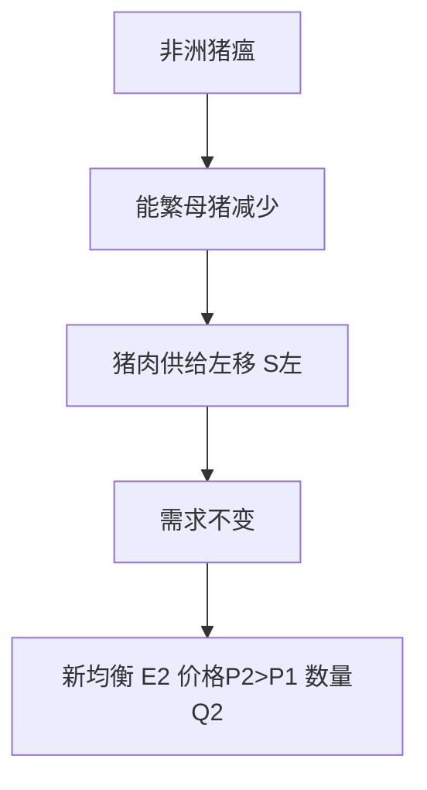
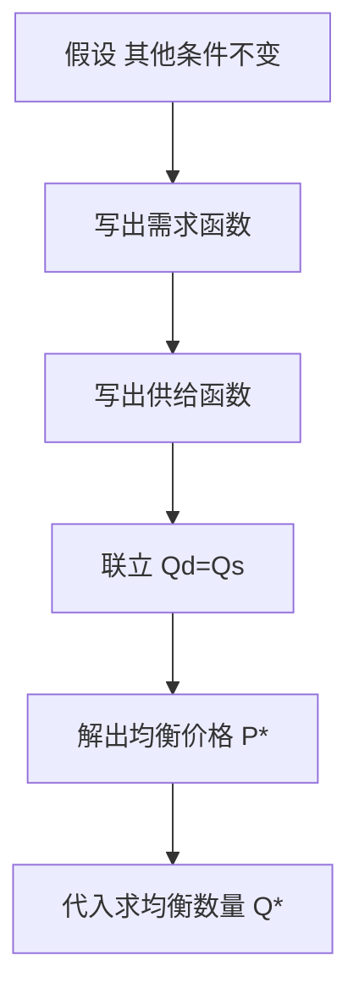
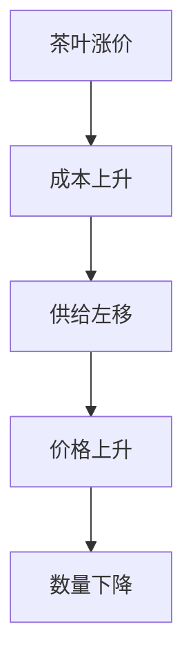
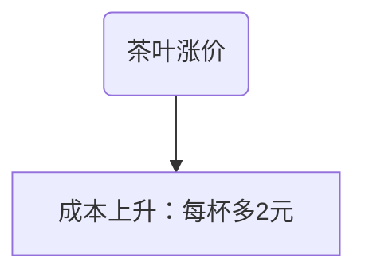

# 曲线移动题 · 格式规范（所有子agent必须遵守）

> 本文件是新增题目的格式标准。所有曲线移动类题目必须按此格式写入对应的 选择题集.md / 考研真题集.md。
> 脚本 tools/build_exam_data.py 会解析这些文件生成 data.js，格式不对会导致题目丢失。

---

## 一、选择题格式（曲线移动类）

在 `选择题集.md` 的对应 KP 分组下追加题目，编号接着现有最大编号往下排。

```markdown
**N. （曲线移动·判断题）奶茶原料茶叶涨价，在其他条件不变时，奶茶市场会发生什么？（　）**
A. 奶茶需求曲线左移，均衡价格下降
B. 奶茶供给曲线左移，均衡价格上升
C. 奶茶需求曲线右移，均衡数量上升
D. 奶茶供给曲线右移，均衡价格下降

> **✅ 答案：B**
> **解析：** 茶叶是生产奶茶的投入品（成本因素）。原料涨价 → 每杯成本上升 → 每一价格下商家愿意供给的数量减少 → **供给曲线左移**（不是需求曲线，因为消费者收入/偏好没变）。供给左移后，需求不变，新均衡点沿需求曲线向左上移动，表现为**均衡价格上升、均衡数量下降**。
>
> ```mermaid
> graph TD
>     A[茶叶涨价] --> B[生产成本上升]
>     B --> C[供给曲线左移 S左]
>     C --> D[需求曲线不变]
>     D --> E[新均衡 价格上升 数量下降]
> ```
>
> **数学推导**：供给函数 $Q^s = c + dP$，成本上升使截距 $c$ 下降（如 $c$ 从 20 降到 10），新供给 $Q^s = 10 + dP$。联立需求 $Q^d = a - bP$，新均衡 $P' = (a-10)/(b+d) > P = (a-20)/(b+d)$。
>
> **生活实例**：2021 年奶茶纸吸管成本暴涨，蜜雪冰城、喜茶纷纷涨价 1-2 元——不是你不想喝了，是商家做一杯的成本高了，供给曲线左移。
```

### 选择题铁律
1. **题干标注题型**：在题干开头加 `（曲线移动·判断）` 或 `（曲线移动·分析）` 或 `（曲线移动·绘图）`。
2. **解析必须包含**：是什么曲线移 + 为什么移 + 新均衡结果。
3. **mermaid 图用 flowchart**：节点文字**不要用括号、冒号、问号、双引号**（mermaid 语法限制）。箭头链展示"事件 → 成本/偏好变化 → 曲线移动 → 新均衡"。
4. **数学推导**：写出相关函数形式，说明哪个参数变了，新均衡怎么解。
5. **生活实例**：奶茶/外卖/打车/口罩/猪肉等接地气例子。

---

## 二、简答题格式（曲线移动类）

在 `考研真题集.md` 的"一、简答题"部分追加，编号接着现有最大编号。锚点 `{#sN}` 要连续。

```markdown
### 简答 N：（曲线移动·分析）用供求模型分析"猪肉价格暴涨"的成因，并画图说明 {#sN}

**【建议字数】450–700 字 ｜ 【建议时间】15 分钟 ｜ 【题型】曲线移动分析**

**【考什么】** 对应知识点 [[知识点/KP03_均衡价格与供求变动|均衡价格与供求变动]]；题型属于曲线移动分析。

**【答题框架】**
- 第 1 段：事件定性——是供给冲击还是需求冲击（5 分）
- 第 2 段：哪条曲线移、往哪移、为什么（5 分）
- 第 3 段：新均衡的价格数量变化 + 图形（5 分）

**【参考答案】**

一、事件定性。2019 年非洲猪瘟导致大量生猪被扑杀，这是典型的**供给冲击**（不是需求变化——消费者对猪肉的偏好没有突变）。

二、曲线移动。生猪是生产猪肉的投入品，能繁母猪存栏量下降 → 在每一价格下养殖户愿意上市的猪肉数量减少 → **猪肉供给曲线向左移动**。需求曲线基本不变（消费者对猪肉的日常需求稳定）。

三、图形与新均衡。如下图：



文字描述坐标图：纵轴猪肉价格 P，横轴数量 Q。原均衡 E1（S1 与 D 交点），供给左移到 S2 后新均衡 E2。E2 在 E1 的左上方——价格更高、数量更少。

四、数学推导。设需求 $Q^d = a - bP$，原供给 $Q^s = c + dP$。原均衡 $P_1 = (a-c)/(b+d)$。猪瘟使供给截距从 $c$ 降到 $c' < c$，新均衡 $P_2 = (a-c')/(b+d) > P_1$。数量 $Q_2 = a - bP_2 < Q_1$。

五、生活实例。2019-2020 年猪肉从 10 元/斤涨到 30 元/斤，饭馆里的肉片变少了——就是供给曲线左移的现实版。政府放储肉、鼓励进口，本质都是想把供给曲线右移回来。

**【解析·得分点】** 采分点：① 判断是供给冲击（5 分）；② 供给左移、需求不变（5 分）；③ 新均衡价升量降（5 分）。易丢分处：把猪瘟当成需求变化。

**【生活实例】** 猪瘟→猪肉贵→你改吃鸡（替代品需求曲线右移）→鸡肉也涨价——这就是一条曲线移动引发连锁反应。
```

---

## 三、论述题格式（曲线移动类）

在"二、论述题"部分追加，锚点 `{#lN}`。论述题要求更高：完整理论推导 + 数学推导 + 政策含义。

```markdown
### 论述 N：（曲线移动·大模型）试用 IS-LM 模型分析"政府增加高铁投资"对国民收入和利率的影响，并画图说明挤出效应 {#lN}

**【建议字数】800–1200 字 ｜ 【建议时间】30 分钟 ｜ 【题型】大模型曲线移动论述**

**【考什么】** 对应知识点 [[知识点/KP01_IS曲线|IS曲线]]、[[知识点/KP05_流动性陷阱与挤出效应|挤出效应]]；题型属于大模型综合分析。

**【答题框架】**
- 第 1 段：政策定性——扩张性财政政策（政府购买增加）（4 分）
- 第 2 段：IS 曲线怎么移（理论推导 + 乘数）（8 分）
- 第 3 段：LM 不变时的新均衡（画图）（6 分）
- 第 4 段：利率上升挤出私人投资（挤出效应）（8 分）
- 第 5 段：数学推导 + 政策含义（4 分）

**【参考答案】**

（此处写完整论述，要求：理论推导从产品市场均衡条件出发 $Y = C + I + G$，写出 $IS$ 曲线方程 $Y = \alpha(\bar{A} - br)$，说明 $G$ 增加如何使 $\bar{A}$ 上升、IS 右移。LM 曲线 $M/P = kY - hr$ 不变。新均衡利率 $r_2 > r_1$，收入 $Y_2 > Y_1$ 但小于完全乘数效应。）

（必须有 mermaid 图展示：G增加 → IS右移 → r上升 → I下降 → 挤出）

**【解析·得分点】** ...

**【生活实例】** 国家投 5 万亿建高铁 → 钢铁水泥需求暴涨 → 贷款利率上升 → 本来想借钱开工厂的老板嫌贵不借了——这就是挤出效应。
```

---

## 四、KP 知识点推导补充格式

在现有 `KPxx_关键词.md` 文件中，找到"## 5. 怎么用（手把手算）"之后、"## 6."之前，**插入一个新章节**：

```markdown
## 5.5 理论推导（一步步推）

> 本节补充：这个结论从什么假设出发，怎么一步步推出来的。

**假设起点**：（写清楚本结论依赖哪几个假设）
1. 假设一：...
2. 假设二：...

**推导过程**：
- 第一步：从假设出发，写出基本方程...
- 第二步：代入...
- 第三步：整理得到...
- 结论：...

## 5.6 数学推导（公式怎么来的）

> 本节补充：每个符号第一次出现必须解释。

设 ...（定义变量）：
$$Q^d = a - bP$$

联立供给：
$$Q^s = c + dP$$

均衡条件 $Q^d = Q^s$：
$$a - bP = c + dP$$
$$a - c = (b+d)P$$
$$P^* = \frac{a-c}{b+d}$$

**图形说明**：纵轴 P，横轴 Q。需求曲线截距 $a/b$、斜率 $-1/b$；供给曲线截距 $-c/d$、斜率 $1/d$。交点即均衡。


```

---

## 五、需要覆盖的曲线清单（西方经济学）

### 微观
| 章节 | 曲线 | 什么因素导致左移/右移 |
|---|---|---|
| 01 需求供给 | 需求曲线 D | 收入、偏好、相关品价格、预期、人数 |
| 01 需求供给 | 供给曲线 S | 成本、技术、投入品价格、预期、税收 |
| 02 消费者选择 | 无差异曲线 | 不移动（形状变）；预算线移动 |
| 02 消费者选择 | 预算线 | 收入变（平移）、商品价格变（旋转） |
| 03 生产与成本 | TP/AP/MP | 不移动；MC/AC 曲线位置由技术决定 |
| 03 生产与成本 | 等成本线 | 工资/利率变化（斜率或截距变） |
| 03 生产与成本 | 生产可能性边界 PPF | 技术进步（外扩）、资源增加（外扩）、战争灾害（内缩） |
| 04 完全竞争 | 行业供给曲线 | 厂商数量、技术、投入品价格 |
| 05 不完全竞争 | 垄断厂商 MR/MC | 不移动；需求曲线移动导致 MR 跟着移 |
| 06 生产要素 | 劳动需求曲线 | 产品价格、MPL 技术、其他要素价格 |
| 06 生产要素 | 劳动供给曲线 | 工资率（点移动）、人口、移民、偏好（线移动） |

### 宏观
| 章节 | 曲线 | 什么因素导致移动 |
|---|---|---|
| 10 收入支出 | 45°线模型 AE 线 | 消费/投资/政府购买/出口变化 |
| 11 IS-LM | IS 曲线 | 财政政策（G/T）、消费/投资意愿 |
| 11 IS-LM | LM 曲线 | 货币政策（M）、价格水平 P、货币需求意愿 |
| 12 AD-AS | AD 曲线 | 财政政策、货币政策、消费投资出口 |
| 12 AD-AS | SAS 短期总供给 | 预期价格、投入品价格（石油危机）、技术 |
| 12 AD-AS | LAS 长期总供给 | 潜在产出（劳动力、资本、技术） |
| 13 失业通胀 | 菲利普斯曲线 | 预期通胀、供给冲击（石油） |
| 14 开放经济 | BP 曲线 | 汇率、国际利率、贸易政策 |
| 16 经济增长 | 索洛 sf(k) 线 | 储蓄率 s 变化 |
| 16 经济增长 | 索洛 (n+δ)k 线 | 人口增长率 n、折旧率 δ |

### 政治经济学
- 价值规律表现形式（价格围绕价值波动）
- 资本有机构成提高对利润率的影响
- 社会再生产两大部类平衡

---

## 六、mermaid 图注意事项（血泪教训）

1. 节点文字**不要用**：`(` `)` `：` `？` `"` `'` `,` `。`
2. 用方括号 `A[文字]` 而不是圆括号
3. 箭头用 `-->` 或 `-- 文字 -->`
4. 复杂因果链用 `graph TD`（从上到下）
5. 图要短，5-8 个节点够了，不要画成流程图大全

**正确示例**：


**错误示例**（节点有括号冒号，会渲染失败）：

