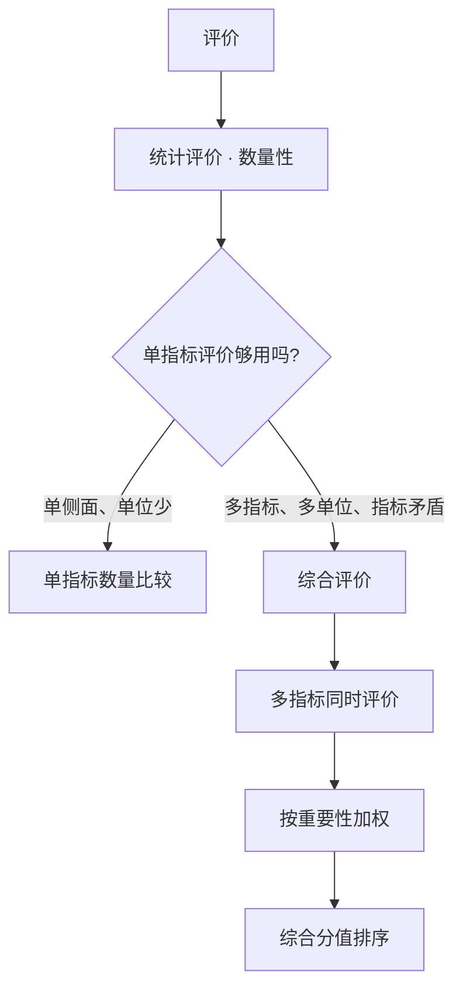
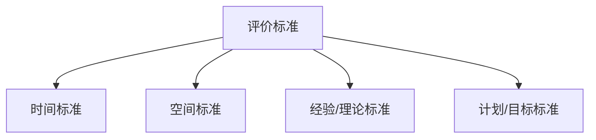
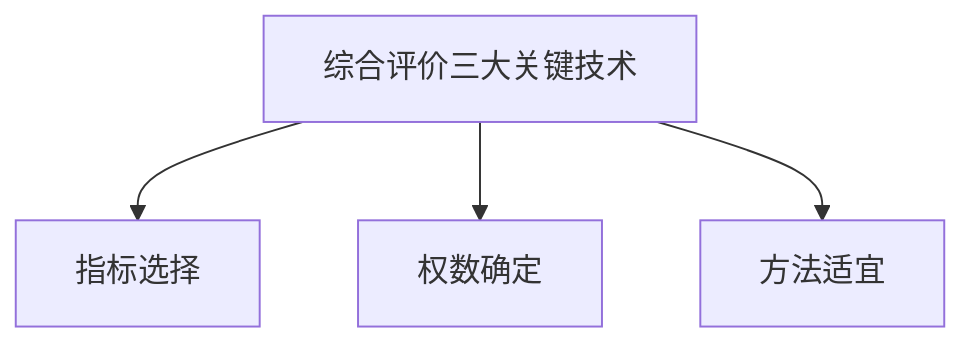

# 绪论 · 章节总结

> 原书第 1–4 页，主文件第 195–264 行。绪论是全书总纲，核心是"评价—统计评价—综合评价"的概念递进与三大关键技术。

## 一、知识框架图

**文字缩进树（兜底）**：

- 评价
  - 统计评价（数量性，从"度"反映状态）
    - [[KP02_评价标准|评价标准]]：时间 / 空间 / 经验理论 / 计划目标
    - 单指标评价 → 局限：指标矛盾、多单位失效
  - 综合评价（多指标、多单位同时）
    - 特点：同时评价、加权、综合分值排序
    - 关键技术：指标、权数、方法
    - 作用：描述、测定、层次分析、聚类、定量定性结合

## 二、核心概念/公式清单

绪论无计算公式，核心概念如下：

| 概念 | 要点 | 用途 |
|---|---|---|
| 评价 | 按标准量化/非量化测量，得出可靠合逻辑结论 | 认识事物的基本方法 |
| 统计评价 | 数量性；规模/水平/速度/协调 | 定量描述与评判 |
| 评价标准 | 时间/空间/经验理论/计划目标 | 比较的参照物与基点 |
| 综合评价 | 多指标、多单位同时评价 | 整体性评价与排序 |
| 关键技术 | 指标、权数、方法 | 保证评价科学可行 |

## 三、[[01_方法选择决策树|方法选择决策树]]（文字版）

绪论层面的决策是"用哪类评价、哪类标准"：

1. 要回答的问题是**价值判断**吗？
   - 有可量化数据 → 进入统计评价；无 → 定性评价。
2. 问题只涉及**一个侧面**吗？
   - 是 → 单指标数量比较；否（多侧面、多单位）→ 综合评价。
3. 比较的**参照系**是什么？
   - 看进步 → 时间标准；看位置 → 空间标准；看合理 → 经验/理论标准；看达标 → 计划/目标标准。
   - 重要分析应**多标准结合**。
4. 进入综合评价后，依次落实三大技术：**[[KP02_指标体系|指标体系]] → 权数 → 合成方法**（后续章节展开）。

## 四、与前后章节的联系

- 绪论提出的"指标、权数、方法"三大关键技术，分别由**第二章（指标）、第四章（权数）、第五章及第六至十章（方法）**承接；
- 指标在合成前需同质化，由**第三章（无量纲化）**解决；
- 三个案例是三大技术的综合实战示范。

## 五、高频考点 / 自测题

1. **名词解释：统计评价。** 要点：从数量上展示规模、水平、速度、协调关系的分析方法与过程，强调总体性、系统性，本质特征是数量性。
2. **统计评价与其他评价的最大区别是什么？** 数量性。
3. **评价标准有哪四类？** 时间、空间、经验或理论、计划或目标。
4. **空间评价标准有哪三种比较方式？** 与相似空间、与先进（最优）空间、与扩大的空间（平均/最好水平）比较。
5. **经验标准与理论标准有何区别？** 前者由历史资料归纳得出（如恩格尔系数），后者由理论推理得出（如财政收入增长不低于经济增长）；应结合使用。
6. **单指标评价的两大局限是什么？** 指标间方向程度不同、相互矛盾；无法处理多指标多单位。
7. **什么是综合评价？其三个特点是什么？** 系统规范地对多指标、多单位同时评价；特点：同时完成、加权、综合分值排序。
8. **综合评价的三大关键技术是什么？** 指标选择、权数确定、方法适宜。
9. **综合评价有哪些作用？** 系统描述、整体测定、层次分析、[[04_聚类分析|聚类分析]]、定量定性结合。
10. **配第《政治算术》的方法论意义？** 数量比较评价的早期典范。
11. **原书批评的三类常见缺陷是什么？** 随意拼凑指标、滥用算术平均/简单代数和、盲信数学结果而不分析目的与数据特征。
12. **计划标准在市场经济条件下的地位？** 宏观分析中较少，微观经济分析仍重要。

## 六、本单元知识点索引

| 编号 | 名称 | 一句话用途 |
|---|---|---|
| KP01 | [[KP01_评价与统计评价|评价与统计评价]] | 界定评价与统计评价的含义与数量性本质 |
| KP02 | 评价标准 | 掌握四类评价标准[[KP05_评价标准值xi0的选择|的选择]]与使用 |
| KP03 | [[KP03_单指标评价及其局限|单指标评价及其局限]] | 理解单指标评价为何在多单位场景失效 |
| KP04 | [[KP04_综合评价的定义与特点|综合评价的定义与特点]] | 掌握综合评价的定义、三特点与适用边界 |
| KP05 | 综合评价的关键技术与作用 | 总览三大技术、五作用与全书结构 |

## 本章方法答辩速查

1. **问：从"评价"到"综合评价"是怎么一步步被逼出来的？请把三种评价方法串起来说。** 答：最基础的评价是按标准对事物作价值衡量；统计评价把它数量化，但统计评价本质上是单指标数量比较——只能反映一个侧面，指标间方向背离时结论互相矛盾，多单位时更是排不出整体名次。为了全面，人们改用指标体系，但指标体系只罗列不合成，指标间仍然打架，整体上反而退步。最后才发展出综合评价：把多指标信息加权合成一个综合分值，按分值排序，既解决整体性、又克服片面性。答辩主线就是"单指标片面→指标体系整体退步→综合评价两全"。
2. **问：四类评价标准怎么配合使用？只选一类会有什么风险？** 答：时间标准看进步、空间标准看位置、经验理论标准看合理、计划目标标准看达标。只选一类会片面：只看同比不知道在全国排第几，只看同业排名不知道自己比去年进步没有，只看计划完成度可能因计划本身不科学而高估。原书建议实际分析多标准交叉验证，例如评价一个地区既看同比、又看与全国平均比、还看是否符合规律。
3. **问：绪论提出的"三大关键技术"分别由后面哪些章节落地？** 答：指标选择归第二章，指标预处理（同质性转换、同向化、无量纲化）归第三章，权数确定归第四章，汇总合成与常规方法归第五章及第六至十章。答辩时要能说清：指标选不准结果就不客观、权数一动排序就翻转、合成方法必须与事物特点匹配——三者是环环相扣的。

---

## 🔗 跨库链接

**📖 原书对应章节：** [[../../../原文件/综合评价/陈正伟_综合评价技术及应用_全书|《综合评价技术及应用》绪论]]

**🐮 大牛库对应模块：** [[../../../经济统计学论文从0基础到精通/07_综合评价方法/01_综合评价是什么|综合评价是什么（五步法总览）]]
