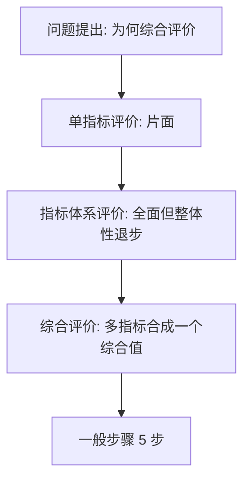
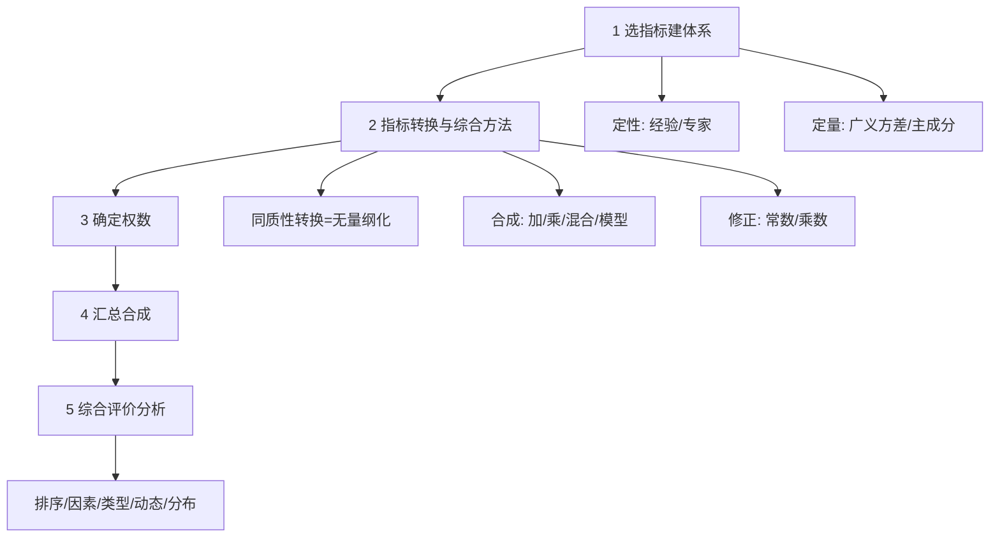
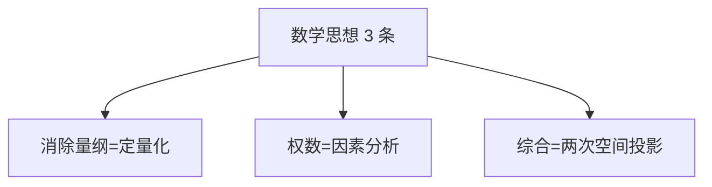

# 第一章 综合评价的一般问题 · 章节总结

> 原书第 5–17 页，主文件第 265–506 行。第一章是全书流程总纲：从"为什么综合评价"出发，给出"一般步骤 5 步"，最后上升到"数学思想 3 条"。

## 一、知识框架图

**文字缩进树（兜底）**：

- 第一章 综合评价的一般问题
  - [[01_第一节_统计综合评价问题的提出|第一节]] 问题的提出
    - 单指标评价（片面、矛盾）
    - 多指标/[[KP02_指标体系|指标体系]]评价（全面但整体性退步）
    - 综合评价（解决整体、克服片面）
  - [[02_第二节_综合评价的一般步骤|第二节]] 一般步骤（5 步）
    - ①选指标建体系：定性（三层次/五注意/八原则）+ 定量（四法）
    - ②指标转换与综合方法：同质性转换（无量纲化）+ 合成（加/乘/混合/模型）+ 修正（常数/乘数、乘积因子、代数和因子）
    - ③定权数：权数敏感，变动改排序
    - ④汇总合成：[[KP09_综合评价值F的构造|综合评价值]]三重含义
    - ⑤综合评价分析：排序/因素影响/类型/动态/分布
  - [[03_第三节_综合评价方法的数学思想|第三节]] 数学思想（3 条）
    - 消除量纲=定量化
    - 权数=因素分析
    - 综合=两次空间投影（A→B→一维直线）

## 二、核心公式清单

| 公式名 | 表达式 | 用途 | 适用条件 |
|---|---|---|---|
| 协方差（广义方差矩阵） | $F=[\delta_{ij}]_{p\times p}$，$\delta_{ij}=\dfrac{\sum(x_i-\bar x_i)(x_j-\bar x_j)}{\sqrt{\sum(x_i-\bar x_i)^2}\sqrt{\sum(x_j-\bar x_j)^2}}$ | [[KP09_极小广义方差法|极小广义方差法]]选指标 | 有样本、定量指标 |
| 总广义方差 | $\det F=f_p$ | 度量 $p$ 指标总变动性 | 同上 |
| 条件广义方差 | $\det F_{p-1}=f_{p-1}$ | 剔除某指标后剩余指标变动 | 选最具代表性指标 |
| 常数修正法 | $I=I_0+K$ | 固定加/减分 | 获得综合值后修正 |
| 乘数修正法 | $I=I_0\times K$ | 比例缩放/一票否决 | 同上，$K\in[0,1]$ |
| 乘积修正 | 修正得分 $=$ 计算得分 $\times k_1$ | 否决/政策导向 | $k_1=0$ 否决、$=1$ 不变 |
| 代数和修正 | 最终得分 $=$ 修正得分 $+\mu_m$ | 鼓励性附加分 | 加分制 |

> ⚠️ 校注：$\delta_{ij}$ 原书称协方差，但所给公式实为[[01_相关系数|相关系数]]形式；使用时注意区分协方差矩阵与相关系数矩阵，选指标结论一致。

## 三、[[01_方法选择决策树|方法选择决策树]]（文字版）

围绕"指标—转换—权数—合成—修正"逐步决策：

1. **指标是否已够用？**
   - 只反映单侧面 → 回到单指标即可；需整体评价 → 必须建指标体系。
2. **指标如何初选？**
   - 有经验/专家、指标不太多 → 定性选择（三层次、八原则）；
   - 指标庞大、需数学筛选 → 定量选择。
3. **定量选指标用哪种？**
   - 想找"能代表其余"的指标、按条件广义方差最小 → **极小广义方差法**；
   - 想剔除"能被其余代替"的指标、按复相关系数最大剔除 → **极大不相关法**；
   - 想降维、按最后主成分小系数剔除 → **主成分法**；
   - 想按相似性分类、各类选代表 → **系统聚类法**（应用最广、最易掌握）。
4. **指标不同质怎么办？** → 先无量纲化（第一次投影），再合成。
5. **指标间可否补偿？**
   - 可补偿（一俊遮百丑）→ 加法合成；
   - 不可补偿（短板敏感）→ 乘法合成；
   - 并存 → 混合；复杂关系 → 模型综合。
6. **需政策奖惩吗？**
   - 等额鼓励加分 → 代数和修正；
   - 一票否决/比例缩放 → 乘积修正。

## 四、与前后章节的联系

- 绪论提出三大关键技术（指标、权数、方法），第一章把它展开为**5 步操作流程**；
- 指标选择的详细方法归属**第二章（指标体系建立）**；
- 同质性转换/无量纲化归属**第三章**；
- 权数确定归属**第四章**；
- 合成方法（加/乘/混合/模型）归属**第五章**；常规综合评价方法归属**第六章及以后**；
- 数学思想中的"权数=因素分析"呼应**第十章因子分析**，"两次投影"是全书流程的几何概括。

## 五、高频考点 / 自测题（含答案要点）

1. **综合评价一般步骤有哪 5 步？** 选指标建体系→指标转换与综合方法→定权数→汇总合成→综合评价分析（前 4 基本、第 5 扩展）。
2. **定性选指标应注意哪五点？** 明确目的目标；三层次因素分析；兼顾八原则；与方法协调；尽量选相对指标并与总量结合。
3. **指标体系三层次是什么？** 总目标层、中间层、指标层。
4. **指标选择八原则？** 目的性、系统性、一贯性、独立性、同向性、全面性、可比性、可操作性。
5. **同向性原则含义？为何重要？** 各指标数值大小与优劣方向应一致；否则方向不同会相互抵消、混淆本质，须同向化。
6. **总量指标与相对指标结合的理由？** 总量反映实际水平但受长期趋势影响；速度指标弥补局限但不反映水平；二者都纳入才客观。
7. **极小广义方差法的选择规则？** 去掉某指标后条件广义方差最小者最具代表性，选入；重复选若干。
8. **$\delta_{ij}$ 的公式与校注？** 原书称协方差但公式实为相关系数形式；选指标时二者结论一致。
9. **常数修正法与乘数修正法公式？** $I=I_0+K$；$I=I_0\times K$。
10. **乘积修正因子 $k_1=0$ 与 $=1$ 各意味什么？** $=0$ 一票否决；$=1$ 稳定不变。
11. **权数为何敏感？** 权数变动会改变被评价对象优劣顺序。
12. **综合评价值的三重含义？** 整体相对地位；抽象反映一般水平/趋势；增加评价信息（可整体、分层、分指标分析）。
13. **综合评价分析五项内容？** 排序、因素和指标影响、类型、动态、分布分析。
14. **综合评价的三条数学思想？** 消除量纲=定量化；权数=因素分析；综合=两次空间投影。
15. **两次投影各是什么？为何缺一不可？** 第一次无量纲化（A→B，统一量纲但仍不可比大小）；第二次合成（B→一维，可排序）。只一次都不能整体排序。

## 六、本章知识点索引

| 编号 | 名称 | 一句话用途 |
|---|---|---|
| KP01 | 单指标评价及其局限 | 理解单指标为何片面、矛盾 |
| KP02 | 多指标评价与整体性退步 | 理解指标体系为何全面却无法整体对比 |
| KP03 | 综合评价的优势与作用 | 掌握综合评价既解决整体又克服片面 |
| KP04 | 指标体系三层次结构 | 掌握总目标层/中间层/指标层搭建 |
| KP05 | 指标选择八项原则 | 建体系时逐条对照的原则网 |
| KP06 | 同质性转换与无量纲化 | 理解综合前必须先统一量纲数量级 |
| KP07 | 汇总综合方法 | 了解加/乘/混合/模型四类合成 |
| KP08 | 汇总指标修正方法 | 掌握综合后奖惩调整（常数/乘数） |
| KP09 | 乘积修正因子 | 用比例缩放/一票否决修正得分 |
| KP10 | 代数和修正因子 | 用固定附加分鼓励品牌创新环保 |
| KP11 | 权数概念与敏感性 | 理解权数为何敏感、会改排序 |
| KP12 | 综合指标汇总合成与评价值含义 | 掌握合成流程与综合评价值三重含义 |
| KP13 | 综合评价分析五项内容 | 排序/因素影响/类型/动态/分布分析 |
| KP14 | 消除量纲即定量化 | 理解第一次投影的数学本质 |
| KP15 | 权数确定即因素分析 | 理解权数=因子影响的数量刻画 |
| KP16 | 综合评价即两次空间投影 | 理解高维样本点→一维有序直线 |

## 本章方法答辩速查

1. **问：综合评价一般分哪几步？前四步和第五步是什么关系？** 答：五步：①选指标建体系；②确定指标转换与综合方法（同质性转换即无量纲化、合成方法、修正方法都在这一步）；③定权数；④汇总合成综合指标；⑤综合评价分析。前四步是基本步骤，第五步（排序、因素影响、类型、动态、分布五项分析）是扩展——基本步骤算出一个分数，扩展分析把分数变成可解释的诊断结论。缺了第五步，交付物只是一张排名表。
2. **问：选指标时定性方法和定量方法怎么配合？极小广义方差法的逻辑是什么？** 答：定性方法（经验、专家咨询）负责扣目的、搭三层次、守八原则；但指标太多会信息重叠，所以再用定量方法从初选集合里筛代表性指标。极小广义方差法：构造 $p$ 个指标的协方差/相关系数矩阵，其行列式（广义方差）度量这组指标的总变动；逐个试删，去掉后条件广义方差最小的那个指标最能代表其余指标的信息，选入，重复筛选。
3. **问：合成方法和修正方法分别怎么选？请串起加法/乘法与常数/乘数两条线。** 答：合成看指标间可否补偿：可补偿（综合水平评价）用加法，不可补偿、强调短板（门槛类考核）用乘法，并存用混合。修正看奖惩性质：等额鼓励（名牌、R&D达标、环保认证）用常数修正 $I=I_0+K$；比例缩放和一票否决（重大安全事故 $K=0$、政策扶持 $K\ge1$）用乘数修正 $I=I_0\times K$。要记住修正只是扩展微调，不能替代正常合成；而整个流程的数学实质是两次投影——无量纲化统一量纲（A→B），加权合成压成一维（B→直线），缺一不可。

---

## 🔗 跨库链接

**📖 原书对应章节：** [[../../../原文件/综合评价/陈正伟_综合评价技术及应用_全书|《综合评价技术及应用》第一章 综合评价的一般问题]]

**🐮 大牛库对应模块：** [[../../../经济统计学论文从0基础到精通/07_综合评价方法/01_综合评价是什么|综合评价是什么（五步法总览）]]
