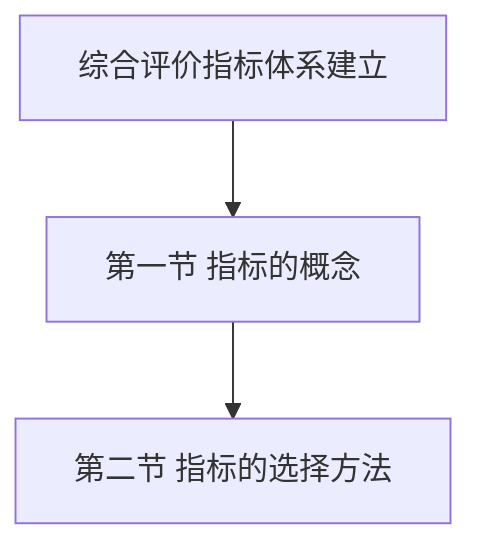
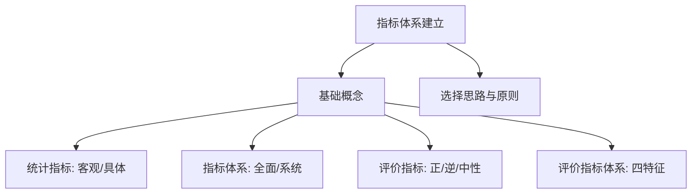
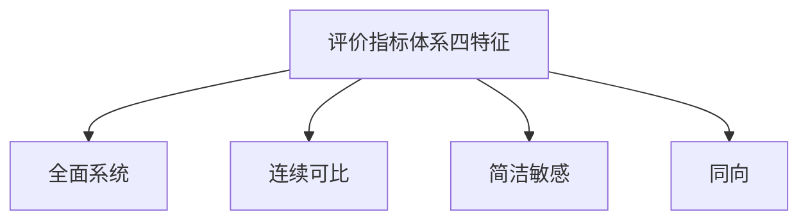
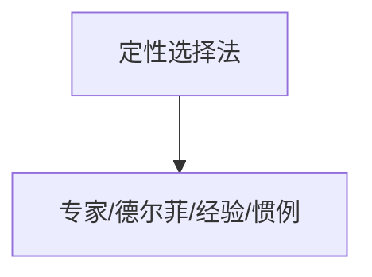
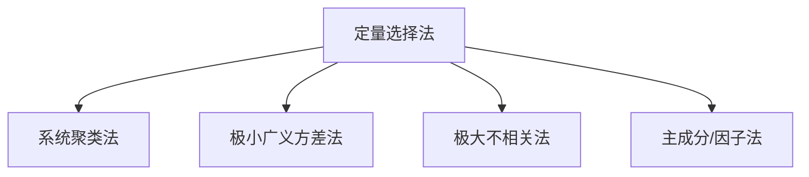

# 第二章 综合评价[[KP02_指标体系|指标体系]]的建立 · 章节总结

> 原书第 17–25 页，主文件第 507–664 行。第二章解决综合评价的第一个关键技术——"用什么指标集合"，是评价效果好坏的基础。

## 一、知识框架图

**文字缩进树（兜底）**：

- 第二章 综合评价指标体系的建立
  - [[01_第一节_综合评价指标的概念|第一节]] [[01_第一节_综合评价指标的概念|综合评价指标的概念]]
    - 指标（广义；客观、具体；单个有片面性）
    - 指标体系（相互联系整体；全面、系统；缺综合性）
    - 评价指标（衡量程度；正/逆/中性；尽量用相对指标）
    - 评价指标体系（特殊集合：全面系统、连续可比、简洁敏感、同向）
    - 选择思路（定性+定量）与原则（系统/全面/可比/简洁为主）
  - [[02_第二节_指标的选择方法|第二节]] [[02_第二节_指标的选择方法|指标的选择方法]]
    - [[KP06_定性选择法|定性选择法]]：专家、德尔菲、经验判断、惯例标准（优点3/局限3）
    - 定量选择法：相似性判断+各类选代表
      - [[KP02_系统聚类法|系统聚类法]]（四步；最常用；能分层不做整体）
      - [[KP09_极小广义方差法|极小广义方差法]]（条件广义方差最小选代表）
      - 极大不相关法（复相关系数最大剔冗余）
      - 主成分/因子法（压缩为少数独立综合指标；能整体不分层）

## 二、核心公式清单

| 公式名 | 表达式 | 用途 | 适用条件 |
|---|---|---|---|
| 相关系数矩阵 | $R=[r_{ij}]_{p\times p},\ r_{ii}=1$ | 系统聚类度量相似性 | 定量指标、有样本 |
| 协方差矩阵 | $F=[\delta_{ij}]_{p\times p}$ | 极小广义方差法基础 | 同上 |
| 元素（相关系数形式） | $\delta_{ij}=\dfrac{\sum(x_i-\bar x_i)(x_j-\bar x_j)}{\sqrt{\sum(x_i-\bar x_i)^2}\sqrt{\sum(x_j-\bar x_j)^2}}$ | 度量指标协同变动 | $i,j=1,\dots,p$ |
| 总广义方差 | $f_p=\det F$ | $p$ 指标总变动性 | 正定矩阵 |
| 条件广义方差 | $f_{p-1}=\det F_{p-1}$ | 剔除某指标后剩余变动 | 选最具代表者 |

> ⚠️ 校注：$\delta_{ij}$ 原书称协方差，公式实为相关系数形式；选指标时二者结论一致，使用注意区分。

## 三、方法选择决策树（文字版）

1. **已明确评价目标，要从哪入手选指标？**
   - 有经验、指标不太多 → 定性选择（专家/德尔菲/经验/惯例）；
   - 指标庞大、需客观筛选 → 定量选择（或定性定量结合）。
2. **定量选指标，目标是哪一种？**
   - 要**分层次、分类型**、灵活构成不同层次体系 → **系统聚类法**（最易掌握、应用最广）；
   - 要找"去掉它其余几乎不动"的**浓缩代表** → **极小广义方差法**；
   - 要**剔除可被其余代替的冗余** → **极大不相关法**；
   - 要把多指标**压缩为少数独立综合指标、做整体评价** → **主成分/因子法**（但不能分层）。
3. **指标方向是否一致？**
   - 有正有逆有中性 → 先**同向化**，中性指标用专门方法。
4. **区域横向对比为主？** → 优先选**相对数**形式指标，避免绝对数。

## 四、与前后章节的联系

- 承接第一章：第一章第二节提出"选指标建体系"是综合评价第一步，本章把它展开为完整概念与方法；
- 指标选定后进入**第三章（无量纲化/同质性转换）**，处理正/逆/中性指标的同向化；
- 权数归属**第四章**，合成归属**第五章**；
- 主成分法、因子法在本章作为"选指标/降维"被提及，其完整方法在**第九章、第十章**展开；
- 三个案例是指标体系建立的实战示范。

## 五、高频考点 / 自测题（含答案要点）

1. **指标体系在综合评价中的地位？** 是综合评价的基础，决定评价效果好坏与工作难易。
2. **指标的两个特点？** 客观性、具体性；但单个指标有片面性。
3. **评价指标按特征分哪三类？** 正指标（越大越好）、逆指标（越小越好）、中性指标（逼近某值好）。
4. **评价指标体系的四特殊性？** 全面系统、连续可比、简洁敏感、同向。
5. **评价指标体系选择的四个主要原则？** 系统性、全面性、可比性、简洁性。
6. **为什么区域对比一般选相对数？** 绝对数随范围扩大而扩大、不可比；相对数是内涵指标、适合横向比较。
7. **定性选择法有哪四种？** 专家评价、德尔菲、经验判断、惯例标准。其中最规范的是德尔菲法。
8. **定性选择法三条优点、三条局限？** 优点：用经验、不大偏差、简单；局限：主观影响大、复杂问题乏力、科学系统规范性差。
9. **定量选择法的基本思路？** 对指标相似性判断，相似一类确定代表指标，构成体系。
10. **系统聚类法四步？** 选相似度度量（常用相关系数法）→ 选类间距离（常用相关系数最大法）→ 画聚类图 → 各类选代表定体系。
11. **相关系数大小与类别数关系？** 选得越大分类越多、越小分类越少。
12. **极小广义方差法的选择准则？** 去掉某指标后条件广义方差最小者最具代表性。
13. **极大不相关法剔除谁？** 复相关系数最大（最能被其余指标信息决定）的指标。
14. **系统聚类法与主成分法的分工？** 聚类管分层分类选代表但不做整体评价；主成分管整体综合评价但不能分层。
15. **为什么定性定量要结合？** 定性保经济意义、定量查统计冗余；单用任一方都会有偏。

## 六、本章知识点索引

| 编号 | 名称 | 一句话用途 |
|---|---|---|
| KP01 | 统计指标 | 界定广义指标的客观性/具体性与多重身份 |
| KP02 | 指标体系 | 理解相互联系指标整体的全面系统性 |
| KP03 | 评价指标与正逆中性指标 | 掌握三类方向指标及同向化要求 |
| KP04 | 评价指标体系及其特征 | 掌握评价专用体系四特殊性 |
| KP05 | 评价指标体系选择思路与原则 | 定性+定量筛选思路与四主要原则 |
| KP06 | 定性选择法 | 掌握专家/德尔菲/经验/惯例四法及优缺点 |
| KP07 | 定量选择法概述 | 总览相似性判断+选代表的定量思路 |
| KP08 | 系统聚类分析法 | 四步聚类选代表，最常用、能分层 |
| KP09 | 极小广义方差法 | 按条件广义方差最小选浓缩代表 |
| KP10 | 极大不相关法 | 按复相关系数最大剔除冗余指标 |
| KP11 | 主成分与因子分析法选指标 | 压缩为少数独立综合指标做整体评价 |

## 本章方法答辩速查

1. **问：本章定性选择法与定量选择法应怎么配合使用？** 答：按"先定量筛、后定性定代表"的顺序——先用数学方法（系统聚类、广义方差、复相关、主成分）对初选大指标集做相似性分析、剔除数值上的冗余指标，再依据经济意义和专家经验在每一类中选定最终代表指标。单用定性会漏掉数值上高度相关的冗余，单用定量可能误删经济意义关键但统计上相似的指标。
2. **问：定量选指标的四种方法在实际中怎么选？** 答：需要分层次、分类型、灵活构成不同指标体系时用系统聚类法（应用最广、最易掌握）；要找"去掉它其余几乎不动"的浓缩代表时用极小广义方差法；要主动剔除可被其余指标代替的冗余时用极大不相关法；要把多指标压缩为少数彼此独立的综合指标、一次性得到整体评价结果时用主成分/因子法，但它不能分层次评价。
3. **问：选定指标后为什么还要做同向化？** 答：评价指标分正指标、逆指标、中性指标三类，方向不一致时直接加权合成，会让逆指标数值越大（如发病率越高）被误算为贡献越大，综合结果失真；正逆并存须同向化、中性指标按适度方法专门处理；区域横向对比还应优先选相对数形式，保证口径、范围、时间、计算方法可比。

---

## 🔗 跨库链接

**📖 原书对应章节：** [[../../../原文件/综合评价/陈正伟_综合评价技术及应用_全书|《综合评价技术及应用》第二章 综合评价指标体系的建立]]

**🐮 大牛库对应模块：** [[../../../经济统计学论文从0基础到精通/07_综合评价方法/01_综合评价是什么|综合评价是什么（含选指标）]]
