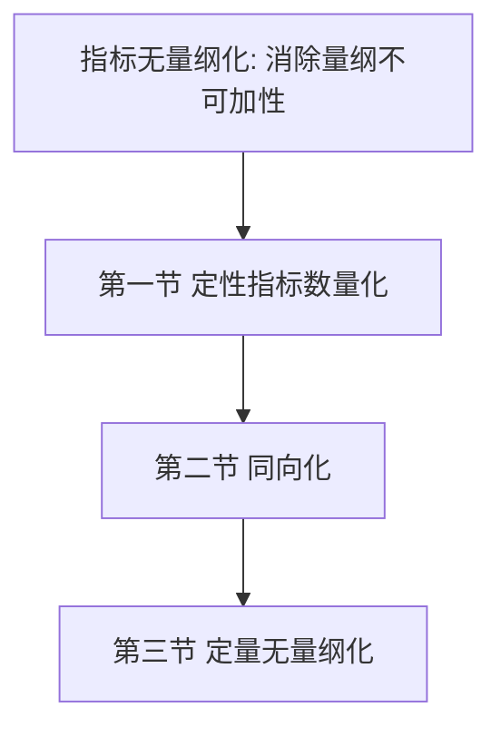
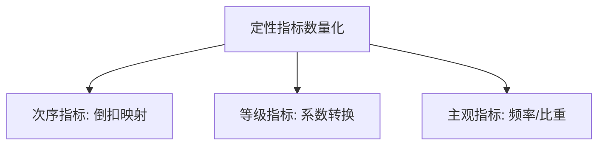
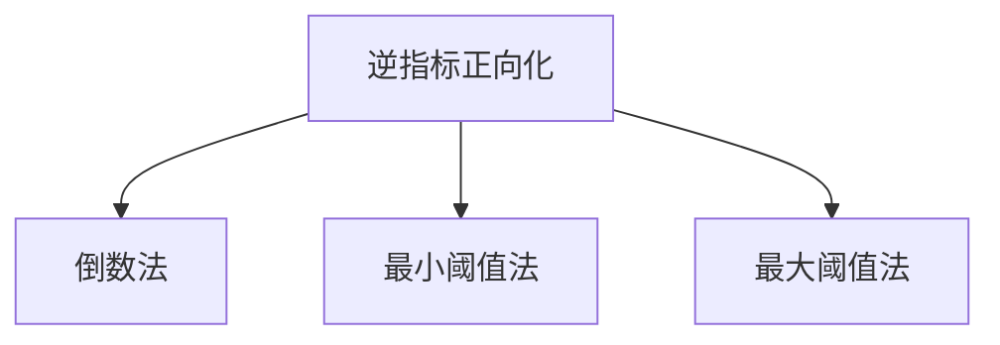
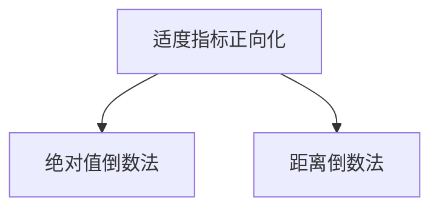
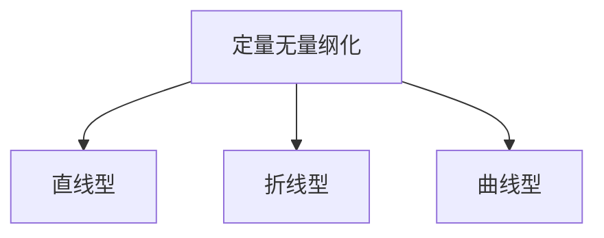
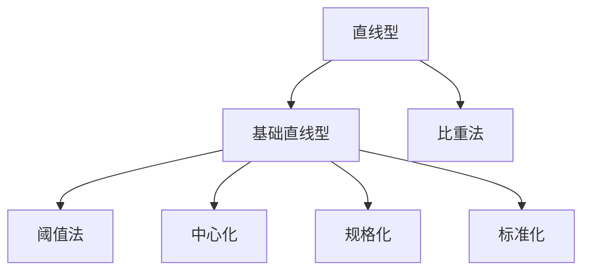

# 第三章 [[02_指标无量纲化|指标无量纲化]]方法 · 章节总结

> 原书主文件第 665–966 行。本章解决"多指标、多量纲、多方向"如何变成可加权相加的评价值。核心主线：**定性数量化 → 指标同向化 → 定量无量纲化**。

> 🐱 **数学白痴先看这段**：你手上有一堆指标——销量 100 杯、差评率 2%、价格 15 元、糖度 5 分。它们单位不一样（杯/%/元/分），方向还不一样（销量越高越好、差评率越低越好），根本不能直接加起来。**无量纲化就是三道预处理工序**：① 把文字评语（优/良/差）变成数字；② 把"越低越好"的指标翻成"越高越好"；③ 把所有数字都压到 0~1 这个统一刻度上。做完这三步，指标们才能公平地放在一起加权求和。

## 一、知识框架图

**文字缩进树（兜底）**：

- 指标无量纲化（消除量纲、使可加）
  - [[01_第一节_定性指标数量化|第一节]] [[01_第一节_定性指标数量化|定性指标数量化]]
    - 三类：次序 / 等级 / 主观
    - 三法：次序式3.1、等级系数转换、主观频率比重
  - [[02_第二节_逆向指标适度指标正向化|第二节]] 同向化（先同向后无量纲）
    - 逆指标三法：倒数 / 最小阈值 / 最大阈值(互补)
    - 适度指标两法：绝对值倒数 / 距离倒数
  - [[03_第三节_定量指标的无量纲化|第三节]] 定量无量纲化
    - 直线型5法：阈值、[[KP09_中心化_均值化|中心化]]、[[KP10_规格化_极差正规化|规格化]]、[[KP11_标准化_ZScore|标准化]]、比重法
    - 折线型：分段函数（门槛/封顶）
    - 曲线型：非线性（哥西等）
    - 实践常用直线型

## 二、核心公式清单

| 式号 | 公式名 | 表达式 | 用途 | 适用条件 |
|---|---|---|---|---|
| 3.1 | 次序指标定量化 | $y_i=1-(x_i-0.5)/n$ | 名次转正向得分 | 有序排名 |
| 3.2 | 倒数法 | $y_i=1/x_i$ | 逆指标正向化 | $x_i>0$ |
| 3.3 | 最小阈值法 | $y_i=x_{\min}/x_i$ | 逆指标正向化 | 有最优阈值 |
| 3.4 | 最大阈值法(互补) | $y_i=1-x_i/x_{\max}$ | 逆指标正向化 | 有最差阈值 |
| 3.5 | 绝对值倒数法 | $y_i=1/\lvert x_i-x_0\rvert$ | 适度指标正向化 | $x_i\neq x_0$ |
| 3.6 | 距离倒数法 | $y_i=1/\sqrt{(x_i-x_0)^2}$ | 适度指标正向化 | 等价3.5 |
| 3.7 | 阈值比较法 | $y_i=x_i/x_0$ | 直线型无量纲 | $x_0\neq0$ |
| 3.8 | 中心化 | $y_i=x_i/E$ | 以均值为基准 | $E\neq0$ |
| 3.9 | 规格化 | $y_i=(x_i-\min)/(\max-\min)$ | 压缩到[0,1] | 功效系数法基础 |
| 3.10 | 标准化 | $y_i=(x_i-\bar x)/S$ | Z-Score | $n>30$ |
| 3.11 | 比重法(和) | $y_i=x_i/\sum x_i$ | 结构占比 | 无负值 |
| 3.12 | 比重法(模) | $y_i=x_i/\sqrt{\sum x_i^2}$ | 结构占比 | 无负值 |
| 3.13 | 折线型 | 三段子分段函数 | 门槛/封顶 | 有 $x_a,x_b$ |
| 3.14 | 曲线型(哥西) | $y_i=1/(1+[5(x_i-1)]^{-2})$ | 非线性转换 | 主导产业弹性 |

## 三、方法选择决策树（文字版）

1. 数据是定性的吗？
   - 名次 → 式（3.1）；等级评语 → 系数转换法；问卷感受 → 频率/比重。
2. 指标方向统一吗？
   - 有逆指标 → 倒数法（无阈值）/ 最小阈值法（有最优值）/ 最大阈值法（有最差值）；$x_{\min}=0$ 改用序号。
   - 有适度指标 → 绝对值倒数法/距离倒数法（先定最优值 $x_0$）。
3. 同向化后做定量无量纲化，看区间效应：
   - 有"门槛以下不计分、封顶以上不加分"→ 折线型（式3.13）；
   - 有显著阶段非线性、参数可标定 → 曲线型（式3.14等）；
   - 一般情况 → 直线型：
     - 有外部阈值/计划数 → 阈值比较法；
     - 以均值为基准 → 中心化；
     - 要固定 [0,1]、功效系数法基础 → 规格化；
     - 大样本 $n>30$、保留离差 → 标准化；
     - 要结构比重、无负值 → 比重法。

## 四、与前后章节的联系

- 上承第二章指标体系：本章把选好的指标做"可加性"预处理；
- 下接第四章赋权：无量纲化后的评价值才是赋权、合成的输入；
- 功效系数法（第六章等常规综合评价方法）以规格化（式3.9）为计算基础；
- 熵值法（第四章）第一步即"同趋势化 + 比重法"，直接调用本章方法。

## 五、高频考点 / 自测题

1. **什么是指标无量纲化？解决什么问题？** 消除各指标计量单位不同带来的不可加性，转化为可相加减的数值。
2. **定性指标分哪三类？** 次序、等级、主观。
3. **式（3.1）中 $(x_i-0.5)$ 的作用？** 避免最后一名得分为 0，使得分均匀分布在 (0,1)。
4. **逆指标正向化有哪三法？** 倒数法、最小阈值法、最大阈值法（互补法）。
5. **$x_{\min}=0$ 时怎么办？** 倒数法、最小阈值法失效，引入序号正向化。
6. **适度指标正向化两法？最优值 $x_0$ 如何确定？** 绝对值倒数法、距离倒数法；$x_0$ 由经验或定量求出，样本均值近似较粗糙。
7. **直线型无量纲化有哪 5 种？** 阈值比较、中心化、规格化、标准化、比重法。
8. **规格化公式与取值范围？** $y_i=(x_i-\min)/(\max-\min)$，取值 [0,1]，是功效系数法基础。
9. **标准化的大数要求？** 样本数 $n>30$。
10. **比重法的两个限制？** 不能处理负值；总量大时数值可能很小。
11. **折线型最大特点？** 避免各指标间相互干扰和相互替代。
12. **为什么实践中常用直线型代替曲线型？** 曲线型参数难定、不当反不如直线型；直线型常与曲线型结果近似；取相对满意解。
13. **同向化与无量纲化的关系？** 先同向、后无量纲；除阈值法外正向化方法不消除量纲。

## 六、本章知识点索引

| 编号 | 名称 | 一句话用途 |
|---|---|---|
| KP01 | 定性指标及其类型 | 区分次序/等级/主观三类定性指标 |
| KP02 | 次序指标定量化 | 用式3.1把名次倒扣映射到(0,1) |
| KP03 | 等级指标定量化 | 用系数转换法把评语档位转为数值 |
| KP04 | 主观指标定量化 | 用频率/比重量化问卷感受 |
| KP05 | 指标方向分类与同向化 | 辨正/逆/适度指标，先同向后无量纲 |
| KP06 | 逆向指标正向化三法 | 倒数/最小阈值/最大阈值法转正 |
| KP07 | 适度指标正向化两法 | 绝对值/距离倒数法绕最优值转正 |
| KP08 | 直线型与阈值比较法 | 以外部阈值为基准的线性转换 |
| KP09 | 中心化（均值化） | 以样本代表值E为基准的转换 |
| KP10 | 规格化（极差正规化） | 压到[0,1]，功效系数法基础 |
| KP11 | 标准化（Z-Score） | 均值0标准差1的转换，需n>30 |
| KP12 | 比重法 | 用结构占比消除量纲，不可含负值 |
| KP13 | 折线型无量纲化 | 分段函数处理门槛/封顶指标 |
| KP14 | 曲线型无量纲化 | 非线性刻画阶段效应 |
| KP15 | 无量纲化方法选择 | 直线/折线/曲线及内部方法的选择逻辑 |

## 本章方法答辩速查

1. **问：定性指标定量化有哪几种办法？各自适用什么场景？** 答：三类定性指标对应三条路：有精确名次（排名）用次序指标公式 $y_i=1-(x_i-0.5)/n$ 倒扣映射到 (0,1)；只有分档评语（优良中差）用系数转换法，由专家给各档定系数（优=1、良=0.5、差=0.1）或转标准百分比；已经有大样本问卷的主观指标（满意度、幸福感）用频率/比重法，算各选项占比，客观性最强。判断顺序：先看数据形态是名次、评语还是问卷统计，再选对应方法。
2. **问：为什么必须"先同向化、后无量纲化"？同向化做完是不是就可以直接合成了？** 答：不同向化就先无量纲化，会把逆指标最好的对象压到 0、最差的压到 1，方向仍然反着，加权后"好对象得低分"。所以顺序是：先辨正/逆/适度，逆指标用倒数法或阈值法转正，适度指标绕最优值 $x_0$ 取偏差倒数转正。但同向化≠无量纲化——除阈值法外，这些方法只翻方向、不消除量纲，之后仍须做第三节的定量无量纲化，才能进入加权合成。
3. **问：定量无量纲化的直线、折线、曲线三大型怎么选？直线型内部五法又怎么分？** 答：先判区间效应：指标有"门槛以下不计分、达标后封顶"特征（如小康进程）用折线型；等量变化在不同水平段意义不同、且参数能标定（如主导产业弹性）用曲线型；一般情况用直线型。直线型内再分：有外部计划数/目标值用阈值比较法；想以平均水平为基准用中心化；要固定压到 [0,1]、作功效系数法基础用规格化；大样本 $n>30$、要保留离差信息用标准化；要看结构占比、且数据无负值用比重法。原书实践结论：曲线型参数难定、定不好反不如直线型，所以日常综合评价常以直线型近似代替曲线型。

---

## 🔗 跨库链接

**📖 原书对应章节：** [[../../../原文件/综合评价/陈正伟_综合评价技术及应用_全书|《综合评价技术及应用》第三章 指标无量纲化方法]]

**🐮 大牛库对应模块：** [[../../../经济统计学论文从0基础到精通/07_综合评价方法/02_指标无量纲化|指标无量纲化（极差/向量归一化）]]
