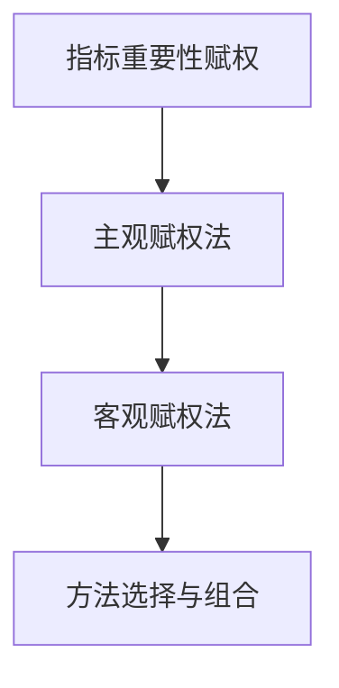
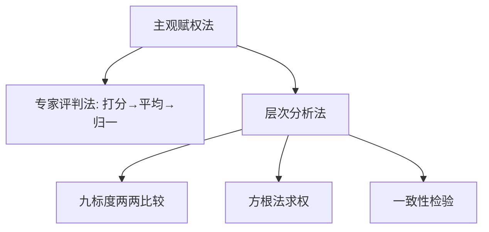
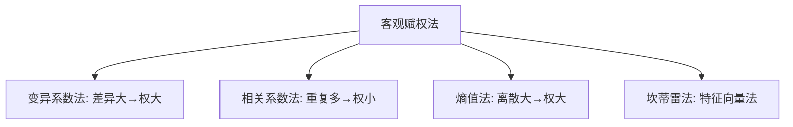
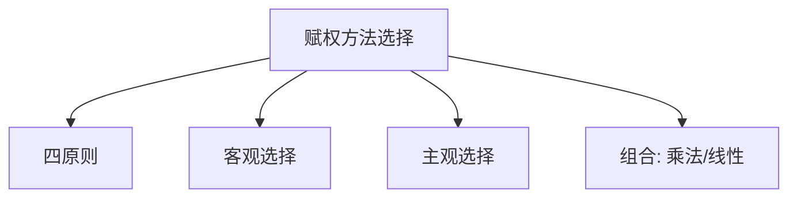

# 第四章 指标重要性赋权方法 · 章节总结

> 原书主文件第 967–1460 行。本章解决"无量纲化后各指标话语权多大"的问题。核心主线：**[[KP11_主观赋权vs客观赋权|主观赋权]] / [[KP11_主观赋权vs客观赋权|客观赋权]] → 方法选择 → [[KP13_组合赋权|组合赋权]]**。

> 🐱 **数学白痴先看这段**：上一章把所有指标都变成 0~1 的分数了，但销量、价格、好评率不能简单平均——因为它们重要性不一样。**赋权就是给每个指标发"话语权"**：销量占 70%、价格占 20%、好评率占 10%，这种比例就是权数。怎么定这个比例？两条路：① 问专家（主观法：专家评判、[[KP05_AHP一致性检验|AHP]]）；② 让数据自己说话（客观法：谁的数据拉开差距大，谁权数大）。最后还可以把两者折中（组合赋权）。

## 一、知识框架图

**文字缩进树（兜底）**：

- 赋权（重要性数量化，权数和=1）
  - 主观赋权
    - [[KP02_专家评判法|专家评判法]]：独立打分→均值方差→多轮收敛→归一
    - AHP：九标度两两比较→判断矩阵→方根法→[[KP05_AHP一致性检验|一致性检验]]→层次综合
  - 客观赋权
    - [[KP07_变异系数法|变异系数法]]（变异信息）
    - [[KP08_相关系数法|相关系数法]]（相关信息）
    - 熵值法（离散/信息量）
    - 坎蒂雷法（变异+相关）
  - 选择与组合
    - 四原则
    - 按差异/关联选客观法
    - 组合赋权（乘法/线性）

## 二、核心公式清单

| 式号 | 公式名 | 表达式 | 用途 | 适用条件 |
|---|---|---|---|---|
| 4.1 | 专家权数均值 | $\bar\omega_j=\frac1n\sum_i\omega_{ij}$ | 专家打分平均 | 多专家 |
| 4.2 | AHP行几何平均 | $\omega_i'=\sqrt[p]{M_i}$ | 方根法中间步 | 已构判断矩阵 |
| 4.3 | AHP权数归一 | $\omega_i=\omega_i'/\sum\omega_j'$ | 得权数 | — |
| 4.4 | 最大特征根 | $\lambda_{\max}=\frac1p\sum_i (BW)_i/\omega_i$ | 一致性检验基础 | — |
| 4.5 | 一致性指标 | $CI=(\lambda_{\max}-p)/(p-1)$ | 偏离一致性 | — |
| 4.6 | 随机一致性比率 | $CR=CI/RI$ | 判定满意一致性 | $CR<0.10$ |
| 4.7 | 层次综合 | $\omega_i=\sum_j\omega_{ij}a_j$ | 多层AHP总权 | 递阶结构 |
| 4.8 | 总一致性 | $CR_{总}=\sum a_jCI_j/\sum a_jRI_j$ | 多层检验 | $CR_{总}<0.10$ |
| — | 变异系数 | $v_i=S_i/\bar x_i$，归一得 $\omega_i$ | 差异赋权 | $\bar x_i\neq0$ |
| — | 多元相关系数 | $\rho_p=r_p'R_{p-1}^{-1}r_p$ | 重复信息度量 | 样本充足 |
| — | 熵值 | $e_j=-K\sum b_{ij}\ln b_{ij}$，$d_j=1-e_j$ | 信息量赋权 | 先同趋势化 |
| — | 坎蒂雷 | RS最大特征根特征向量W归一 | 变异+相关 | — |
| — | 组合赋权(乘) | $\omega_i=a_i\beta_i/\sum a_j\beta_j$ | 主客观结合 | — |
| — | 组合赋权(线) | $k_i=\lambda a_i+(1-\lambda)\beta_i$ | 主客观折中 | $\lambda$人为定 |
| — | 多法组合赋权 | $\omega_i=\prod_t w_i^{(t)}/\sum_j\prod_t w_j^{(t)}$ 或 $\omega_i=\sum_t\lambda_t w_i^{(t)}$ | ≥3套权数再合成 | 各法权数不严重打架 |

## 三、方法选择决策树（文字版）

1. 有充足样本数据吗？
   - 有 → 客观赋权：
     - 关注差异性 → 变异系数法或熵值法；
     - 关注关联性 → 相关系数法；
     - 两者都关注 → 坎蒂雷法。
   - 无 / 需专业导向 → 主观赋权：
     - 关注专家统一意见 → 德尔菲专家评判法；
     - 关注深层规范判断 → AHP（须通过 CR<0.10）。
2. 单类方法够吗？
   - 不够（主客观各有偏）→ 组合赋权：乘法合成或线性综合（如三七开）。
3. 任何方法都须满足：权数归一 $\sum\omega_i=1$、突出差异性。

## 四、与前后章节的联系

- 上承第三章无量纲化：本章权数作用于无量纲化后的评价值；
- 熵值法第一步"同趋势化+比重法"直接调用第三章方法；
- 下接第五章及以后合成方法：权数与无量纲值合成综合评价值；
- 主成分分析、因子分析也是客观赋权法，在第九、十章展开。

## 五、高频考点 / 自测题

1. **赋权的含义？** 把各指标对研究目的的重要性以数量值反映出来。
2. **赋权分哪两大类？** 主观赋权（专家评判、AHP）、客观赋权（变异系数、相关系数、熵值、坎蒂雷）。
3. **专家评判法基本思路？** 专家独立打分→求均值方差→多轮收敛→归一化。
4. **AHP 是谁提出的？核心思想？** 萨蒂；分解层次、两两比较、一致性检验。
5. **九分位标度 1/3/5/7/9 各表示什么？** 同等/稍重要/重要/很重要/极重要。
6. **判断矩阵性质？** $b_{ii}=1$，$b_{ij}=1/b_{ji}$，只需 $p(p-1)/2$ 次比较。
7. **方根法三步？** 行积 $M_i$→p 次方根 $\omega_i'$→归一化 $\omega_i$。
8. **一致性检验三公式与判定门槛？** $\lambda_{\max}$、$CI=(\lambda_{\max}-p)/(p-1)$、$CR=CI/RI$；$CR<0.10$ 通过。
9. **p=3 时 RI 值？** 0.58。
10. **变异系数法原理？** 变异越大、分辨力越强、权数越大；$v_i=S_i/\bar x_i$ 归一。
11. **熵值法五步？** 同趋势化→比重化→算 $e_j$→差异系数 $d_j=1-e_j$→归一化。
12. **坎蒂雷法为何更合理？** RS 矩阵同时含变异信息(S)与相关信息(R)。
13. **权数选择四原则？** 差异性、特征性、归一性、定性定量结合。
14. **组合赋权两形式？** 乘法合成 $\omega_i=a_i\beta_i/\sum$；线性综合 $k_i=\lambda a_i+(1-\lambda)\beta_i$。
15. **为什么用 AHP 而不用熵值法？反之呢？** 缺数据/需导向→AHP；有数据/要可复算→熵值法（详见 KP11）。

## 六、本章知识点索引

| 编号 | 名称 | 一句话用途 |
|---|---|---|
| KP01 | 赋权的概念与分类 | 界定赋权及主客观两大类 |
| KP02 | 专家评判法 | 专家独立打分平均归一化 |
| KP03 | AHP概述与九标度 | 萨蒂两两比较的标度体系 |
| KP04 | 判断矩阵与方根法求权 | 行积→几何平均→归一得权数 |
| KP05 | AHP一致性检验 | CI/CR/RI 判定逻辑自洽 |
| KP06 | AHP层次综合与总一致性 | 多层权数综合与总检验 |
| KP07 | 变异系数法 | 按指标变异程度客观赋权 |
| KP08 | 相关系数法 | 按指标间重复信息赋权 |
| KP09 | 熵值法 | 按信息量/离散程度赋权 |
| KP10 | 坎蒂雷赋权法 | 同时利用变异与相关信息 |
| KP11 | 主观vs客观赋权 | 两类方法系统对比与选择逻辑 |
| KP12 | 赋权原则与方法选择 | 四原则与选用规则 |
| KP13 | 组合赋权 | 主客观乘法/线性综合 |
| KP14 | 组合赋权深化 | 多套权数再合成：乘法/线性、系数λ确定 |

## 本章方法答辩速查

1. **问：主观赋权和客观赋权各自什么时候用？** 答：缺乏历史样本数据、或指标重要性有明确专业导向（如安全类指标必须优先）时用主观赋权（专家评判法或AHP），由专家经验注入导向；有充足可比样本数据、希望权数可复算可比较时用客观赋权，让数据的变异和相关说话。原书反对两个极端——既不迷信数学方法，也不完全依赖专家，两者都重要时用组合赋权。
2. **问：四种客观赋权法之间怎么选？** 答：只关注各指标在对象间拉开差距的能力，选变异系数法（手算简便）或熵值法（理论严谨、需先同趋势化）；关注指标间信息重复程度、想压低冗余指标权数，选相关系数法；想同时利用变异和相关两种信息，选坎蒂雷法，它最充分地利用了原始数据。
3. **问：AHP和专家评判法都属主观赋权，实际怎么选？** 答：专家能直接、大致把握各指标权重、追求专家意见收敛一致时用专家评判法（德尔菲式多轮反馈打分）；专家直接给绝对权数有困难但善于两两比较、且需要规范深入判断时用AHP，它还要过一致性检验 $CR<0.10$ 这一关。

---

## 🔗 跨库链接

**📖 原书对应章节：** [[../../../原文件/综合评价/陈正伟_综合评价技术及应用_全书|《综合评价技术及应用》第四章 指标重要性赋权方法]]

**🐮 大牛库对应模块：** [[../../../经济统计学论文从0基础到精通/07_综合评价方法/03_熵值法|熵值法（客观赋权实战）]]｜[[../../../经济统计学论文从0基础到精通/07_综合评价方法/04_AHP层次分析法|AHP层次分析法（主观赋权实战）]]｜[[../../../经济统计学论文从0基础到精通/07_综合评价方法/09_Excel熵值法计算|Excel手算熵值法]]
