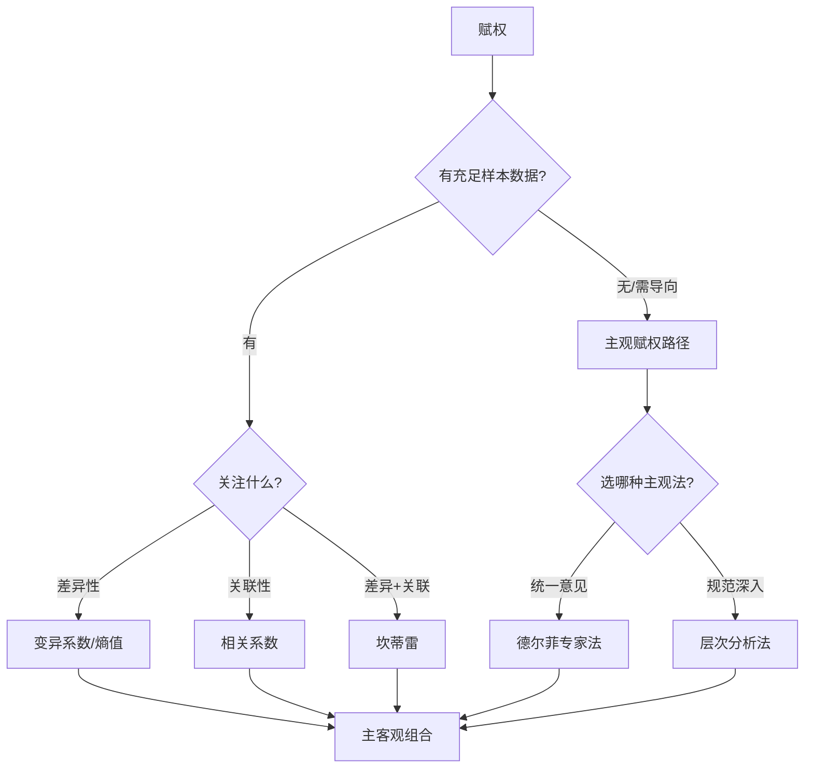

# KP12 · 赋权原则与方法选择

## 一、是什么

权数选择的四条基本原则与主客观方法选用规则。

| 原则 | 含义 |
|---|---|
| 差异性 | 权数须突出指标间差异，否则退化为等权 |
| 特征性 | 据评价者特殊要求/偏好对计算权数作导向修正 |
| 归一性 | 各权数之和 $\sum W_i=1$ |
| 定性定量结合 | 同时用主观、客观、特殊性分析，综合利弊后定权 |

## 二、怎么用（选择规则）

**客观法选择**：

1. 关注**差异性** → [[KP07_变异系数法|变异系数法]]、[[KP09_熵值法|熵值法]]；
2. 关注**关联性** → [[KP08_相关系数法|相关系数法]]；
3. 两者都关注 → 坎蒂雷法。

**主观法选择**：

1. 关注专家**统一意见** → 德尔菲专家调查法；
2. 关注专家深层意见与数据规范统一 → [[04_AHP层次分析法|层次分析法]]。

## 三、什么时候用

- 任何赋权前先对照四原则；
- 选具体方法时按上述规则判别。

## 四、什么时候不能用 / 易错点

- 违背归一性（$\sum W_i\neq1$）→ 合成错误；
- 只看差异不看关联、或反之 → 方法选错；
- 只凭单一方法、不做定性定量结合 → 片面。

## 五、方法选择决策链

## 六、为什么按这些规则选

- 差异性原则是权数存在的意义（等权=无权）；
- 不同信息对应不同客观法：变异→差异系数/熵；重复→相关；两者→坎蒂雷；
- 主观法中专家法重共识、[[KP05_AHP一致性检验|AHP]]重规范，按专家协作方式选。

## 七、完整例子（原书）

- 关注人口素质指标谁家差异大 → 例 4.2 用变异系数法；
- 关注专家对三经济效益指标的规范判断 → 例 4.1 用 AHP。

## 答辩常问（带标准答案）

1. **问：权数确定要遵守哪四条原则？** 答：差异性（权数须突出指标间差异，否则退化为等权）、特征性（据评价者特殊要求对计算权数作导向修正）、归一性（各权数之和等于1）、定性定量结合（同时用主客观分析、综合利弊后定权）。
2. **问：[[02_第二节_客观赋权法|客观赋权法]]内部怎么选？[[01_第一节_主观赋权法|主观赋权法]]内部又怎么选？** 答：客观法——关注指标间差异性用变异系数法或熵值法，关注指标间关联性用[[01_相关系数|相关系数]]法，两者都关注用坎蒂雷法。主观法——关注专家统一意见用德尔菲专家调查法，关注专家深层意见与规范统一用层次分析法AHP。

## 八、速记卡

- 四原则：**差异、特征、归一、定性定量结合**。
- 客观：差异→变异/熵；关联→相关；两者→坎蒂雷。
- 主观：统一意见→德尔菲；规范深入→AHP。

**关联知识点**：[KP07 变异系数法](./KP07_变异系数法.md)｜[KP11 主客观对比](./KP11_主观赋权vs客观赋权.md)｜[KP13 组合赋权](./KP13_组合赋权.md)

---

## 🔗 相关知识点

**同章关联：** [[./KP07_变异系数法|KP07 变异系数法]]｜[[./KP11_主观赋权vs客观赋权|KP11 主客观对比]]｜[[./KP13_组合赋权|KP13 组合赋权]]

**跨章/跨课关联：** [[../../03_指标无量纲化/知识点/KP15_无量纲化方法选择|无量纲化是赋权的前置步骤]]｜[[../../05_数值综合方法/知识点/KP12_组合评价法|组合评价法（多方法互证）]]

**🐮 大牛库深入：** [[../../../经济统计学论文从0基础到精通/07_综合评价方法/03_熵值法|熵值法（客观赋权）]]｜[[../../../经济统计学论文从0基础到精通/07_综合评价方法/04_AHP层次分析法|AHP（主观赋权）]]

**📖 原书原文：** [[../../../原文件/综合评价/陈正伟_综合评价技术及应用_全书|《综合评价技术及应用》第四章]]
