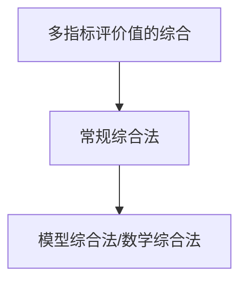
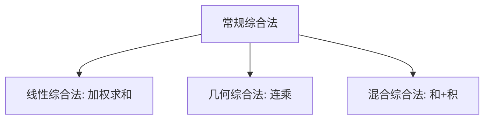
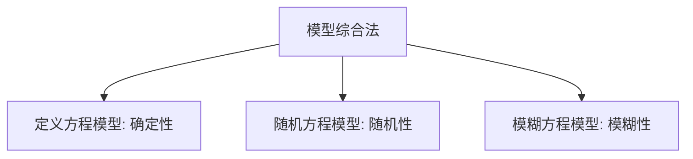
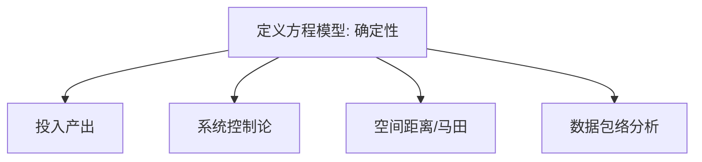
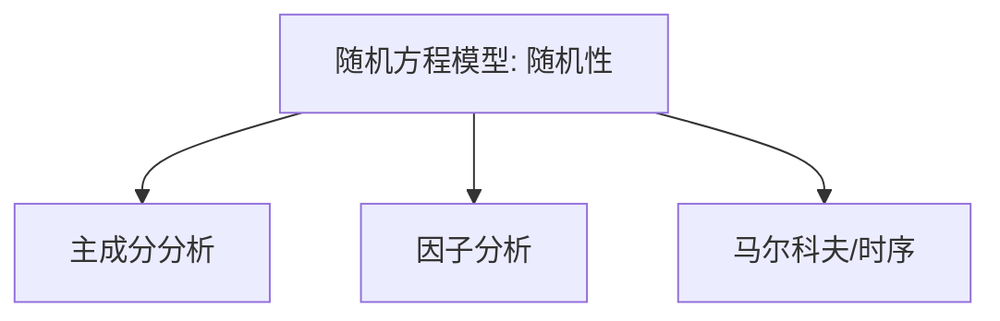
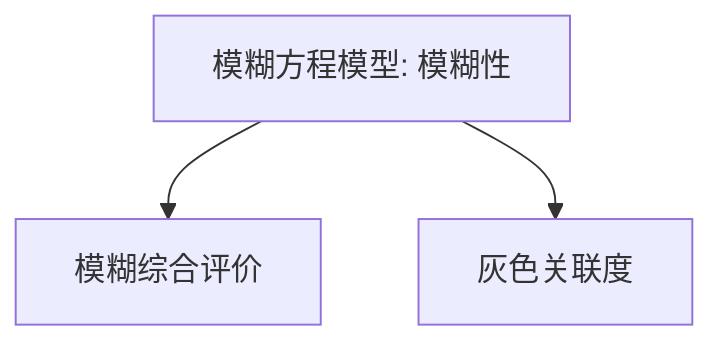

# 第五章 · 综合评价数值的综合方法 · 章节总结

> 主文件第 1461–1888 行。本章解决"多个指标评价值如何综合成一个综合指标"的合成算子问题，方法分四大类：线性、几何、混合（前三类=常规综合法）、[[04_第四节_模型综合法|模型综合法]]（=数学综合法）。

## 一、知识框架图

**文字缩进树（兜底）**：

- 综合方法四大类
  - 常规综合法
    - 线性综合：$z=\sum w_i x_i$；可线性替代；突出大权数；要求指标不相关
    - 几何综合：$z=\prod x_i^{w_i}$；一票否决；要求全正；强调均衡
    - 混合综合：和+积；直接/间接混合；重要性与评价值差异都大
  - 模型综合法
    - 定义方程（确定性）：投入产出、系统控制、空间距离（[[KP08_马田系统MTS|马田系统]]）、[[KP09_数据包络分析DEA|DEA]]
    - 随机方程（随机性）：主成分、[[KP03_PCA与因子分析对比|因子分析]]、马尔科夫、时间序列
    - 模糊方程（模糊性）：[[KP10_灰色关联度vs模糊综合评价|模糊综合评价]]、[[KP10_灰色关联度vs模糊综合评价|灰色关联度]]

## 二、核心公式清单

| 公式名 | 表达式 | 用途 | 适用条件 |
|---|---|---|---|
| 线性综合(5.1) | $z=\sum_{i=1}^p w_i x_i$ | 加权求和 | 指标不相关、可替代 |
| 简单算术平均(5.2) | $z=\frac1p\sum x_i$ | 等权综合 | 各指标等权 |
| 加权几何(5.3) | $z=\prod_{i=1}^p x_i^{w_i}$ | 连乘综合 | 指标全正、强调均衡 |
| 简单几何(5.4) | $z=(\prod x_i)^{1/p}$ | 等权几何平均 | 指标全正、等权 |
| 混合综合(5.5) | $z=\sum w_i'y_i+(\prod x_i^{w_i})^{1/\sum w_i}$ | 和+积 | 差异都大 |
| 模型综合一般式(5.10) | $Z_i=F(x_1^i,\dots,x_p^i)$ | 高维投影一维 | 能找到函数 $F$ |
| 广义马氏距离(5.11) | $D_t^2=\frac1k\sum a_{ij}(\frac{\zeta_{ti}-m_i}{\sigma_i})(\frac{\zeta_{tj}-m_j}{\sigma_j})$ | 到基准空间距离 | 基准空间已知 |
| 望小信噪比(5.14) | $\eta=-10\log\frac1l\sum D_t^2$ | 衡量接近目标 | 马氏距离望小 |
| DEA效率(5.15) | $\max E_e=\frac{\sum u_jO_{je}}{\sum v_iI_{ie}}$ | 求单位最大效率 | 投入产出、系数为正 |
| DEA约束(5.16) | 各单位比率 $\le1$ | 保证无人超100% | — |
| DEA样本量(5.17) | $K\ge2(N+M)$ | 决策单元数门槛 | $N$投入、$M$产出 |
| Kendall协调系数 | $W=\dfrac{12S}{T^{2}(n^{3}-n)}$，$S=\sum(R_i-\bar R)^2$ | 多法排名一致性 | 先检验再合成，W>0.7 |
| Spearman等级相关 | $r_s=1-\dfrac{6\sum d_i^2}{n(n^2-1)}$ | 两法排名一致性 | $r_s>0.8$ |
| Borda计数 | 第$r$名得 $n-r$ 分，各法相加 | 名次→分数合成 | 排名无并列 |

## 三、[[01_方法选择决策树|方法选择决策树]]（文字版）

判断"指标间是否可替代 / 是否要求均衡"是选合成算子的关键：

1. **指标间是否要求严格均衡、允许一票否决？**
   - 是（一项为 0 即全盘失败）→ **[[02_第二节_几何综合法|几何综合法]]**；
   - 否（短板可被长板补）→ 进入 2。
2. **指标间重要程度差异大吗？评价值差异大吗？**
   - 重要性差异大、评价值差异小 → **线性综合法**（突出重点、对小差异不敏感）；
   - 重要性差异小、评价值差异大 → **几何综合法**（灵敏区分、不偏袒）；
   - 两者差异都大 → **混合综合法**。
3. **指标关系能用和/积刻画吗？**
   - 能，且指标不相关 → 常规综合法；
   - 不能（复杂函数关系）→ **模型综合法**，再按关系类型：
     - 确定性（部门平衡、效率、距离）→ 定义方程模型（投入产出/控制/距离/DEA）；
     - 随机性（指标相关、降维）→ 随机方程模型（主成分/因子）；
     - 模糊性（满意度、定性）→ 模糊方程模型（模糊综合/灰色关联）。

## 四、与前后章节的联系

- 本章是"**合成算子**"层：前接第三章（无量纲化，把指标变成可比的 $x_i$）、第四章（赋权，得到 $w_i$）；
- 第六章的常规方法（综合评分、综合指数、RSR、功效系数）在**合成环节都调用本章的线性综合法**；
- 模型综合法中的主成分、因子分析在第九、十章展开，灰色关联在第七章、模糊综合在第八章展开。

## 五、高频考点 / 自测题

1. **四大综合方法及分类？** 线性、几何、混合（=常规综合法）、模型综合法（=数学综合法）。
2. **线性综合法公式及等权特例？** $z=\sum w_i x_i$；等权 $z=\frac1p\sum x_i$。
3. **线性综合法最核心的特征与最大缺点？** 指标间可线性替代；最大缺点是相互替代掩盖短板/抹杀亮点。
4. **线性综合法适用条件？** 指标间不相关；权数差异大、评价值差异小。
5. **几何综合法公式？为何一票否决？** $z=\prod x_i^{w_i}$；连乘结构下任一 $x_i=0$ 则 $z=0$。
6. **几何综合法对数据的硬性要求？** 各指标值必须全为正；负值无意义。
7. **几何综合法适用场合？** 指标联系强、重要性差别小、评价值差异大。
8. **混合综合法适合何种场合？** 重要程度差异大且评价值差异也大。
9. **雷克莱因国力方程？** $P=(C+E+M)(S+W)$，硬实力×软实力。
10. **模型综合法的数学实质？** 把高维样本点投影到一维直线上排序。
11. **定义方程模型综合法四种典型？** 投入产出、系统控制、空间距离（马田系统）、DEA。
12. **DEA 的本质与样本量规则？** 产出/投入比的线性规划，自动定权；$K\ge2(N+M)$。
13. **马田系统与灰色关联的三点主要区别？** 出发点（距离 vs 曲线形状）、参照（固定基准不可互换 vs 互为参照）、指标（信噪比可衡量波动 vs 关联度不能）。
14. **C-D 生产函数中技术水平 $A$ 用什么综合法测算？** 几何综合法，$A=y/(R^\alpha L^\beta)$。

## 六、本章知识点索引

| KP | 名称 | 一句话用途 |
|---|---|---|
| KP01 | 线性综合法 | 加权求和合成，可线性替代 |
| KP02 | 几何综合法 | 连乘合成，一票否决、要求均衡 |
| KP03 | 混合综合法 | 和+积，兼取两者优点 |
| KP04 | 模型综合法 | 建函数 $Z=F(X)$，高维投影一维 |
| KP05 | 投入产出分析法 | 部门间确定性平衡与感应度/影响力 |
| KP06 | 系统控制论方法 | 信息反馈闭环评价系统功能 |
| KP07 | 空间距离评价法 | 实际点到目标点距离越小越好 |
| KP08 | 马田系统 MTS | 马氏距离+信噪比作类别判别 |
| KP09 | 数据包络分析 DEA | 多投入多产出相对效率线性规划 |
| KP10 | 随机方程模型综合法 | 主成分/因子分析等降维 |
| KP11 | 模糊方程模型综合法 | 模糊综合评价/灰色关联 |
| KP12 | 组合评价法 | 多法排名再合成：Kendall W检验、Borda、Copeland |

## 本章方法答辩速查

1. **问：线性、几何、混合三种常规综合法怎么选？** 答：先问指标间是否要求严格均衡、允许一票否决——是（一项为0即全盘失败，如安全、可靠性评价）用几何综合法；否再看差异结构：重要性差异大、评价值差异小用线性综合法（突出重点、对小差异不敏感）；重要性差异小、评价值差异大用几何法（灵敏区分、不偏袒任一指标）；两者差异都大用混合综合法（既按重要性拉开差距、又惩罚严重不均衡）。
2. **问：什么时候该从常规综合法升级到模型综合法？** 答：当指标间关系根本不是加权和或连乘结构时——多投入多产出的效率评价用DEA、部门间平衡用投入产出分析、实际值到目标值的接近程度用空间距离/马田系统、指标相关需降维用主成分或因子分析、主观满意度类模糊判断用模糊综合评价或灰色关联。常规混合一旦走向复杂，必然转化为模型综合法。
3. **问：组合评价和组合赋权有什么区别？** 答：组合赋权合的是各种赋权法算出的权数向量，解决话语权怎么分配；组合评价合的是多种评价方法算出的得分或排名——先做Kendall W一致性检验（一般 $W>0.7$ 且卡方显著），确认各法排名一致后，再用Borda计数、Copeland两两PK或等权平均合成一个共识名次。

---

## 🔗 跨库链接

**📖 原书对应章节：** [[../../../原文件/综合评价/陈正伟_综合评价技术及应用_全书|《综合评价技术及应用》第五章 综合评价数值的综合方法]]

**🐮 大牛库对应模块：** [[../../../经济统计学论文从0基础到精通/07_综合评价方法/05_TOPSIS法|TOPSIS法（距离合成）]]｜[[../../../经济统计学论文从0基础到精通/07_综合评价方法/06_熵值法-TOPSIS组合|熵值法-TOPSIS组合]]｜[[../../../经济统计学论文从0基础到精通/07_综合评价方法/10_距离方法选择指南|距离方法选择指南]]
