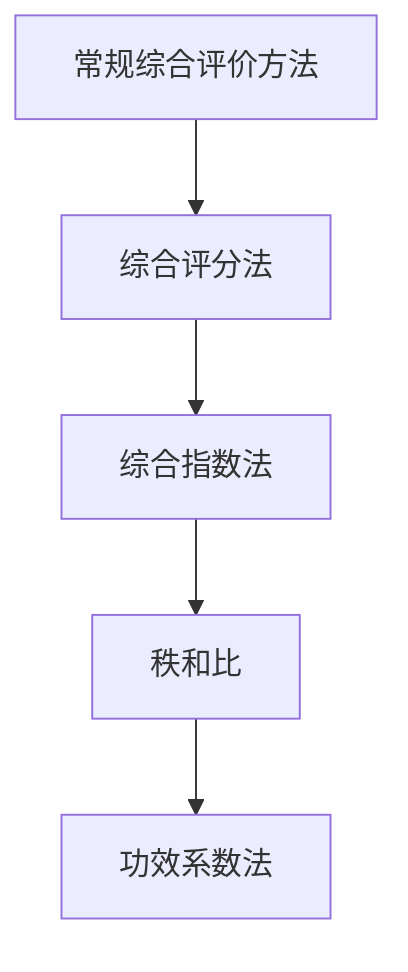
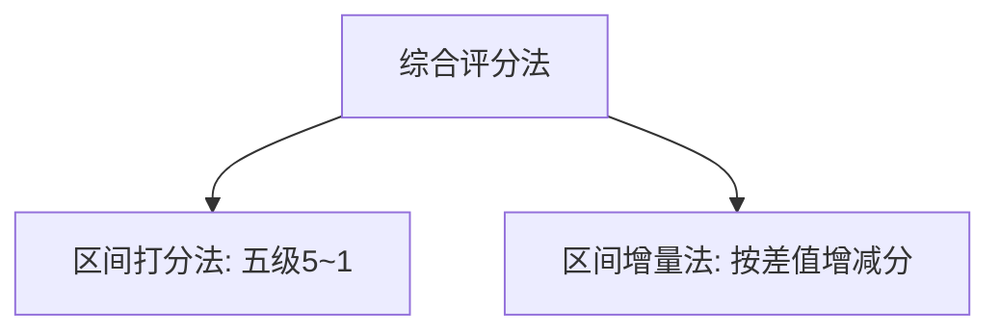
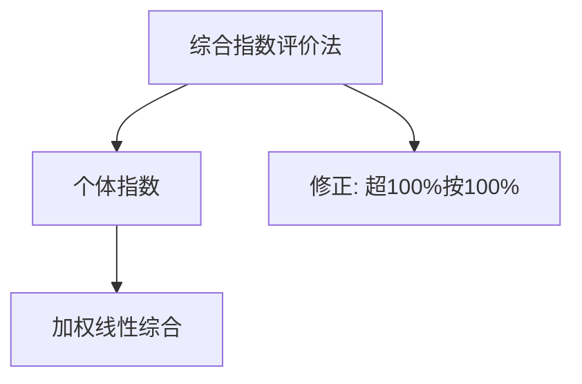
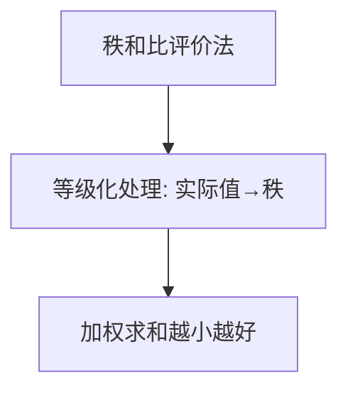
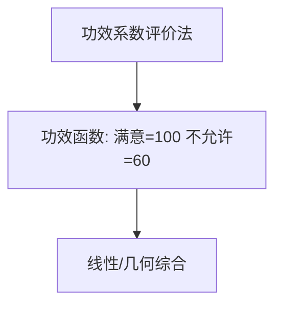

# 第六章 · 几种常规综合评价方法 · 章节总结

> 主文件第 1889–2386 行。常规综合评价方法数学原理较简单，**本身不能消除指标间相关作用的影响**，使用前应已解决指标间线性替代与线性相关问题。

## 一、知识框架图

**文字缩进树（兜底）**：

- 常规综合评价方法（指标须先独立）
  - [[01_第一节_综合评分法|综合评分法]]：实际值→分数→加权和
    - [[KP02_区间打分法|区间打分法]]（五级 5~1）
    - [[KP03_区间增量法|区间增量法]]（以平均为基准按 D 增减分）
  - 综合指数法：实际值/标准值得个体指数 → 加权和
  - [[KP06_秩和比RSR评价法|秩和比]] [[KP06_秩和比RSR评价法|RSR]]：等级化（排秩）→ 加权和，越小越好
  - 功效系数法：[[KP09_功效函数|功效函数]]（满意 100/不允许 60）→ 线性或几何综合

## 二、核心公式清单

| 公式 | 表达式 | 用途 | 适用条件 |
|---|---|---|---|
| 区间增量(6.x) | $F_i=[x_i/x_0]+(x_i-x_0)/D$ | 按偏离标准计分 | 有标准值 $x_0$ |
| 综合指数(6.1) | $z=\sum w_i x_i/x_{i0}$ | 实际/标准比值加权 | 标准值 $x_{i0}$ 已知 |
| 均值(6.2) | $\bar x_j=\frac1{28}\sum x_{ij}$ | 求全国平均标准 | 标准取平均 |
| RSR(6.3) | $z_i=\frac{100}{np}\sum w_j r_{ij}$ | 位次加权和 | $r_{ij}$ 为位次 |
| 功效系数正向(6.4) | $d_i=\frac{x_i-x_i^{(s)}}{x_i^{(h)}-x_i^{(s)}}×40+60$ | 正向[[02_指标无量纲化|指标无量纲化]] | $x_i^{(h)}>x_i^{(s)}$ |
| 功效系数逆向(6.5) | $d_i=100-\frac{x_i^{(h)}-x_i}{x_i^{(h)}-x_i^{(s)}}×40$ | 逆向指标无量纲化 | 逆向指标 |
| 线性综合(6.6) | $d=\sum w_i d_i/\sum w_i$ | 功效系数线性汇总 | — |
| 几何综合(6.7) | $d=(\prod d_i^{w_i})^{1/\sum w_i}$ | 功效系数几何汇总 | $d_i>0$ |

## 三、[[01_方法选择决策树|方法选择决策树]]（文字版）

1. **数据是否有极端值、且只关心相对名次？**
   - 是 → **RSR**（排秩抗异常值，结果越小越好）；
   - 否 → 进入 2。
2. **是否有明确的"及格—满意"双边界？**
   - 是（要把结果落在 60~100 区间）→ **功效系数法**；
   - 否 → 进入 3。
3. **是否需要保留"实际值比标准高出多少"的相对差异？**
   - 是（与平均/计划/历史标准比）→ **综合指数法**；
   - 否（只需朴素分级打分）→ **综合评分法**。
4. 无论选哪种，都须先保证**指标相互独立**（常规法不能消除相关）。

## 四、与前后章节的联系

- 本章是第五章"线性综合法"在常规评价中的具体应用：四法合成环节都用加权求和；
- 指标权重可来自第四章（赋权），例 6.4 的 RSR 权数即用第九章主成分第一主成分系数；
- 功效函数属第三章"直线型无量纲化"的一种；
- 指标须先同向化（逆向指标取倒数/倒扣），由第三章无量纲化解决。

## 五、高频考点 / 自测题

1. **常规综合评价方法的共同前提？** 本身不能消除指标间相关影响，使用前须已解决指标线性替代与线性相关问题。
2. **综合评分法的两种形式？** 区间打分法（五级 5~1）、区间增量法（按偏离 $D$ 增减分）。
3. **综合评分法最大缺点？** 评价标准人为性强，客观性难令人信服。
4. **综合指数法公式？** $z=\sum w_i x_i/x_{i0}$。
5. **综合指数法的四个特征？** 须定标准值；线性综合有替代；无量纲化与综合同时进行；存在线性替代影响。
6. **如何防止综合指数法的线性替代？** 个体指数超 100% 部分按 100% 计。
7. **评价标准值 $x_{i0}$ 如何选？** 纵向=基础/历史最好；横向=同类最好/平均；检查计划=计划数。
8. **RSR 法中正向指标如何排秩？** 数值越大等级数越小（名次越靠前）。
9. **RSR 相同值如何处理？** 取平均位次（如 12、13 位同值取 12.5）。
10. **RSR 结果方向？** $z_i$ 越小越好。
11. **RSR 与综合指数法在线性替代上有何区别？** RSR 仍有替代但**较弱**。
12. **功效系数正向/逆向公式？** 正向 $d_i=\frac{x_i-x_i^{(s)}}{x_i^{(h)}-x_i^{(s)}}×40+60$；逆向倒扣 $100-\frac{x_i^{(h)}-x_i}{x_i^{(h)}-x_i^{(s)}}×40$。
13. **功效系数取值范围？** 满意值=100、不允许值=60，之间 60~100。
14. **功效系数法实践权数取几？** 1、2、3（重要=3、相关=1、一般=2）。
15. **例 6.5 哪年回落？** 1983 年（综合功效系数 68.4，低于 1982 的 71.4）。

## 六、本章知识点索引

| KP | 名称 | 一句话用途 |
|---|---|---|
| KP01 | 综合评分法 | 实际值转分数后加权求和 |
| KP02 | 区间打分法 | 五级 5~1 分查标准表打分 |
| KP03 | 区间增量法 | 以平均为基准按偏离 $D$ 增减分 |
| KP04 | 综合指数评价法 | 实际/标准个体指数加权 |
| KP05 | 评价标准值 $x_{i0}$ 的选择 | 按纵向/横向/计划选基准 |
| KP06 | 秩和比 RSR 评价法 | 位次加权、抗异常值 |
| KP07 | 等级化处理 | 实际值转秩、同值取平均位次 |
| KP08 | 功效系数评价法 | 满意/不允许双边界映射 60~100 |
| KP09 | 功效函数 | 直线型无量纲化公式 |
| KP10 | 四种常规方法对比 | 打分方式/基准/方向/抗异常值对照 |

## 本章方法答辩速查

1. **问：综合评分法、综合指数法、RSR、功效系数法各自特点？怎么选？** 答：综合评分法最朴素人人能懂但主观；综合指数法保留相对差异但有线性替代；RSR 抗异常值但丢失数值差异、结果越小越好；功效系数法有满意/不允许双边界、映射 60~100。选法：怕异常值看名次→RSR；要保留相对差异→综合指数法；要双边界百分制→功效系数法；要最省事→综合评分法。四法都不能消除指标相关，须先保证指标独立。
2. **问：四法在"线性替代"上有何差异？** 答：综合评分法、综合指数法、功效系数法都有线性替代（某指标超额可抵补另一指标不足），RSR 替代程度较弱（因为只看位次）。综合指数法检查计划时可用"超 100% 部分按 100% 计"修正。
3. **问：四法结果方向有何不同？** 答：RSR 的 $z_i$ 越小越好（位次越小越好），其余三法都是得分越大越好。这是答辩常考的方向陷阱，勿混。

---

## 🔗 跨库链接

**📖 原书对应章节：** [[../../../原文件/综合评价/陈正伟_综合评价技术及应用_全书|《综合评价技术及应用》第六章 几种常规综合评价方法]]

**🐮 大牛库对应模块：** [[../../../经济统计学论文从0基础到精通/07_综合评价方法/05_TOPSIS法|TOPSIS法（现代距离合成）]]
