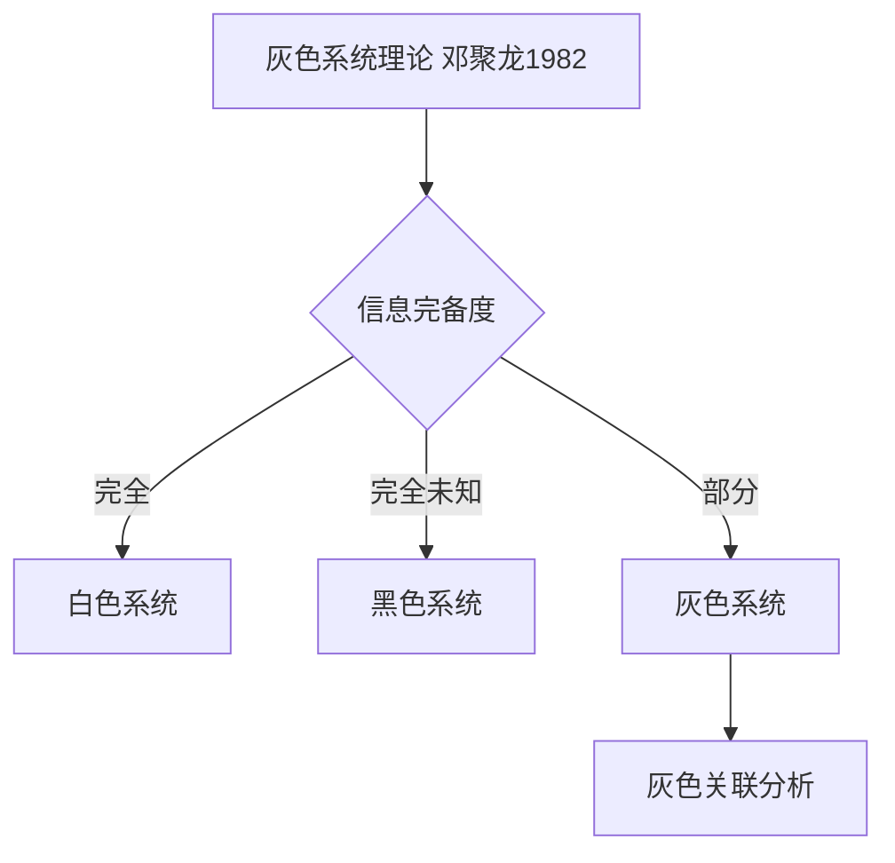
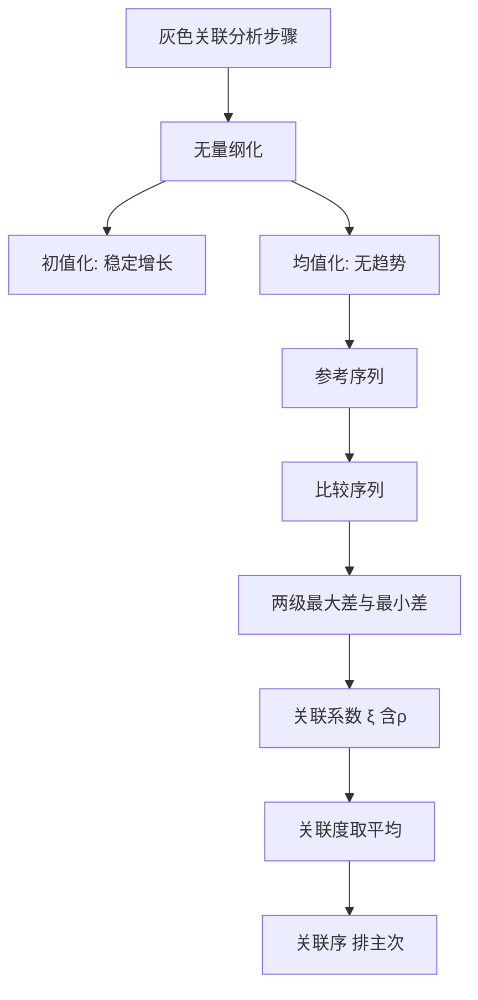
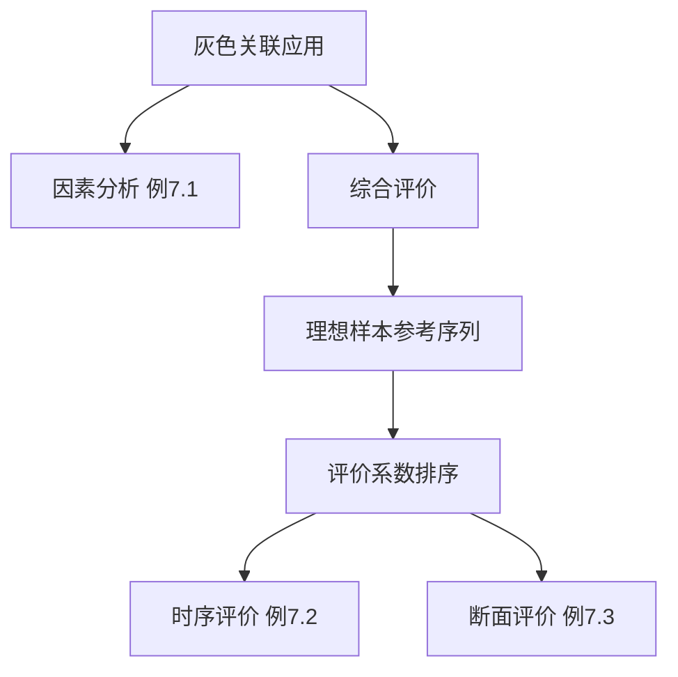

# 第七章 · [[KP10_灰色关联度vs模糊综合评价|灰色关联度]][[KP06_秩和比RSR评价法|评价法]] · 章节总结

> 原书第七章，主文件第 2387–2878 行。核心：在**信息不完全（灰色）**条件下，靠"曲线形状相似性"测度关联、构造理想样本作综合评价排序。

## 一、知识框架图

**文字缩进树（兜底）**：

- 灰色关联度评价法
  - 基础概念
    - 灰色系统（白/灰/黑；邓聚龙 1982；少数据）
    - 灰要素（客观存在/不易量化/正负；整体/局部影响）
    - 关联度（曲线形状相似性；相对变化量度）
  - 计算方法
    - 无量纲化：初值化 / [[KP09_中心化_均值化|均值化]]
    - 参考序列 + 比较序列
    - 两级差 Δ(min)、Δ(max)
    - 关联系数 ξ(ρ) + 分辨系数 ρ(0.1~0.5)
    - 关联度 r＝平均 + 关联序
  - 综合评价应用
    - 理想最优参考序列（正向取最大/逆向取最小/适度取适度值）
    - 阈值法无量纲化（最优＝1，x_0=(1,…,1)）
    - 综合评价系数 E_i=r_i×100（等权）或加权 Σω_j ξ_ij×100
    - 时序纵向（例7.2）/ 断面横向（例7.3）

## 二、核心公式清单

| 公式名 | 表达式 | 用途 | 适用条件 |
|---|---|---|---|
| 初值化 | $x_i'=x_i/x_0$ | 无量纲化 | 稳定增长数列 |
| 均值化 | $x_i'=x_i/\bar{x}$ | 无量纲化 | 无明显趋势 |
| 绝对离差 | $\Delta_{0k}(t)=\|x_0(t)-x_k(t)\|$ | 逐点距离 | 已无量纲化 |
| 两级最小差 | $\Delta(\min)=\min_k\min_t\Delta_{0k}(t)$ | 关联系数基准 | — |
| 两级最大差 | $\Delta(\max)=\max_k\max_t\Delta_{0k}(t)$ | 关联系数基准 | — |
| 关联系数 (7.1) | $\xi_{0k}(t)=\dfrac{\Delta(\min)+\rho\Delta(\max)}{\Delta_{0k}(t)+\rho\Delta(\max)}$ | 单点贴合度 | $\rho\in(0,1)$ |
| 关联度 (7.2) | $r_{0k}=\dfrac1n\sum_t\xi_{0k}(t)$ | 整体关联 | 等权平均 |
| 阈值法无量纲化 | $x_{ij}'=x_{ij}/x_{0j}$ | 综合[[KP02_评价标准|评价标准]]化 | 最优值化 1 |
| 综合评价系数 | $E_i=r_i\times100$ | 百分制排序 | 等权 |
| 加权改进 | $E_i=(\sum_j\omega_j\xi_{ij})\times100$ | 考虑指标重要性 | 指标重要性不同 |

## 三、[[01_方法选择决策树|方法选择决策树]]（文字版）

1. 问题的不确定性来自**信息不完全、样本少**吗？
   - 是 → 继续；否（边界模糊、需分级）→ 转第八章[[KP10_灰色关联度vs模糊综合评价|模糊综合评价]]。
2. 要判断的是"**哪个因素影响目标最大**"还是"**哪个被评价对象整体最好**"？
   - 因素主次 → 以真实目标（如 GDP）为参考序列（[[01_第一节_灰色关联度分析方法|第一节]]/例 7.1）；
   - 对象排序 → 以样本内理想最优样本为参考序列（[[02_第二节_灰色关联度分析在综合评价中的应用|第二节]]/例 7.2、7.3）。
3. 数列有无明显趋势？
   - 稳定增长 → 初值化；无明显趋势 → 均值化；综合评价统一用阈值法除以最优值。
4. 指标重要性是否相同？
   - 相同 → 等权 $E_i=r_i\times100$；不同 → 加权 $E_i=(\sum\omega_j\xi_{ij})\times100$。
5. 结果区分度不够？→ 调整分辨系数 $\rho$（0.1~0.5）提高区分效度。
6. 大样本、要建预测方程/降维？→ 不用灰色方法，转回归/主成分（第九章）。

## 四、与前后章节的联系

- **承接**：第三章无量纲化（本章初值化/均值化/阈值法是其在灰色方法中的具体应用）、第四章权数（本章加权改进 $\omega_j$）；
- **并列对比**：与第八章模糊综合评价同属"不确定性下的综合评价"——灰色处理信息不完全，模糊处理边界模糊（见 KP10 对比表）；
- **后续**：第九章主成分、第十章因子分析处理的是"指标过多、信息重叠"问题，与本章少数据灰色路径互补；案例中亦有应用。

## 五、高频考点 / 自测题

1. **灰色系统理论由谁提出、哪年？** 邓聚龙教授，1982 年。
2. **白、灰、黑系统如何区分？** 信息完全明确／部分明确／完全未知。
3. **关联度的几何本质是什么？** 参考序列与比较序列曲线形状的相似程度。
4. **初值化与均值化有何区别？各适用什么数据？** 初值化除以首项（定基发展速度），适稳定增长；均值化除以均值，适无明显趋势。
5. **写出关联系数公式并说明 ρ 的作用。** $\xi=\frac{\Delta(\min)+\rho\Delta(\max)}{\Delta_{0k}(t)+\rho\Delta(\max)}$；ρ 为分辨系数（0<ρ<1，常 0.1~0.5），削弱 Δ(max) 失真、提高差异敏感性。
6. **两级最大差、最小差如何取？** 先条内取极值，再条间取最小的最小、最大的最大。
7. **关联度如何计算？其绝对值为什么意义不大？** $r_{0k}=\frac1n\sum_t\xi_{0k}(t)$；关键是关联序（相对大小），绝对值随方法/ρ 变化。
8. **综合评价型灰色关联如何构造参考序列？** 正向指标取最大、逆向取最小、适度指标取适度值，拼成理想样本；阈值法无量纲化后 $x_0=(1,\dots,1)$。
9. **综合评价系数 $E_i$ 如何定义？为何乘 100？** $E_i=r_i\times100$；乘 100 仅为符合百分制评分习惯。
10. **原方法的主要缺陷及改进？** 默认等权、未考虑指标重要性；改进为 $E_i=(\sum\omega_j\xi_{ij})\times100$。
11. **例 7.1 的关联序与结论？** $r_{03}>r_{01}>r_{02}$，第三产业为主导，一、二产业同一水平。
12. **例 7.2 中能源消耗系数为何取最小值？** 它是逆向指标（越小越好），参考序列取最优即最小。
13. **灰色关联与模糊综合评价处理的不确定性有何不同？** 灰色＝信息不完全；模糊＝边界亦此亦彼。

## 六、本章知识点索引

| 编号 | 名称 | 一句话用途 |
|---|---|---|
| KP01 | 灰色系统与灰色要素 | 界定白/灰/黑系统与灰要素性质分类 |
| KP02 | 灰色关联度的定义与几何意义 | 掌握关联度概念与"曲线相似"本质 |
| KP03 | 原始数据无量纲化（初值化/均值化） | 消除量纲、选择正确标准化方法 |
| KP04 | 参考序列与比较序列 | 确定评价"标杆"与被比对象 |
| KP05 | 两级最大差与最小差 | 求全场最近/最远点基准 |
| KP06 | 关联系数与分辨系数 | 核心公式 7.1 与 ρ 的作用 |
| KP07 | 关联度与关联序 | 由平均得整体关联并排主次 |
| KP08 | 理想最优参考序列构造 | 综合评价中如何拼虚拟最优样本 |
| KP09 | 灰色关联综合评价步骤与评价系数 | 六步流程与 $E_i$、加权改进 |
| KP10 | 灰色关联度 vs 模糊综合评价 | 两类不确定性下的方法选择对比 |

## 本章方法答辩速查

1. **问：灰色关联分析在因素分析和综合评价两种用途下，参考序列构造有何不同？** 答：因素分析（例 7.1）以真实目标值（如 GDP）为参考，回答"哪个产业影响 GDP 最大"，结果是关联序排因素主次；综合评价（例 7.2、7.3）从样本中取各指标最优值拼虚拟理想样本为参考（正取最大、逆取最小），阈值法无量纲化后 $x_0=(1,\dots,1)$，回答"哪个对象整体最好"，结果是百分制 $E_i$ 排序。
2. **问：灰色关联和 TOPSIS、模糊综合评价什么时候选哪个？** 答：数据少、信息不完全、看曲线趋势相似性→灰色关联；数据齐全、有明确正负理想解距离→TOPSIS；概念边界模糊、需分等级描述→模糊综合。灰色关联只需少量样本曲线，不要求典型分布；模糊综合需要构造隶属函数和评语等级集，工作量更大。
3. **问：灰色关联综合评价的完整六步及默认缺陷？** 答：①定参考序列（理想最优样本）；②阈值法无量纲化（最优=1）；③求两级差 $\Delta(\min)/\Delta(\max)$；④算关联系数 $\xi_{ij}$；⑤对 $p$ 个指标平均得 $r_i$、乘 100 得 $E_i$；⑥$E_i$ 越大越优排序。默认缺陷是等权 $1/p$、未考虑指标重要性，改进为 $E_i=(\sum_j\omega_j\xi_{ij})\times100$。

---

## 🔗 跨库链接

**📖 原书对应章节：** [[../../../原文件/综合评价/陈正伟_综合评价技术及应用_全书|《综合评价技术及应用》第七章 灰色关联度评价法]]

**🐮 大牛库对应模块：** [[../../../经济统计学论文从0基础到精通/07_综合评价方法/08_灰色关联分析|灰色关联分析（小样本实战）]]
