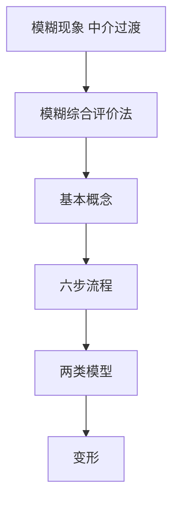
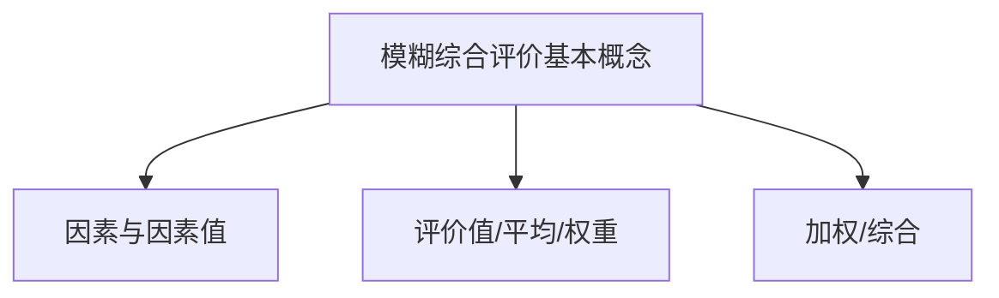
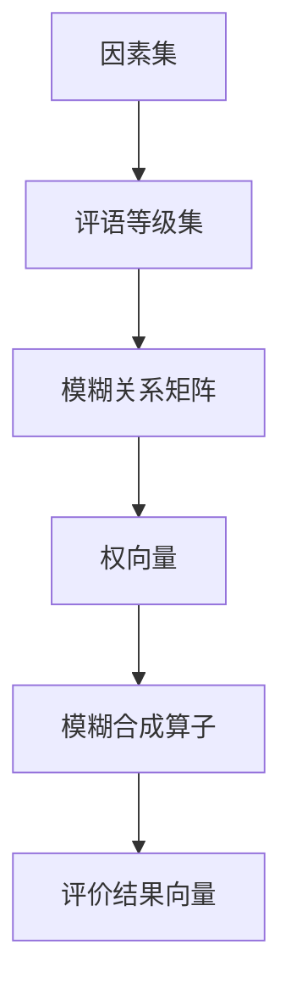
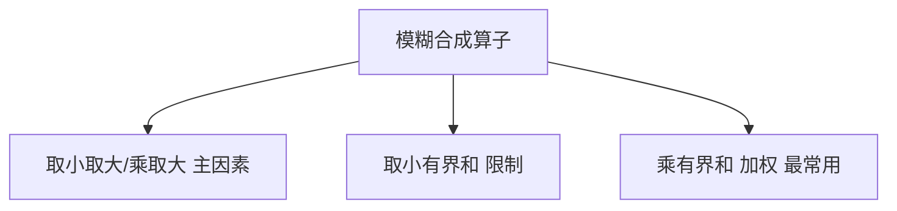
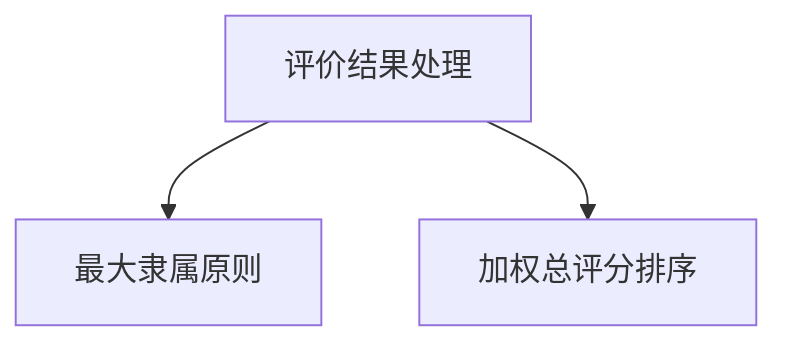
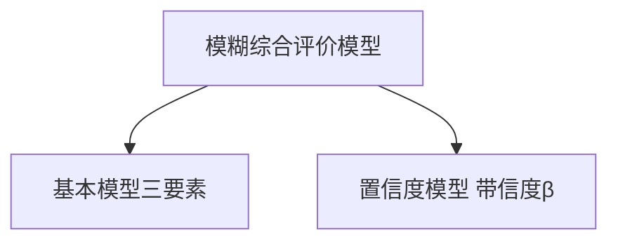
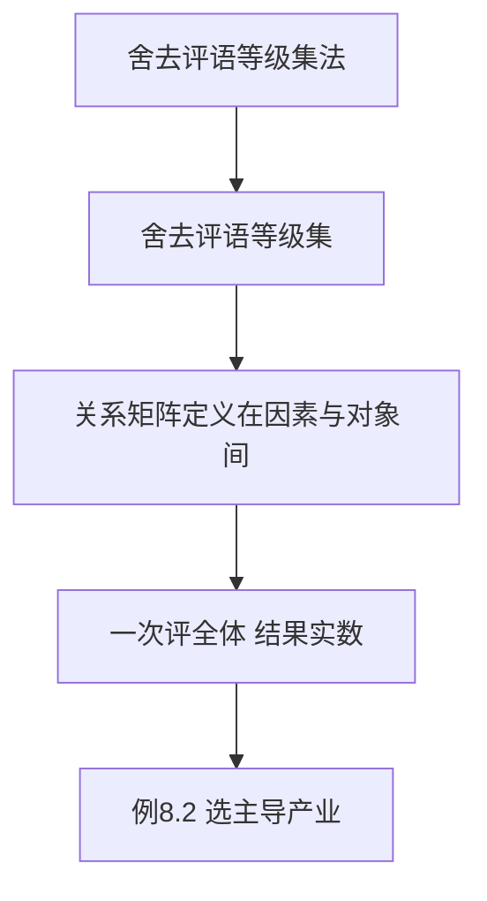

# 第八章 · [[KP10_灰色关联度vs模糊综合评价|模糊综合评价]]方法 · 章节总结

> 原书第八章，主文件第 2879–3490 行。核心：用**隶属度**处理"边界模糊、亦此亦彼"的不确定性，把定性分级判断定量化。

## 一、知识框架图

**文字缩进树（兜底）**：

- 模糊综合评价方法
  - 基本概念：F/Fv/E/Ep/W/Epw/Ez；五特点
  - 基本模型 (U,V,R)：R=(r_ij)，B=AR
  - 置信度模型：隶属度+集中程度，带 β
  - 六步：U→V→R→A→合成O→B 分析
    - U [[KP04_因素集U与评语等级集V|因素集]]（剔除相关因素）
    - V 评语集（4~9 级）
    - R：主观等级[[KP12_比重法|比重法]]/客观隶属函数·历史频率·模糊子集表
    - A 权向量（模糊法定权，和为 1）
    - O 算子：取小取大、乘取大、取小有界和、乘有界和
    - B：最大隶属原则 / 加权总评分
  - 变形：舍去评语等级集 V
    - R 定义在因素与对象间、一次评全体、结果实数
    - 例 8.2 选主导产业（五指标+分段隶属函数）

## 二、核心公式清单

| 公式名 | 表达式 | 用途 | 适用条件 |
|---|---|---|---|
| [[KP05_模糊关系矩阵R与单因素评价|模糊关系矩阵]] (8.1) | $R=(r_{ij})_{p\times m}$ | 单因素评价 | $0\le r_{ij}\le1$ |
| 基本合成 (8.2) | $B=AR$ | 得评价向量 | $\sum a_i=1$ |
| 合成模型 (8.11) | $B=A\,O\,R$ | 选算子合成 | — |
| 取小取大 (8.12) | $b_j=\max_i\min(a_i,r_{ij})$ | 主因素突出 | — |
| 乘取大 (8.13) | $b_j=\max_i(a_i r_{ij})$ | 主因素突出 | — |
| 取小有界和 (8.14) | $b_j=\min\{1,\sum_i\min(a_i,r_{ij})\}$ | 限制修正 | — |
| 乘有界和 (8.15) | $b_j=\min\{1,\sum_i a_i r_{ij}\}$ | **加权平均，最常用** | 每因素贡献 |
| 向量作权数 (8.16) | $w_i=b_i^k/\sum_j b_j^k$ | 结果排序 | 需区分同等级 |
| 总评分 (8.17) | $C=\sum_j w_j c_j$ | 单点值排序 | — |
| 需求收入弹性 (8.18) | $e_i=\frac{\Delta X_i/X_i}{\Delta y/y}$ | 主导产业指标 | — |
| 技术进步率 (8.19) | $A_i=x_i-a_i k_i-\beta_i l_i$ | 主导产业指标 | $a_i\approx0.3\sim0.4$ |

## 📐 端到端完整算例（手把手走一遍）

下面用"评价甲、乙两家餐厅"一个完整例子，把模糊综合评价六步全部走一遍，每步数字都列出来。看完这个例子，本章所有 KP 就串起来了。

### 第 0 步：场景

小明想比较街上**甲、乙**两家餐厅。他要回答两个问题：每家餐厅整体算"好/中/差"哪一档？两家之间谁更好？

### 第 1 步：定因素集 $U$（评哪几个方面）

他挑三件事：口味、价格、服务。

$$U=\{u_1\text{ 口味},\ u_2\text{ 价格},\ u_3\text{ 服务}\},\quad p=3$$

### 第 2 步：定评语等级集 $V$（用哪几档刻度）

$$V=\{v_1\text{ 好},\ v_2\text{ 中},\ v_3\text{ 差}\},\quad m=3$$

### 第 3 步：请 10 位食客投票，建模糊关系矩阵 $R$

这是**主观指标**，用等级比重法：每个等级票数 ÷ 总人数 10，就是隶属度。

**甲店投票：**

| 因素 | 好 | 中 | 差 |
|---|---|---|---|
| 口味 | 6 | 3 | 1 |
| 价格 | 2 | 5 | 3 |
| 服务 | 4 | 4 | 2 |

除以 10，得甲店 $R_甲$：

$$R_甲=\begin{bmatrix}0.6&0.3&0.1\\0.2&0.5&0.3\\0.4&0.4&0.2\end{bmatrix}$$

**乙店投票：**

| 因素 | 好 | 中 | 差 |
|---|---|---|---|
| 口味 | 4 | 5 | 1 |
| 价格 | 1 | 6 | 3 |
| 服务 | 3 | 5 | 2 |

除以 10，得乙店 $R_乙$：

$$R_乙=\begin{bmatrix}0.4&0.5&0.1\\0.1&0.6&0.3\\0.3&0.5&0.2\end{bmatrix}$$

读法：$R$ 每行是一个因素在三档评语上的分布，每行加起来都等于 1。

### 第 4 步：定权向量 $A$

小明觉得口味最重要、价格次之、服务再次：

$$A=(a_1,a_2,a_3)=(0.5,\ 0.3,\ 0.2),\qquad \sum a_i=1$$

### 第 5 步：选合成算子，算评价向量 $B$

实践最常用**乘与有界和**（式 8.15）：$b_j=\sum_i a_i r_{ij}$（每项都贡献）。

**甲店**：逐列算

- "好"这一列：$0.5\times0.6+0.3\times0.2+0.2\times0.4=0.30+0.06+0.08=\mathbf{0.44}$
- "中"这一列：$0.5\times0.3+0.3\times0.5+0.2\times0.4=0.15+0.15+0.08=\mathbf{0.38}$
- "差"这一列：$0.5\times0.1+0.3\times0.3+0.2\times0.2=0.05+0.09+0.04=\mathbf{0.18}$

$$B_甲=(0.44,\ 0.38,\ 0.18)$$

**乙店**：逐列算

- "好"：$0.5\times0.4+0.3\times0.1+0.2\times0.3=0.20+0.03+0.06=\mathbf{0.29}$
- "中"：$0.5\times0.5+0.3\times0.6+0.2\times0.5=0.25+0.18+0.10=\mathbf{0.53}$
- "差"：$0.5\times0.1+0.3\times0.3+0.2\times0.2=0.05+0.09+0.04=\mathbf{0.18}$

$$B_乙=(0.29,\ 0.53,\ 0.18)$$

### 第 6 步：处理 $B$——判等级 + 排序

**先用最大隶属原则判等级**（挑最大分量对应那一档）：

- 甲：$\max(0.44,0.38,0.18)=0.44$，对应"好" → **甲判为"好"**
- 乙：$\max(0.29,0.53,0.18)=0.53$，对应"中" → **乙判为"中"**

**再用加权总评分细分排序**（式 8.17，设等级分：好=1、中=0.6、差=0.2，$k=1$）：

- 甲：$C_甲=0.44\times1+0.38\times0.6+0.18\times0.2=0.44+0.228+0.036=\mathbf{0.704}$
- 乙：$C_乙=0.29\times1+0.53\times0.6+0.18\times0.2=0.29+0.318+0.036=\mathbf{0.644}$

### 最终结论

| 餐厅 | $B$ 向量 | 最大隶属等级 | 总评分 $C$ |
|---|---|---|---|
| 甲 | (0.44, 0.38, 0.18) | **好** | 0.704 |
| 乙 | (0.29, 0.53, 0.18) | **中** | 0.644 |

$$C_甲(0.704)>C_乙(0.644)$$

**小明应选甲店**：甲店"好"的隶属度最高（0.44），乙店"中"的隶属度最高（0.53）；两家"差"的程度相同（都是 0.18）。甲店整体更接近"好"，乙店则卡在"中"。这就是完整的模糊综合评价——从因素集、评语集、投票矩阵、权重、合成、到判级排序，每一步都有数字。

## 三、[[01_方法选择决策树|方法选择决策树]]（文字版）

1. 不确定性来自"**边界模糊、亦此亦彼**"吗？是 → 模糊综合；否（信息少）→ 第七章灰色关联。
2. 需要划分"很好/较好…"**评语等级**吗？
   - 需要 → 严格模糊综合（设 $V$）；
   - 只需给各对象一个可排序实数（如选主导产业）→ 舍去评语等级集法。
3. $r_{ij}$ 是主观还是客观指标？
   - 主观 → 等级比重法；客观 → 历史频率法（常用）/隶属函数模型法（$m\times p$ 个）/模糊子集表法。
4. 合成要突出主因素还是全体贡献？
   - 主因素 → 取小取大/乘取大；全体贡献 → 乘与有界和（实践常用）。
5. 结果需要判等级还是排序？
   - 判等级 → 最大隶属原则；同等级细分排序 → 加权总评分 $C$。
6. 专家意见分歧大、需标信度？→ 置信度模型。

## 四、与前后章节的联系

- **对比第七章**：灰色关联处理"信息不完全（少数据）"，模糊综合处理"边界模糊（亦此亦彼）"；两者都输出可排序结果，但灰色靠曲线贴近、模糊靠隶属度（见 [第七章 KP10](../07_灰色关联度/知识点/KP10_灰色关联度vs模糊综合评价.md)）；
- **承接**：第四章权数（$A$ 用模糊方法确定）、第三章无量纲化（客观指标隶属函数）；
- **后续**：主成分/[[KP03_PCA与因子分析对比|因子分析]]处理指标过多重叠，与本章"指标模糊分级"互补。

## 五、高频考点 / 自测题

1. **模糊综合评价的数学基础与核心理论是什么？** 模糊数学的隶属度理论，把定性评价定量化。
2. **模糊现象的根源？** 中介过渡性、亦此亦彼（如 9.99% 是否通胀）。
3. **$U$、$V$、$R$、$A$、$B$ 各指什么？** 因素集、评语集、模糊关系矩阵、权向量、评价向量。
4. **评语等级数 $m$ 一般取多少？为什么？** 4~9；过多难判、过少失真。
5. **$r_{ij}$ 的含义？主/客观指标各如何确定？** $u_i$ 对 $v_j$ 的隶属程度；主观用等级比重法，客观用隶属函数模型/历史频率/模糊子集表。
6. **写出四种合成算子并分类。** 取小取大、乘取大（主因素突出）；取小有界和（限制修正）；乘有界和（加权平均，最常用）。
7. **为什么实践常用乘与有界和算子？** 每因素都贡献，且 $b_j=\min\{1,\sum a_i r_{ij}\}\le1$ 符合隶属约束。
8. **$B$ 是向量，如何处理才能排序？** 最大隶属原则（判等级）；或用 $w_i=b_i^k/\sum b_j^k$ 加权算总评分 $C$。
9. **舍去评语等级集法与严格模糊评价的三点区别？** $R$ 定义域不同（因素×对象 vs 因素×评语）；一次评全体 vs 单个；结果实数 vs 模糊向量。
10. **例 8.1 中 $B_{1964}=(0.538,0.504,0.15)$ 说明什么？** 增长型程度 0.538 略高，按最大隶属属增长型；但与稳定型 0.504 接近，硬标准无法刻画。
11. **模糊综合评价为何无法消除因素相关性？如何应对？** 方法本身不能，须选指标时事前剔除相关因素。
12. **主导产业五指标是什么？** 需求收入弹性、技术进步率、制约度、依存度、产业份额。
13. **灰色关联与模糊综合处理的不确定性有何不同？** 灰色＝信息不完全；模糊＝边界亦此亦彼。

## 六、本章知识点索引

| 编号 | 名称 | 一句话用途 |
|---|---|---|
| KP01 | [[KP01_模糊现象与模糊综合评价法|模糊现象与模糊综合评价法]] | 界定模糊评价与亦此亦彼根源 |
| KP02 | 基本概念体系 | 掌握 F/Fv/Ep/W/Epw/Ez 符号关系 |
| KP03 | [[KP03_隶属函数与隶属度|隶属函数与隶属度]] | 确定 $r_{ij}$ 的四种方法 |
| KP04 | 因素集 U 与评语等级集 V | 构建指标体系与等级刻度 |
| KP05 | 模糊关系矩阵 R 与单因素评价 | 连接因素与评语的桥梁 |
| KP06 | 模糊合成算子 | 四种算子及乘有界和的选择 |
| KP07 | 最大隶属原则与结果处理 | 把向量 B 变成等级/可排序总分 |
| KP08 | 置信度模糊评价模型 | 给评价结果附加信度 |
| KP09 | 舍去评语等级集的模糊综合评价 | 一次评全体、结果实数 |
| KP10 | 主导产业选择（例 8.2） | 舍去评语集法的完整应用示范 |

## 本章方法答辩速查

1. **问：模糊综合评价的适用条件是什么？** 答：评价对象具有中介过渡性、无法用"非此即彼"硬切分等级；需要把"很好/较好/一般/差"这类定性判断定量化；系统从安全到不安全是逐步变化而非突然改变。既可用于主观指标也可用于客观指标。
2. **问：严格模糊综合评价、舍去评语等级集法、置信度模型三者如何选择？** 答：需要分等级描述（安全等级、人口类型）→严格模糊（设 $V$，输出模糊向量 $B$）；只需给全体对象一个可排序实数（选主导产业）→舍去 $V$ 法（一次评全体、输出实数）；专家意见分歧大、需要同时给可信程度→置信度模型（输出带 $\beta$ 的向量 $\bar B$）。
3. **问：模糊综合评价为什么不能用 AHP 直接打分？** 答：AHP 直接打分是"一个因素给一个数"，丢失了"85 分究竟偏很好还是偏好"的中介过渡信息；模糊综合用隶属度让一个因素在各等级上有分布（$m$ 个数描述一个因素），保留亦此亦彼性。但模糊方法本身无法消除因素间相关，选指标时须事前剔除相关因素。

---

## 🔗 跨库链接

**📖 原书对应章节：** [[../../../原文件/综合评价/陈正伟_综合评价技术及应用_全书|《综合评价技术及应用》第八章 模糊综合评价方法]]

**🐮 大牛库对应模块：** [[../../../经济统计学论文从0基础到精通/07_综合评价方法/07_模糊综合评价|模糊综合评价（评语集实战）]]
