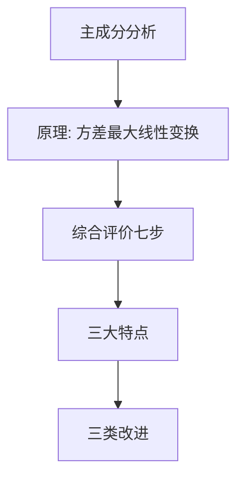
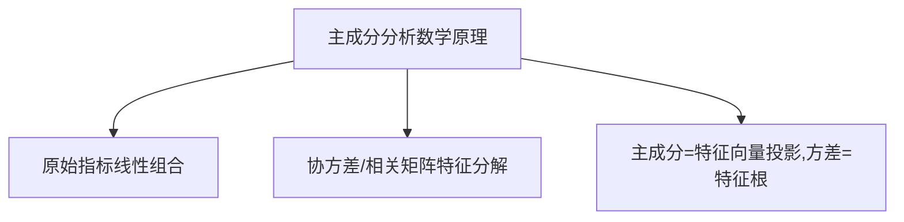
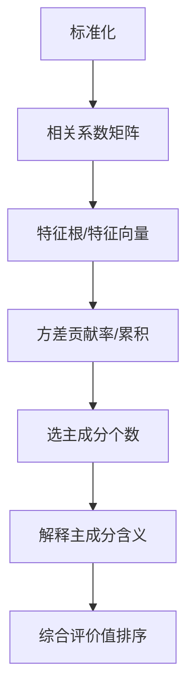
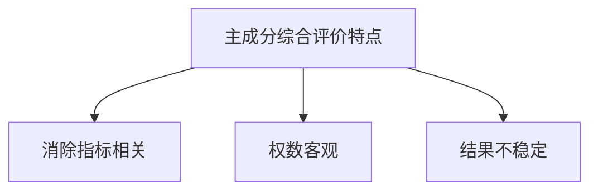
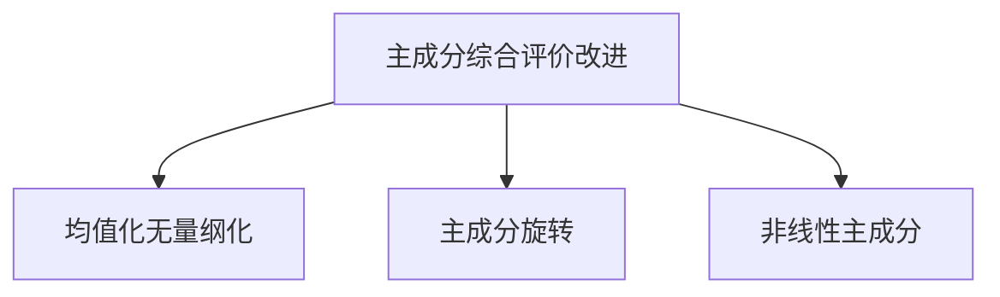

# 第九章 [[02_主成分分析PCA|主成分分析]] · 章节总结

> 原书第 3491–4080 行。核心：用少数几个彼此不相关、方差递减的主成分代替多个相关原始指标，再按方差贡献率加权综合排序。

## 一、知识框架图

**文字缩进树（兜底）**：

- 主成分分析 [[KP04_PCA与FA对比|PCA]]
  - 原理
    - 概念：多指标→少数不相关综合指标
    - 数学：线性组合 + 方差递减 + 总方差守恒 + 特征分解
    - 作用：降维/透视/画图/回归/选变量
  - 综合评价步骤（七步）
    - [[KP11_标准化_ZScore|标准化]] → R → 特征根向量 → 贡献率 → 选 k → 解释 → F
  - 应用实例
    - 例 9.1 地区工业经济效益（7 指标，k=3，累计 97.03%）
    - 例 9.2 地区文化教育水平（6 指标，k=2，累计 88.3%）
  - 特点
    - 消除相关（最大优点）/ 权数客观 / 结果不稳定
  - 改进
    - [[KP09_中心化_均值化|均值化]]（保留变异差异信息）
    - 最大方差旋转（系数两极化）
    - 非线性主成分（对数[[KP09_中心化_均值化|中心化]]，成分数据）

## 二、核心公式清单

| 公式名 | 表达式 | 用途 | 适用条件 |
|---|---|---|---|
| 主成分线性组合 | $y_i=\sum_{j=1}^p a_{ij}x_j$ | 构造新综合指标 | 系数单位化 |
| 方差性质 | $\mathrm{cov}(y_i,y_j)=\lambda_i\ (i=j),\ 0\ (i\neq j)$ | 主成分方差=特征根 | 特征分解后 |
| z-score 标准化 | $z_{ij}=(x_{ij}-\bar{x}_j)/S_j$ | 消除量纲 | 通用 |
| [[01_相关系数|相关系数]] | $r_{ij}=s_{ij}/(\sqrt{s_{ii}}\sqrt{s_{jj}})$ | 指标间线性相关 | 标准化后 |
| 方差贡献率 | $a_k=\lambda_k/\sum_i\lambda_i$ | 单主成分信息份额 | 特征根从大到小 |
| 累积贡献率 | $a(k)=\sum_{j=1}^k\lambda_j/\sum_i\lambda_i$ | 前 k 个主成分信息份额 | 选 k |
| [[KP09_综合评价值F的构造|综合评价值]] | $F=\sum_{i=1}^k\lambda_i y_i/\sum_{i=1}^p\lambda_i$ | 合成总分排序 | 选好 k 后 |
| 均值化 | $z_{ij}=x_{ij}/\bar{x}_j$ | 保留变异差异信息 | 改进无量纲化 |
| 对数中心化 | $y_{ij}=\log x_{ij}-\frac1p\sum_l\log x_{il}$ | 成分数据非线性 PCA | 成分数据 |
| 百分制换算 | $d_i=(F_i-\min F)/(\max F-\min F)\times70+30$ | 转百分制 | 需要时 |

## 三、[[01_方法选择决策树|方法选择决策树]]（文字版）

1. 评价指标是否**彼此相关、个数较多**？
   - 否（指标不相关、个数少）→ 直接用综合评分法/加权合成，不必 PCA。
   - 是 → 进入 2。
2. 目的是**降维排序**还是**探寻潜在结构**？
   - 仅降维排序、要求得分精确 → **主成分分析**。
   - 要解释背后潜在因子、因子含义要清晰 → **因子分析**（见第十章）。
3. 数据是否为**成分数据/结构占比**（如消费结构）？
   - 是 → **非线性主成分**（对数中心化）。
   - 否 → 进入 4。
4. 是否关注**各指标变异程度差异**本身也是重要信息？
   - 是 → **均值化**无量纲化。
   - 否 → 默认 z-score 标准化。
5. 主成分含义是否**可直接解释**？
   - 可 → 直接用。
   - 不可 → **最大方差旋转**后再解释（仍不可则去奇异样本/增删指标）。
6. 样本是否**大样本**（$n>2p$）？
   - 否 → 慎用 PCA，结果不稳定。
   - 是 → 按七步流程执行。

**何时两者都不适用**：指标量纲差异极大且变异差异信息不可忽略、样本极小、指标间存在强非线性关系且无法转化、或评价需要跨年纵向可比（PCA 结果不稳定不可比）——此时应改用固定权数的主观赋权/熵值法等。

## 四、与前后章节的联系

- **承接第三章（无量纲化）**：PCA 第一步即 z-score 标准化；第五节均值化是无量纲化方法的改进。
- **承接第四章（赋权）**：PCA 的权数（方差贡献率）是客观赋权的一种，与主观赋权、变异系数法等并列。
- **承接第六~八章（常规/灰色/模糊综合评价）**：PCA 是多元统计型综合评价，与前述方法互补。
- **开启第十章（因子分析）**：因子分析是 PCA 的推广，主成分从形式上可看成因子分析的特例；第九章第五节的旋转改进直接引用第十章的方差最大旋转技术。

## 五、高频考点 / 自测题

1. **名词解释：主成分分析。** 要点：将多个相关指标经线性变换转为少数方差递减、彼此不相关的综合指标的降维方法。
2. 主成分分析的基本思想是什么？ 用较少变量获得较多信息，解决指标相关导致的信息重叠。
3. 主成分的方差与特征根有何关系？ $\mathrm{var}(y_i)=\lambda_i$，主成分间协方差为 0。
4. 为什么要对原始数据标准化？ 消除量纲数量级影响，使协方差矩阵=相关矩阵。
5. 方差贡献率与累积贡献率的区别？ $a_k$ 是单主成分信息份额；$a(k)$ 是前 k 个合计份额。
6. 确定主成分个数有哪三种原则？ 累计贡献率≥85%、$\lambda>1$（Kaiser）、Bartlett 检验。
7. 为什么综合评价值偏向多主成分加权而不只取 $y_1$？ $y_1$ 仅提取约一半信息，只用它以偏概全、甚至歪曲相对地位。
8. 主成分综合评价的三大特点？ 消除指标相关（最大优点）、权数客观、结果不稳定。
9. 为什么说 PCA 结果不稳定？ 样本集合变→协方差矩阵变→主成分变→位次变；故适宜一次性评价，需 $n>2p$。
10. 均值化相比标准化有何改进？ 保留各指标变异程度差异信息（标准化使方差=1 抹平了这部分）。
11. 主成分旋转的目的？ 使系数两极化，主成分含义清晰；旋转不改变 $F$。
12. 非线性主成分适用于什么数据？ 成分数据（如消费结构占比），用对数中心化变换。
13. 例 9.1 中为什么贵州用改进法位次上升、广东下降？ 第三主成分突出产值利税率 $x_4$，贵州 $x_4$ 高、广东 $x_4$ 低，只用 $y_1$ 无视了 $x_4$。
14. 综合评价值为负意味着经济效益为负吗？ 否，仅表示在样本平均水平以下（标准化零点所致）。

## 六、本章知识点索引

| 编号 | 名称 | 一句话用途 |
|---|---|---|
| KP01 | 主成分分析的概念与基本思想 | 界定 PCA 是什么、为何降维 |
| KP02 | 主成分分析的数学原理 | 特征分解求主成分的数学机制 |
| KP03 | 主成分分析法的作用 | 降维/透视/画图/回归/选变量五作用 |
| KP04 | 主成分分析综合评价的步骤 | 七步操作流程总览 |
| KP05 | 数据标准化与相关系数矩阵 | z-score 标准化与 R 的构造 |
| KP06 | 特征值、方差贡献率与累积贡献率 | 量化每个主成分拿走多少信息 |
| KP07 | 主成分个数的确定原则 | 85%/λ>1/Bartlett 三原则 |
| KP08 | 主成分含义的解释 | 按系数大小符号给主成分命名 |
| KP09 | 综合评价值 F 的构造 | 方差贡献率加权合成总分 |
| KP10 | 主成分综合评价方法的特点 | 消相关/权数客观/结果不稳定 |
| KP11 | 均值化无量纲化改进 | 保留变异差异信息的无量纲化 |
| KP12 | 主成分旋转改进 | 最大方差旋转使系数两极化 |
| KP13 | 非线性主成分分析 | 对数中心化处理成分数据 |

## 本章方法答辩速查

1. **问：主成分分析和因子分析都能做综合评价，答辩时怎么一句话区分？** 答：看方向——PCA 是"合成"：把 $p$ 个相关指标线性变换成 $k$ 个方差递减、互不相关的主成分再加权，主成分得分精确；FA 是"分解"：假定指标背后有 $m$ 个不可测公因子 $X=AF+\varepsilon$，旋转后给因子命名，但因子得分靠 Thomson 估计带误差。要精确排序选 PCA，要解释潜在结构选 FA。
2. **问：这两个无监督降维方法的适用条件是什么？什么时候都不能用？** 答：共同条件——指标间要有较强相关（信息重叠才有降维必要）、样本量要大（一般 $n>2p$）、指标已标准化。指标几乎不相关、样本极小、或评价需要跨年纵向可比时，两个都别用，改用权数固定的主观赋权或熵值法。
3. **问：主成分分析怎么和回归、聚类配合使用？** 答：和回归配合——自变量多重共线性时用主成分做主成分回归，新自变量互不相关、估计稳定（某指标在前 $m$ 个主成分系数都近 0 还可删该变量）；和聚类配合——先用 PCA 把样品投影到前两主成分平面画散点图看聚集，或先聚类分组再对各组做 PCA。注意 PCA 权数随样本变、结果不可跨年比。

---

## 🔗 跨库导航

- 📚 **同方法另一教材视角：** [[../../04_多元统计/05_主成分分析/00_章节总结|多元统计教材·主成分分析（3KP·理论导向）]]
- 🐮 **大牛库配套：** [[../../../经济统计学论文从0基础到精通/08_降维与分类/02_主成分分析PCA|大牛库·PCA手算推导与Python验证]]
- 📖 **原书对应：** [[../../../原文件/多元统计分析/何晓群_多元统计分析_全书|何晓群《多元统计分析》第5章]]
- 🔀 **姊妹方法：** [[../10_因子分析/00_章节总结|第10章 因子分析（PCA合成 vs FA分解）]]
