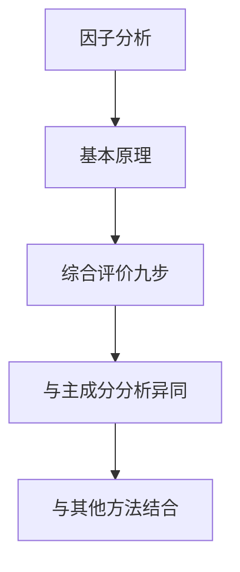
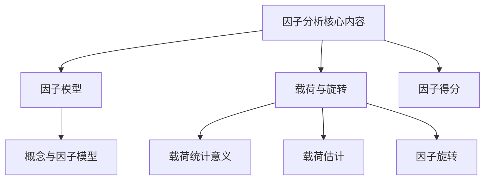
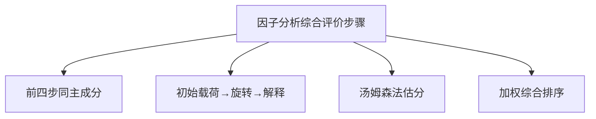
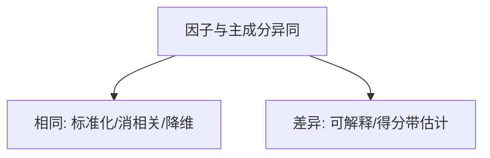
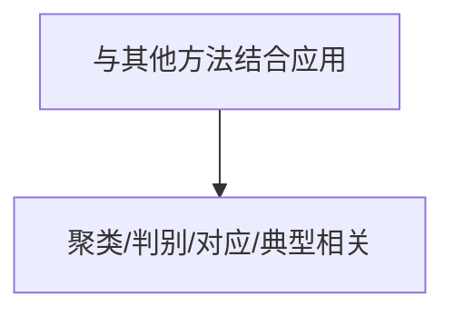

# 第十章 [[KP03_PCA与因子分析对比|因子分析]] · 章节总结

> 原书第 4081–4776 行。核心：用少数不可观测的公共因子的线性组合+特殊因子来解释原始指标间相关关系，旋转后因子含义清晰，可用于综合评价。

## 一、知识框架图

**文字缩进树（兜底）**：

- 因子分析 FA
  - [[KP01_PCA基本原理|基本原理]]
    - 概念：找公共因子解释变量相关
    - 模型：$X=AF+\varepsilon$（公因子+特殊因子）
    - 载荷意义：$a_{ij}$ [[01_相关系数|相关系数]]、$h_i^2$ 共同度、$g_j$ 方差贡献
    - 载荷估计：主成分法 $a_{ij}=u_{ij}\sqrt{\lambda_j}$
    - 旋转：方差最大正交旋转（Kaiser）
    - 得分：Thomson $\hat{F}=A'R^{-1}X$
  - 综合评价九步
    - 前四同 [[KP04_PCA与FA对比|PCA]]；后五特有
    - 例 10.1 宏观经济效益（3 因子，89.62%）
    - 例 10.2 企业技术开发能力（3 因子，88.90%）
    - 市场景气指数构建
  - 与 PCA 异同
    - 相同 4 点；差异 3 点 + 模型假定
  - 与其他方法结合
    - 聚类/判别/对应/典型相关/多维尺度
    - 多元统计三作用：简化结构/预测控制/数值分类

## 二、核心公式清单

| 公式名 | 表达式 | 用途 | 适用条件 |
|---|---|---|---|
| [[KP02_因子模型|因子模型]] | $X=AF+\varepsilon$ | 指标=公因子线性组合+特殊因子 | 指标已[[KP11_标准化_ZScore|标准化]] |
| 因子载荷 | $a_{ij}$ = $x_i$ 与 $F_j$ 相关系数 | 衡量联系紧密程度 | 因子模型下 |
| 共同度 | $h_i^2=\sum_j a_{ij}^2$ | 公因子解释 $x_i$ 方差比例 | $1=h_i^2+\mathrm{var}(\varepsilon_i)$ |
| 公因子方差贡献 | $g_j=\sum_i a_{ij}^2$ | 第 j 公因子对全部指标贡献 | 标准化总方差=p |
| 方差贡献率 | $a_j=g_j/p$ | 公因子重要性 | $a_j$ 越大越重要 |
| 载荷估计（主成分法） | $a_{ij}=u_{ij}\sqrt{\lambda_j}$ | 由特征分解估载荷 | 主成分法 |
| 方差最大旋转 | $v=\frac1p\sum_j\sum_i(b_{ij}^2/h_i^2)^2-\frac1{p^2}\sum_j(\sum_i b_{ij}^2/h_i^2)^2$ | 使载荷两极化 | 正交旋转 |
| Thomson [[KP06_因子得分Thomson法|因子得分]] | $\hat{F}=A'R^{-1}X$ | 由指标估公因子值 | $m<p$，最小二乘 |
| [[KP09_综合评价值F的构造|综合评价值]] | $\hat{F}=\sum_i\omega_i\hat{F}_i,\ \omega_i=\lambda_i/\sum_j\lambda_j$ | 合成总分 | 选好 m 个公因子 |
| 景气指数 | $y=\sum_j(\lambda_j/\sum_i\lambda_i)\hat{f}_j$ | 综合景气指数 | 客观赋权 |
| 逆指标正向化 | $X_i'=1/(1+\lvert X_i\rvert)$ | 逆指标转正 | 逆指标 |
| 适度指标正向化 | $X_i'=1/(1+\lvert\alpha-X_i\rvert)$ | 适度指标转正 | 最适值 $\alpha$ |

## 三、方法选择决策树（文字版）

1. 评价指标是否**彼此相关、个数较多**？
   - 否 → 直接综合评分法。
   - 是 → 进入 2。
2. 研究目的是**只要降维排序**还是**既要排序又要解释潜在结构**？
   - 只要排序、要求精确、计算简便 → **主成分分析 PCA**。
   - 要解释潜在因子、因子含义清晰、深入定性分析 → **因子分析 FA**。
3. 因子含义是否可直接解释？
   - 可 → 直接命名；
   - 不可 → **方差最大正交旋转**后再命名。
4. 是否需要对**新样品归类**？
   - 是 → FA + 判别分析。
5. 是否需要**先把对象/指标分类**？
   - 是 → FA + 聚类分析。
6. 是否需要**两组变量间关系**？
   - 是 → FA + 典型相关分析。
7. **指标不相关、样本极小、需跨年纵向可比** → 两者都不用，改用固定权数主观赋权/熵值法。

## 四、与前后章节的联系

- **承接第九章 PCA**：FA 是 PCA 的推广；主成分法估计载荷时直接借用 PCA 的特征分解；PCA 是 FA 的特例，故 FA 的旋转技术可移植到 PCA。
- **承接第三、四章**：FA 第一步标准化与无量纲化承接第三章；权数（方差贡献率）承接第四章客观赋权。
- **开启第十一章案例**：因子分析与聚类、判别等结合是综合评价方法的扩展。
- **与第九章关系**：两法异同详见第三节，PCA 精确但含义模糊，FA 含义清晰但得分带估计误差。

## 五、高频考点 / 自测题

1. **名词解释：因子分析。** 要点：在主成分基础上构筑意义明确的公因子，以它们为框架分解原变量，用有限不可观测隐变量解释原始变量相关关系的多元统计方法。
2. 因子模型 $X=AF+\varepsilon$ 中各符号含义？ $X$ 可观测指标，$A$ 载荷矩阵，$F$ 公因子（不可测），$\varepsilon$ 特殊因子。
3. 因子载荷 $a_{ij}$ 的统计意义？ $x_i$ 与 $F_j$ 的相关系数。
4. 什么是共同度 $h_i^2$？ $A$ 第 $i$ 行平方和，公因子解释 $x_i$ 方差的比例；$1=h_i^2+\mathrm{var}(\varepsilon_i)$。
5. 公因子方差贡献 $g_j$ 与方差贡献率 $a_j$？ $g_j=\sum_i a_{ij}^2$，$a_j=g_j/p$。
6. 主成分法估计载荷公式？ $a_{ij}=u_{ij}\sqrt{\lambda_j}$。
7. 为什么要因子旋转？ 初始载荷平铺难解释，旋转使两极化、因子含义清晰；最常用 Kaiser 方差最大正交旋转。
8. Thomson 因子得分公式？ $\hat{F}=A'R^{-1}X$；因 $m<p$ 只能估计不能精确求解。
9. FA 与 PCA 的相同点？ 标准化、消相关、权数客观、降维、以 $R$ 为出发点。
10. FA 与 PCA 的差异？ FA 因子更易解释但得分带估计误差、计算量大；PCA 精确但含义模糊；FA 是分解模型 $X=AF+\varepsilon$，PCA 是变换 $Y=U'X$。
11. 为什么说 FA 评价结果没有 PCA 准确？ 因子得分靠回归估计，带误差；PCA 主成分得分精确。
12. 公因子个数如何确定？ 累计贡献率≥85% 或 $\lambda\geqslant1$。
13. FA 可与哪些方法结合？ 聚类、判别、对应、典型相关、多维尺度。
14. 异常值检验的奈尔检验与格布拉斯检验区别？ 方差已知用奈尔（分母 $\sigma$），未知用格布拉斯（分母 $S$）。
15. 市场景气指数如何构造？ 以因子方差贡献率为权对因子得分加权求和。

## 六、本章知识点索引

| 编号 | 名称 | 一句话用途 |
|---|---|---|
| KP01 | 因子分析的概念与基本思想 | 界定 FA 是什么、为何找公因子 |
| KP02 | 因子模型 | $X=AF+\varepsilon$ 的数学结构 |
| KP03 | 因子载荷矩阵 A 的统计意义 | 载荷/共同度/方差贡献三层含义 |
| KP04 | 因子载荷矩阵的估计（主成分法） | $a_{ij}=u_{ij}\sqrt{\lambda_j}$ |
| KP05 | 因子旋转 | 方差最大正交旋转使因子含义清晰 |
| KP06 | 因子得分（Thomson 法） | $\hat{F}=A'R^{-1}X$ 估计因子得分 |
| KP07 | 因子分析综合评价的步骤 | 九步操作流程 |
| KP08 | 公共因子数的确定 | 累计贡献率≥85% 或 $\lambda\geqslant1$ |
| KP09 | 因子分析与主成分分析的异同 | 详细对比表与方法选择决策 |
| KP10 | 因子分析与其他方法结合应用 | 聚类/判别/对应/典型相关/多维尺度 |
| KP11 | 市场景气指数的因子分析构建 | 以因子贡献率加权构造景气指数 |
| KP12 | 数据预处理与异常值检验 | 奈尔/格布拉斯检验、正向化、标准化 |

## 本章方法答辩速查

1. **问：因子分析和主成分分析同属无监督降维，答辩被追问"到底选哪个"怎么答？** 答：四句话——同：都标准化、消相关、权数都是 $\lambda/\sum\lambda$、都从 $R$ 出发；异：FA 是分解模型 $X=AF+\varepsilon$ 需假定，PCA 只是变换 $Y=U'X$；FA 旋转后因子含义清晰但得分带估计误差，PCA 得分精确但主成分常解释不清。只要排序选 PCA，要既排序又归因（说清差距出在哪个因子）选 FA。
2. **问：做因子分析前要过哪几道前提检验？** 答：①KMO 统计量大于 0.6（低于 0.5 不适合）②Bartlett 球形检验显著 $p<0.05$（指标间确有相关）③样本 $n>2p$ 大样本。预处理上先异常值检验（奈尔/格布拉斯）、逆指标正向化、再标准化，然后才进因子模型。
3. **问：因子分析怎么和聚类、判别、回归类方法串起来用？** 答：+聚类：先分组再因子分析，因子命名更扎实；+判别：把因子得分当判别变量，判断新样品归属（距离判别最常用）；做回归时也可先用 FA/PCA 把相关指标压成少数因子再回归，消除多重共线性——降维在前、建模在后，是综合评价的标准流水线。

---

## 🔗 跨库导航

- 📚 **同方法另一教材视角：** [[../../04_多元统计/06_因子分析/00_章节总结|多元统计教材·因子分析（4KP·理论导向）]]
- 🐮 **大牛库配套：** [[../../../经济统计学论文从0基础到精通/08_降维与分类/03_因子分析|大牛库·因子分析与旋转]]
- 📖 **原书对应：** [[../../../原文件/多元统计分析/何晓群_多元统计分析_全书|何晓群《多元统计分析》第6章]]
- 🔀 **姊妹方法：** [[../09_主成分分析/00_章节总结|第9章 主成分分析（PCA合成 vs FA分解）]]
