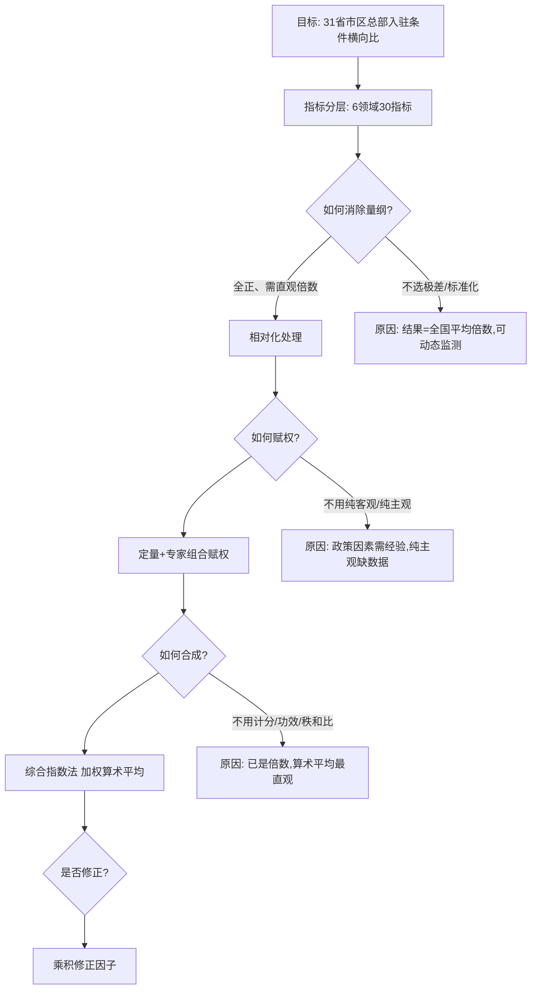

# 案例一 · 企业入驻条件（总部经济）综合评价

<a href="../../../exam.html" target="_blank" style="display:inline-block;padding:6px 16px;background:#2563eb;color:#fff;border-radius:6px;text-decoration:none;font-size:14px;">📝 开始做题</a>

> 来源：原书"案例一：企业入驻条件综合评价方法"，主文件第 4777–5251 行。
> 数据年份：2003 年；资料来源：2004 年《中国统计年鉴》、《重庆大企业集团》及其他相关资料。
> 评价对象：中国大陆 31 个省、自治区、直辖市，并汇总为东部、中部、西部三大区域。

## 一、研究背景与问题

**背景**：总部经济是"通过创造各种有利条件，吸引跨国公司和外埠大型企业总部入驻，企业总部在中心城市集群布局，设立研发中心和销售中心，生产加工基地则安排在营运成本较低的周边地区或外地，从而形成合理的价值链分工"的经济形态。企业集团选择总部入驻地点时，需要考虑的基本因素包括：①基础设施；②市场需求因素；③经济发展水平；④第三产业发达程度；⑤人文社会底蕴；⑥区域拥有的总部机构状况（总部氛围）。

**研究问题**：将上述影响总部入驻的基本因素**定量化描述并进行横向对比分析**，为企业集团在中国内地各省市区设置总部机构提供定量分析与科学决策依据；同时为地方政府发展总部经济、制定战略和支持体系提供依据。

**研究范围**：行政区域上的各省市区 + 按经济区域划分的东、中、西部三大地区。研究方法的设计思路明确为：**在[[04_AHP层次分析法|层次分析法]]（[[KP05_AHP一致性检验|AHP]]）的基础上进行分层评价、综合评价分析**；[[KP02_指标体系|指标体系]]在总部经济理论与社会经济发展理论指导下、结合中国统计实践设置；定量与定性结合、突出定量。

> 📖 **小白导览（数学白痴先读这段）**
>
> 这个案例要回答一个很实际的问题：**一个企业集团想把总部搬到中国哪个省最好？**
>
> 研究者没有拍脑袋说"当然去北京上海"，而是拆成六件事来打分：
> 1. **基础设施**（路好不好、房贵不贵）
> 2. **市场需求**（本地人有没有钱消费）
> 3. **经济发展水平**（这个省整体富不富）
> 4. **第三产业发达程度**（餐饮、金融、物流跟不跟得上）
> 5. **人文社会条件**（人多不多、好不好招员工）
> 6. **总部氛围**（已经有多少大公司把总部放这儿了）
>
> 每一件事下面又有好几个具体指标，一共 30 个。每个指标原书都给了权数（0.92~4.29 不等），越重要的指标权数越大。最后把 30 个指标加权加起来，就是一个省的"总部入驻吸引力总分"。
>
> 你不用手算那 30 个指标——只需要看懂：**权数大的指标话语权大，比如"企业集团 R&D 费用"权数 4.29 是最高的，说明原书认为"这个地方已经有多少研发投入"最能代表总部氛围。**

## 二、指标体系构建

### 2.1 指标遴选七原则

原书提出构筑指标体系应遵循：**目的性、可比性、可操作性、系统性、一贯性、独立性、同向性**七项原则。其中"同向性"原则特别强调：各指标数值大小与优劣评价方向应一致，尽量全部取正指标或全部取逆指标；若正逆并存，必须先转换为同向指标再评价，避免方向不同相互抵消、混淆事物本质特征。

### 2.2 六大领域及其经济含义

| 领域（层） | 英文/符号 | 经济含义（原书界定） |
|---|---|---|
| 基础设施状况 | $Y_1$ | 城市基础设施建设与社会经济环境的硬件条件，影响总部办事的方便性与有效性 |
| 市场需求 | $Y_2$ | 区域内市场需求/经济交易总量的现状与交易密度（含国内、国际、常住与非常住单位间交易） |
| 经济发展水平 | $Y_3$ | 区域经济总体规模、经济密度、经济实力；与交易活动量和份额成正比 |
| 第三产业发达程度 | $Y_4$ | 为总部提供生产生活服务的条件，反映社会经济生活质量与产业结构质量 |
| 人文社会条件 | $Y_5$ | 人文社会底蕴与社会关系条件（暂用间接指标，待社会发展指数成熟后替换） |
| 总部氛围（总部机构状态） | $Y_6$ | 区域已有的总部经济集聚程度；总部多则产生集聚力，便利业务联系与行政效率 |

### 2.3 指标筛选过程（从候选 35 个到实际使用 30 个）

原书给出了明确的"候选→剔除"筛选记录，这是指标可操作性原则的示范：

- **基础设施**：候选 8 个（公路密度、每百人电话门数、全社会固定资产投资、货运密度、客运密度、商品房销售额、商品房价格、国民财产密度）。
  - 剔除"国民财产密度"：很多省市无该统计资料；
  - 剔除"公路密度、每百人电话门数"：与全社会固定资产投资高度正相关；
  - 剔除"商品房价格"：资料不齐且与商品房销售额高度正相关，改用商品房销售额反映。
  - **保留 4 个**：全社会固定资产投资、货运密度、客运密度、商品房销售额。
- **市场需求**：候选 7 个，**保留 3 个**：社会消费品销售总额、海关进出口总额、社会消费品密度。
- **经济发展水平**：候选 5 个全部保留：人均 GDP、财政收入、投资密度、经济密度（GDP 密度）、财政密度。
- **第三产业发达程度**：候选 5 个全部保留：第三产业增加值占 GDP 比重、城镇居民可支配收入、农村居民纯收入、**城市恩格尔系数倒数**、国际旅游人数。
- **人文社会底蕴**：候选含就业人数、人口总数、人口密度、人文指数（专家主观打分 0–10 分）、社会发展指数。后两者因资料不成熟本次未使用，**实际保留 3 个**：就业人数、人口总数、人口密度。
- **总部氛围**：候选含企业集团 5 指标 + 大企业 4 指标 + 政府重视程度，**实际使用 10 个**（企业集团单位个数、资产总额、营业收入、R&D 费用、从业人员数；大企业个数、资产总额、营业收入、R&D 费用；政府重视程度）。

> **口径界定**：企业集团按国家统计局统计口径；"大企业"指企业集团中营业收入和资产均在 5 亿元以上者。

### 2.4 完整指标体系表（30 个指标，含权数与方向）

> 权数 $F_i$ 来自原书表 2，由"国民经济统计资料定量分析 + 专家主观标定"结合得到。**方向列**：原书明确"上述评价指标体系中的各个指标，在评价中的作用都是正指标"。

| 序号 | 领域 | 指标 $X_{ij}$ | 权数 $F_i$ | 方向 |
|---:|---|---|---:|---|
| 1 | 基础设施 | 区域全社会固定资产投资（亿元） | 1.84 | 正 |
| 2 | 基础设施 | 区域货运密度（亿吨公里/平方公里） | 2.15 | 正 |
| 3 | 基础设施 | 区域客运密度（万人次/平方公里） | 2.76 | 正 |
| 4 | 基础设施 | 区域商品房销售额（亿元） | 2.91 | 正 |
| 5 | 市场需求 | 区域社会消费品销售总额（亿元） | 1.69 | 正 |
| 6 | 市场需求 | 区域海关进出口总额（亿美元） | 2.61 | 正 |
| 7 | 市场需求 | 区域社会消费品密度（商品销售亿元/平方公里） | 3.83 | 正 |
| 8 | 经济发展 | 人均 GDP（元） | 3.83 | 正 |
| 9 | 经济发展 | 财政收入（亿元） | 2.45 | 正 |
| 10 | 经济发展 | 投资密度（投资额亿元/平方公里） | 3.68 | 正 |
| 11 | 经济发展 | 经济密度（GDP 亿元/平方公里） | 3.53 | 正 |
| 12 | 经济发展 | 财政密度（亿元/平方公里） | 3.99 | 正 |
| 13 | 第三产业 | 第三产业增加值占 GDP 比重 | 3.07 | 正 |
| 14 | 第三产业 | 城镇居民可支配收入（元） | 3.68 | 正 |
| 15 | 第三产业 | 农村居民纯收入（元） | 2.91 | 正 |
| 16 | 第三产业 | 城市恩格尔系数倒数 | 2.15 | 正（已正向化） |
| 17 | 第三产业 | 国际旅游人数（人） | 3.22 | 正 |
| 18 | 人文社会 | 就业人数（万人） | 1.69 | 正 |
| 19 | 人文社会 | 人口总数（万人） | 0.92 | 正 |
| 20 | 人文社会 | 人口密度（万人/平方公里） | 1.99 | 正 |
| 21 | 总部氛围 | 企业集团单位个数（个） | 1.53 | 正 |
| 22 | 总部氛围 | 企业集团资产总额（亿元） | 3.37 | 正 |
| 23 | 总部氛围 | 企业集团营业收入（亿元） | 3.83 | 正 |
| 24 | 总部氛围 | 企业集团 R&D 费用（亿元） | 4.29 | 正 |
| 25 | 总部氛围 | 企业集团从业人员数（万人） | 3.99 | 正 |
| 26 | 总部氛围 | 大企业个数（个） | 4.14 | 正 |
| 27 | 总部氛围 | 大企业资产总额（亿元） | 4.60 | 正 |
| 28 | 总部氛围 | 大企业营业收入（亿元） | 4.91 | 正 |
| 29 | 总部氛围 | 大企业 R&D 费用（亿元） | 5.06 | 正 |
| 30 | 总部氛围 | 政府重视程度（行政特征系数） | 4.75 | 正（主观标定） |

**领域权数小计（由上表权数加总，中间结果）**：

| 领域 | 指标个数 | 权数小计 | 占总权数比重 |
|---|---:|---:|---:|
| 基础设施 $Y_1$ | 4 | 9.66 | 10.13% |
| 市场需求 $Y_2$ | 3 | 8.13 | 8.52% |
| 经济发展 $Y_3$ | 5 | 17.48 | 18.33% |
| 第三产业 $Y_4$ | 5 | 15.03 | 15.76% |
| 人文社会 $Y_5$ | 3 | 4.60 | 4.82% |
| 总部氛围 $Y_6$ | 10 | 40.47 | 42.44% |
| **合计** | **30** | **95.37** | **100%** |

> 计算说明：9.66+8.13+17.48+15.03+4.60+40.47 = 95.37。可见原书赋权最重的是"总部氛围"（占 42.44%），体现总部经济"集聚效应"的核心地位；人文社会条件因暂用间接指标，权数最低。

**"政府重视程度"行政特征系数（原书表 1）**：

| 行政区域类型 | 系数 |
|---|---:|
| 首都 | 2 |
| 名城上海 | 1.5 |
| 直辖市 | 1.2 |
| 沿海地区 | 1.1 |
| 一般省级地区 | 1.0 |

## 三、方法选择决策链（为什么用这套方法）

### 3.1 决策链路总览

### 3.2 逐环节决策理由（原书依据）

| 环节 | 候选方法 | 本案例选择 | 选择理由 / 排除理由 |
|---|---|---|---|
| 框架 | 单层评价 vs 分层评价 | **AHP 式分层评价**（设计思路明示） | 六大领域是天然层次；先算领域得分 $Y_j$ 再算总分，既可看总排名又可看"短板领域" |
| 无量纲化 | 极差变换、Z-score [[KP11_标准化_ZScore|标准化]]、[[KP12_比重法|比重法]]、相对化处理 | **相对化处理（比值法）**：$x_i/x_i^0$ | ①结果为"相当于全国平均水平的倍数"，经济含义直观；②全部正指标可直接相除；③若长期动态监测可用前三年均值作标准，保证可比 |
| [[KP05_评价标准值xi0的选择|评价标准值]] $x_i^0$ | 时间标准、空间标准、经验/理论标准、计划标准 | **空间标准**：2003 年全国同指标平均数 | 原书论证其"可行性、科学性、统一性"；横向比较各省，全国均值是最合理的参照系 |
| 赋权 | 主观（专家/AHP）、客观（变异系数/熵值/坎蒂雷） | **定量 + 定性结合（[[KP13_组合赋权|组合赋权]]）** | 纯[[KP11_主观赋权vs客观赋权|客观赋权]]会把"政策重要但差异小"的指标（如政府重视程度）权重压低；纯主观则脱离数据 |
| 合成方法 | 综合计分法、综合指数法、标准化处理法、功效系数法 | **综合指数法（直接综合法）** | 原书原话："根据本研究对象的实际情况，我们认为使用综合指数法为好" |
| 平均方式 | 算术平均 vs 几何平均 | **算术平均** | 指标经相对化后为正值倍数；几何平均在含零值/缺失时失效，且规模类指标宜算术叠加 |
| 修正 | 不修正 vs 加法/乘积修正 | **乘积修正因子 $K_i$** | 对特殊政策情形给一票否决或加分，避免数学结果覆盖政策现实 |

## 四、关键计算过程（保留中间结果）

### 4.1 相对化处理

对每一指标 $i$、每一参评区域，先除以该指标 2003 年全国平均数 $x_i^0$：

$$\text{相对值} = \frac{X_i}{X_i^0}$$

- $X_i$：某省市区指标 $i$ 的实际值；
- $X_i^0$：2003 年全国同指标平均值（空间评价标准）；
- 结果含义：该指标相当于全国平均水平的倍数（>1 即高于全国平均）。

### 4.2 分层评价值 $Y_j$（各领域得分）

原书给出六个领域公式（照录）：

$$Y_1=\frac{\sum_{i=1}^{4}\frac{X_i}{X_i^0}f_i}{\sum_{i=1}^{4}f_i}\qquad\text{（基础设施）}$$

$$Y_2=\frac{\sum_{i=5}^{7}\frac{X_i}{X_i^0}f_i}{\sum_{i=5}^{7}f_i}\qquad\text{（市场需求）}$$

$$Y_3=\frac{\sum_{i=8}^{13}\frac{X_i}{X_i^0}f_i}{\sum_{i=8}^{13}f_i}\qquad\text{（经济发展水平）}$$

$$Y_4=\frac{\sum_{i=14}^{17}\frac{X_i}{X_i^0}f_i}{\sum_{i=14}^{17}f_i}\qquad\text{（第三产业发展程度）}$$

$$Y_5=\frac{\sum_{i=18}^{20}\frac{X_i}{X_i^0}f_i}{\sum_{i=18}^{20}f_i}\qquad\text{（人文社会底蕴）}$$

$$Y_6=\frac{\sum_{i=21}^{30}\frac{X_i}{X_i^0}f_i}{\sum_{i=21}^{30}f_i}\qquad\text{（总部氛围）}$$

> ⚠️ **校注 1（下标错位）**：按 2.3 节指标序号，经济发展水平实为第 8–12 号指标（5 个），第三产业实为第 13–17 号指标（5 个）；而原书公式 $Y_3$ 取 8–13、$Y_4$ 取 14–17，两段区间合计 8–17 共 10 项，与两个领域共 10 个指标吻合，属公式区间端点的笔误，此处照录原书公式，实际计算应按指标归属分别加权。

### 4.3 整体评价值 $I$ 与修正 $D$

原书写法（照录）：

$$I=\frac{\sum_{i=1}^{30}X_i f_i}{\sum_{i=1}^{30}f_i}=\sum_{j=1}^{6}Y_j,\qquad i=1,\cdots,30;\;j=1,\cdots,6$$

$$D=I\times K_i\quad(i=1,2,3)$$

> ⚠️ **校注 2（公式与结果不一致，以结果为准）**：左端"30 指标统一加权平均"与右端"六领域得分求和"在数学上并不相等。用原书表 4 数据验证：东部地区 25.74+13.41+52.78+13.24+6.01+95.06 = **206.24**，恰等于表 4 东部综合得分；全国 11.99+5.70+24.27+11.22+4.51+43.88 = **101.57≈101.58**；中部 6.25+2.51+11.88+11.24+4.87+23.49 = **60.24≈60.22**；西部 4.00+1.18+8.16+9.19+2.67+13.08 = **38.28≈38.27**。故实际计算口径为 **$I=\sum_{j=1}^{6}Y_j$（六大领域得分直接相加）**，表中综合得分的数量级（全国 100 出头、北京近 600）也与此一致。

**修正因子 $K_i$（原书表 3）**：

| 修正因子 | 数值 $K_i$ | 意义 |
|---|---|---|
| 政策控制发展 | 0 | 一票否决 |
| 政策扶持 | $0<K<1$ | 根据情况设置，可高可低 |
| 政策规定发展（有发展规划和扶持政策） | $K\ge1$ | 指定建设地区 |

注：修正因子也可大于 1，但一般不大于 1。

## 五、结果与结论

### 5.1 三大区域综合评价（原书表 4）

| 地区 | 基础设施 $Y_1$ | 市场需求 $Y_2$ | 经济发展 $Y_3$ | 第三产业 $Y_4$ | 人文社会 $Y_5$ | 总部氛围 $Y_6$ | 综合得分 $I$ |
|---|---:|---:|---:|---:|---:|---:|---:|
| 东部 | 25.74 | 13.41 | 52.78 | 13.24 | 6.01 | 95.06 | **206.24** |
| 全国 | 11.99 | 5.70 | 24.27 | 11.22 | 4.51 | 43.88 | **101.58** |
| 中部 | 6.25 | 2.51 | 11.88 | 11.24 | 4.87 | 23.49 | **60.22** |
| 西部 | 4.00 | 1.18 | 8.16 | 9.19 | 2.67 | 13.08 | **38.27** |

> 注：原书表 4 中"第三产业"与"人文社会"两行的地区列顺序与其他列不同（中部第三产业 11.24 高于全国 11.22、中部人文社会 4.87 高于全国 4.51），上表已按数值归位。

**三大区域结论**：

1. 东部综合得分 206.24，是西部（38.27）的 **5.39 倍**；中部（60.22）与西部均未达全国平均（101.58）；东中西呈明显几何差异。
2. 东部六个领域全部领先；中部仅第三产业（11.24）、人文社会（4.87）2 个因素略高于全国，其余 4 个低于全国；西部六个因素全部低于全国平均。

### 5.2 各省市区综合排名（原书表 5）

| 名次 | 地区 | 综合得分 | 名次 | 地区 | 综合得分 |
|---:|---|---:|---:|---|---:|
| 1 | 北京 | 592.42 | 17 | 重庆 | 54.32 |
| 2 | 上海 | 506.67 | 18 | 吉林 | 51.33 |
| 3 | 广东 | 234.27 | 19 | 山西 | 51.21 |
| 4 | 江苏 | 178.34 | 20 | 陕西 | 46.02 |
| 5 | 山东 | 177.24 | 21 | 江西 | 44.41 |
| 6 | 浙江 | 168.02 | 22 | 内蒙古 | 42.86 |
| 7 | 天津 | 138.68 | 23 | 云南 | 41.46 |
| 8 | 河南 | 83.77 | 24 | 广西 | 40.45 |
| 9 | 辽宁 | 81.31 | 25 | 新疆 | 40.35 |
| 10 | 福建 | 81.16 | 26 | 海南 | 35.86 |
| 11 | 河北 | 74.64 | 27 | 贵州 | 31.85 |
| 12 | 湖北 | 73.33 | 28 | 甘肃 | 28.44 |
| 13 | 四川 | 69.98 | 29 | 宁夏 | 26.17 |
| 14 | 安徽 | 62.59 | 30 | 青海 | 21.34 |
| 15 | 黑龙江 | 60.28 | 31 | 西藏 | 16.02 |
| 16 | 湖南 | 54.86 | — | 东部 / 中部 / 西部 | 206.24 / 60.22 / 38.27 |
| — | 全国平均 101.58；平均数 103.31；标准差 124.60；离散系数 120.60% | | | | |

> ⚠️ **校注 3**：原书表 5 同时给出"全国平均 101.58"（=三大区域加权口径）与"平均数 103.31"（=31 省简单算术均值）；离散系数 120.6012% = 124.60 ÷ 103.31 ≈ 1.206。

**全国格局结论**：

1. 最优前 3 名（北京、上海、广东）全部在东部，构成"总部入驻最优三角"，三者得分比全国平均高出 2 倍以上（北京约为全国 5.8 倍）。
2. 总体呈"东部 > 中部 > 西部"三个台阶；**西部最高水平仅是东部最低水平、相当于中部平均水平**。
3. 离散程度：东部离散系数 87.47%（高水平下不均衡）；中部 21.47%（低水平下均衡）；西部 38.83%（低水平下较均衡）。

### 5.3 分领域排名与离散程度（原书 3.2 节）

| 领域 | 前 3 名地区 | 高于全国平均地区数 | 低于西部平均地区数 | 离散系数 |
|---|---|---:|---:|---:|
| 基础设施 | 上海、天津、北京 | 8 | 7 | 136.52% |
| 市场需求 | 广东、上海、江苏 | 10 | 7 | 149.63% |
| 经济发展水平 | 上海、北京、天津 | 8 | 5 | 173.35% |
| 第三产业发达程度 | 浙江、广东、北京 | 14 | 7 | 22.71% |
| 人文社会条件 | 上海、河南、山东 | 14 | 8 | 68.73% |
| 总部氛围 | 北京、上海、广东 | 7 | 7 | 172.19% |

**总部氛围专项分布（原书表 6，节选关键名次）**：北京 452.52 遥遥领先（约为第 2 名上海 108.99 的 4.15 倍），上海 108.99、广东 106.56、山东 99.81、东部平均 95.06、江苏 76.89、浙江 73.39、全国平均 43.88、河南 32.84、湖北 32.79、天津 32.06…… 末位西藏 4.93；31 省平均数 44.74、标准差 77.04、离散系数 172.19%。北京在总部氛围上的极端领先是其综合得分（592.42）远超上海（506.67）的主因。

### 5.4 东、中、西部分区结论

| 区域 | 包含省市区数 | 前 3 名 | 后 3 名 | 区域均值 | 离散系数 | 发展状态 |
|---|---:|---|---|---:|---:|---|
| 东部 | 11 | 北京、上海、广东 | 福建、河北、海南 | 206.24 | 87.47% | 高水平、不均衡（高于全国平均 2 倍多；7 省高于全国平均，占 63.64%） |
| 中部 | 8 | 河南、湖北、安徽 | 吉林、山西、江西 | 60.22 | 21.47% | 低水平、均衡（全部未达全国平均） |
| 西部 | 12 | 四川、重庆、陕西 | 宁夏、青海、西藏 | 38.27 | 38.83% | 低水平、均衡（全部未达全国平均） |

**政策含义**：各省市区制定总部经济战略时须正视本区域差距；企业选总部基地时，不能只看综合得分，还应结合各领域得分与具体指标，识别"短板领域"。

## 六、可复用的分析模板（抽象为步骤清单）

适用于"多区域、多指标、需要横向比较并带政策修正"的综合评价问题（如招商引资环境、园区竞争力、投资目的地选择）：

1. **界定评价目标与参照系**：明确为空间横向比较 → 选全国（或同类区域）同指标均值 $x_i^0$ 为标准；长期监测则改前三年移动平均。
2. **搭建层次框架**：按理论拆成若干领域（本案例 6 个），每个领域选 3–10 个可获数的代表指标。
3. **指标筛选留痕**：对候选指标逐一说明剔除理由（资料缺、高度相关、口径不齐），保证独立性与可操作性。
4. **同向化**：全部转成正指标（本案例把恩格尔系数取倒数）；确有逆/适度指标时先正向化。
5. **相对化无量纲化**：$X_i/X_i^0$，得到"相当于平均水平的倍数"。
6. **组合赋权**：统计数据的客观分析 + 专家标定结合，形成 $f_i$；分领域算权数小计，检查权重结构是否符合理论预期（本案例总部氛围占 42%）。
7. **分层合成**：领域内加权算术平均得 $Y_j$；总分用 $\sum Y_j$（便于短板分析）或统一加权平均。
8. **政策修正**：设乘积修正因子 $K$（0=否决、0–1=扶持折减、>1=规划区加分），$D=I\times K$。
9. **多维诊断**：不仅报总分，还要报分领域得分、区域分组均值、离散系数（识别"高水平不均衡"还是"低水平均衡"）。
10. **结果表达**：总分排名表 + 分领域前 3/超均值数 + 区域梯队结论，落到决策建议。

## 七、与本书方法/章节的对应表

| 本案例环节 | 使用的方法/概念 | 对应本书章节/知识点 |
|---|---|---|
| 七大遴选原则 | 指标选择目的性、可比性、系统性、独立性、同向性 | [指标体系选择思路与原则](../02_指标体系建立/知识点/KP05_评价指标体系选择思路与原则.md) |
| 正/逆指标识别（恩格尔系数取倒数） | 正逆中性指标、同向化 | [评价指标与正逆中性指标](../02_指标体系建立/知识点/KP03_评价指标与正逆中性指标.md)、[逆向指标正向化](../03_指标无量纲化/知识点/KP06_逆向指标正向化.md) |
| $X_i/X_i^0$ 相对化处理 | 比重法/相对化无量纲化 | [比重法](../03_指标无量纲化/知识点/KP12_比重法.md) |
| 以全国均值为标准 $x_i^0$ | 评价标准值的选择、空间评价标准 | [评价标准值 xi0 的选择](../06_常规综合评价方法/知识点/KP05_评价标准值xi0的选择.md)、[评价标准](../00_绪论/知识点/KP02_评价标准.md) |
| 分层框架 | AHP 层次结构思想 | [AHP 概述与九标度](../04_赋权方法/知识点/KP03_AHP概述与九标度.md) |
| 定量+定性组合赋权 | 专家评判、组合赋权 | [专家评判法](../04_赋权方法/知识点/KP02_专家评判法.md)、[组合赋权](../04_赋权方法/知识点/KP13_组合赋权.md) |
| 综合指数法（直接综合法） | 综合指数评价法、线性（算术）综合 | [综合指数评价法](../06_常规综合评价方法/知识点/KP04_综合指数评价法.md)、[线性综合法](../05_数值综合方法/知识点/KP01_线性综合法.md) |
| 乘积修正因子 $D=I\times K$ | 乘积修正因子 | [乘积修正因子](../01_综合评价的一般问题/知识点/KP09_乘积修正因子.md) |
| 离散系数刻画区域差异 | 综合评价结果的对比分析 | [综合评价分析五项内容](../01_综合评价的一般问题/知识点/KP13_综合评价分析五项内容.md) |

**关联文件**：[案例二 · 城市竞争力与房地产价格](./案例二_城市竞争力与房地产价格.md)（同属本书案例篇，展示主成分回归 + 双方法评价的另一套方法组合）

---

## 🔗 跨库链接

**📖 原书对应章节：** [[../../../原文件/综合评价/陈正伟_综合评价技术及应用_全书|《综合评价技术及应用》案例一·企业入驻条件原文]]

**🐮 大牛库实战对照：** [[../../../经济统计学论文从0基础到精通/07_综合评价方法/README|07 综合评价方法模块（熵值法/AHP/TOPSIS模板）]]
