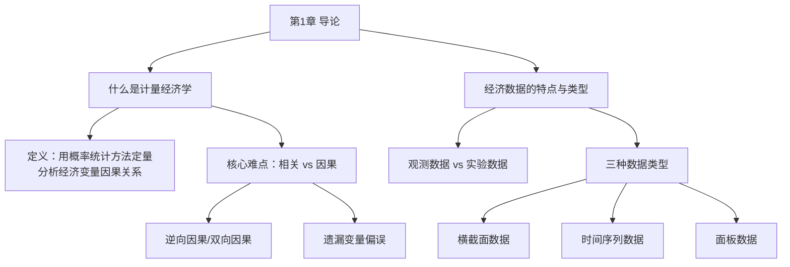

# 第1章 导论 · 章节总结

## 一、章节框架图

## 二、文字知识树

- **[[01_什么是计量经济学|什么是计量经济学]]**
  - 定义：运用概率统计方法对经济变量之间的（因果）关系进行定量分析
  - 相关关系 ≠ 因果关系
    - 相关够用：仅做预测（如谷歌预测流感）
    - 因果困难：需要经济理论支撑作用机制
  - 因果推断的两大障碍
    - 逆向因果/双向因果（FDI↔经济增长、收入↔消费）
    - 遗漏变量 Z 同时影响 X 和 Y（病床与死亡的外星人例子）
  - 随机扰动项 ε：所有无法把握因素的"垃圾桶"
    - 遗漏变量、测量误差、函数形式误设、人类行为随机性
    - "The devil is in the error term"
- **经济数据的特点与类型**
  - 特点：观测数据（非实验数据）；所有经济变量都是随机变量
  - 横截面数据：多个体、同时点
  - 时间序列数据：一个体、多时点
  - 面板数据：多个体、多时点

## 三、核心概念清单

| 概念 | 定义 | 关键说明 |
|------|------|----------|
| 计量经济学 | 用概率统计方法定量分析经济变量（因果）关系 | 因果加括号：数据不足时常无法确定因果 |
| 相关关系 | X 与 Y 一起变动 | 够做预测，不够做政策推断 |
| 因果关系 | X 导致 Y | 需理论机制支撑；要排除逆向因果和遗漏变量 |
| 被解释变量 | 被影响的变量 Y（dependent variable） | 如 lnw（工资对数） |
| 解释变量 | 影响 Y 的变量 X（regressor） | 如 s（教育年限） |
| 随机扰动项 | ε，所有遗漏因素的总和 | 像"垃圾桶"，但又希望它性质好 |
| 遗漏变量 | 未观测但同时影响 X 和 Y 的 Z | 导致 [[KP02_OLS正交性|OLS]] 估计偏误 |

## 四、章节联系

- **向后**：本章是全书的总纲，提出"因果识别"这一计量经济学核心命题。
- **向前**：
  - 第2章教工具（Stata）
  - 第3章数学准备（概率、分布、统计推断）
  - 第4章正式进入一元线性回归——本章提到的扰动项 ε、遗漏变量问题将在第4-5章正式建模处理。

## 五、自测题

**1. 什么是计量经济学？它与经济预测有何区别？**

答：计量经济学是运用概率统计方法对经济变量之间的（因果）关系进行定量分析的科学。区别在于：如果只对预测感兴趣，相关关系就足够；但如果要推断因果关系（X 是否导致 Y），则必须建立在经济理论基础上，并排除逆向因果和遗漏变量等干扰。

**2. 为什么说"医院病床是死亡的原因"这个推断是错误的？遗漏变量是什么？**

答：因为病床（X）和死亡（Y）之间存在遗漏变量 Z——疾病严重程度。重病者才会躺病床，也更可能死亡。遗漏变量 Z 同时影响 X 和 Y，导致伪相关。政策建议"远离病床"显然荒谬。

**3. 横截面数据、时间序列数据、面板数据各举一个例子。**

答：
- 横截面数据：2013年中国各省的 GDP（多个体、同时点）
- 时间序列数据：1994—2013年山东省每年的 GDP（一个体、多时点）
- 面板数据：1994—2013年中国各省每年的 GDP（多个体、多时点）

## 本章方法答辩速查

1. **问：整门计量经济学的主线是什么？后面各章是怎么串起来的？** 答：主线就是"因果识别"——从本章提出的两大障碍（逆向因果、遗漏变量）出发：第 4~5 章建立 OLS 并讲清它什么时候无偏一致（$E(\varepsilon|X)=0$）；第 6~8 章处理扰动项不满足经典假设的三类问题（[[02_异方差|异方差]]、[[03_自相关|自相关]]、模型设定错误）；第 9 章[[03_工具变量IV|工具变量]]解决"不可观测的遗漏变量/双向因果"；第 11 章面板[[06_固定效应FE|固定效应]]消掉不随时间变化的遗漏变量；第 12~13 章时间序列解决非平稳带来的伪回归。答辩时能用这条主线把章节顺序讲出来，说明真正理解了课程结构。
2. **问：为什么做政策研究（如"提高最低工资会不会减少就业"）不能只靠相关关系？** 答：因为政策问题问的是"如果改变 X，Y 会变多少"，这是反事实问题，只有因果效应能回答。相关关系可能由遗漏变量驱动——病床多和死亡多相关，但政策不该是"关掉医院"。本章的价值就是提醒：拿到回归结果第一步不是看星号，而是问"这里的 X 和 Y 之间有没有遗漏变量或双向因果"。

---

## 🔗 相关知识点

**同章入门导航：** [[01_什么是计量经济学|什么是计量经济学]]｜[[02_经济数据类型|经济数据类型]]

**跨章进阶路线：** [[../01_Stata入门/01_Stata基本操作|Stata基本操作]]｜[[../02_数学回顾/01_概率与分布|概率与分布]]｜[[../09_工具变量法/知识点/KP01_内生性与工具变量|内生性与工具变量]]｜[[../11_面板数据/知识点/KP01_固定效应模型|面板固定效应]]

**🐮 大牛库深入：** [[../../../经济统计学论文从0基础到精通/00_学前准备/README|学前准备]]｜[[../../../经济统计学论文从0基础到精通/05_内生性与面板/01_什么是内生性|什么是内生性]]

**📖 原书原文：** [[../../../原文件/计量经济学/陈强_计量经济学及Stata应用_全书|陈强《计量经济学及Stata应用》第1章]]
