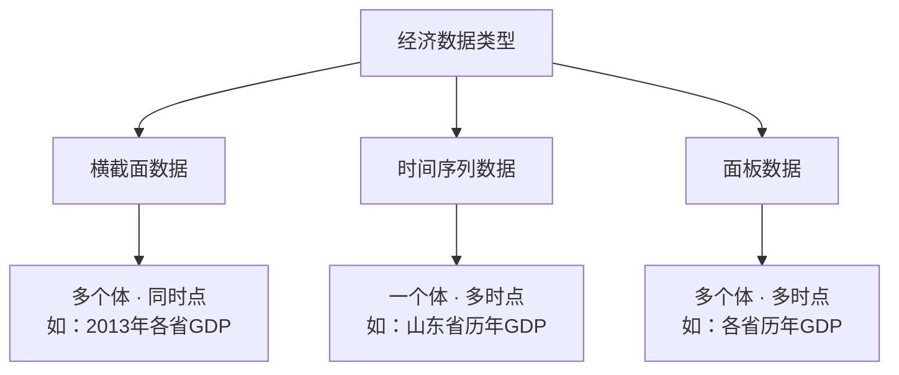

# 1.2 经济数据的特点与类型

## 概述

经济学无法像自然科学那样做控制实验，所以经济数据是"观测数据"而非"实验数据"。按照数据的维度，分为三种类型：横截面、时间序列、面板。

## 要点梳理

### 1. 经济数据的特点

- **观测数据（observational data）**：非实验产生，自然发生（如统计局数据）
- **所有经济变量都是随机变量**：因为个人行为有随机性
- ⚠️ 本书假设所有变量都是随机的（即使常数也视为退化随机变量），不采用"解释变量固定"的简化假设

### 2. 三种数据类型对比

| 类型 | 英文 | 定义 | 例子 | 维度 |
|------|------|------|------|------|
| 横截面数据 | Cross-sectional data | 多个经济个体在**同一时点**的取值 | 2013年中国各省GDP | 个体×1（时点） |
| 时间序列数据 | Time series data | **一个**经济个体在**不同时点**的取值 | 1994—2013年山东省每年GDP | 1（个体）×时点 |
| 面板数据 | Panel data | **多个体**在**不同时点**的取值 | 1994—2013年中国各省每年GDP | 个体×时点 |

### 3. 数据类型的直观理解

## 小结

1. 经济数据是观测数据，不是实验数据，这是计量因果识别困难的根源之一。
2. 横截面数据看"差异"（个体之间的不同），时间序列看"变化"（时间上的趋势），面板数据两者兼顾。
3. 本书三种数据类型都会涉及，Stata 是主要分析工具。

## 答辩常问（带标准答案）

1. **问：横截面数据、时间序列数据、面板数据分别是什么？各举一个例子。** 答：横截面是**多个个体、同一时点**——如 2013 年全国各省 GDP；时间序列是**一个个体、多个时点**——如山东省 1994—2013 年历年 GDP；面板是**多个个体、多个时点**——如 1994—2013 年全国各省历年 GDP。面板相当于横截面和时间序列的"杂交"，既能看个体差异、又能看随时间的变化。
2. **问：为什么说经济数据是"观测数据"而不是"实验数据"？这对因果推断意味着什么？** 答：自然科学可以做控制实验（随机分组、控制条件），但经济学无法让国家随机"吃"政策——我们只能被动观测经济系统自然运行产生的数据。观测数据的后果是：解释变量的取值是被观测对象自己"选择"的，往往与扰动项相关（能力高的人自己选择多上学），所以简单回归混杂了选择效应，因果识别才需要[[03_工具变量IV|工具变量]]、[[06_固定效应FE|固定效应]]等专门设计。
3. **问：三种数据类型各自对应本章后面哪类计量方法？** 答：横截面数据对应普通 [[KP02_OLS正交性|OLS]]、[[02_异方差|异方差]]、工具变量（第 4~9 章）；时间序列对应[[03_自相关|自相关]]、[[02_平稳性|平稳性]]、单位根与协整（第 8、12、13 章）；面板数据对应固定效应/[[07_随机效应RE与Hausman检验|随机效应]]（第 11 章）。答辩时被问"你的数据是什么类型、为什么用这个方法"，答案就挂在这个对应关系上。

---

## 🔗 相关知识点

**同章关联：** [[00_章节总结|章节总结]]｜[[01_什么是计量经济学|什么是计量经济学]]

**跨章方法对应：** [[../03_一元线性回归/知识点/KP01_一元回归模型|一元回归（横截面数据）]]｜[[../09_工具变量法/知识点/KP01_内生性与工具变量|工具变量（解决观测数据内生性）]]｜[[../11_面板数据/知识点/KP01_固定效应模型|面板固定效应（面板数据核心方法）]]

**🐮 大牛库深入：** [[../../../经济统计学论文从0基础到精通/05_内生性与面板/05_面板数据是什么|面板数据是什么]]｜[[../../../经济统计学论文从0基础到精通/11_方法选择决策/01_方法选择决策树|方法选择决策树]]

**📖 原书原文：** [[../../../原文件/计量经济学/陈强_计量经济学及Stata应用_全书|陈强《计量经济学及Stata应用》第1章]]
