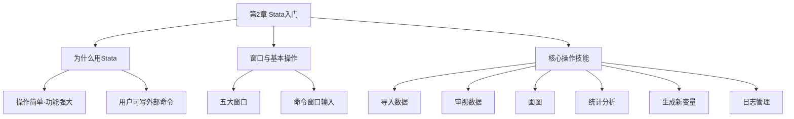

# 第2章 Stata入门 · 章节总结

## 一、章节框架图

## 二、文字知识树

- **Stata 概述**
  - 欧美最流行的计量软件，操作简单功能强大
  - 支持用户自编外部命令（SSC 平台下载）
  - 本书使用 Stata 13（2013年发布）
- **五大窗口**
  - Review（历史命令窗口，左上）
  - Results（结果窗口，中间大）
  - Command（命令窗口，中下）
  - Variables（变量窗口，右上）
  - Properties（属性窗口，右下，不常用）
- **核心操作**
  - 导入：Excel 复制粘贴 / File → Import / `use file.dta, clear`
  - 审视：`describe` / `list` / `summarize` / `tabulate`
  - 画图：`histogram`（直方图）/ `scatter`（散点图）
  - 统计：`summarize` / `pwcorr`（[[01_相关系数|相关系数]]）
  - 生成变量：`generate` / `replace` / `rename`
  - 日志：`log using` / `log off` / `log on` / `log close`
- **命令管理**
  - PgUp/PgDn 调历史命令
  - `help command` 查帮助
  - `ssc install newcommand` 装外部命令

## 三、核心命令速查

| 操作目的 | 命令 | 说明 |
|----------|------|------|
| 打开数据 | `use file.dta, clear` | clear 表示替换内存数据 |
| 清空内存 | `clear` | 关闭当前数据集 |
| 看变量列表 | `describe`（简写 `d`） | 显示变量名、标签、类型 |
| 列数据 | `list s lnw in 1/5` | 第1到5个观测值 |
| 条件筛选 | `list s lnw if s >= 16` | 逻辑条件筛选 |
| 删除观测值 | `drop if s >= 16` | 不可撤销，慎用 |
| 保留观测值 | `keep if s >= 16` | 只保留满足条件的 |
| 升序排序 | `sort s` | 按 s 从小到大 |
| 降序排序 | `gsort -s` | 按 s 从大到小 |
| 直方图 | `histogram s, width(1) frequency` | 看分布 |
| 散点图 | `scatter lnw s` | 看两变量关系 |
| 描述统计 | `summarize s`（简写 `sum s`） | 均值、标准差、最值 |
| 详细统计 | `sum lnw, detail` | 偏度、峰度、分位数 |
| 频数表 | `tabulate s`（简写 `tab s`） | 频数、百分比、累积 |
| 相关系数 | `pwcorr lnw s expr, sig star(.05)` | 带 p 值和星号 |
| 生成新变量 | `gen lns = log(s)` | 取对数 |
| [[KP03_虚拟变量|虚拟变量]] | `gen college = (s >= 16)` | 条件为真取1，假取0 |
| 修改变量 | `replace college = (s >= 15)` | 重新赋值 |
| 变量重命名 | `rename colleg college` | 改变量名 |
| 计算器 | `display log(2)` | Stata 当计算器用 |
| 开始日志 | `log using today` | 记录输出到 smcl 文件 |
| 暂停日志 | `log off` | 暂时不记录 |
| 恢复日志 | `log on` | 继续记录 |
| 关闭日志 | `log close` | 结束日志 |
| 帮助 | `help histogram` | 查命令用法 |
| 装外部命令 | `ssc install newcommand` | 从 SSC 下载 |

## 四、章节联系

- **向后**：第1章提出了计量经济学要解决什么问题。
- **向前**：本章是工具课——第3章数学回顾、第4章[[KP04_一元回归Stata解读|一元回归]]都要用 Stata 命令来操作和验证。

## 五、自测题

**1. 在 Stata 中，`=` 和 `==` 有什么区别？**

答：一个等号 `=` 表示赋值（如 `gen y = x*2`）；两个等号 `==` 表示"等于"（如 `list if s == 16`）。

**2. 为什么 `drop if` 命令要特别小心？**

答：因为 Stata 没有撤销（undo）功能，删除后无法恢复。建议先备份原始数据。

**3. `pwcorr lnw s expr, sig star(.05)` 输出中，lnw 和 s 的相关系数为 0.5368，p 值为 0.0022，这说明什么？**

答：相关系数 0.5368 表示工资对数与教育年限中等程度正相关；p 值 0.0022 < 0.05，说明在 5% 显著性水平下显著相关（实际上在 1% 水平也显著）。

## 本章方法答辩速查

1. **问：实证论文为什么强调"用命令、不用菜单点选"？** 答：三个理由：一是**可复现**——命令写在 do 文件和日志里，别人照着敲就能得到完全一样的结果，菜单操作无法回溯；二是**可修改**——换一个设定（如加[[KP03_稳健标准误|稳健标准误]]）只需改命令重跑，不用从头点一遍；三是写论文附录时要公开 do 文件证明结果真实。答辩被问"你的实证过程怎么让人相信"，答案就是"所有操作都在 do 文件和 log 日志里，可复现"。
2. **问：拿到一份陌生数据，正确的探索顺序是什么？** 答：按本章的工作流走：`use` 载入 → `describe` 看变量和缺失 → `summarize` 看均值标准差最值 → `histogram`/`scatter` 画图看分布和异常值 → `tab`/`pwcorr` 看分类和相关 → 最后才跑回归。先描述统计再回归，一是避免"垃圾进垃圾出"，二是画图常常能发现异常值、双峰分布这类回归解释不了的问题。

---

## 🔗 相关知识点

**同章关联：** [[01_Stata基本操作|Stata基本操作]]

**跨章入门导航：** [[../00_导论/01_什么是计量经济学|什么是计量经济学]]｜[[../02_数学回顾/01_概率与分布|概率与分布基础]]｜[[../03_一元线性回归/知识点/KP01_一元回归模型|一元回归（Stata实操）]]

**🐮 大牛库深入：** [[../../../经济统计学论文从0基础到精通/11_方法选择决策/04_Stata_R实操速查|Stata/R实操速查]]｜[[../../../经济统计学论文从0基础到精通/11_方法选择决策/05_SPSS操作指引|SPSS操作指引]]

**📖 原书原文：** [[../../../原文件/计量经济学/陈强_计量经济学及Stata应用_全书|陈强《计量经济学及Stata应用》第2章]]
