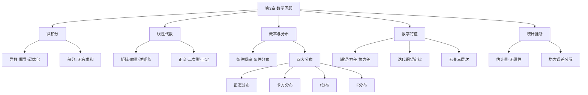

# 第3章 数学回顾 · 章节总结

## 一、章节框架图



## 二、统计分布速查表

| 分布 | 英文 | 形状 | 自由度 | 期望 | 方差 | 用途 | Stata函数 |
|------|------|------|--------|------|------|------|-----------|
| [[07_正态分布|正态分布]] | Normal | 钟形对称 | 无 | μ | σ² | 一切统计推断的基础；[[KP11_标准化_ZScore|标准化]]后Z~N(0,1) | `normalden(x)`, `normal(x)` |
| 卡方分布 | χ² | 右偏，取值为正 | k | k | 2k | 方差检验、联合显著性F检验的分子 | `chi2den(k,x)`, `chi2(k,x)` |
| t分布 | t | 对称，比正态厚尾 | k | 0（k>1） | k/(k-2)（k>2） | 小样本下回归系数显著性检验 | `tden(k,t)`, `t(k,t)`, `ttail(k,t)` |
| F分布 | F | 右偏，取值为正 | (k₁,k₂) | — | — | 回归方程整体显著性检验 | `Fden(k1,k2,x)`, `F(k1,k2,x)` |

### 分布之间的关系

```mermaid
graph TD
    A[标准正态 Z~N(0,1)] -->|平方| B[χ²(1)]
    B -->|k个独立标准正态平方和| C[χ²(k)]
    A -->|除以 √(χ²(k)/k)| D[t(k)]
    C -->|除以自由度后相比| E[F(k₁,k₂)]
    D -->|平方| E
    F[自由度k→∞] --> D
    D --> F
```

**关键关系**：
- $Z \sim N(0,1) \Rightarrow Z^2 \sim \chi^2(1)$
- $\sum_{i=1}^k Z_i^2 \sim \chi^2(k)$（k个独立标准正态平方和）
- $Z / \sqrt{Y/k} \sim t(k)$，其中 $Z \sim N(0,1)$，$Y \sim \chi^2(k)$，二者独立
- $(Y_1/k_1)/(Y_2/k_2) \sim F(k_1,k_2)$，其中 $Y_1 \sim \chi^2(k_1)$，$Y_2 \sim \chi^2(k_2)$，二者独立
- $X \sim t(k) \Rightarrow X^2 \sim F(1,k)$
- $k \to \infty$ 时，t分布收敛于标准正态分布

## 三、核心公式清单

| 公式 | 含义 | 符号解释 |
|------|------|----------|
| $E(X) = \sum x_k p_k$ | 期望（离散） | $x_k$取值，$p_k$概率 |
| $E(X) = \int x f(x) dx$ | 期望（连续） | $f(x)$密度函数 |
| $Var(X) = E[(X-E(X))^2]$ | 方差 | 衡量波动大小 |
| $Var(X) = E(X^2) - [E(X)]^2$ | 方差简便公式 | 计算时用 |
| $Cov(X,Y) = E[(X-EX)(Y-EY)]$ | 协方差 | 两变量线性联动方向 |
| $Cov(X,Y) = E(XY) - E(X)E(Y)$ | 协方差简便公式 | 计算时用 |
| $\rho = \frac{Cov(X,Y)}{\sqrt{Var(X)Var(Y)}}$ | [[01_相关系数|相关系数]] | $-1 \le \rho \le 1$ |
| $E(Y) = E_X[E(Y|x)]$ | 迭代期望定律 | 无条件期望=条件期望的加权平均 |
| $MSE(\hat\theta) = Var(\hat\theta) + [Bias(\hat\theta)]^2$ | 均方误差分解 | 偏差² + 方差 |

## 四、无关性三层次

```mermaid
graph TD
    A[相互独立] -->|最强| B[联合分布=边缘分布乘积]
    A --> C[意味着]
    C --> D[均值独立]
    D -->|中等| E[E(Y|x)=E(Y)]
    D --> F[意味着]
    F --> G[线性不相关]
    G -->|最弱| H[Cov(X,Y)=0]
```

**逻辑链**：相互独立 ⇒ 均值独立 ⇒ 线性不相关；反之不然。

## 五、章节联系

- **向后**：第2章教了 Stata 操作。
- **向前**：本章的概率、分布、统计推断是第4章 [[KP02_OLS正交性|OLS]] [[KP01_OLS估计量推导|估计量推导]]和[[KP02_假设检验|假设检验]]的数学基础。特别是：
  - 正态分布、t分布 → 第5章回归系数的假设检验
  - 均值独立、迭代期望定律 → 第4章扰动项外生性假设
  - 无偏性、MSE → 第4-5章评价 OLS 估计量好坏的标准

## 六、自测题

**1. t分布和标准正态分布有什么区别？什么时候t分布近似正态？**

答：t分布以原点对称，但中间山峰更低更尖，两侧尾部更厚（厚尾）。当自由度 k→∞ 时，t分布收敛于标准正态分布。小样本下用t分布更保守（尾部概率更大）。

**2. 什么是均值独立？它和相互独立、线性不相关是什么关系？**

答：如果 E(Y|x) 不依赖于 X（即条件期望=无条件期望），则称 Y 均值独立于 X。关系：相互独立 ⇒ 均值独立 ⇒ 线性不相关；反过来不成立。

**3. 均方误差 MSE 可以分解为哪两部分？这个分解有什么意义？**

答：MSE = Var(θ̂) + [Bias(θ̂)]²，即方差 + 偏差平方。意义：估计量的好坏不是只看无偏性——一个有偏但方差极小的估计量，可能比无偏但方差很大的估计量 MSE 更小。这就是偏差-方差权衡。

## 本章方法答辩速查

1. **问：回归分析最核心的外生性假设 $E(\varepsilon|X)=0$，对应本章的哪个数学概念？** 答：对应"均值独立"——扰动项对 X 均值独立，即给定 X 后扰动项的条件期望为零，不随 X 变化。这比"Cov(X,ε)=0"（线性不相关）强：回归要求的是**均值独立**，不是只不相关。答辩时被追问"为什么 Cov=0 不够"，答案就是：Cov=0 只管线性，扰动项均值仍可能随 X 变化，条件期望不是直线就会产生偏误。
2. **问：回归输出表里的 t [[08_t检验和F检验|检验和]] F 检验，分别用本章哪两个分布？为什么？** 答：单个系数是否为零用 **t 分布**检验：$t=(\hat\beta_k-0)/SE(\hat\beta_k)$，小样本下扰动正态时服从 t(K)；多个系数联合为零（整个方程、或一组约束）用 **F 分布**检验：F 是两个卡方估计量的比（约束前后残差平方和的相对改善）。记住关系：单个约束时 $F(1,k)=t(k)^2$，两种检验对同一约束给出完全一致的结论。

---

## 🔗 相关知识点

**同章关联：** [[01_概率与分布|概率与分布]]｜[[02_统计推断思想|统计推断思想]]

**跨章基础导航：** [[../03_一元线性回归/知识点/KP01_一元回归模型|一元回归模型（OLS推导）]]｜[[../05_大样本OLS/知识点/KP01_大样本OLS|大样本OLS]]｜[[../10_二值选择模型/知识点/KP02_最大似然估计|最大似然估计（MLE）]]

**🐮 大牛库深入：** [[../../../经济统计学论文从0基础到精通/01_基础数学/README|基础数学模块]]｜[[../../../经济统计学论文从0基础到精通/03_相关与回归/07_假设检验直觉|假设检验直觉]]

**📖 原书原文：** [[../../../原文件/计量经济学/陈强_计量经济学及Stata应用_全书|陈强《计量经济学及Stata应用》附录]]
