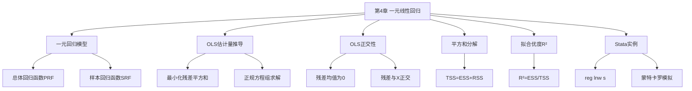

# 第4章 一元线性回归 · 章节总结

## 一、章节框架图

## 二、核心公式清单

| 公式 | 含义 | 符号解释 |
|------|------|----------|
| $y_i = \alpha + \beta x_i + \varepsilon_i$ | 总体回归模型（PRF） | α截距，β斜率，ε扰动项 |
| $\hat\beta = \frac{\sum(x_i-\bar{x})(y_i-\bar{y})}{\sum(x_i-\bar{x})^2}$ | [[KP02_OLS正交性|OLS]]斜率估计量 | 离差形式，最常用 |
| $\hat\alpha = \bar{y} - \hat\beta \bar{x}$ | OLS截距估计量 | 样本回归线过样本均值点 |
| $\hat{y}_i = \hat\alpha + \hat\beta x_i$ | 拟合值（预测值） | 样本回归函数SRF |
| $e_i = y_i - \hat{y}_i$ | 残差 | 实际值减拟合值 |
| $\sum e_i = 0$ | 残差和为0 | OLS[[KP02_OLS正交性|正交性]]推论 |
| $\sum x_i e_i = 0$ | 残差与X正交 | OLS一阶条件 |
| TSS = ESS + RSS | 平方和分解 | 总平方和=解释+残差 |
| $R^2 = ESS/TSS = 1 - RSS/TSS$ | [[KP03_拟合优度R2|拟合优度]] | 0≤R²≤1 |
| $R^2 = [Corr(y_i, \hat{y}_i)]^2$ | R²与[[01_相关系数|相关系数]]关系 | 有常数项时成立 |

## 三、假设清单（[[KP04_一元回归Stata解读|一元回归]]的基本设定）

1. **线性于参数**：$y_i = \alpha + \beta x_i + \varepsilon_i$（对 α、β 线性，对 x 可以是非线性如 x²）
2. **随机抽样**：$\{(x_i, y_i)\}_{i=1}^n$ 为 iid 样本
3. **解释变量有变异**：$\sum(x_i - \bar{x})^2 \neq 0$（x 不能是常数）
4. **扰动项条件均值为零**：$E(\varepsilon_i | x_i) = 0$（外生性假设——最关键）

## 四、章节联系

- **向后**：第3章的 OLS 最优化（微积分）、正交性（线性代数）、条件期望（概率）在本章全部用上。
- **向前**：本章是全书的理论核心——
  - 第5章将讨论 OLS 估计量的小样本性质（无偏性、有效性）
  - 第6章将讨论大样本性质（一致性）
  - 后续所有[[KP03_多元回归Stata|多元回归]]、[[03_工具变量IV|工具变量]]、面板数据都是本章的推广。

## 五、自测题

**1. 总体回归函数（PRF）和样本回归函数（SRF）有什么区别？**

答：PRF 是总体层面的真实关系 $E(y|x) = \alpha + \beta x$，α、β 是未知常数；SRF 是用样本数据估计出来的 $\hat{y} = \hat\alpha + \hat\beta x$，$\hat\alpha$、$\hat\beta$ 是随机变量（随样本变化）。蒙特卡罗模拟显示：不同样本得到不同的 SRF，但都围绕 PRF 波动。

**2. OLS 估计量 β̂ 的分母为什么不能为零？**

答：分母是 $\sum(x_i - \bar{x})^2$，如果为零意味着所有 x_i 都相等（x 是常数）。此时相同的 x 对应不同的 y，无法估计 x 对 y 的作用——没有变化就没有估计。

**3. R² = 0.98（无常数项回归）为什么不一定比 R² = 0.25（有常数项回归）更好？**

答：因为无常数项回归的 R² 是"非中心 R²"（$R^2_{uc} = \sum\hat{y}^2 / \sum y^2$），和有常数项的 R² 定义不同，二者不可比。无常数项回归强迫直线过原点，常常会得到不合理的系数（如教育回报率41.5%），即使 R² 很高也没有经济意义。

## 本章方法答辩速查

1. **问：本章四条基本假设中，哪一条是"命根子"？为什么？** 答：$E(\varepsilon_i|x_i)=0$（扰动项条件均值为零，外生性假设）。其他假设都有退路：x 有变异、随机抽样不满足时，[[KP01_大样本理论|大样本理论]]（第 5 章）能救；线性于参数只是形式；唯独外生性不成立时，OLS 系数有偏且**不一致**——样本再大也救不回来，后面整本书（工具变量、面板固定效应、双重差分）都是在补救这一条。答辩时判断一个研究可不可信，先问它的外生性站不站得住。
2. **问：本章的平方和分解 TSS = ESS + RSS、R² = ESS/TSS，在什么前提下成立？** 答：前提是模型**含有常数项**。有常数项时 OLS 保证 $\sum e_i=0$，分解才成立；去掉常数项后残差和不再为零，分解失效，Stata 汇报的是非中心 R²，数值虚高且不能和有常数项回归的 R² 比。这也是"过原点回归的 R² 高达 0.98 反而要警惕"的数学原因。

---

## 🔗 相关资源

**章间导航：** 📑 本章知识点目录见 `知识点/` ｜ [[../04_多元线性回归/00_章节总结|第5章 多元线性回归]] ➡️

**🐮 大牛库对应模块：** [[../../../经济统计学论文从0基础到精通/03_相关与回归/README|03 相关与回归（OLS推导/R²/t检验）]]

**📖 原书对应章节：** [[../../../原文件/计量经济学/陈强_计量经济学及Stata应用_全书|陈强《计量经济学及Stata应用》第4章]]
