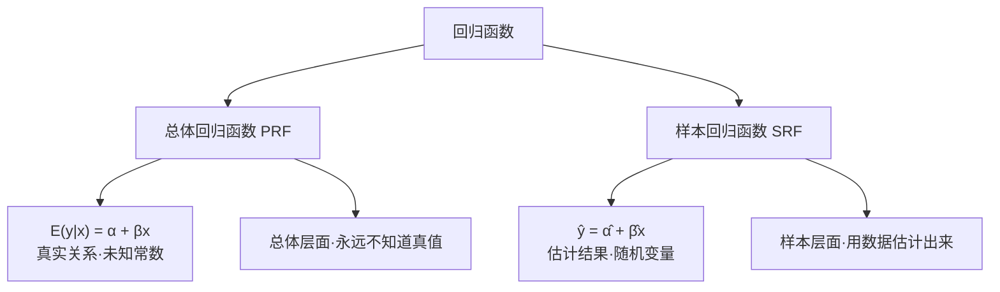

# 4.1 一元线性回归模型

<div style="text-align:right;margin:10px 0;"><a href="../../../exam.html" target="_blank" style="display:inline-block;padding:6px 16px;background:#2563eb;color:#fff;border-radius:6px;text-decoration:none;font-size:14px;">📝 开始做题</a></div>


## 概述

本章从明瑟方程出发，引入一元线性回归模型的标准形式，区分总体回归函数（PRF）和样本回归函数（SRF），并介绍数据生成过程（DGP）的概念。

## 一、为什么要用回归？

**明瑟方程（Mincer Equation）**：
$$\ln w = \alpha + \beta s$$

- $\ln w$：工资对数（被解释变量 Y）
- $s$：教育年限（解释变量 X）
- $\alpha$：截距项（s=0 时的工资对数）
- $\beta$：斜率 = 教育投资回报率

**β 的经济含义**：
$$\beta = \frac{d \ln w}{ds} = \frac{dw/w}{ds} \approx \frac{\Delta w / w}{\Delta s}$$

即：每多上一年学，工资平均增加 β×100%。

但教育不是影响工资的唯一因素，所以要加扰动项：
$$\ln w = \alpha + \beta s + \varepsilon$$

## 二、一元线性回归模型的标准形式

$$y_i = \alpha + \beta x_i + \varepsilon_i \quad (i = 1, \cdots, n)$$

| 符号 | 名称 | 含义 |
|------|------|------|
| $y_i$ | 被解释变量（dependent variable） | 要被解释的变量 |
| $x_i$ | 解释变量（regressor） | 用来解释 y 的变量 |
| $\alpha$ | 截距项（intercept） | x=0 时 y 的均值 |
| $\beta$ | 斜率（slope） | x 每增加1单位，y 平均变化多少 |
| $\varepsilon_i$ | 扰动项/误差项 | 所有其他影响因素 |
| i | 下标 | 第 i 个个体 |
| n | 样本容量 | 观测值个数 |

## 三、总体回归函数 vs 样本回归函数



### 总体回归函数（PRF）

$$E(y_i | x_i) = \alpha + \beta x_i$$

- 是 x 取某个值时 y 的条件期望
- α、β 是未知的总体参数（常数）
- 这就是真实的数据生成过程（DGP）

### 样本回归函数（SRF）

$$\hat{y}_i = \hat{\alpha} + \hat{\beta} x_i$$

- 是用样本数据估计出来的直线
- $\hat{\alpha}$、$\hat{\beta}$ 是估计量（随机变量）
- 不同样本会得到不同的 SRF

### 数据生成过程（DGP）

从数据生成角度看：
1. 从分布中随机抽取 $x_i$
2. 从分布中随机抽取 $\varepsilon_i$
3. 按 $y_i = \alpha + \beta x_i + \varepsilon_i$ 计算 $y_i$
4. 研究者只观测到 $(x_i, y_i)$，看不到 $\varepsilon_i$

**计量经济学的任务**：通过观测到的 $\{(x_i, y_i)\}$，推断未知的 $(\alpha, \beta)$。

## 四、Stata 散点图 + 回归线

```stata
* 目的：画工资对数 vs 教育年限的散点图+拟合线
use grilic.dta, clear
twoway scatter lnw s || lfit lnw s
* scatter lnw s：散点图
* lfit lnw s：linear fit，画线性拟合直线
```

**输出解读**：散点大致呈正相关趋势，拟合线从左下到右上，直观支持明瑟方程的线性设定。

## 小结

1. 一元回归模型：$y_i = \alpha + \beta x_i + \varepsilon_i$，是对条件期望 $E(y|x)$ 的线性建模。
2. PRF 是真实的总体关系（未知常数），SRF 是样本估计的结果（随机变量）。
3. 扰动项 $\varepsilon_i$ 包含所有遗漏因素——它是"魔鬼所在"。
4. 回归分析的核心任务：用样本数据 $\{(x_i, y_i)\}$ 估计总体参数 $(\alpha, \beta)$。

## 答辩常问（带标准答案）

1. **问：总体回归函数 PRF 和样本回归函数 SRF 到底差在哪？为什么说 α、β 是常数，而 α̂、β̂ 是随机变量？** 答：PRF $E(y|x)=\alpha+\beta x$ 是总体层面的真实关系，α、β 是固定但未知的常数，我们永远看不到真值；SRF $\hat y=\hat\alpha+\hat\beta x$ 是拿某一批具体样本算出来的直线，换一批样本，$\hat\alpha$、$\hat\beta$ 就会变，所以它们是随机变量。蒙特卡罗模拟正是反复抽样、画出一簇围绕 PRF 波动的 SRF，说明"估计值是对真实关系的含噪近似"。
2. **问：模型里为什么非要留一个扰动项 ε？它到底装了些什么？** 答：因为影响 y 的因素远不止 x 这一个，模型不可能把所有因素都写进去，ε 就是这些遗漏内容的"垃圾桶"：没观测到的其他解释变量（能力、工龄）、函数形式误设（真实关系里有 s² 而模型没放）、y 的测量误差、人类行为的内在随机性。正因为 ε 装了这么多东西，对它的假设——尤其是 $E(\varepsilon_i|x_i)=0$（条件均值为零）——才是整个回归能否解释为因果关系的关键。
3. **问：明瑟方程里 β 前面是 ln w，为什么 β 可以直接解释成"每多上一年学工资涨百分之几"？** 答：因为 $\beta = d\ln w / ds = (dw/w)/ds$，对数工资对教育求导，分子是工资的比例增长率 $dw/w$，分母是教育变化量 ds。所以半对数设定下，β 乘以 100% 就是"x 每增加一单位，y 的百分之多少变化"，本例即多受一年教育，小时工资平均提高约 β×100%。
