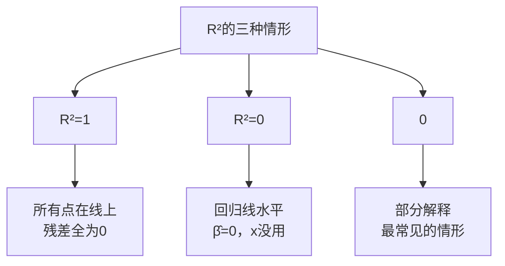

# KP03 拟合优度 R²

<div style="text-align:right;margin:10px 0;"><a href="../../../../exam.html" target="_blank" style="display:inline-block;padding:6px 16px;background:#2563eb;color:#fff;border-radius:6px;text-decoration:none;font-size:14px;">📝 开始做题</a></div>


## 1. 是什么

**拟合优度（R²）**：衡量样本回归线对数据点拟合得有多好的指标——被解释变量的总变动中，能被解释变量解释的比例。

**直觉类比**：就像拼图完成了多少。TSS 是整张拼图的总面积，ESS 是你拼上去的部分，RSS 是还空着的部分。R² 就是拼好的比例——1就是完美拼完，0就是一块都没拼上。

**解决什么问题**：[[KP02_OLS正交性|OLS]] 已经找到了"离所有点最近"的直线，但这条线到底离得有多近？R² 给一个绝对的度量。

## 2. 怎么用

### 平方和分解公式

$$\underbrace{\sum (y_i - \bar{y})^2}_{TSS} = \underbrace{\sum (\hat{y}_i - \bar{y})^2}_{ESS} + \underbrace{\sum e_i^2}_{RSS}$$

| 缩写 | 全称 | 含义 |
|------|------|------|
| TSS | Total Sum of Squares | 总离差平方和——y 的总变动 |
| ESS | Explained Sum of Squares | 解释平方和——模型能解释的部分 |
| RSS | Residual Sum of Squares | 残差平方和——模型解释不了的部分 |

**直觉**：y 的总波动 = x 能解释的波动 + 解释不了的波动。

### R² 的定义

$$R^2 = \frac{ESS}{TSS} = 1 - \frac{RSS}{TSS}$$

- $0 \le R^2 \le 1$
- R² = 1：所有点都在回归线上，完美拟合
- R² = 0：回归线是水平线，x 完全解释不了 y
- R² 越高，拟合越好

#### 【三问】R² 这个数到底在说什么？

- **怎么来的（直觉推导）**：y 的总波动 $TSS = \sum (y_i - \bar y)^2$，可以拆成两部分——一部分被回归线"接住了"（拟合值 $\hat y_i$ 相对均值的波动，即 ESS），另一部分是回归线没接住的残差（RSS）。数学上可以证明 $TSS = ESS + RSS$（这是OLS带常数项的魔力，残差和 $\sum e_i = 0$，且残差与拟合值正交 $\sum e_i \hat y_i = 0$）。既然总波动被拆成"解释了的"和"没解释的"，那解释了的占比就是 $ESS/TSS$，这就是 R²。
- **为什么用它**：解决"这条回归线到底贴得有多近"的问题。OLS 只告诉你"找到了一条最近的线"，但"最近"是相对的——在一堆噪声里找最近，和在一堆信号里找最近，结论完全不同。R² 给你一个 0~1 的数，直观告诉你 x 对 y 的解释力度有多大。
- **知识为什么存在**：在 R² 之前，人们只能看残差图凭感觉说"拟合得好不好"。R² 把"拟合好坏"变成了一个**可比较、可排序**的数字——同样的 y，模型 A 的 R²=0.3，模型 B 的 R²=0.6，显然 B 解释力更强。这为"选模型"提供了第一个客观标准（虽然不是唯一标准）。

### R² 与[[01_相关系数|相关系数]]的关系

有常数项时：
$$R^2 = [Corr(y_i, \hat{y}_i)]^2$$

即 R² 等于 y 和拟合值之间相关系数的平方——这就是为什么叫 R 平方。

### 三种极端情形



### Stata 代码

```stata
* 目的：回归后看R²
use grilic.dta, clear
reg lnw s
* 输出右上角：R-squared = 0.2527
* 意思是：教育年限能解释工资对数约25.3%的变动
```

### 计算演示（奶茶店例子）

| x | y | ŷ = 15+5x | e | y-ȳ | (y-ȳ)² | ŷ-ȳ | (ŷ-ȳ)² | e² |
|---|---|-----------|---|------|--------|------|--------|----|
| 1 | 20 | 20 | 0 | -10 | 100 | -10 | 100 | 0 |
| 2 | 25 | 25 | 0 | -5 | 25 | -5 | 25 | 0 |
| 3 | 30 | 30 | 0 | 0 | 0 | 0 | 0 | 0 |
| 4 | 35 | 35 | 0 | 5 | 25 | 5 | 25 | 0 |
| 5 | 40 | 40 | 0 | 10 | 100 | 10 | 100 | 0 |

- TSS = 100+25+0+25+100 = 250
- ESS = 100+25+0+25+100 = 250
- RSS = 0
- R² = 250/250 = 1 → 完美拟合

## 3. 什么时候用

- 有常数项的回归，看拟合程度
- 比较不同模型（同样的 y，不同的 x）谁拟合更好
- 初步判断模型是否有意义

## 4. 什么时候不能用/易错点

- **R² 高 ≠ 模型好**：R² 只衡量拟合程度，不衡量因果关系对不对。R²=0.99 也可能是伪回归。
- **R² 低 ≠ 模型没用**：社会科学里 R²=0.25 已经不错了（人行为本来就难预测）。
- **无常数项回归**：平方和分解不成立，Stata 汇报的 R² 是"非中心 R²"，和有常数项的 R² 不可比。
- **不能只看 R² 选模型**：评估回归是否显著要用 F 检验，不是看 R²。

## 5. 与相似方法对比表

| 指标 | 公式 | 含义 | 适用条件 |
|------|------|------|----------|
| R² | ESS/TSS | 解释了y变动的比例 | 有常数项 |
| 调整 R² | 1 - (RSS/(n-k-1))/(TSS/(n-1)) | 惩罚变量个数的R² | [[KP03_多元回归Stata|多元回归]]（第5章） |
| 非中心 R² | Σŷ²/Σy² | 过原点回归用 | 无常数项 |

## 6. 为什么选这个

R² 是最直观的拟合度量——一个0到1的数，人人都能理解"解释了百分之多少的变动"。虽然它有很多局限，但作为入门指标足够直观。

## 7. 完整例子

**书中原例（grilic）**：
- TSS = 139.286
- ESS（Model）= 35.204
- RSS（Residual）= 104.082
- R² = 35.204 / 139.286 = 0.2527

**解读**：教育年限能解释工资对数约25.3%的变动——剩下74.7%由其他因素（能力、工龄、学校等）解释。

**反例（无常数项回归）**：
- 有常数项 R² = 0.2527（可信）
- 无常数项 R² = 0.9798（不可比，系数也变成41.5%，明显不合理）

## 答辩常问（带标准答案）

1. **问：R² 高达 0.99，能不能说明这个回归一定很好、很可信？** 答：不能。R² 只度量"样本点离回归线有多近"，它既不判断因果方向，也不判断变量是否平稳。经典反例是伪回归：两个各自带趋势的不平稳时间序列（如某国 GDP 和某国啤酒销量）做回归，R² 可以轻松超过 0.9，但二者毫无经济联系。评估模型要同时看系数的经济意义、显著性（t、F 检验）和变量性质。
2. **问：为什么无常数项（过原点）回归汇报的 R² 不能和有常数项回归的 R² 直接比较？** 答：有常数项时才有平方和分解 $TSS = ESS + RSS$，R² = ESS/TSS 的含义是"y 的总变动中被解释的比例"。去掉常数项后这个分解不成立，Stata 汇报的是"非中心 R²"（$\sum \hat y_i^2 / \sum y_i^2$），定义完全不同，数值经常虚高（本例中 0.98 vs 0.25），即使它更高也不代表拟合更好，反而可能是强迫直线过原点造成的扭曲。
3. **问：社会科学回归 R² 只有 0.2 左右，是不是说明模型做得很失败？** 答：不是。研究对象是人的行为时，影响 y 的因素天然又多又杂，横截面工资方程 R² 在 0.1~0.3 区间是常态。判断模型好坏的标准是：核心系数符号和大小是否符合经济理论、是否统计显著、遗漏变量是否被合理控制，而不是 R² 的绝对高低。

## 8. 速记卡

- TSS = ESS + RSS（总变动 = 解释了的 + 没解释的）
- R² = ESS/TSS = 1 - RSS/TSS
- 0 ≤ R² ≤ 1，越接近1拟合越好
- R² 高不代表因果对，R² 低不代表模型没用
- 无常数项时 R² 定义变了，别乱比
- 口诀：**"总变动拆两半，解释除以总就是R方；高了别得意，低了别灰心，拟合好坏它说了算，因果对错它不管"**

---

## 🔗 相关知识点

**同章关联：** [[KP01_OLS估计量推导|OLS推导]] ｜ [[KP02_OLS正交性|OLS正交]] ｜ [[KP04_一元回归Stata解读|Stata解读]]

**跨章/跨课关联：** [[../../04_多元线性回归/知识点/KP03_多元回归Stata|多元Stata]] ｜ [[../../../05_统计学原理/08_相关与回归/知识点/KP09_拟合优度R2|统计原理·R²]] ｜ [[../../08_模型设定与数据问题/知识点/KP02_多重共线性|多重共线性]]

**🐮 大牛库深入：** [[../../../../经济统计学论文从0基础到精通/03_相关与回归/06_拟合优度R²|06 拟合优度 R²]] ｜ [[../../../../经济统计学论文从0基础到精通/03_相关与回归/01_相关系数|01 相关系数]]

**📖 原书原文：** [[../../../../原文件/计量经济学/陈强_计量经济学及Stata应用_全书#4. 画图|陈强《计量经济学》第4-5章]]
