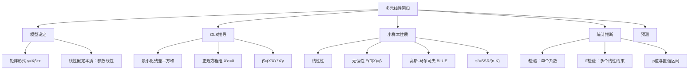
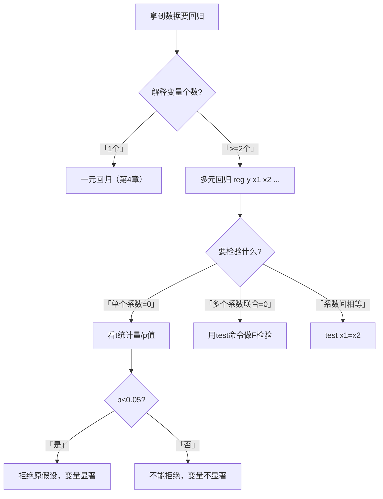

# 第5章 [[05_多元线性回归|多元线性回归]] · 章节总结

## 一、章节框架图

## 二、文字知识树

- **模型设定**
  - 一般形式：$y_i = \beta_1 + \beta_2 x_{i2} + \cdots + \beta_K x_{iK} + \varepsilon_i$
  - 矩阵形式：$\mathbf{y} = \mathbf{X}\boldsymbol{\beta} + \boldsymbol{\varepsilon}$
  - 线性假定的本质：对参数 $\beta$ 线性，不是对变量线性（平方项、对数项仍可）
- **[[KP02_OLS正交性|OLS]]推导**
  - 最小化 $\sum e_i^2$，对 $\hat\beta_k$ 求偏导得一阶条件
  - 正规方程组：$\mathbf{X}'\mathbf{e} = \mathbf{0}$（残差与每个解释变量正交）
  - 解：$\hat{\boldsymbol{\beta}} = (\mathbf{X}'\mathbf{X})^{-1}\mathbf{X}'\mathbf{y}$
  - 几何解释：$\mathbf{y} = \hat{\mathbf{y}} + \mathbf{e}$，$\hat{\mathbf{y}}$ 是 $\mathbf{y}$ 在 $\mathbf{X}$ 超平面上的投影
- **[[KP03_拟合优度R2|拟合优度]]**
  - $R^2 = \text{ESS}/\text{TSS} = 1 - \text{RSS}/\text{TSS}$
  - 校正拟合优度 $\bar{R}^2 = 1 - \frac{\text{RSS}/(n-K)}{\text{TSS}/(n-1)}$，惩罚过多变量
- **古典假定（5条）**
  1. 线性假定（对参数线性）
  2. 严格外生性：$E(\varepsilon_i|X)=0$
  3. X满列秩（无严格[[KP02_多重共线性|多重共线性]]）
  4. 球形扰动项：$Var(\varepsilon|X)=\sigma^2 I_n$（同方差+无[[03_自相关|自相关]]）
  5. 扰动项[[07_正态分布|正态分布]]：$\varepsilon|X \sim N(0,\sigma^2 I_n)$
- **小样本性质**
  - 线性性、无偏性、$Var(\hat\beta|X)=\sigma^2(X'X)^{-1}$
  - 高斯-马尔可夫定理：在假定5.1–5.4下，OLS是BLUE
  - $s^2 = \frac{1}{n-K}\sum e_i^2$ 是 $\sigma^2$ 的无偏估计
- **统计推断**
  - t统计量：$t_k = \frac{\hat\beta_k - c}{SE(\hat\beta_k)} \sim t(n-K)$
  - F统计量：$F = \frac{(R\hat\beta-r)'[R(X'X)^{-1}R']^{-1}(R\hat\beta-r)/m}{s^2} \sim F(m,n-K)$
  - F的似然比表达式：$F = \frac{(SSR^*-SSR)/m}{SSR/(n-K)}$
  - 检验整个方程显著性：$F = \frac{R^2/(K-1)}{(1-R^2)/(n-K)}$
- **预测**
  - 点预测：$\hat{y}_0 = x_0'\hat\beta$
  - 预测误差方差：$Var(\hat{y}_0-y_0) = \sigma^2[1 + x_0'(X'X)^{-1}x_0]$

## 三、核心公式清单

| 公式 | 符号解释 | 适用条件 |
|------|----------|----------|
| $\hat{\boldsymbol{\beta}}=(\mathbf{X}'\mathbf{X})^{-1}\mathbf{X}'\mathbf{y}$ | OLS估计量；X为n×K数据矩阵 | X满列秩，$(X'X)^{-1}$存在 |
| $Var(\hat\beta\|X)=\sigma^2(X'X)^{-1}$ | β̂的条件协方差矩阵 | 球形扰动项假定（5.4） |
| $s^2=\frac{1}{n-K}\sum e_i^2$ | σ²的无偏估计 | 自由度校正为n-K |
| $t_k=\frac{\hat\beta_k-c}{SE(\hat\beta_k)}\sim t(n-K)$ | 单个系数t检验 | 正态扰动项假定（5.5） |
| $F=\frac{(SSR^*-SSR)/m}{SSR/(n-K)}$ | 线性约束F检验（似然比形式） | m个约束，K个参数 |
| $R^2=1-\frac{RSS}{TSS}$ | 拟合优度 | 回归含常数项 |

## 四、[[01_方法选择决策树|方法选择决策树]]

## 五、章节联系

- **与第4章（[[KP04_一元回归Stata解读|一元回归]]）**：第4章是K=2的特例，本章推广到任意K个解释变量。
- **与第6章（大样本OLS）**：本章小样本理论需要正态扰动项假定，第6章放松为大样本渐近理论。
- **与第7、8章**：本章假定球形扰动项（同方差、无自相关），第7、8章分别放松这两个假定。
- **与第9章**：本章假定模型设定正确，第9章讨论遗漏变量、函数形式错误等设定问题。

## 六、自测题

**1. 偏回归系数 $\beta_k$ 的精确含义是什么？**

答：在保持其他所有解释变量不变的条件下，$x_k$ 增加一单位，$y$ 平均变化 $\beta_k$ 单位。这是"控制其他变量"后的净效应，不是 $x_k$ 与 $y$ 的简单相关。

**2. OLS估计量的正规方程组是什么？其几何含义？**

答：$X'e=0$，即残差向量 $e$ 与每个解释变量都正交。几何上意味着 $y$ 被分解为相互正交的拟合值 $\hat y$ 和残差 $e$，$\hat y$ 是 $y$ 在 $X$ 超平面上的投影。

**3. 高斯-马尔可夫定理的核心假定是什么？结论是什么？**

答：核心假定是球形扰动项（同方差+无自相关）。结论：在假定5.1–5.4下，OLS是BLUE（最佳线性无偏估计），即在所有线性无偏估计中方差最小。

**4. 为什么 $s^2$ 的分母是 $n-K$ 而不是 $n$？**

答：因为 $n$ 个残差 $e_1,\cdots,e_n$ 必须满足 $K$ 个正规方程 $X'e=0$ 的约束，只有 $(n-K)$ 个残差是自由独立的。除以 $(n-K)$ 才是 $\sigma^2$ 的无偏估计。

**5. t统计量的公式是什么？服从什么分布？**

答：$t_k = \frac{\hat\beta_k - c}{SE(\hat\beta_k)} \sim t(n-K)$。分子是估计量离假想值的距离，分母是标准误（距离的度量单位）。

**6. 检验整个回归方程显著性的F统计量与 $R^2$ 的关系？**

答：$F = \frac{R^2/(K-1)}{(1-R^2)/(n-K)}$。$R^2$ 越大，F统计量越大，方程越显著。

**7. 无常数项回归有什么风险？**

答：如果真实模型有常数项但回归时忽略了，会导致严重的估计偏差。如grilic例子中，无常数项回归算出教育回报率36.7%（显然不合理），而有常数项时为10.3%。一般建议始终包含常数项。

**8. 预测误差方差的两个来源是什么？**

答：(1) 抽样误差：$\sigma^2 x_0'(X'X)^{-1}x_0$（不能精确知道参数β）；(2) 新扰动项 $\varepsilon_0$ 的方差 $\sigma^2$。样本很大时抽样误差消失，但 $\sigma^2$ 始终存在。

## 本章方法答辩速查

1. **问：本章古典五假定中，哪一条不满足后果最严重？其余几条不满足时为什么还有退路？** 答：后果分两类。**严格外生性 $E(\varepsilon|X)=0$ 不满足**最严重——系数有偏且不一致，样本再大也救不回来，这正是后续工具变量、固定效应要补救的对象；**球形扰动项（同方差+无自相关）不满足**时，系数本身仍无偏一致，只是标准误算错，第 6~7 章用稳健标准误、Newey-West 就能修好；**正态扰动项**不满足时大样本下用渐近正态替代，不致命；**X 不满秩**则直接无法估计，Stata 会自动删掉冗余变量。答辩时能用这张"不满足后果分级表"回答，说明真正分清了哪些问题能修、哪些不能。
2. **问：t 检验和 F 检验在本章怎么分工？为什么单个约束时 F = t²？** 答：单个系数是否为零（或等于某个数）用 t 检验；多个系数联合为零、或多个线性约束（如 $\beta_1=\beta_2$）用 F 检验。数学上对**单个约束**而言，$F(1,n-K)=t(n-K)^2$，两者给出完全一致的结论，只是 F 是平方形式。答辩被问"为什么回归表里整体 F 检验显著、而个别 t 不显著"，答案就是：F 检验的是全部系数联合为零（整体有解释力），t 检验是每个系数单独能不能被识别，两回事。

---

## 🔗 相关资源

**章间导航：** ⬅️ [[../03_一元线性回归/00_章节总结|← 第4章 一元线性回归]] ｜ 📑 本章知识点目录见 `知识点/` ｜ [[../05_大样本OLS/00_章节总结|第6章 大样本OLS]] ➡️

**🐮 大牛库对应模块：** [[../../../经济统计学论文从0基础到精通/03_相关与回归/05_多元线性回归|05 多元线性回归]] ｜ [[../../../经济统计学论文从0基础到精通/03_相关与回归/09_虚拟变量|09 虚拟变量]]

**📖 原书对应章节：** [[../../../原文件/计量经济学/陈强_计量经济学及Stata应用_全书|陈强《计量经济学及Stata应用》第5章]]
