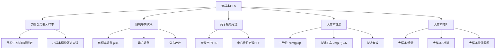
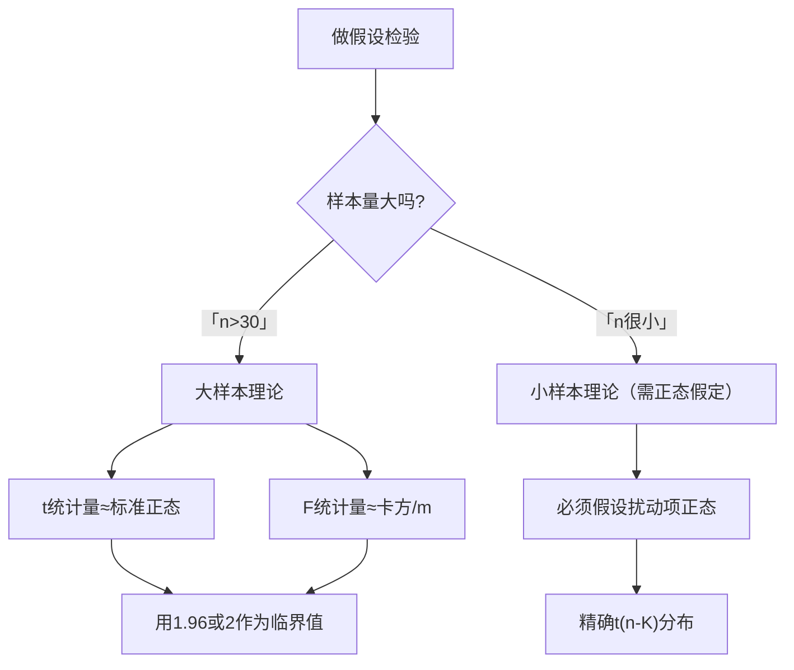

# 第6章 大样本[[KP02_OLS正交性|OLS]] · 章节总结

## 一、章节框架图

## 二、文字知识树

- **为什么需要大样本**
  - 小样本OLS需要扰动项[[07_正态分布|正态分布]]才能做精确t/F检验
  - 现实中扰动项往往不正态（如工资分布偏斜）
  - [[KP01_大样本理论|大样本理论]]不要求正态，只要样本足够大，渐近分布自然正态
- **随机收敛的概念**
  - 依概率收敛（plim）：$\hat\theta_n \xrightarrow{p} \theta$，样本越大估计值越靠近真实值
  - 均方收敛：$E[(\hat\theta_n-\theta)^2]\to 0$
  - 分布收敛：$\hat\theta_n$ 的分布收敛到某已知分布（如正态）
- **两个极限定理**
  - 大数定律（LLN）：$\bar X \xrightarrow{p} E(X)$，样本均值收敛到总体均值
  - 中心极限定理（CLT）：$\sqrt{n}(\bar X-\mu)/\sigma \xrightarrow{d} N(0,1)$，无论总体分布如何，[[KP11_标准化_ZScore|标准化]]的样本均值渐近正态
- **大样本性质**
  - 一致性：$plim(\hat\beta)=\beta$（n→∞时估计量收敛到真值）——比无偏性更弱但更基本
  - 渐近正态性：$\sqrt{n}(\hat\beta-\beta)\xrightarrow{d} N(0, \sigma^2 Q^{-1})$
  - 渐近有效：大样本下方差最小
- **大样本推断**
  - t统计量渐近服从标准正态（n大时用正态近似t分布）
  - F统计量渐近服从卡方分布
  - 置信区间：$\hat\beta_k \pm 1.96 \times SE(\hat\beta_k)$

## 三、核心公式清单

| 公式 | 符号解释 | 适用条件 |
|------|----------|----------|
| $\bar X \xrightarrow{p} E(X)$ | 大数定律：样本均值→总体均值 | 独立同分布、有限方差 |
| $\sqrt{n}(\bar X-\mu)/\sigma \xrightarrow{d} N(0,1)$ | 中心极限定理 | 独立同分布、有限方差 |
| $plim(\hat\beta)=\beta$ | OLS估计量的一致性 | 严格外生性+渐近满秩 |
| $\sqrt{n}(\hat\beta-\beta)\xrightarrow{d} N(0, \sigma^2 Q^{-1})$ | 渐近正态分布 | LLN+CLT条件满足 |
| $t_k=\hat\beta_k/SE(\hat\beta_k)\xrightarrow{d} N(0,1)$ | 大样本t统计量 | n足够大 |

## 四、[[01_方法选择决策树|方法选择决策树]]

## 五、章节联系

- **与第5章**：第5章小样本理论需要正态扰动项假定（5.5），本章放松这个假定，用大样本渐近分布代替精确小样本分布。
- **与第7、8章**：大样本理论是后续[[KP03_稳健标准误|稳健标准误]]、Newey-West等方法的统计基础。
- **与第9章**：大样本下遗漏变量导致不一致（$plim\neq\beta$），这是判定设定误差严重程度的依据。

## 六、自测题

**1. 为什么需要大样本理论？小样本理论有什么局限？**

答：小样本OLS要求扰动项严格正态分布才能得到精确的t分布和F分布。现实中很多变量（如工资、收入）的分布明显偏斜，不满足正态。大样本理论不要求正态，只要n足够大，中心极限定理自动给出渐近正态分布。

**2. 一致性和无偏性的区别？哪个更基本？**

答：无偏性是 $E(\hat\theta)=\theta$（期望等于真值）；一致性是 $plim(\hat\theta)=\theta$（n→∞时收敛到真值）。一致性更基本：无偏的估计量不一定一致（如样本均值n→∞时方差不消失）；一致的估计量不一定无偏（有偏但偏差随n消失）。大样本下我们更关心一致性。

**3. 大数定律的直觉是什么？**

答：掷骰子掷1次，点数可能是1-6任意；掷1万次，平均点数一定接近3.5（期望）。样本越大，样本均值越稳定地等于总体均值。

**4. 中心极限定理的直觉？为什么它是统计学的基石？**

答：无论原始数据是什么分布（均匀、指数、二项……），把它们加总/求平均，标准化后就近似标准正态。这就是为什么很多检验都用正态分布——我们不需要知道原始分布，只要样本够大，均值的分布就正态。

**5. 大样本下t统计量服从什么分布？和小样本有何不同？**

答：大样本下 $t_k = \hat\beta_k/SE(\hat\beta_k)$ 渐近服从 $N(0,1)$。小样本下服从 $t(n-K)$。n很大时 $t(n-K)\approx N(0,1)$，两者几乎一样。所以大样本下直接用1.96作5%临界值。

**6. CLT对总体分布有什么要求？**

答：只要求独立同分布、有有限均值和有限方差。不要求总体正态！这是CLT强大的地方。

**7. OLS估计量一致性的条件是什么？**

答：(1) 严格外生性 $E(\varepsilon|X)=0$；(2) $X'X/n$ 渐近满秩（即不存在渐近完全共线性）。满足这两条，$plim(\hat\beta)=\beta$。

## 本章方法答辩速查

1. **问：小样本理论和大样本理论在实证中怎么分工？为什么实证论文默认用大样本结论？** 答：小样本理论要求扰动项严格正态，才能得到精确的 t(n-K)、F(m,n-K) 分布——这个假设现实中几乎不成立（工资、收入都偏态）。大样本理论靠大数定律和中心极限定理，只要 iid、有限方差，t 统计量渐近 N(0,1)、F 渐近卡方，不需要正态假设。实证样本量通常成百上千，所以默认用大样本临界值（1.96），小样本只在 n<30 时才谨慎使用。
2. **问：既然大样本能让估计量一致，为什么还要担心遗漏变量？加大样本不就行了吗？** 答：一致性的前提是严格外生性 $E(\varepsilon|X)=0$ 成立。遗漏变量恰恰破坏了这个前提——此时 $plim(\hat\beta)=\beta+\text{偏差}$，n 趋于无穷时估计量停留在错误的值上，**不一致**。这是大样本救不了的问题：[[02_异方差|异方差]]、[[03_自相关|自相关]]是推断问题（n 大了标准误会自己修正），遗漏变量是一致性问题（n 大了偏差还在）。答辩被问"我的样本已经很大了还需要工具变量吗"，答案就是：需要，因为遗漏变量偏差不随样本量消失。

---

## 🔗 相关资源

**章间导航：** ⬅️ [[../04_多元线性回归/00_章节总结|← 第5章 多元线性回归]] ｜ 📑 本章知识点目录见 `知识点/` ｜ [[../06_异方差/00_章节总结|第7章 异方差]] ➡️

**🐮 大牛库对应模块：** [[../../../经济统计学论文从0基础到精通/04_回归三大问题/01_经典假设五条|04-01 经典假设五条]] ｜ [[../../../经济统计学论文从0基础到精通/03_相关与回归/07_假设检验直觉|07 假设检验直觉]]

**📖 原书对应章节：** [[../../../原文件/计量经济学/陈强_计量经济学及Stata应用_全书|陈强《计量经济学及Stata应用》第6章]]
