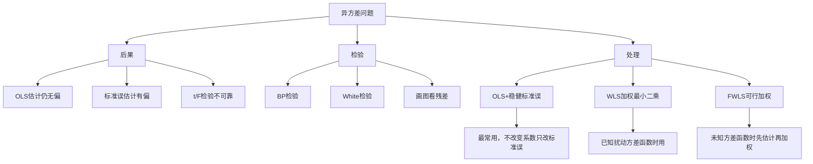
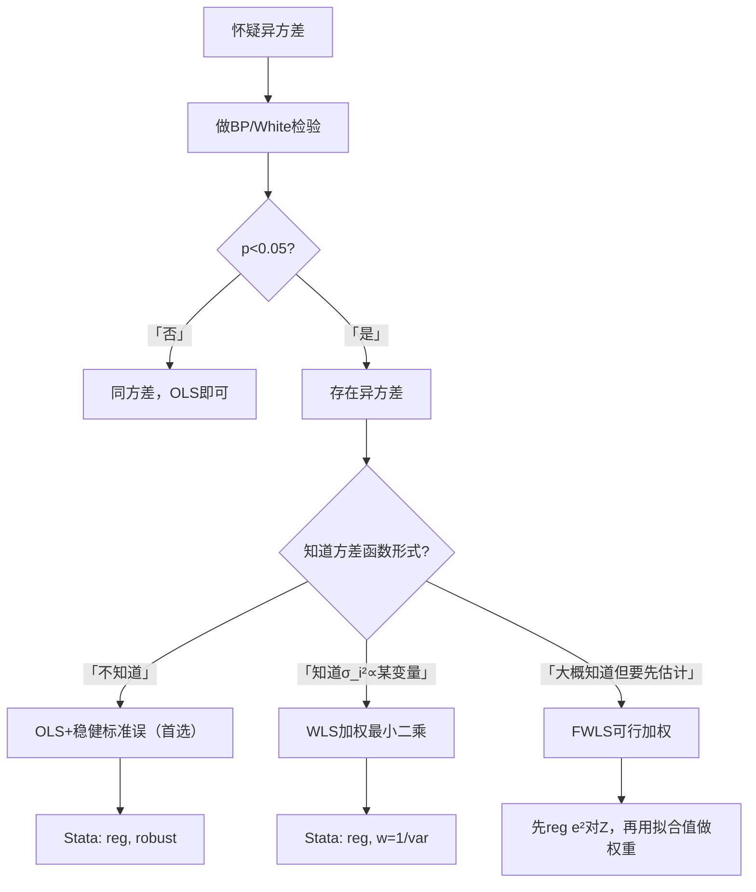

# 第7章 [[02_异方差|异方差]] · 章节总结

## 一、章节框架图

## 二、文字知识树

- **什么是异方差**
  - 同方差：$Var(\varepsilon_i|X)=\sigma^2$（所有观测的扰动方差相同）
  - 异方差：$Var(\varepsilon_i|X)=\sigma_i^2$（方差随观测变化）
  - 典型场景：大公司利润波动比小公司大；高收入家庭消费波动比低收入家庭大
- **异方差的后果**
  - [[KP02_OLS正交性|OLS]]估计量 $\hat\beta$ 仍无偏（$E(\hat\beta|X)=\beta$）
  - 但OLS估计的标准误 $s^2(X'X)^{-1}$ 不再正确（有偏）
  - 导致t检验、F检验、置信区间都不可靠
  - OLS不再是BLUE（不再是最有效估计）
- **异方差的检验**
  - **BP检验（Breusch-Pagan）**：用 $e_i^2$ 对解释变量回归，检验 $e_i^2$ 是否与X系统相关
  - **White检验**：BP检验的升级版，加入解释变量的平方项和交叉项，捕捉非线性异方差
  - 原假设 $H_0$：同方差；p<0.05则拒绝，即存在异方差
- **异方差的处理**
  - **OLS+[[KP03_稳健标准误|稳健标准误]]（White）**：最常用，不改变系数，只修正标准误
  - **WLS（加权最小二乘）**：知道 $\sigma_i^2$ 的函数形式时，用 $1/\sigma_i$ 加权
  - **FWLS（可行WLS）**：不知道 $\sigma_i^2$ 时，先用数据估计 $\sigma_i^2$，再加权
- **选择策略**
  - 不知道异方差具体形式 → OLS+稳健标准误（首选）
  - 知道 $\sigma_i^2$ 与某变量成比例 → WLS
  - 想估计方差函数再用 → FWLS

## 三、核心公式清单

| 公式 | 符号解释 | 适用条件 |
|------|----------|----------|
| $Var(\varepsilon_i\|X)=\sigma_i^2$ | 异方差定义 | 方差随观测变化 |
| $Var(\hat\beta\|X)=(X'X)^{-1}X'\Omega X(X'X)^{-1}$ | 异方差下真实协方差矩阵 | $\Omega=diag(\sigma_1^2,\cdots,\sigma_n^2)$ |
| $\hat V_{White}=\frac{1}{n-K}(X'X)^{-1}\sum e_i^2 x_i x_i'(X'X)^{-1}$ | White稳健标准误 | 不假设方差函数形式 |
| BP统计量 $=ESS_2/2$ | $e_i^2$ 对X回归的解释平方和 | 检验线性异方差 |
| WLS权重 $w_i=1/\sigma_i$ | 加权使加权后方差同方差 | 已知 $\sigma_i^2$ |

## 四、方法选择决策链

## 五、章节联系

- **与第5章**：第5章假定球形扰动项（同方差），本章放松这个假定。
- **与第8章**：第7章处理横截面异方差，第8章处理时间序列[[03_自相关|自相关]]。两者都违反球形扰动项假定，但方向不同。
- **与第6章**：稳健标准误的[[KP01_大样本理论|大样本理论]]基础是第6章的渐近理论。

## 六、自测题

**1. 异方差的定义是什么？**

答：扰动项的方差不再是常数 $\sigma^2$，而是随观测变化：$Var(\varepsilon_i|X)=\sigma_i^2$。

**2. 异方差下OLS估计量还无偏吗？标准误呢？**

答：OLS估计量仍无偏（$E(\hat\beta)=\beta$），因为无偏性只依赖严格外生性。但OLS默认的标准误 $s^2(X'X)^{-1}$ 有偏，不再正确，导致t/F检验不可靠。

**3. BP[[08_t检验和F检验|检验和]]White检验的原假设是什么？p<0.05意味着什么？**

答：原假设 $H_0$：同方差。p<0.05则拒绝 $H_0$，即认为存在异方差。BP检验只检验线性形式的异方差；White检验加入平方项和交叉项，能捕捉更一般的异方差。

**4. White稳健标准误的核心思想是什么？**

答：不假设异方差的具体函数形式，直接用样本数据估计 $X'\Omega X$。公式 $\hat V_{White}=(X'X)^{-1}(\sum e_i^2 x_i x_i')(X'X)^{-1}$。大样本下一致，小样本可能不准。

**5. OLS+稳健标准误 vs WLS vs FWLS，什么时候用哪个？**

答：
- OLS+稳健标准误：不知道异方差形式，最常用，只修正标准误不改系数
- WLS：已知 $\sigma_i^2$ 的函数形式（如 $\sigma_i\propto x_i$），用 $1/\sigma_i$ 加权
- FWLS：大概知道方差函数形式，先用数据估计 $\hat\sigma_i^2$ 再加权

**6. 为什么大公司营业额的误差天然比小公司大？**

答：大公司的销售额基数大，受各种随机因素影响的绝对量自然大。这就是为什么回归企业数据时经常遇到异方差——按规模加权（WLS）是自然做法。

## 本章方法答辩速查

1. **问：异方差和下一章自相关在"后果"上是不是同一类问题？实证处理思路为什么高度相似？** 答：是同一类——它们都违反"球形扰动项"假定，但**都不破坏 OLS 系数的无偏性和一致性**（只要严格外生性成立），错的只是标准误，所以 t 检验、置信区间失真。处理思路也一模一样：先检验（BP/White 或 DW/BG），**首选"OLS 系数不动、只修标准误"**（稳健标准误对应异方差、Newey-West 对应自相关），只有确知方差/自相关结构时才换 WLS/FGLS。答辩时把"诊断 → 修推断 → 才换估计法"这条链条说出来，就是把本章和自相关章串成了一条线。
2. **问：实证论文报告异方差问题的标准流程是什么？** 答：四步：① 跑普通 OLS 看系数符号大小；② 做 BP 或 White 检验确认异方差；③ 对比普通标准误和稳健标准误——相差不大就口头说明，相差大就加 `, robust` 重报；④ 若理论上明确知道 $\sigma_i^2$ 与某变量成比例（如按公司规模），才用 WLS/FWLS。被问"p<0.001 是不是必须 WLS"时，答案是：大样本下轻微异方差也显著，看普通 SE 和稳健 SE 的实际差异，差异小就不必大动干戈。

---

## 🔗 相关资源

**章间导航：** ⬅️ [[../05_大样本OLS/00_章节总结|← 第6章 大样本OLS]] ｜ 📑 本章知识点目录见 `知识点/` ｜ [[../07_自相关/00_章节总结|第8章 自相关]] ➡️

**🐮 大牛库对应模块：** [[../../../经济统计学论文从0基础到精通/04_回归三大问题/02_异方差|04-02 异方差]] ｜ [[../../../经济统计学论文从0基础到精通/04_回归三大问题/05_三大问题诊断流程|04-05 诊断流程]]

**📖 原书对应章节：** [[../../../原文件/计量经济学/陈强_计量经济学及Stata应用_全书|陈强《计量经济学及Stata应用》第7章]]
