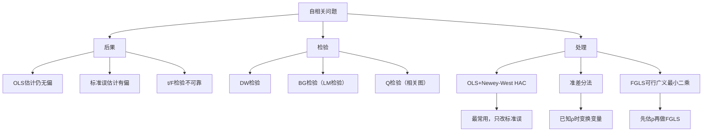
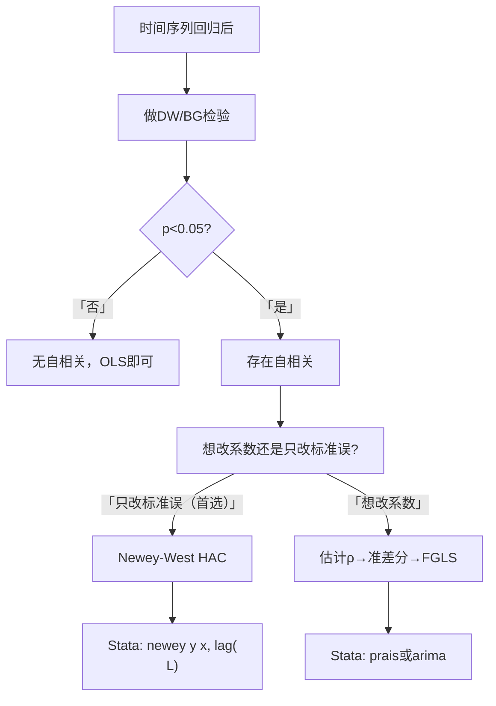

# 第8章 [[03_自相关|自相关]] · 章节总结

## 一、章节框架图

## 二、文字知识树

- **什么是自相关**
  - 横截面假定不同观测的扰动项互不相关
  - 时间序列中，$\varepsilon_t$ 和 $\varepsilon_{t-1}$ 往往相关：$Cov(\varepsilon_t,\varepsilon_{t-1})\neq 0$
  - 典型场景：本月销量和上月销量天然相关；宏观经济的繁荣/衰退有惯性
  - 一阶自回归模型AR(1)：$\varepsilon_t = \rho \varepsilon_{t-1} + u_t$
- **自相关的后果**
  - [[KP02_OLS正交性|OLS]]估计量仍无偏
  - 但OLS标准误有偏（通常低估），t/F检验不可靠
  - OLS不再是BLUE
- **检验方法**
  - **DW检验**：$DW \approx 2(1-\hat\rho)$。d≈2无自相关；d<2正自相关；d>2负自相关
  - **BG检验（Breusch-Godfrey LM检验）**：更一般，可检验高阶自相关，Stata用 `estat bgodfrey`
  - **Q检验（Box-Pierce/Ljung-Box）**：看残差的相关图
- **处理方法**
  - **OLS+Newey-West [[KP03_NeweyWest_HAC|HAC]]标准误**：最常用，同时修正[[02_异方差|异方差]]和自相关
  - **准差分法**：假设AR(1)，变换 $y_t-\rho y_{t-1}$、$x_t-\rho x_{t-1}$
  - **FGLS**：先估计 $\hat\rho$，再做准差分回归

## 三、核心公式清单

| 公式 | 符号解释 | 适用条件 |
|------|----------|----------|
| $\varepsilon_t=\rho\varepsilon_{t-1}+u_t$ | AR(1)自相关模型 | 一阶自相关 |
| $DW\approx 2(1-\hat\rho)$ | DW统计量与一阶自[[01_相关系数|相关系数]]关系 | 含常数项、解释变量严格外生 |
| $\rho>0$正自相关时，OLS标准误通常低估 | 后果 | 时间序列经济数据常见 |
| Newey-West截断参数 $L\approx n^{1/4}$ | HAC滞后阶数选择 | 经验法则 |

## 四、方法选择决策链

## 五、章节联系

- **与第7章（异方差）**：第7章违反"同方差"，本章违反"无自相关"。两者合起来违反球形扰动项假定。
- **与第6章**：Newey-West HAC的[[KP01_大样本理论|大样本理论]]基础是第6章渐近理论。
- **与第9章**：时间序列模型设定（滞后项、结构变动）也可能导致自相关。

## 六、自测题

**1. 自相关的定义？为什么时间序列容易有自相关？**

答：自相关指 $Cov(\varepsilon_t,\varepsilon_{t-s})\neq 0$，即不同时期的扰动项相关。时间序列天然有惯性：经济繁荣不会一夜变衰退，本月销量和上月销量相关。

**2. DW统计量和ρ的关系？怎么判断？**

答：$DW\approx 2(1-\hat\rho)$。
- d≈2：$\hat\rho\approx 0$，无自相关
- d<2：$\hat\rho>0$，正自相关（经济数据最常见）
- d>2：$\hat\rho<0$，负自相关

**3. DW检验的局限是什么？为什么还要用BG检验？**

答：DW只能检验一阶自相关，且要求解释变量严格外生。BG检验可以检验任意阶数的自相关（不只一阶），更一般。Stata中 `estat bgodfrey` 直接给出BG检验结果。

**4. Newey-West HAC的"HAC"是什么意思？**

答：Heteroskedasticity and Autocorrelation Consistent——异方差自相关一致的标准误。同时修正两种问题，是时间序列实证的标配。

**5. Newey-West滞后阶数怎么选？**

答：经验法则 $L \approx n^{1/4}$。例如n=36，$36^{1/4}\approx 2.45$，取L=3。

**6. 自相关下OLS估计量还无偏吗？**

答：仍无偏。无偏性只依赖严格外生性。但OLS标准误有偏（通常低估），导致t检验过度拒绝。

## 本章方法答辩速查

1. **问：本章自相关和上一章异方差，为什么处理思路完全平行？** 答：因为它们是同一个"球形扰动项"假定被从两个方向打破：异方差打破"方差相同"，自相关打破"观测独立"。二者都**只让标准误失真、不动系数的无偏一致性**，所以处理套路一模一样：先检验（DW/BG vs BP/White），首选"系数不动、只修标准误"（Newey-West HAC vs White [[KP03_稳健标准误|稳健标准误]]），确知 AR(1) 结构且样本大时才上 FGLS。答辩时被问"这两章能不能合并成一章理解"，答案就是：合并成一句话——"扰动项不满足球形假定时，首选修标准误，不要轻易动系数"。
2. **问：DW 检验有两个经典失效场景，答辩时能完整说出来吗？** 答：两个：一是模型包含**滞后被解释变量**（$y_{t-1}$ 作解释变量）时，DW 统计量渐近偏向 2，即使有自相关也会假装无自相关，必须改用 BG 检验；二是 DW 只能检验**一阶**自相关，怀疑 AR(2) 及以上时直接用 BG（`estat bgodfrey, lags(2)`）或 Q 检验，DW 可能完全失灵（如两阶交替正负时一阶 $\hat\rho$ 反而接近 0）。

---

## 🔗 相关资源

**章间导航：** ⬅️ [[../06_异方差/00_章节总结|← 第7章 异方差]] ｜ 📑 本章知识点目录见 `知识点/` ｜ [[../08_模型设定与数据问题/00_章节总结|第9章 模型设定]] ➡️

**🐮 大牛库对应模块：** [[../../../经济统计学论文从0基础到精通/04_回归三大问题/03_自相关|04-03 自相关]] ｜ [[../../../经济统计学论文从0基础到精通/04_回归三大问题/05_三大问题诊断流程|04-05 诊断流程]]

**📖 原书对应章节：** [[../../../原文件/计量经济学/陈强_计量经济学及Stata应用_全书|陈强《计量经济学及Stata应用》第8章]]
