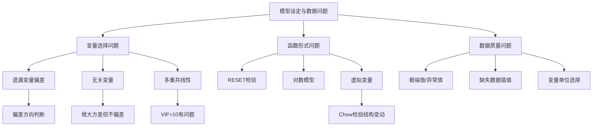
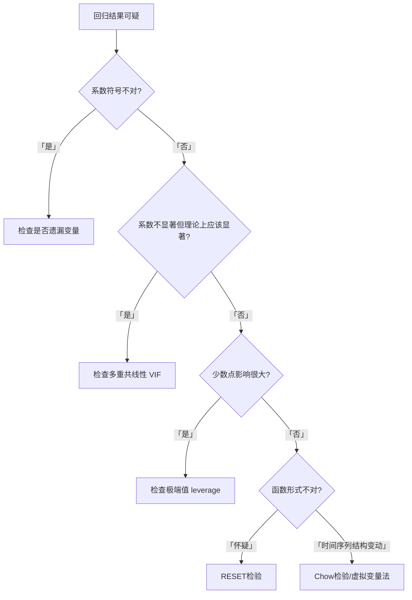

# 第9章 模型设定与数据问题 · 章节总结

## 一、章节框架图

## 二、文字知识树

- **[[KP01_遗漏变量偏差|遗漏变量偏差]]**
  - 真实模型：$y=\beta_1+\beta_2 x_2+\beta_3 x_3+\varepsilon$
  - 误设模型：$y=\beta_1+\beta_2 x_2+u$（漏掉 $x_3$）
  - 如果 $Cov(x_2, x_3)\neq 0$，$\hat\beta_2$ 有偏且不一致
  - 偏差方向：$\hat\beta_2$ 把 $x_3$ 的效应混入自己
- **无关变量**
  - 真实模型只有 $x_2$，却多放了 $x_3$（$\beta_3=0$）
  - 后果：$\hat\beta_2$ 仍无偏，但方差变大（效率损失）
- **[[KP02_多重共线性|多重共线性]]**
  - 解释变量间高度相关（非完全共线）
  - 后果：系数不稳定、标准误大、t值小
  - VIF（方差膨胀因子）>10提示有问题
  - 但预测仍可用（只是系数不可信）
- **极端值**
  - 少数观测对回归结果有不成比例的影响
  - 用leverage（影响力）判断
- **[[KP04_函数形式检验|函数形式检验]]**
  - RESET检验：用拟合值的高次项检验遗漏非线性
  - 对数模型：变量取对数后系数=弹性
- **[[KP03_虚拟变量|虚拟变量]]**
  - 截距虚拟变量：改变截距
  - 斜率虚拟变量（交互项）：改变斜率
  - Chow检验：检验结构变动（等价于联合F检验虚拟变量及其交互项）
- **缺失数据**
  - 线性插值：ipolate命令
  - 有趋势的数据先取对数再插值

## 三、核心公式清单

| 公式 | 符号解释 | 适用条件 |
|------|----------|----------|
| 遗漏变量偏差 $\hat\beta_2 \xrightarrow{p} \beta_2 + \beta_3\cdot\delta$ | δ是x3对x2回归的斜率 | x3与x2相关时 |
| VIF = 1/(1-R_k²) | R_k²是x_k对其他X回归的R² | VIF>10提示共线性 |
| Chow F = $\frac{(SSR^*-SSR_1-SSR_2)/K}{(SSR_1+SSR_2)/(n-2K)}$ | 结构变动检验 | 已知突变日期 |
| 对数模型系数 | β_k = x_k变化1%时y变化β_k% | 两边取对数 |

## 四、方法选择决策链

## 五、章节联系

- **与第5章**：本章讨论"模型设定错误"的后果，第5章假设模型设定正确。
- **与第7、8章**：本章也涉及检验方法（RESET、Chow），与[[02_异方差|异方差]]/[[03_自相关|自相关]]检验并列。
- **遗漏变量偏差**：是所有实证研究最警惕的问题，也是因果推断的核心难点。

## 六、自测题

**1. 遗漏变量偏差的方向怎么判断？**

答：真实模型 $y=\beta_1+\beta_2 x_2+\beta_3 x_3$，漏掉 $x_3$。如果 $\beta_3>0$ 且 $x_2$ 与 $x_3$ 正相关，则 $\hat\beta_2$ 高估（混入了 $x_3$ 的正效应）。反之，若 $x_2$ 与 $x_3$ 负相关，则低估。

**2. 无关变量的后果？和遗漏变量有什么不同？**

答：无关变量（β₃=0但放进了模型）导致 $\hat\beta_2$ 仍无偏，但方差变大。遗漏变量导致 $\hat\beta_2$ 有偏且不一致。一个是"浪费效率"，一个是"估计错误"。

**3. VIF是什么？VIF>10意味着什么？**

答：VIF = 1/(1-R_k²)，衡量x_k能被其他解释变量解释的程度。VIF>10意味着x_k和其他变量高度共线，系数估计不稳定。

**4. 截距虚拟变量和斜率虚拟变量的区别？**

答：截距虚拟变量D：$y=\beta_1+\beta_2 x+\delta D$，D=1时截距平移δ。
斜率虚拟变量（交互项）：$y=\beta_1+\beta_2 x+\gamma Dx$，D=1时斜率改变γ。
同时放：$y=\beta_1+\beta_2 x+\delta D+\gamma Dx$，截距和斜率都变。

**5. Chow检验的思路？和虚拟变量法的关系？**

答：Chow检验比较"全样本回归的SSR*"和"分两段回归的SSR1+SSR2"。如果SSR*远大于SSR1+SSR2，说明两段应该分开回归，即存在结构变动。等价于：在全样本回归中加入虚拟变量D和交互项Dx，联合检验D和Dx的系数=0。

**6. RESET检验做什么？**

答：用 $\hat y$、$\hat y^2$、$\hat y^3$ 加入回归，检验它们的联合显著性。如果显著，说明原模型遗漏了非线性项，函数形式不对。

## 本章方法答辩速查

1. **问：本章四类"模型设定问题"（遗漏变量、无关变量、多重共线性、函数形式误设）的后果严重程度怎么排序？** 答：按"是否破坏一致性"分两档。**遗漏变量**和**函数形式误设（真实曲线拟合直线）**最严重——系数有偏且不一致，样本再大也救不回来，必须靠加变量、[[03_工具变量IV|工具变量]]、换函数形式根治；**无关变量**和**多重共线性**只破坏效率——系数仍无偏一致，只是标准误变大、检验功效低，前者删掉多余变量即可，后者删变量反而会制造遗漏变量偏差，不能乱删。答辩被问"VIF 高要不要删变量"，答案就是：先分清这是哪一档问题。
2. **问：拿到一个回归结果感觉"不对劲"，本章的诊断顺序是什么？** 答：按决策链走：先看**系数符号**——与理论相反，八成是遗漏变量（或变量定义反了）；再看**该显著的不显著**——查 VIF，怀疑多重共线性；再看**少数点影响过大**——画 leverage/残差图找极端值（winsorize 1%/99%）；最后怀疑**函数形式**——跑 RESET（`estat ovtest`），显著说明残差里还有曲线形状没被建模。这个"符号 → 显著性 → 影响力 → 形式"的排查顺序，就是答辩现场演示诊断能力的标准答案。

---

## 🔗 相关资源

**章间导航：** ⬅️ [[../07_自相关/00_章节总结|← 第8章 自相关]] ｜ 📑 本章知识点目录见 `知识点/`

**🐮 大牛库对应模块：** [[../../../经济统计学论文从0基础到精通/04_回归三大问题/04_多重共线性|04-04 多重共线性]] ｜ [[../../../经济统计学论文从0基础到精通/04_回归三大问题/05_三大问题诊断流程|04-05 诊断流程]]

**📖 原书对应章节：** [[../../../原文件/计量经济学/陈强_计量经济学及Stata应用_全书|陈强《计量经济学及Stata应用》第9章]]
