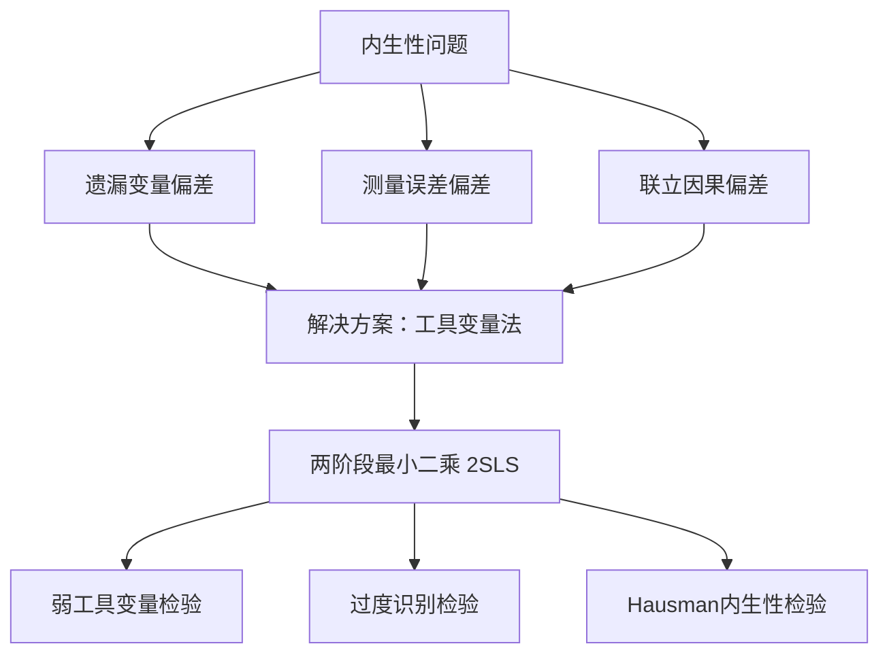
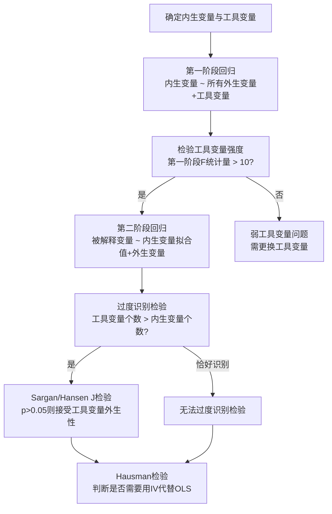

# 第10章 [[03_工具变量IV|工具变量]]法 · 章节总结

## 核心问题：为什么需要IV？

当解释变量与扰动项相关（内生性）时，[[KP02_OLS正交性|OLS]]估计不一致。内生性的三大来源：



## 2[[KP02_两阶段最小二乘2SLS|SLS]] 操作流程



## 关键决策：什么时候用IV

| 情形 | 是否内生 | 用什么方法 |
|------|----------|------------|
| 所有解释变量外生 | 否 | OLS |
| 存在内生变量，找到强工具变量 | 是 | 2SLS/IV |
| 工具变量弱（F<10） | 是 | 不可靠，需换IV或用有限信息MLE |
| 过度识别（IV数>内生变数） | 是 | 2SLS + Sargan检验 |
| 恰好识别（IV数=内生变数） | 是 | 2SLS，无法过度识别检验 |

## 核心公式速查

- **IV估计量**：$\hat{\beta}_{IV} = \frac{\sum (z_i - \bar{z})(y_i - \bar{y})}{\sum (z_i - \bar{z})(x_i - \bar{x})}$
- **2SLS第一阶段**：$x_i = \pi_0 + \pi_1 z_i + \text{其他外生变量} + v_i$
- **2SLS第二阶段**：$y_i = \beta_0 + \beta_1 \hat{x}_i + \text{其他外生变量} + \varepsilon_i$
- **弱IV经验法则**：第一阶段F统计量 > 10（Stock-Yogo临界值）
- **过度识别检验**：Hansen J统计量 ~ $\chi^2(L-K)$，L=工具变量数，K=内生变量数

## Stata 命令速查

```stata
* 2SLS回归
ivregress 2sls y x1 x2 (内生变量 = 工具变量1 工具变量2), robust

* 第一阶段与弱工具变量检验
estat firststage

* 过度识别检验
estat overid

* Hausman检验（对比OLS与IV）
estimates store iv
reg y x1 x2 内生变量
estimates store ols
hausman iv ols, sigmamore
```

## 本章方法答辩速查

1. **问：一篇用工具变量的实证论文，答辩时被要求完整说出"从识别到报告"的链条，应该怎么串？** 答：五步：① 先论证**内生性来源**（遗漏变量/测量误差/双向因果），说明 OLS 为什么有偏；② 提出工具变量并论证两个条件——相关性、外生性（排他性靠经济理论，恰好识别时无法统计检验）；③ 跑**第一阶段**，报告 F>10 排除[[KP03_弱工具变量|弱工具变量]]；④ 报告 2SLS 系数；⑤ 过度识别时（工具数>内生数）做 Sargan/Hansen J，p>0.05 说明工具外生性没被数据拒绝；最后用 Hausman（DWH）检验对比 OLS 与 IV，判断内生性是否真实存在。少任何一步，审稿人都会追问。
2. **问：IV 估出来的系数能不能直接说成"X 对 Y 的总体平均因果效应"？** 答：不能。IV 识别的是 **LATE（局部平均处理效应）**——只对"受工具变量影响而改变了 x 取值"的那部分依从者有效，不是全体人群的 ATE。例如用"出生季度"做教育的工具，估的是"出生真的影响了上学决策"那群人的教育回报。严谨表述是"IV 估计了受该工具影响子群体的局部因果效应"，答辩时主动说出 LATE 这个概念，会明显加分。
3. **问：如果第一阶段 F 只有 5，老师问"你这工具能用吗"，怎么答？** 答：先承认弱工具问题：F<10 时 2SLS 偏误向 OLS 方向靠、置信区间失真。补救路径：① 经济理论指导下找更强的工具；② 改用 LIML（`ivregress liml`），对弱工具偏误更小；③ 工具实在不行就换识别策略（面板[[06_固定效应FE|固定效应]]、双重差分）。同时说明工具不是越多越好，堆一堆弱工具反而更糟。

---

## 🔗 相关知识点

**同章KP导航：** [[知识点/KP01_内生性与工具变量|KP01 内生性与工具变量]]｜[[知识点/KP02_两阶段最小二乘2SLS|KP02 2SLS]]｜[[知识点/KP03_弱工具变量|KP03 弱工具变量]]｜[[知识点/KP04_过度识别与Hausman|KP04 过度识别与Hausman]]

**跨章进阶链条：** [[../04_多元线性回归/知识点/KP01_多元回归模型|多元回归（OLS基础）]]→ 本章IV → [[../11_面板数据/知识点/KP01_固定效应模型|面板FE（另一种因果识别）]]

**🐮 大牛库对应模块：** [[../../../经济统计学论文从0基础到精通/05_内生性与面板/README|05 内生性与面板模块]]

**📖 原书原文：** [[../../../原文件/计量经济学/陈强_计量经济学及Stata应用_全书|陈强《计量经济学及Stata应用》第9章]]
