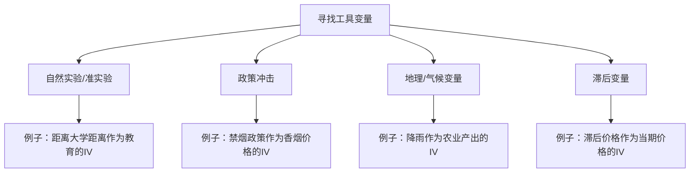

# KP01 内生性与工具变量

## 一句话直觉

> **当解释变量"不干净"（与扰动项相关）时，[[KP02_OLS正交性|OLS]]就被"污染"了；工具变量就是找来一个"干净的外援"，只通过内生变量影响被解释变量，不直接插手。**

---

## 一、核心定义

### [[01_什么是内生性|什么是内生性]]（Endogeneity）

内生性 = 解释变量 $x$ 与扰动项 $\varepsilon$ 相关，即 $\text{Cov}(x, \varepsilon) \neq 0$。

此时OLS估计量 $\hat{\beta}_{OLS}$ 不一致：

$$\text{plim } \hat{\beta}_{OLS} = \beta + \frac{\text{Cov}(x, \varepsilon)}{\text{Var}(x)} \neq \beta$$

### 内生性的三大来源

| 来源 | 机制 | 例子 |
|------|------|------|
| **[[KP01_遗漏变量偏差|遗漏变量偏差]]** | 未观测因素同时影响x和y | 能力同时影响教育年限和工资 |
| **测量误差偏差** | x的观测值 ≠ 真实值 | 用"报告收入"代替"真实收入" |
| **联立因果偏差** | y反过来影响x | 价格影响需求，需求也影响价格 |

### 工具变量（Instrumental Variable, IV）

找一个变量 $z$，满足两个条件：

1. **相关性（Relevance）**：$z$ 与内生变量 $x$ 相关，即 $\text{Cov}(z, x) \neq 0$
2. **外生性（Exogeneity / Exclusion Restriction）**：$z$ 与扰动项 $\varepsilon$ 不相关，即 $\text{Cov}(z, \varepsilon) = 0$

---

## 二、为什么OLS不行了

### 数学推导

真实模型：$y = \beta_0 + \beta_1 x + \varepsilon$

OLS估计量：

$$\hat{\beta}_{OLS} = \frac{\sum (x_i - \bar{x})(y_i - \bar{y})}{\sum (x_i - \bar{x})^2}$$

大样本极限：

$$\text{plim } \hat{\beta}_{OLS} = \beta_1 + \frac{\text{Cov}(x, \varepsilon)}{\text{Var}(x)}$$

关键结论：只要 $\text{Cov}(x, \varepsilon) \neq 0$，$\hat{\beta}_{OLS}$ 就偏向真实值，且样本再大也不会消失。

---

## 三、工具变量估计量怎么来的

### 单内生变量、单工具变量情形

真实模型：$y = \beta_0 + \beta_1 x + \varepsilon$，其中 $x$ 内生。

工具变量 $z$ 满足：$\text{Cov}(z, x) \neq 0$ 且 $\text{Cov}(z, \varepsilon) = 0$。

对模型两边取与 $z$ 的协方差：

$$\text{Cov}(z, y) = \beta_1 \text{Cov}(z, x) + \text{Cov}(z, \varepsilon) = \beta_1 \text{Cov}(z, x)$$

因此：

$$\hat{\beta}_{IV} = \frac{\text{Cov}(z, y)}{\text{Cov}(z, x)} = \frac{\sum (z_i - \bar{z})(y_i - \bar{y})}{\sum (z_i - \bar{z})(x_i - \bar{x})}$$

**直觉理解**：$z$ 带来的y的变动，全部归因于x对y的影响（因为z只通过x影响y）。

#### 【三问】IV 估计量这个"分式"是怎么想出来的？

- **怎么来的（直觉推导）**：原方程 $y = \beta_0 + \beta_1 x + \varepsilon$ 两边同时对 $z$ 取协方差，得到 $\text{Cov}(z,y) = \beta_1 \text{Cov}(z,x) + \text{Cov}(z,\varepsilon)$。因为工具变量满足外生性 $\text{Cov}(z,\varepsilon)=0$，最后一项消失；又因为相关性 $\text{Cov}(z,x)\neq 0$，可以除过去，解出 $\beta_1 = \text{Cov}(z,y)/\text{Cov}(z,x)$。用样本协方差代替总体协方差，就得到上面的公式。
- **为什么用它**：解决"当 x 本身不干净（与扰动项相关）时，OLS 被污染、估计有偏"的问题。IV 的核心思路是：不直接用 x 自己的变动（里面混杂了 $\varepsilon$），而是**借用 z 的那部分"干净的"变动**来识别 $\beta_1$。只要 z 只通过 x 影响 y，这部分变动就是纯净的，算出来的 $\hat\beta_{IV}$ 在大样本下一致。
- **知识为什么存在**：在 IV 之前，经济学家面对"价格与需求互为因果""教育与能力互为因果"这类问题束手无策——OLS 估计的不是因果，是相关。IV 方法（Wright 父子 1928 年研究烟草市场时发明）第一次让经济学家能**从相关中分离出因果**。今天绝大多数微观计量、劳动经济学、发展经济学的因果推断，都建立在 IV 思想之上（包括自然实验、双重差分、断点回归的底层逻辑都和 IV 同源）。

---

## 四、生活实例：禁烟政策作为香烟需求的IV

### 研究问题

估计香烟需求价格弹性：$Q = \beta_0 + \beta_1 P + \varepsilon$

**问题**：价格 $P$ 是内生的——供给和需求同时决定价格，价格与需求扰动项相关（联立因果偏差）。

### 找工具变量

**IV候选**：各州的禁烟政策（是否设立禁烟法）

- **相关性**：禁烟政策提高香烟零售价格（合规成本增加），所以 $\text{Cov}(\text{政策}, P) > 0$ ✓
- **外生性**：禁烟政策是外生的立法行为，不直接影响居民的香烟需求偏好 ✓

### 逐步计算

假设我们有以下简化数据（n=5）：

| 观测 | 价格P | 需求量Q | 政策Z(0/1) |
|------|-------|---------|------------|
| 1 | 4 | 100 | 0 |
| 2 | 5 | 90 | 0 |
| 3 | 6 | 80 | 1 |
| 4 | 7 | 70 | 1 |
| 5 | 8 | 60 | 1 |

**Step 1**：计算均值
- $\bar{P} = 6$，$\bar{Q} = 80$，$\bar{Z} = 0.6$

**Step 2**：计算协方差
- $\sum (Z_i - \bar{Z})(Q_i - \bar{Q})$
  - 观测1：$(0-0.6)(100-80) = -0.6 \times 20 = -12$
  - 观测2：$(0-0.6)(90-80) = -0.6 \times 10 = -6$
  - 观测3：$(1-0.6)(80-80) = 0.4 \times 0 = 0$
  - 观测4：$(1-0.6)(70-80) = 0.4 \times (-10) = -4$
  - 观测5：$(1-0.6)(60-80) = 0.4 \times (-20) = -8$
  - 合计：$-30$

- $\sum (Z_i - \bar{Z})(P_i - \bar{P})$
  - 观测1：$-0.6 \times (4-6) = -0.6 \times (-2) = 1.2$
  - 观测2：$-0.6 \times (5-6) = -0.6 \times (-1) = 0.6$
  - 观测3：$0.4 \times (6-6) = 0$
  - 观测4：$0.4 \times (7-6) = 0.4$
  - 观测5：$0.4 \times (8-6) = 0.8$
  - 合计：$3.0$

**Step 3**：IV估计量

$$\hat{\beta}_{IV} = \frac{-30}{3.0} = -10$$

**对比OLS**：

$$\hat{\beta}_{OLS} = \frac{\sum (P_i - \bar{P})(Q_i - \bar{Q})}{\sum (P_i - \bar{P})^2} = \frac{-100}{10} = -10$$

（在这个简化例子中碰巧相同，实际数据中IV与OLS通常差异很大。）

---

## 五、Stata 实现

```stata
* 数据：香烟需求量 Q，价格 P，政策虚拟变量 Z
use cigarette_data.dta, clear

* 单IV的2SLS（命令形式：被解释变量 外生变量 (内生变量 = 工具变量)）
ivregress 2sls Q (P = Z), robust

* 等价的手工两步法（仅理解原理，实际用ivregress）
* 第一步：P 对 Z 回归，得到拟合值
reg P Z
predict P_hat, xb

* 第二步：Q 对 P_hat 回归（注意：标准误不正确！）
reg Q P_hat
```

**注意**：手工两步法的标准误是错的，因为第二阶段使用的是拟合值而非真实值。实际分析必须用 `ivregress`。

---

## 六、常见误区

| 误区 | 正确理解 |
|------|----------|
| "工具变量越多越好" | 过度识别时需要检验工具变量外生性，[[KP03_弱工具变量|弱工具变量]]会导致估计偏误 |
| "IV一定比OLS好" | 如果没有内生性，OLS更有效；IV标准误通常更大 |
| "只要找到IV就万事大吉" | 外生性约束（排他性）无法检验，只能靠理论论证 |
| "IV估计就是因果效应" | IV估计的是LATE（局部平均处理效应），仅对受工具变量影响的子群体有效 |

---

## 七、如何寻找好的工具变量



**好IV的黄金标准**：
1. 经济理论能解释为什么它与内生变量相关
2. 经济理论能论证为什么它不直接影响被解释变量
3. 它是外生的（不由系统内部决定）

## 答辩常问（带标准答案）

1. **问：一个合格的工具变量必须满足哪两个条件？答辩时老师追问"这两个条件哪个能统计检验、哪个不能"怎么答？** 答：第一是**相关性**：z 必须与内生变量 x 相关（Cov(z,x)≠0），这个能直接检验——看第一阶段回归 x 对 z 的系数和 F 统计量；第二是**外生性（排他性约束）**：z 只能通过 x 影响 y，与扰动项无关（Cov(z,ε)=0），这个在恰好识别（一个内生变量一个工具）时**无法用统计方法检验**，只能靠经济理论和制度背景论证它为什么不直接影响 y。这也是"找 IV 难就难在外生性说不服人"的原因。
2. **问：解释变量"内生性"到底从哪来？有哪些典型来源？** 答：三大来源：一是**遗漏变量偏差**——不可观测的因素（如能力）同时影响 x 和 y；二是**测量误差偏差**——x 的观测值不等于真实值（如用自报收入代替真实收入），经典测量误差会让系数向零衰减；三是**联立因果偏差**——y 反过来影响 x（价格与需求量互为因果，观测到的是供需曲线的交点）。三者的共同后果都是 Cov(x,ε)≠0，OLS 不一致，样本再大也救不了。
3. **问：为什么 IV 估计量 $\hat\beta_{IV}=Cov(z,y)/Cov(z,x)$ 就是一致的？** 答：把真实方程 $y=\beta_0+\beta_1x+\varepsilon$ 两边同时对 z 取协方差：$Cov(z,y)=\beta_1Cov(z,x)+Cov(z,\varepsilon)$。由外生性第二项为零，由相关性分母不为零可以除过去，于是 $plim(\hat\beta_{IV})=\beta_1$。直觉是：z 引起的那部分 y 的变动是"干净"的（不沾 ε），全部归因于 x 对 y 的因果效应。
4. **问：IV 估出来的系数是不是就是"X 对 Y 的总体因果效应"（ATE）？** 答：不是，这是高频陷阱。IV 识别的是**LATE（局部平均处理效应）**——只对"受工具变量影响而改变了 x 取值"的那部分子群体（依从者）有效。例如用"是否到大学附近居住"做教育的 IV，估出来的是"居住位置真的影响了上学选择"那群人的教育回报，不是全体人群的平均效应。答辩时说"IV 估计的是 LATE，不能直接推广到全体"会显得非常严谨。

---

## 🔗 相关知识点

**同章关联：** [[KP02_两阶段最小二乘2SLS|2SLS估计法]]｜[[KP03_弱工具变量|弱工具变量]]｜[[KP04_过度识别与Hausman|过度识别与Hausman检验]]

**跨章关联：** [[../../11_面板数据/知识点/KP01_固定效应模型|固定效应FE（另一种解决内生性的思路）]]｜[[../../04_多元线性回归/知识点/KP01_多元回归模型|多元回归基础]]

**🐮 大牛库深入：** [[../../../经济统计学论文从0基础到精通/05_内生性与面板/01_什么是内生性|什么是内生性]]｜[[../../../经济统计学论文从0基础到精通/05_内生性与面板/03_工具变量IV|工具变量IV详解]]

**📖 原书原文：** [[../../../原文件/计量经济学/陈强_计量经济学及Stata应用_全书|陈强《计量经济学及Stata应用》第9章]]
