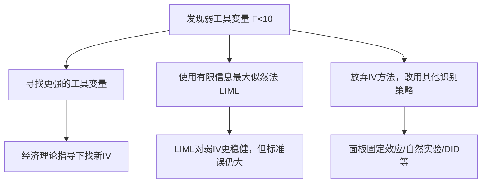

# KP03 弱工具变量

<div style="text-align:right;margin:10px 0;"><a href="../../../../exam.html" target="_blank" style="display:inline-block;padding:6px 16px;background:#2563eb;color:#fff;border-radius:6px;text-decoration:none;font-size:14px;">📝 开始做题</a></div>


## 一句话直觉

> **如果工具变量和内生变量几乎不相关，那它就像一根"细软的绳子"——看着连着，其实拉不动任何东西，估计结果完全不可靠。**

---

## 一、什么是弱工具变量

### 定义

工具变量 $z$ 与内生变量 $x$ 的相关性很弱，即第一阶段回归中 $z$ 的系数不显著或 $R^2$ 很低。

### 数学表达

第一阶段：$x = \pi_0 + \pi_1 z + \text{其他外生变量} + v$

弱工具变量意味着 $\pi_1$ 接近0，即 $z$ 对 $x$ 的解释力很弱。

---

## 二、弱工具变量的后果

| 后果 | 说明 |
|------|------|
| **2[[KP02_两阶段最小二乘2SLS|SLS]]估计不一致** | 即使大样本也无法收敛到真实值 |
| **估计偏向[[KP02_OLS正交性|OLS]]** | 弱IV时，2SLS的偏误方向指向OLS（最极端情况等于OLS） |
| **标准误被低估** | 看起来显著，实际不可靠 |
| **[[KP02_假设检验|假设检验]]失真** | 置信区间覆盖率远低于名义水平（如名义95%实际只有30%） |

### 偏误方向的直觉

- 强IV：2SLS ≈ 真实值，OLS有偏
- 弱IV：2SLS → OLS（偏误回来了）
- 结论：弱IV比没有IV好不了多少

---

## 三、如何检验弱工具变量

### 经验法则：第一阶段F统计量 > 10

这是Stock和Yogo提出的经典经验法则：

- **F > 10**：工具变量不算太弱，2SLS偏误 < 10%的OLS偏误
- **F < 10**：弱工具变量问题严重

### 为什么用F统计量

第一阶段回归中，检验"所有工具变量系数联合为0"的F统计量，直接衡量工具变量对内生变量的联合解释力。

### Stock-Yogo 检验（更严格）

- 原假设：工具变量是弱的
- 备择假设：工具变量是强的
- 临界值根据"最大容忍偏误比例"和工具变量个数而定
- Stata中 `estat firststage` 会自动报告

---

## 四、生活实例："弱绳拉大车"

### 类比

想象你要用一根绳子拉一辆卡车：

- **强IV**：钢丝绳（粗、结实）→ 能拉动卡车（有效估计）
- **弱IV**：棉线（细、脆弱）→ 拉不动，卡车纹丝不动（无效估计）
- **没有IV**：直接推卡车（OLS偏误）

### 具体计算

假设第一阶段回归：$x = \pi_0 + \pi_1 z + v$

| 情形 | $\hat{\pi}_1$ | 标准误 | F统计量 | 判断 |
|------|---------------|--------|---------|------|
| 强IV | 0.50 | 0.10 | 25.0 | F>10，工具变量有效 |
| 中等IV | 0.15 | 0.08 | 3.5 | F<10，弱工具变量 |
| 极弱IV | 0.02 | 0.05 | 0.16 | F≈0，几乎无关 |

**F统计量计算**：$F = (\hat{\pi}_1 / \text{SE}(\hat{\pi}_1))^2$

- 强IV：$F = (0.50/0.10)^2 = 25$
- 中等IV：$F = (0.15/0.08)^2 = 3.5$
- 极弱IV：$F = (0.02/0.05)^2 = 0.16$

---

## 五、Stata 实现

```stata
* 2SLS回归
ivregress 2sls lnwage exper (educ = quarter nearcollege), robust

* 查看第一阶段和弱工具变量检验
estat firststage

* estat firststage 输出解读：
* 1. 第一阶段回归的R-squared
* 2. 第一阶段F统计量（关键！>10为好）
* 3. Stock-Yogo临界值（如果Stata版本支持）
* 4. 最小特征值统计量

* 如果有多个内生变量，会分别报告每个内生变量的第一阶段F
```

### 输出解读示例

```
First-stage regression summary statistics

  Variable |    R-sq   Adjusted R-sq  Partial R-sq  F(2, 995)
-----------+------------------------------------------------------
      educ |   0.356        0.349         0.082       22.45
```

- Partial R-sq = 0.082：工具变量单独解释了教育年限约8%的变异
- F = 22.45 > 10：通过弱工具变量检验 ✓

---

## 六、弱工具变量怎么办



### 解决方案

1. **找更强的IV**：经济理论驱动，找与内生变量更相关的外生变量
2. **使用LIML**：有限信息[[KP02_最大似然估计|最大似然估计]]，对弱IV的偏误比2SLS小
   ```stata
   ivregress liml lnwage exper (educ = quarter nearcollege), robust
   ```
3. **增加工具变量个数**：更多IV可能提高第一阶段F（但也可能引入弱IV问题）
4. **放弃IV**：如果实在找不到好IV，坦诚讨论内生性问题，不要硬上

---

## 七、关键数字记忆

| 指标 | 好 | 坏 |
|------|-----|-----|
| 第一阶段F统计量 | > 10 | < 10 |
| Partial R-sq | > 0.1 | < 0.05 |
| 工具变量t统计量（单IV） | > 3.2（≈√10） | < 3.2 |

---

## 八、常见误区

| 误区 | 正确理解 |
|------|----------|
| "F>10就万事大吉" | 10是经验法则，不是绝对标准；F=9.9也可能有偏误 |
| "工具变量越多越好" | 弱IV多了反而更糟，不如少而精 |
| "弱IV也能出显著结果" | 显著结果可能是偏误造成的，不可信 |
| "LIML完全解决弱IV问题" | LIML偏误小但标准误大，不是万能药 |

## 答辩常问（带标准答案）

1. **问：工具变量弱（z 与 x 几乎不相关）会造成什么后果？为什么说"弱 IV 比没有 IV 好不了多少"？** 答：三个后果：一是 2SLS 估计量**不一致**，偏误方向系统性地指向 OLS——IV 越弱，2SLS 越像 OLS，极端情况下两者几乎相等；二是标准误被低估，t 值虚高，"显著"结果可能纯粹是偏误造成的；三是置信区间严重失真，名义 95% 的区间实际覆盖率可能只有 30% 左右。直觉是：弱工具变量像一根棉线拉卡车，拉不动就等于没拉，估计又回到 OLS 的老路上。
2. **问：第一阶段 F > 10 这个经验法则是哪来的？背后的含义是什么？** 答：来自 Stock-Yogo 的弱工具变量检验研究。含义是：F > 10 时，2SLS 估计的偏误不超过 OLS 偏误的 10%，可以接受；F < 10 则说明工具太弱，偏误不可忽略。只有一个工具变量时，检验就是看 t 值，换算过来是 |t| > √10 ≈ 3.2。要注意 10 只是经验法则不是硬门槛，F=9.9 不代表立刻报废，但应该警惕并报告 Stock-Yogo 临界值。
3. **问：答辩时第一阶段 F 只有 5，老师问你"工具变量太弱怎么办"，怎么答？** 答：三条路按优先级说：一是在经济理论指导下**另找更强的工具变量**；二是改用量限信息最大似然法 **LIML**（`ivregress liml`），它对弱 IV 的偏误比 2SLS 小，但代价是标准误变大；三是干脆放弃 IV，换用其他识别策略（面板[[06_固定效应FE|固定效应]]、双重差分、断点回归等）。同时要说明：工具变量不是越多越好，堆一堆弱 IV 反而让偏误更严重。

---

## 🔗 相关知识点

**同章关联：** [[KP01_内生性与工具变量|内生性与工具变量]]｜[[KP02_两阶段最小二乘2SLS|2SLS估计法]]｜[[KP04_过度识别与Hausman|过度识别与Hausman检验]]

**跨章关联：** [[../../11_面板数据/知识点/KP01_固定效应模型|固定效应FE（替代IV的另一种因果识别策略）]]｜[[../../06_异方差/知识点/KP01_异方差检验|异方差检验]]

**🐮 大牛库深入：** [[../../../../经济统计学论文从0基础到精通/05_内生性与面板/03_工具变量IV|工具变量IV详解]]｜[[../../../../经济统计学论文从0基础到精通/05_内生性与面板/04_两阶段最小二乘2SLS|2SLS实操]]

**📖 原书原文：** [[../../../../原文件/计量经济学/陈强_计量经济学及Stata应用_全书|陈强《计量经济学及Stata应用》第9章]]

