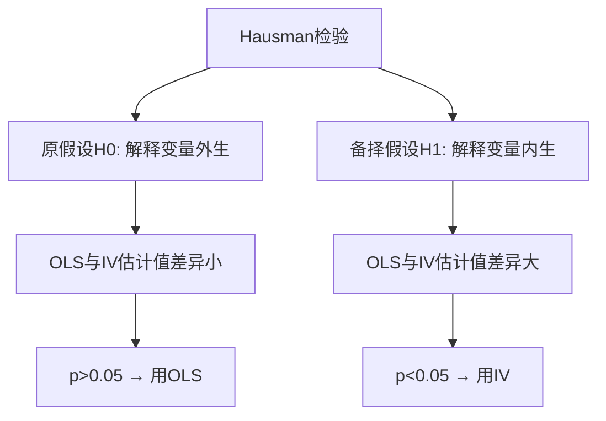
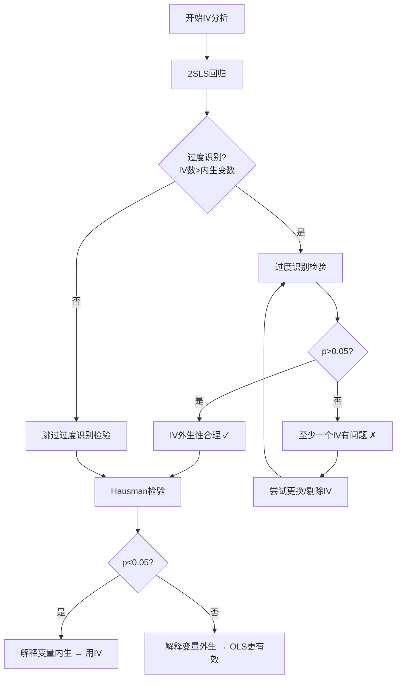

# KP04 过度识别与Hausman检验

## 一句话直觉

> **过度识别检验是"[[03_工具变量IV|工具变量]]的体检"——查它们是否真的干净；Hausman检验是"[[KP02_OLS正交性|OLS]]和IV的PK赛"——决定到底该用哪个。**

---

## 一、过度识别检验（Overidentification Test）

### 什么时候需要

- 工具变量个数 $L$ > 内生变量个数 $K$（过度识别）
- 如果 $L = K$（恰好识别），无法检验

### 核心思想

如果所有工具变量都是外生的，那么2[[KP02_两阶段最小二乘2SLS|SLS]]残差应该与所有工具变量不相关。

**检验步骤**：
1. 做2SLS回归，得到残差 $\hat{\varepsilon}_{2SLS}$
2. 将残差对所有外生变量（包括工具变量）回归
3. 得到 $R^2$
4. 构造统计量：$nR^2 \sim \chi^2(L-K)$

### Sargan vs Hansen J

| 检验 | 适用条件 | Stata命令 |
|------|----------|-----------|
| Sargan检验 | 同方差假设 | `estat overid` |
| Hansen J检验 | [[02_异方差|异方差]]稳健（更通用） | `estat overid, robust` |

### 判断规则

- **原假设 $H_0$**：所有工具变量都是外生的（有效）
- **p值 > 0.05**：接受原假设，工具变量外生性合理 ✓
- **p值 < 0.05**：拒绝原假设，至少有一个工具变量不是外生的 ✗

---

## 二、Hausman检验（内生性检验）

### 核心问题

**到底该用OLS还是IV？**

- 如果解释变量是外生的 → OLS一致且有效（更优选）
- 如果解释变量是内生的 → OLS不一致，必须用IV

Hausman检验就是在两者之间做统计判断。

### 检验逻辑



### 统计量

$$H = (\hat{\beta}_{IV} - \hat{\beta}_{OLS})' [\text{Var}(\hat{\beta}_{IV}) - \text{Var}(\hat{\beta}_{OLS})]^{-1} (\hat{\beta}_{IV} - \hat{\beta}_{OLS}) \sim \chi^2(K)$$

其中 $K$ 为内生变量个数。

### 直觉理解

- 如果OLS和IV估计差不多 → 说明OLS没有偏误 → 用OLS（更有效）
- 如果OLS和IV估计差很多 → 说明OLS有偏误 → 用IV（虽然不那么有效，但一致）

---

## 三、生活实例：教育回报率该用OLS还是IV？

### 研究问题

估计教育年限对工资的影响：$\ln(wage) = \beta_0 + \beta_1 educ + \varepsilon$

### 两种估计结果

| 方法 | $\hat{\beta}_1$ | 标准误 |
|------|-----------------|--------|
| OLS | 0.075 | 0.010 |
| 2SLS（IV=出生季度） | 0.120 | 0.040 |

### Hausman检验计算

[[KP02_假设检验|假设检验]]统计量 $H = 4.2$，自由度 = 1（一个内生变量）

- $\chi^2(1)$ 的5%临界值 = 3.84
- $H = 4.2 > 3.84$ → p < 0.05
- **结论**：拒绝原假设，教育年限是内生的，应该用IV估计

**经济解释**：能力偏差使得OLS低估了教育回报率（或者高估，取决于具体情况）。IV估计的0.12意味着每多一年教育工资提高12%。

---

## 四、Stata 完整代码

```stata
* ===== 过度识别检验 =====
ivregress 2sls lnwage exper (educ = quarter nearcollege), robust
estat overid  // Hansen J检验（因为用了robust）

* 输出解读：
* Hansen J statistic (N*R2) = 2.34
* Chi-sq(1) p-value = 0.126
* p>0.05 → 工具变量外生性合理

* ===== Hausman检验 =====
* 方法1：传统hausman命令
ivregress 2sls lnwage exper (educ = quarter), robust
estimates store iv_model

reg lnwage educ exper
estimates store ols_model

hausman iv_model ols_model, sigmamore

* 方法2：DWH检验（更常用，异方差稳健）
* 先做第一阶段回归，提取残差
reg educ quarter exper
predict v_hat, resid

* 把残差放入原回归
reg lnwage educ exper v_hat
* v_hat的t检验就是DWH检验
* 如果v_hat显著 → 教育年限内生
```

---

## 五、决策流程图



---

## 六、对比表：过度识别检验 vs Hausman检验

| 维度 | 过度识别检验 | Hausman检验 |
|------|-------------|-------------|
| 检验对象 | 工具变量是否外生 | 解释变量是否内生 |
| 原假设 | 所有IV外生 | 解释变量外生（OLS一致） |
| 适用条件 | 过度识别（L>K） | 有有效IV |
| p>0.05意味着 | IV是干净的 | 可以用OLS |
| p<0.05意味着 | IV有问题 | 必须用IV |
| Stata命令 | `estat overid` | `hausman` 或 DWH检验 |

---

## 七、常见误区

| 误区 | 正确理解 |
|------|----------|
| "Hausman p>0.05就说明没有内生性" | 可能是检验功效不够（样本小），不是真的没有内生性 |
| "过度识别检验通过了就说明IV完美" | 只检验了"过度识别部分"的IV，恰好识别的IV无法检验 |
| "过度识别p<0.05说明所有IV都不行" | 可能只有一个IV有问题，其他可能是好的 |
| "Hausman显著就必须用IV" | 还要看IV是否强；弱IV下Hausman检验本身也不可靠 |
| "OLS和IV估计差很多就一定是内生性" | 也可能是IV估计的是LATE，与OLS的ATE本来就不同 |

## 答辩常问（带标准答案）

1. **问：过度识别检验什么情况下才能做？它的原假设和判断规则是什么？** 答：只有当工具变量个数 L **严格多于**内生变量个数 K（过度识别）时才能做——恰好识别（L=K）时没有多余的工具可用来"互相检验"，自由度为零，统计量算不出来。它的原假设是"所有工具变量都是外生的（干净的）"：把 2SLS 残差对所有外生变量回归，用 $nR^2$ 构造卡方统计量。判断规则是 **p > 0.05 不拒绝原假设，说明工具外生性合理；p < 0.05 则至少有一个工具不干净**，需要逐一排查。同方差用 Sargan，异方差稳健用 Hansen J（`estat overid, robust`）。
2. **问：Hausman 检验到底在检验什么？结果怎么指导"用 OLS 还是用 IV"？** 答：它检验的是"解释变量到底外生还是内生"。思路是比较两个估计量：若解释变量外生，OLS 一致且有效、IV 也一致但更不精确，两者估计值应该接近；若解释变量内生，OLS 不一致，两个估计值会系统性地差很多。决策规则：原假设是"解释变量外生（OLS 一致）"——**p > 0.05 不拒绝，说明 OLS 没偏，直接用 OLS（更有效）；p < 0.05 拒绝，说明 OLS 有偏，必须改用 IV**。Stata 中异方差稳健做法是 DWH 检验：把第一阶段残差 $\hat v$ 放进原回归看其显著性。
3. **问：如果 OLS 和 IV 两个估计值差很多，能不能直接断定"存在内生性"？** 答：不能，这是陷阱题。两个估计差大有两种解释：一是 OLS 有偏（真内生）；二是 IV 估计的本来就不是同一个参数——IV 识别的是 **LATE**（只对受工具影响的子群体有效），OLS 反映的可能是全体的平均效应（ATE），两组人群不同，系数天然就不该相等。另外，如果工具变量本身很弱，Hausman 检验的结论也不可靠。严谨的表述是：差异 + 强工具 + 理论论证，三者齐备才能说"OLS 有内生性偏误"。

---

## 🔗 相关知识点

**同章关联：** [[KP01_内生性与工具变量|内生性与工具变量]]｜[[KP02_两阶段最小二乘2SLS|2SLS估计法]]｜[[KP03_弱工具变量|弱工具变量]]

**跨章关联：** [[../../11_面板数据/知识点/KP03_Hausman检验|面板Hausman检验（FE vs RE选择）]]｜[[../../02_数学回顾/知识点/KP02_假设检验思想|假设检验的基本逻辑]]

**🐮 大牛库深入：** [[../../../经济统计学论文从0基础到精通/05_内生性与面板/07_随机效应RE与Hausman检验|RE与Hausman检验]]｜[[../../../经济统计学论文从0基础到精通/05_内生性与面板/04_两阶段最小二乘2SLS|2SLS实操]]

**📖 原书原文：** [[../../../原文件/计量经济学/陈强_计量经济学及Stata应用_全书|陈强《计量经济学及Stata应用》第9-10章]]

