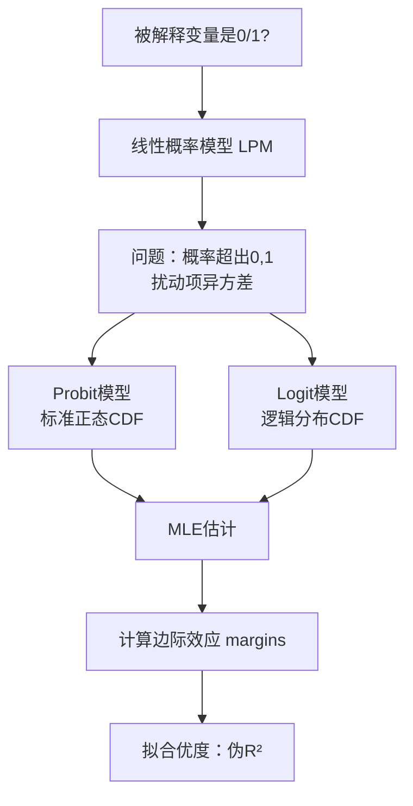

# 第11章 二值选择模型 · 章节总结

## 核心问题：当被解释变量是0/1时

[[KP02_OLS正交性|OLS]]（线性概率模型LPM）的问题：
- 预测概率可能超出[0,1]区间
- 扰动项必然[[02_异方差|异方差]]
- 边际效应是常数（不现实）

解决方案：Probit / Logit 模型



## Logit vs Probit 对比

| 维度 | Logit | Probit |
|------|-------|--------|
| 分布 | 逻辑分布 | 标准[[07_正态分布|正态分布]] |
| 尾部 | 更厚 | 较薄 |
| 系数尺度 | ≈ Probit × 1.6 | ≈ Logit / 1.6 |
| 边际效应 | 几乎相同 | 几乎相同 |
| 计算复杂度 | 更简单 | 稍复杂 |
| 适用场景 | 大样本、厚尾数据 | 正态假设合理时 |

**关键结论**：实际应用中，Logit和Probit的边际效应和预测概率几乎没有差别。

## 核心公式

- **Probit**：$P(y=1|x) = \Phi(\beta_0 + \beta_1 x)$
- **Logit**：$P(y=1|x) = \frac{1}{1 + e^{-(\beta_0 + \beta_1 x)}}$
- **Logit对数几率**：$\ln\left(\frac{P}{1-P}\right) = \beta_0 + \beta_1 x$
- **边际效应（均值处）**：$\frac{\partial P}{\partial x} = \phi(\cdot) \cdot \beta_1$（Probit）

## Stata 命令速查

```stata
* Probit回归
probit y x1 x2 x3

* Logit回归
logit y x1 x2 x3

* 计算平均边际效应
margins, dydx(x1 x2 x3)

* 计算在特定值处的预测概率
margins, at(x1=5)

* 拟合优度
estat classify  // 分类准确率
```

## 本章方法答辩速查

1. **问：被解释变量是 0/1 时，为什么不直接用 OLS（LPM）？LPM 什么时候还能将就用？** 答：LPM 三个硬伤：预测值可能超出 [0,1]（不像概率）、扰动项必然异方差（方差 p(1-p) 随 x 变）、假设 x 对概率的边际效应是常数（现实是 S 曲线中间陡、两端平）。Logit/Probit 用 S 型 CDF 把线性指数压缩到 0~1，天然解决这三点。但实务中如果样本里 y=1 的概率集中在 0.2~0.8 之间、S 曲线接近直线段，LPM 的系数近似等于边际效应，简单直观、解释方便，也能凑合用；概率接近 0 或 1（稀有事件）时必须用 Logit/Probit。
2. **问：二值模型论文的报告规范是什么？为什么不能把 Stata 输出的 β₁ 直接抄进结论？** 答：规范是：原始系数 β₁ 只是潜变量指数上的斜率，**必须用 `margins, dydx(...)` 算出平均边际效应（AME）再报告**——边际效应 = φ(·)·β₁，随 x 取值变化（教育 6 年处和 16 年处不同）。另外 Logit 和 Probit 系数尺度差约 1.6 倍，但大样本下边际效应和预测概率几乎相同，被问"选哪个"时答：结论一致，看有没有几率比（e^β）的解释需求。

---

## 🔗 相关知识点

**同章KP导航：** [[知识点/KP01_Logit与Probit|KP01 Logit与Probit]]｜[[知识点/KP02_最大似然估计|KP02 最大似然估计]]

**跨章方法进阶：** [[../03_一元线性回归/知识点/KP01_OLS估计量推导|一元OLS（LPM对比）]]→ 本章Logit/Probit → [[../11_面板数据/知识点/KP01_固定效应模型|面板模型（面板Logit/Probit基础）]]

**🐮 大牛库对应模块：** [[../../../经济统计学论文从0基础到精通/06_受限因变量/README|06 受限因变量模块]]

**📖 原书原文：** [[../../../原文件/计量经济学/陈强_计量经济学及Stata应用_全书|陈强《计量经济学及Stata应用》第11章]]
