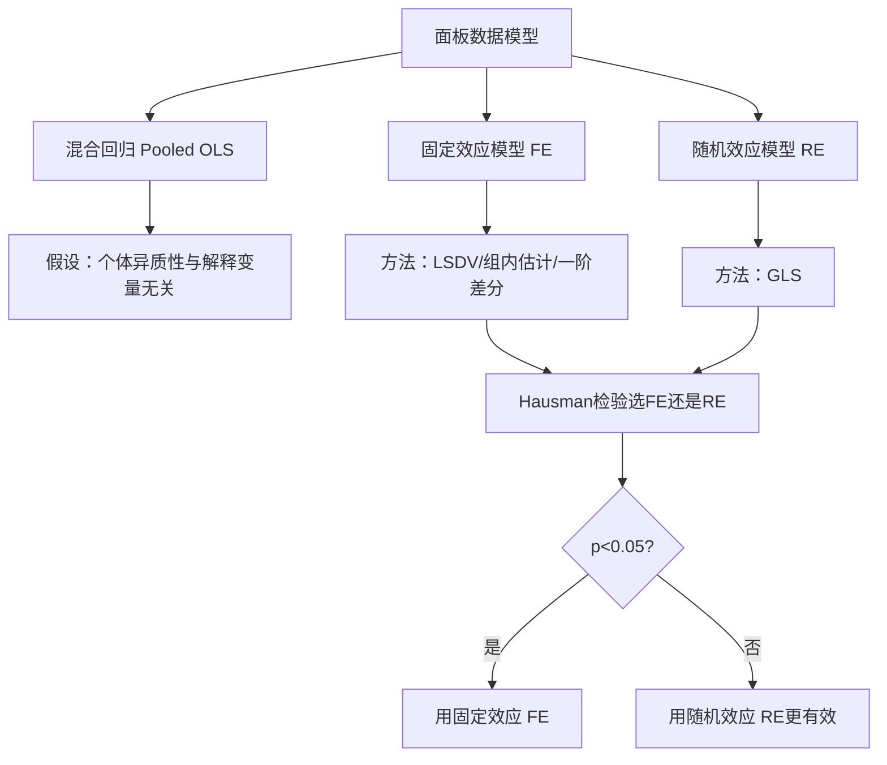
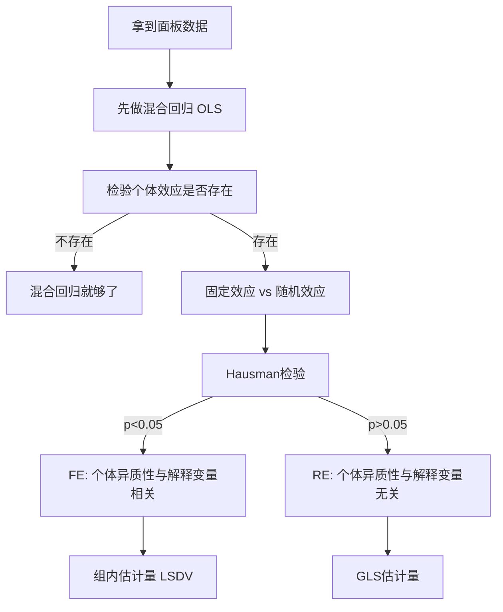

# 第12章 面板数据 · 章节总结

## 核心问题：面板数据比横截面好在哪里

面板数据 = 同一个体在不同时间的重复观测。

优势：
- 控制个体不可观测的异质性（[[KP01_遗漏变量偏差|遗漏变量偏差]]）
- 更多观测值 → 更精确的估计
- 可以追踪动态变化



## 决策流程



## 三种模型对比

| 模型 | 个体效应处理 | 一致性条件 | 有效性 |
|------|-------------|-----------|--------|
| 混合[[KP02_OLS正交性|OLS]] | 忽略 | 个体效应与解释变量无关 | 最有效（如果假设成立） |
| [[06_固定效应FE|固定效应]]FE | 允许与解释变量相关 | 总一致 | 损失部分信息 |
| [[07_随机效应RE与Hausman检验|随机效应]]RE | 假设与解释变量无关 | 仅当假设成立时一致 | 比FE更有效 |

## Stata 命令速查

```stata
* 设定面板数据
xtset id year

* 混合回归
reg y x1 x2

* 固定效应
xtreg y x1 x2, fe

* 随机效应
xtreg y x1 x2, re

* Hausman检验
xtreg y x1 x2, fe
estimates store fe
xtreg y x1 x2, re
estimates store re
hausman fe re
```

## 本章方法答辩速查

1. **问：拿到面板数据，从混合 OLS 到 FE/RE 的完整决策顺序是什么？** 答：三步走：① 先跑混合 OLS；② 做 **Breusch-Pagan LM 检验**（`xttest0`）看个体效应是否存在——原假设 $\sigma_u^2=0$（不需要个体效应），p>0.05 就停在混合 OLS；③ 个体效应存在时做 **Hausman 检验**——p<0.05（拒绝"RE 假设"）选 **FE**（个体效应与解释变量相关，RE 有偏）；p>0.05 选 **RE**（更有效，还能估计不随时间变化的变量）。答辩被问"为什么不直接默认 FE"，答案是：RE 假设成立时更有效、且能识别性别这类不变变量，没必要一律用 FE。
2. **问：[[KP01_固定效应模型|固定效应模型]]能解决所有遗漏变量问题吗？它的识别边界在哪？** 答：不能。FE 靠组内去均值，只能消掉**不随时间变化**的遗漏变量（个人能力、地区地理、企业文化）；随时间变化的混淆因素（个人健康逐年变化、地区当年政策冲击）仍留在扰动项里，还得靠[[03_工具变量IV|工具变量]]。另外 FE 的识别代价是：**不随时间变化的核心解释变量（性别、种族、地理位置）会被连同 $u_i$ 一起消掉，无法估计**——选 FE 前必须确认核心变量在样本期内真的随时间变化。

---

## 🔗 相关知识点

**同章KP导航：** [[知识点/KP01_固定效应模型|KP01 固定效应模型FE]]｜[[知识点/KP02_随机效应模型|KP02 随机效应模型RE]]｜[[知识点/KP03_Hausman检验|KP03 Hausman检验]]

**跨章方法进阶链条：** [[../09_工具变量法/知识点/KP01_内生性与工具变量|工具变量IV]] → 本章面板FE/RE → [[../12_平稳时间序列/00_章节总结|平稳时间序列]]

**🐮 大牛库对应模块：** [[../../../经济统计学论文从0基础到精通/05_内生性与面板/README|05 内生性与面板模块]]

**📖 原书原文：** [[../../../原文件/计量经济学/陈强_计量经济学及Stata应用_全书|陈强《计量经济学及Stata应用》第10章]]
