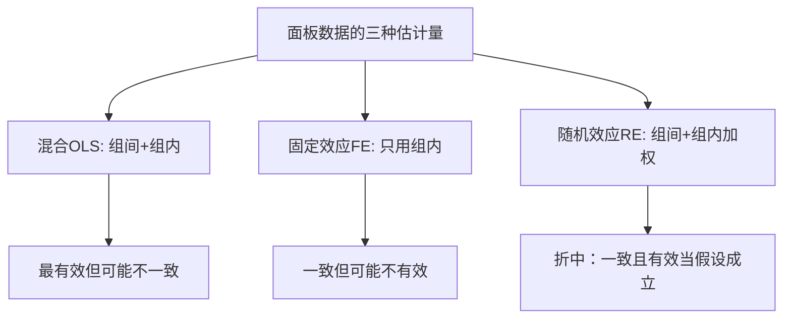

# KP02 随机效应模型

<div style="text-align:right;margin:10px 0;"><a href="../../../../exam.html" target="_blank" style="display:inline-block;padding:6px 16px;background:#2563eb;color:#fff;border-radius:6px;text-decoration:none;font-size:14px;">📝 开始做题</a></div>


## 一句话直觉

> **随机效应模型假设每个个体的"底色"是从一个大分布里随机抽出来的——就像从一个池子里随机捞人，而不是给每个人单独建档案。这样更省信息、更有效。**

---

## 一、模型设定

### 与[[06_固定效应FE|固定效应]]的区别

$$y_{it} = \beta_0 + \beta_1 x_{it} + u_i + \varepsilon_{it}$$

**随机效应的关键假设**：

$$\text{Cov}(u_i, x_{it}) = 0$$

个体效应 $u_i$ 与解释变量 $x_{it}$ **不相关**。

### 随机效应的分布假设

$$u_i \sim N(0, \sigma_u^2)$$

$$\varepsilon_{it} \sim N(0, \sigma_\varepsilon^2)$$

$u_i$ 被视为随机变量，而不是每个个体的固定参数。

---

## 二、RE的估计方法：GLS

### 为什么不能用[[KP02_OLS正交性|OLS]]

因为复合扰动项 $u_i + \varepsilon_{it}$ 存在序列相关：

$$\text{Cov}(u_i + \varepsilon_{it}, u_i + \varepsilon_{is}) = \sigma_u^2 \neq 0 \quad (t \neq s)$$

同一个体不同时间的扰动项相关（因为共享 $u_i$）。

### GLS的思想

对数据做变换，消除序列相关，然后用OLS。

$$y_{it} - \theta \bar{y}_i = \beta_0 (1-\theta) + \beta_1 (x_{it} - \theta \bar{x}_i) + \text{error}$$

其中 $\theta$ 是一个介于0和1之间的权重：

$$\theta = 1 - \frac{\sigma_\varepsilon}{\sqrt{\sigma_\varepsilon^2 + T\sigma_u^2}}$$

### θ的直觉

- 如果 $\sigma_u^2$ 很大（个体效应很强）→ θ接近1 → 几乎就是FE（组内估计）
- 如果 $\sigma_u^2$ 很小（个体效应很弱）→ θ接近0 → 几乎就是混合OLS

**RE是FE和混合OLS的折中**。

---

## 三、FE vs RE 对比

| 维度 | 固定效应 FE | 随机效应 RE |
|------|------------|------------|
| 个体效应与x相关 | 允许 | 不允许（必须无关） |
| 估计量 | 组内估计/LSDV | GLS |
| 一致性 | 总一致 | 仅当假设成立时一致 |
| 有效性 | 较低（只用组内变异） | 较高（用了组间+组内变异） |
| 能否估计不随时间变的变量 | 不能 | 能 |
| 适用场景 | 个体效应与x相关 | 个体效应与x无关 |

### 什么时候RE更有效

- 如果 $\text{Cov}(u_i, x_{it}) = 0$ 成立，RE比FE更有效（标准误更小）
- RE还能估计"性别"、"种族"等不随时间变化的变量的系数
- FE完全吸收了这些变量的效应

---

## 四、生活实例：研究公司利润率

### 研究问题

估计研发投入对公司利润率的影响：$profit_{it} = \beta_0 + \beta_1 R\&D_{it} + u_i + \varepsilon_{it}$

### 两种视角

**FE视角**：
- 每个公司有自己的"企业文化"（$u_i$），可能与研发投入相关
- 控制公司固定效应，看"同一个公司，增加研发后利润率怎么变"

**RE视角**：
- 假设"企业文化"是随机的，与研发投入无关
- 既比较"不同公司之间"的差异，也比较"同一公司不同时间"的差异

### 什么时候用RE

如果企业文化确实与研发投入无关（比如行业随机分配了研发投入），RE更有效。

但现实中，研发投入多的公司可能本来就是"好公司"（$u_i$ 高），所以FE更可靠。

---

## 五、Stata 完整代码

```stata
* 设定面板数据
xtset id year

* ===== 随机效应回归 =====
xtreg profit rd, re

* 输出解读：
* rd系数 = 0.35（RE估计）
* sigma_u = 0.5  ← 个体效应的标准差
* sigma_e = 0.2  ← 随机扰动的标准差
* rho = 0.83     ← 个体效应方差占总方差的比例

* ===== 组间估计量（Between Estimator） =====
* 只用个体间变异，不用个体内变异
xtreg profit rd, be

* 输出解读：
* 相当于对每个个体取时间均值，然后做横截面回归
* 衡量"研发投入多的公司，利润率是否更高"（纯组间比较）

* ===== Breusch-Pagan LM检验：是否需要随机效应 =====
* 原假设：sigma_u^2 = 0（不需要个体效应，混合OLS就够了）
xtreg profit rd, re
xttest0

* 如果p<0.05 → 存在个体效应，不能用混合OLS
```

---

## 六、RE的三个估计量的关系



**直觉**：
- 混合OLS：把所有数据混在一起
- FE：只看同一个体内部的变化
- RE：既看个体内部，也看个体之间，但给个体内部更大的权重

---

## 七、常见误区

| 误区 | 正确理解 |
|------|----------|
| "RE就是OLS" | RE是GLS，对序列相关做了校正 |
| "RE一定比FE差" | 如果假设成立，RE更有效，还能估计时间不变变量 |
| "rho很大说明要用FE" | rho大只说明个体效应重要，不代表与x相关 |
| "RE的假设无法检验" | Hausman检验就是专门检验RE假设的 |

## 答辩常问（带标准答案）

1. **问：随机效应模型成立的关键假设是什么？这个假设现实中为什么常常不成立？** 答：核心假设是个体效应与解释变量不相关：$Cov(u_i, x_{it})=0$——把"每个个体的底色"当成从一个分布里随机抽出来的，而不是和 x 有系统关系。现实中这个假设经常不成立，例如研究研发对利润率的影响时，研发投入多的公司本身就是"好公司"（$u_i$ 高），$u_i$ 和 $x_{it}$ 天然相关。所以 RE 不是默认选择，必须用 Hausman 检验判断这个假设站不站得住。
2. **问：RE 为什么不能直接用 OLS，而要用 GLS？** 答：因为复合扰动项 $u_i+\varepsilon_{it}$ 在同一个体的不同时间点之间是相关的——同一公司 2010 年和 2011 年的扰动项共享同一个 $u_i$，$Cov(u_i+\varepsilon_{it}, u_i+\varepsilon_{is})=\sigma_u^2\neq0$（t≠s）。直接 OLS 的标准误把观测当成独立的，会算错。GLS 的做法是对数据做 $y_{it}-\theta\bar y_i$ 变换（θ 介于 0 和 1 之间），把序列相关消掉后再 OLS：θ 接近 1 时退化成 FE，θ 接近 0 时退化成混合 OLS——所以 RE 是 FE 和混合 OLS 的加权折中。
3. **问：RE 比 FE 好在哪里、差在哪里？什么时候该选 RE？** 答：好处理由两条：一是它同时利用了**组间（个体之间）和组内（个体内部）**两部分变异，假设成立时比只用组内变异的 FE 更有效、标准误更小；二是它能估计**不随时间变化的变量**（性别、种族、行业），而 FE 会把这些变量连同 $u_i$ 一起消掉。差的地方是：一旦 $Cov(u_i,x)\neq0$ 不成立，RE 就不一致，而 FE 永远一致。决策规则是：Hausman 检验 p>0.05（不能拒绝"RE 假设"）就选 RE 换有效性；p<0.05 就选 FE 保一致性。

---

## 🔗 相关知识点

**同章关联：** [[KP01_固定效应模型|固定效应模型（FE）]]｜[[KP03_Hausman检验|Hausman检验（FE vs RE选择）]]

**跨章关联：** [[../../07_自相关/知识点/KP01_DW检验|自相关与GLS（RE本质是GLS）]]｜[[../../06_异方差/知识点/KP01_异方差检验|异方差稳健标准误]]

**🐮 大牛库深入：** [[../../../../经济统计学论文从0基础到精通/05_内生性与面板/07_随机效应RE与Hausman检验|RE与Hausman检验详解]]｜[[../../../../经济统计学论文从0基础到精通/05_内生性与面板/05_面板数据是什么|面板数据基础]]

**📖 原书原文：** [[../../../../原文件/计量经济学/陈强_计量经济学及Stata应用_全书|陈强《计量经济学及Stata应用》第10章]]

