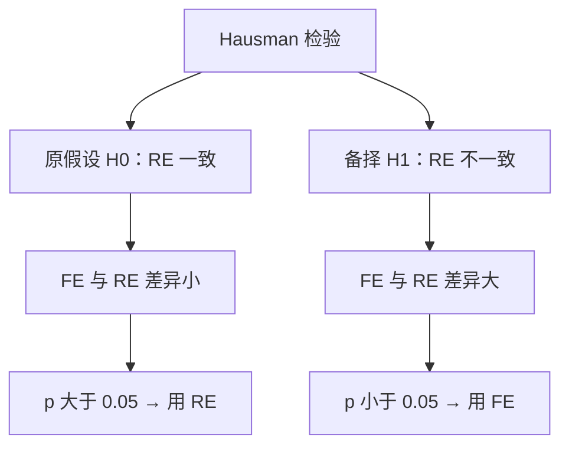

# KP03 · Hausman 检验

<div style="text-align:right;margin:10px 0;"><a href="../../../../exam.html" target="_blank" style="display:inline-block;padding:6px 16px;background:#2563eb;color:#fff;border-radius:6px;text-decoration:none;font-size:14px;">📝 开始做题</a></div>


## 1. 是什么

**一句话直觉**：Hausman 检验是 FE 和 RE 的"PK 赛"——两者结果差不多就选更省力的（RE 更有效），差很多就选更稳的（FE 一致）。

两种估计量：
- **FE 估计量** $\hat{\beta}_{FE}$：无论 $u_i$ 与 $x$ 是否相关都一致
- **RE 估计量** $\hat{\beta}_{RE}$：仅当 $u_i$ 与 $x$ 无关时才一致且有效

检验统计量：

$$H = (\hat{\beta}_{FE} - \hat{\beta}_{RE})' [\text{Var}(\hat{\beta}_{FE}) - \text{Var}(\hat{\beta}_{RE})]^{-1} (\hat{\beta}_{FE} - \hat{\beta}_{RE}) \sim \chi^2(K)$$

其中 $K$ 是随时间变化的解释变量个数。

---

## 2. 怎么用



**Stata 代码**：

```stata
xtreg lnwage educ exper, fe
estimates store fe_model
xtreg lnwage educ exper, re
estimates store re_model
hausman fe_model re_model
```

若存在[[02_异方差|异方差]]，用更稳健的 `xtoverid`（需先安装）代替传统 Hausman。

---

## 3. 什么时候用

- 在 FE 和 RE 之间拿不定主意时
- 想用 RE（因为它能估计不随时间变化的变量、标准误更小），但需要验证 RE 的假设是否成立
- 通常作为面板回归的**标准报告步骤**

---

## 4. 什么时候不能用 / 易错点

- 只对**随时间变化**的变量有效，不随时间变化的变量在 FE 中被吸收，无法参与检验
- 样本量小时检验功效不足，$p>0.05$ 不一定代表 RE 真的成立，可能只是检不出来
- 大样本时 $p<0.05$ 可能只是微小偏差，经济意义不大

**易错点**：

| 误区 | 正确理解 |
|------|----------|
| $p>0.05$ 就说明 RE 一定对 | 可能是样本小、功效低 |
| 显著就必须用 FE | 还要看偏差有无经济意义 |
| 可以检验所有变量 | 只检验随时间变化的变量 |
| FE、RE 系数差不多就一定不显著 | 还要看标准误 |

---

## 5. 与相似方法对比

| 检验 | 适用情况 | 是否稳健于异方差 |
|------|---------|----------------|
| 传统 Hausman | 同方差 | 否 |
| xtoverid（DWH） | 存在异方差 | 是 |
| 直接按理论选 FE | 理论明确指出 $u_i$ 与 x 相关 | — |

---

## 6. 为什么用这个不用那个

- **为什么不直接默认 FE？** FE 更保守但无法估计不随时间变化的变量、标准误更大。若 Hausman 表明 RE 假设成立，RE 更有效。
- **为什么不用传统 Hausman 而用 xtoverid？** 数据常存在异方差，传统 Hausman 依赖同方差假设，xtoverid 更稳健。
- **为什么检验只是辅助？** 若经济理论已明确个体效应与解释变量相关（如能力与教育），应直接用 FE，不必被检验结果束缚。

---

## 7. 完整例子：教育回报率的 FE vs RE

| 变量 | FE 估计 | RE 估计 |
|------|--------|--------|
| 教育年限 | 0.075 | 0.095 |
| 工作经验 | 0.020 | 0.025 |

假设 $H = 8.5$，自由度 $K=2$，$\chi^2(2)$ 的 5% 临界值为 5.99。

- $H = 8.5 > 5.99$，故 $p<0.05$
- 拒绝原假设，个体效应与解释变量相关，应选 FE
- 经济含义：能力（$u_i$）确实与教育相关，RE 有偏、FE 可靠

---

## 答辩常问（带标准答案）

1. **问：Hausman 检验的原假设是什么？为什么"两个估计量差异大"就能推出要用 FE？** 答：原假设是"RE 估计量一致"，即 $Cov(u_i,x_{it})=0$ 成立。逻辑是：FE 不管原假设成不成立都一致；RE 只有在原假设成立时才一致且更有效。如果原假设为真，两个估计量都一致，差异只是抽样噪声，应该很小；一旦 $Cov(u,x)\neq0$，RE 不一致而 FE 仍一致，两者系数就会系统性地差很多。所以决策规则是：**p < 0.05 拒绝原假设 → RE 有偏，选 FE；p > 0.05 不拒绝 → 选更有效的 RE**。
2. **问：Hausman 检验能对所有解释变量（包括性别、行业）做比较吗？** 答：不能。它只对**随时间变化的变量**有效。不随时间变化的变量（性别、种族、地区）在 FE 里被 $u_i$ 吸收掉了，根本没有 FE 系数可以拿来和 RE 比较，所以这些变量无法参与检验。被问"为什么我的 Hausman 自由度只有 2"时，答案就是：自由度 K 等于模型中随时间变化的解释变量个数。
3. **问：Hausman 检验 p > 0.05，是不是就说明 RE 假设成立、应该放心用 RE？** 答：不一定，要分两种情况警惕：一是**样本量小**时检验功效低，p > 0.05 可能只是"检不出来"而不是"真的没有相关"；二是大样本下 p < 0.05 可能反映的是微小偏差，经济意义不大。另外如果经济理论已经明确个体效应与解释变量相关（如能力与教育），应该直接用 FE，让理论优先于检验结果；数据有异方差时传统 Hausman 不可靠，要改用 `xtoverid`。

## 8. 速记卡

- Hausman：比 FE 和 RE 差多少，统计量服从 $\chi^2(K)$
- $p<0.05$ → 用 FE；$p>0.05$ → 用 RE
- 只检验随时间变化的变量
- 有异方差用 xtoverid
- 理论优先，检验只是辅助

---

## 🔗 相关知识点

**同章关联：** [[KP01_固定效应模型|固定效应模型（FE）]]｜[[KP02_随机效应模型|随机效应模型（RE）]]

**跨章关联：** [[../../09_工具变量法/知识点/KP04_过度识别与Hausman|IV-Hausman检验（检验解释变量是否内生）]]｜[[../../02_数学回顾/02_统计推断思想|假设检验的基本逻辑]]

**🐮 大牛库深入：** [[../../../../经济统计学论文从0基础到精通/05_内生性与面板/07_随机效应RE与Hausman检验|RE与Hausman检验详解]]｜[[../../../../经济统计学论文从0基础到精通/05_内生性与面板/06_固定效应FE|固定效应FE]]

**📖 原书原文：** [[../../../../原文件/计量经济学/陈强_计量经济学及Stata应用_全书#10. 矩阵的秩|陈强《计量经济学及Stata应用》第10章]]
