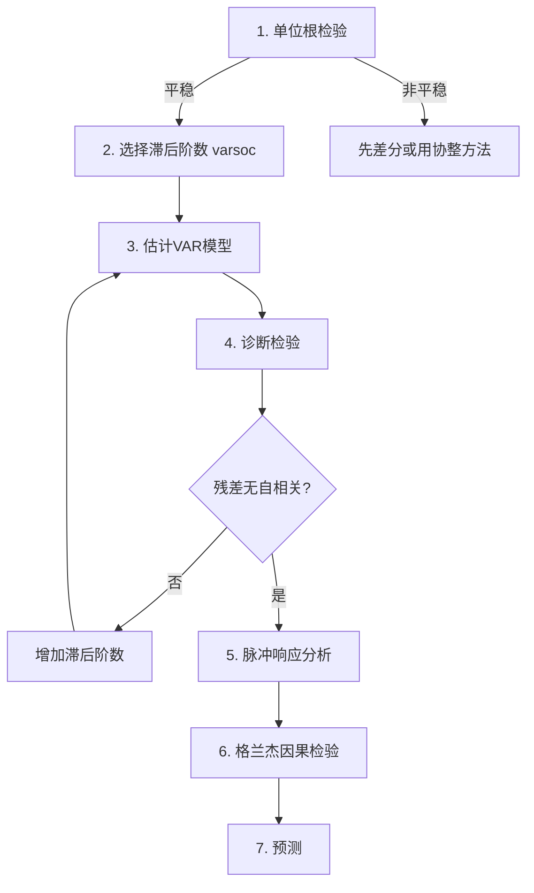

# KP01 VAR模型

<div style="text-align:right;margin:10px 0;"><a href="../../../../exam.html" target="_blank" style="display:inline-block;padding:6px 16px;background:#2563eb;color:#fff;border-radius:6px;text-decoration:none;font-size:14px;">📝 开始做题</a></div>


## 一句话直觉

> **VAR就是"联立方程组的简化版"——每个变量都是自己和别人滞后值的函数，不用区分谁是解释谁是被解释，大家互相影响。**

---

## 一、模型设定

### 双变量VAR(1)

$$y_{1t} = \beta_{10} + \beta_{11} y_{1,t-1} + \beta_{12} y_{2,t-1} + \varepsilon_{1t}$$

$$y_{2t} = \beta_{20} + \beta_{21} y_{1,t-1} + \beta_{22} y_{2,t-1} + \varepsilon_{2t}$$

**特点**：
- 每个方程的解释变量都是一样的（所有变量的滞后值）
- 没有内生性问题（滞后值都是外生的）
- 可以用[[KP02_OLS正交性|OLS]]逐个方程估计

### 向量形式

$$\mathbf{y}_t = \boldsymbol{\beta}_0 + \boldsymbol{\beta}_1 \mathbf{y}_{t-1} + \boldsymbol{\varepsilon}_t$$

---

## 二、脉冲响应函数（IRF）

### 核心问题

**给 $y_1$ 一个冲击，$y_2$ 在未来各期会怎么变？**

### 直觉

- 冲击：$\varepsilon_{1t}$ 增加1个单位
- 当期影响：$y_{1t}$ 直接变，$y_{2t}$ 不变（因为方程中没有当期值）
- 下一期：$y_{2,t+1}$ 受到 $y_{1t}$ 的影响
- 再下一期：影响继续传导

### 正交化脉冲响应（OIRF）

因为扰动项之间可能相关，需要做Cholesky分解来"正交化"。

**关键**：变量排序很重要！
- 排在前面的变量冲击会影响后面的变量
- 排在后面的变量冲击不影响前面的变量

---

## 三、格兰杰因果检验

### 什么是格兰杰因果

**x格兰杰引起y**：x的滞后值有助于预测y（在控制y自身滞后值之后）。

$$y_t = \alpha_0 + \alpha_1 y_{t-1} + \dots + \alpha_p y_{t-p} + \beta_1 x_{t-1} + \dots + \beta_p x_{t-p} + \varepsilon_t$$

原假设 $H_0$：$\beta_1 = \beta_2 = \dots = \beta_p = 0$（x不格兰杰引起y）

### 重要警告

> **格兰杰因果 ≠ 真正的因果关系！**

格兰杰因果只是"预测力"，不是"因果关系"。

例子：
- 公鸡打鸣格兰杰引起太阳升起（打鸣在先，太阳在后）
- 但显然不是公鸡导致太阳升起

---

## 四、生活实例：货币政策对产出的影响

### 研究问题

利率冲击如何影响GDP增长率？

### VAR模型

$$\begin{pmatrix} GDP_t \\ r_t \end{pmatrix} = \begin{pmatrix} \beta_{10} \\ \beta_{20} \end{pmatrix} + \begin{pmatrix} \beta_{11} & \beta_{12} \\ \beta_{21} & \beta_{22} \end{pmatrix} \begin{pmatrix} GDP_{t-1} \\ r_{t-1} \end{pmatrix} + \begin{pmatrix} \varepsilon_{1t} \\ \varepsilon_{2t} \end{pmatrix}$$

### 脉冲响应结果

| 期数 | GDP对利率冲击的响应 | 经济解释 |
|------|---------------------|----------|
| 0期 | 0 | 当期无影响（价格粘性） |
| 1期 | -0.3% | 利率上升，产出开始下降 |
| 2期 | -0.5% | 效应最大 |
| 4期 | -0.3% | 效应逐渐减弱 |
| 8期 | ≈0 | 效应消失 |

**解读**：紧缩性货币政策（利率上升）对产出有短期负面影响，约2个季度达到最大，一年后基本消失。

### 格兰杰因果检验

- 原假设：利率不格兰杰引起GDP
- 检验结果：p = 0.02 < 0.05
- 结论：利率的滞后值有助于预测GDP增长率

**但注意**：这不代表利率"导致"GDP变化，只是利率有预测力。

---

## 五、Stata 完整代码

```stata
* 设定时间序列
tsset year

* ===== 选择滞后阶数 =====
varsoc gdp_rate interest_rate

* 输出解读：
* 不同信息准则（AIC/BIC/HQIC）选择的最优滞后阶数
* 一般选AIC或BIC最小的阶数

* ===== VAR估计 =====
var gdp_rate interest_rate, lag(1/2)

* 输出解读：
* 两个方程：gdp_rate方程和interest_rate方程
* 每个方程的系数、标准误、p值

* ===== 脉冲响应函数 =====
* 创建IRF文件
irf create var1, set(myirf)

* 画正交化脉冲响应图
irf graph oirf, impulse(interest_rate) response(gdp_rate)

* 也可以看累积脉冲响应
irf graph coirf, impulse(interest_rate) response(gdp_rate)

* ===== 格兰杰因果检验 =====
vargranger

* 输出解读：
* gdp_rate方程：interest_rate的滞后值是否联合显著？
*   F统计量 = 5.23, p = 0.023
*   → interest_rate格兰杰引起gdp_rate
* interest_rate方程：gdp_rate的滞后值是否联合显著？
*   F统计量 = 1.12, p = 0.33
*   → gdp_rate不格兰杰引起interest_rate

* ===== 诊断检验 =====
* 残差自相关检验
varlmar

* 模型平稳性检验
varstable, graph
```

---

## 六、VAR建模的步骤



---

## 七、常见误区

| 误区 | 正确理解 |
|------|----------|
| "格兰杰因果就是因果关系" | 只是预测力，不是因果 |
| "VAR不需要理论" | 变量排序、模型设定都需要理论指导 |
| "滞后阶数越多越好" | 过拟合损失自由度，用信息准则选择 |
| "脉冲响应不显著就没用" | 置信区间包含0但点估计有经济意义也值得讨论 |
| "VAR是纯粹的统计模型" | VAR的结构（变量选择、排序）都依赖经济理论 |

## 答辩常问（带标准答案）

1. **问：格兰杰因果检验显著，是不是就证明了"x 导致 y"？** 答：不是，这是必背陷阱。格兰杰因果的定义只是：在控制 y 自身滞后值之后，x 的滞后值还能显著改善对 y 的预测（原假设是 x 各阶滞后系数联合为零）。它度量的是**时间先后上的预测力**，不是经济因果。经典反例是"公鸡打鸣格兰杰引起太阳升起"——打鸣在先、太阳在后，统计上完全能通过检验，但谁都知道不是公鸡导致的。严谨表述是"x 对 y 有格兰杰意义上的预测力"。
2. **问：VAR 模型为什么可以直接用 OLS 逐个方程估计，不怕内生性问题？** 答：因为每个方程右边的解释变量全部是各变量的**滞后值**（$y_{1,t-1}$、$y_{2,t-1}$），相对于当期扰动项 $\varepsilon_{it}$ 来说都是前定的、外生的，与当期扰动不相关。所以逐方程 OLS 既是一致的、也是有效的（各方程解释变量完全相同）。这是 VAR 比结构联立方程模型省事的关键。
3. **问：做正交化脉冲响应（Cholesky 分解）时，为什么"变量排序"是个被老师追问的点？** 答：因为扰动项之间相关，Cholesky 分解把相关结构三角化，排**在前面**的变量的冲击被假设可以同期影响后面的变量，而排在后面的变量冲击对前面变量没有同期影响。排序不同，脉冲响应的形状可能完全不同——货币政策模型里把 GDP 排利率前面，和反过来，结论可能不一致。选排序必须靠经济理论（如"价格粘性：利率当期不影响产出"），不能拍脑袋。


---

## 🔗 相关知识点

**同章关联：**
[[KP02_ARMA模型|ARMA模型]]

**跨章/跨课关联：**
[[../../../03_时间序列/06_多元时序与协整/知识点/KP03_协整与ECM|时序视角·协整与ECM（VECM）]]

**🐮 大牛库深入：**
[[../../../../经济统计学论文从0基础到精通/09_时间序列/07_协整与误差修正ECM|大牛库·协整ECM]]

**📖 原书原文：**
[[../../../../原文件/计量经济学/陈强_计量经济学及Stata应用_全书#13. 平稳时间序列|陈强教材·第13章 VAR与协整]]
