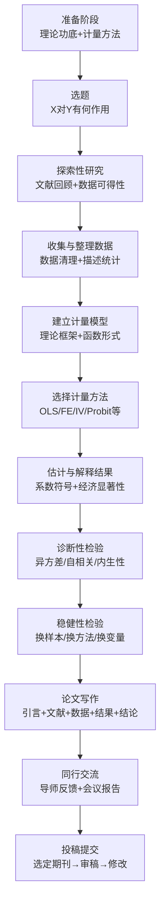
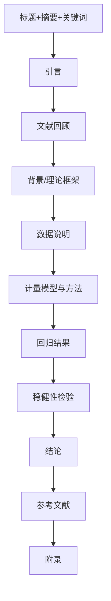
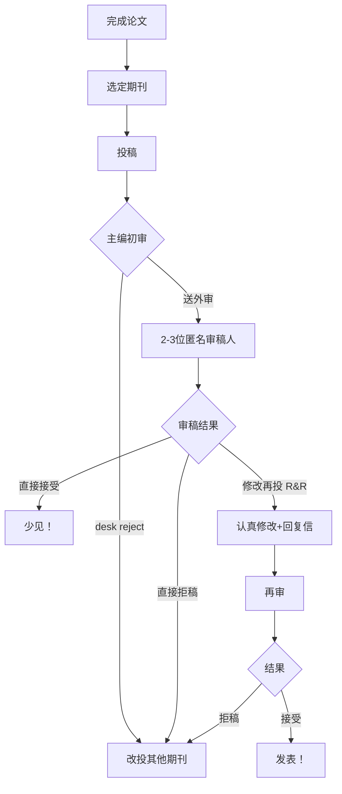

# 第15章 实证研究指南

<a href="../../../exam.html" target="_blank" style="display:inline-block;padding:6px 16px;background:#2563eb;color:#fff;border-radius:6px;text-decoration:none;font-size:14px;">📝 开始做题</a>

## 从选题到投稿的完整流程图

---

## 一、选题的四要素

| 要素 | 标准 | 例子 |
|------|------|------|
| **具体** | X和Y明确可测 | "教育年限对工资对数的影响" |
| **有趣** | 为什么重要？别人在乎吗？ | "最低工资对就业的影响" |
| **新颖** | 边际贡献是什么？ | 用新数据/新方法/新视角 |
| **可行** | 数据能找到吗？ | 有公开数据库可得 |

---

## 二、诊断性检验清单

### [[KP02_OLS正交性|OLS]]基础诊断

| 检验 | Stata命令 | 原假设 | 不通过怎么办 |
|------|-----------|--------|-------------|
| [[02_异方差|异方差]] | `estat imtest, white` | 同方差 | 用[[KP03_稳健标准误|稳健标准误]] |
| [[03_自相关|自相关]]（时间序列） | `estat dwatson` / `estat bgodfrey` | 无自相关 | 用Newey-West标准误 |
| [[KP02_多重共线性|多重共线性]] | `estat vif` | 无严重共线性 | 删变量/合并变量 |
| 正态性 | `estat imtest` | 扰动项正态 | 大样本不影响 |
| 遗漏变量 | `ovtest` | 无遗漏变量 | 加控制变量/用FE/IV |

### 面板数据诊断

| 检验 | Stata命令 | 目的 |
|------|-----------|------|
| 个体效应存在 | `xttest0` | 选混合OLS还是RE |
| Hausman检验 | `hausman` | 选FE还是RE |
| 序列相关 | `xtserial` | 面板自相关 |
| 组间异方差 | `xttest3` | 面板异方差 |

### [[03_工具变量IV|工具变量]]诊断

| 检验 | Stata命令 | 标准 |
|------|-----------|------|
| [[KP03_弱工具变量|弱工具变量]] | `estat firststage` | F > 10 |
| 过度识别 | `estat overid` | p > 0.05 |
| 内生性检验 | `estat endogenous` | p < 0.05则内生 |

### 时间序列诊断

| 检验 | Stata命令 | 目的 |
|------|-----------|------|
| 单位根 | `dfuller` | 判断I(0)还是I(1) |
| 协整 | `vecrank` | 长期均衡关系 |
| 残差自相关 | `wntestq` / `varlmar` | 模型设定是否正确 |

---

## 三、[[06_稳健性检验|稳健性检验]]清单

### 为什么需要稳健性检验

> 只汇报"最佳"结果 = 数据挖掘的偏差。只有换各种设定结果都差不多，才是真的稳健。

### 常见稳健性检验方法

| 方法 | 具体操作 | 目的 |
|------|----------|------|
| **更换样本区间** | 去掉前5年/后5年/去掉异常年份 | 结果是否由少数样本驱动 |
| **去掉极端值** | 1%和99%分位winsorize | 结果是否由 outliers驱动 |
| **更换函数形式** | 水平值→对数→双对数 | 结果是否依赖函数形式 |
| **更换计量方法** | OLS→FE→RE→IV | 结果是否依赖估计方法 |
| **增加控制变量** | 从少到多逐步加入 | 结果是否被遗漏变量解释 |
| **更换变量定义** | 不同口径的X或Y | 结果是否依赖变量测量 |
| **更换数据来源** | 不同数据库的同一变量 | 结果是否依赖数据质量 |
| **安慰剂检验** | 随机分配处理组 | 结果是否是随机的 |
| **替换被解释变量** | 用Y的替代指标 | 结果是否依赖Y的定义 |

---

## 四、论文结构清单

### 各部分写作要点

| 部分 | 要点 |
|------|------|
| **摘要** | 100字左右：研究问题+方法+主要结论 |
| **引言** | 研究什么+为什么重要+用什么数据+主要发现+边际贡献 |
| **文献回顾** | 不是堆砌！是为了引出本文的边际贡献 |
| **数据说明** | 来源+定义+描述统计表（均值/标准差/最小最大） |
| **计量模型** | 回归方程+为什么用这个方法+识别策略 |
| **回归结果** | 表格+系数解读+统计显著性+经济显著性 |
| **稳健性** | 换各种设定，结果是否差不多 |
| **结论** | 总结+贡献+局限+未来方向 |

---

## 五、统计显著性 vs 经济显著性

### 区别

| 维度 | 统计显著性 | 经济显著性 |
|------|-----------|-----------|
| 衡量 | p值大小 | 系数大小+变量单位 |
| 含义 | 估计得精不精确 | 影响大不大 |
| 例子 | p=0.001（显著） | 系数=0.001（影响很小） |

### 重要原则

> **统计显著 ≠ 经济显著。**

一个系数可能统计上非常显著（p<0.01），但经济上毫无意义（影响太小）。

反过来，一个系数可能经济上很大，但因为标准误大而统计上不显著。

### 解读方法

1. 看符号：是否与理论预期一致？
2. 看大小：1单位X变化，Y变化多少？换算成百分比
3. 看显著性：p值是否小于0.05？
4. 综合：既要有统计显著性，也要有经济显著性

---

## 六、常见陷阱

| 陷阱 | 后果 | 避免方法 |
|------|------|----------|
| 数据挖掘 | 找到假的显著结果 | 稳健性检验+预注册 |
| 遗漏变量 | 估计不一致 | 控制变量/FE/IV |
| 过度解读 | 把相关当因果 | 小心识别策略 |
| 只报好结果 | 偏差 | 所有设定都汇报 |
| 忽略数据质量 | "垃圾进垃圾出" | 仔细检查数据 |
| 因果关系过度声称 | 审稿人批评 | 用谨慎的语言 |

---

## 七、投稿流程

**关键提醒**：
- 切忌一稿多投
- R&R是好消息！说明编辑认为有希望
- 修改要认真，回复信要逐条回应
- 被拒很正常，顶尖期刊拒稿率90%+

## 答辩常问（带标准答案）

1. **问：统计显著和经济显著有什么区别？为什么 p<0.01 的系数也可能"毫无意义"？** 答：统计显著（p 值小）回答的是"估计得精不精确"——系数是不是系统性偏离零；经济显著回答的是"影响大不大"——1 单位 X 变化换算成 Y 的百分比有多大、值不值得政策干预。大样本下系数 0.001 也能 p<0.001（统计显著），但经济上微不足道；反过来一个效应很大的系数，可能因标准误大而不显著。答辩规范表述是同时报告二者：符号是否符合理论、换算后的经济量级、以及显著性。
2. **问：为什么审稿人一定要看"稳健性检验"？只汇报最优结果有什么问题？** 答：只挑"最显著的那组结果"汇报，本质是数据挖掘偏差——把随机波动当成了真实发现。稳健性检验的逻辑是：换样本区间（去掉异常年份）、去极端值（winsorize 1%/99%）、换函数形式、换估计方法（OLS→FE→IV）、换变量定义，结果符号和显著性都差不多，才能说明结论不是被某一种设定"做"出来的。安慰剂检验（随机分配处理组）尤其能直接证伪"效果其实是随机的"。
3. **问：完整的实证研究流程应该怎么走？从选题到投稿。** 答：七个环节：选题（具体、有趣、新颖、可行四要素）→ 数据收集与清理（描述统计先行）→ 建立理论框架与函数形式 → 选择识别方法（OLS/FE/IV/Probit 对应不同内生性来源）→ 估计并解读（统计+经济显著性）→ 诊断检验（异方差/自相关/共线性/内生性）→ 稳健性检验，最后才写作投稿。答辩被问"你的研究设计是什么"，按这条链条讲清楚每个环节的选择理由即可。

---

## 🔗 相关知识点

**跨章方法导航：** [[../09_工具变量法/知识点/KP01_内生性与工具变量|工具变量IV（解决内生性）]]｜[[../10_二值选择模型/知识点/KP01_Logit与Probit|Logit/Probit（二值因变量）]]｜[[../11_面板数据/知识点/KP01_固定效应模型|面板固定效应FE（面板数据）]]

**🐮 大牛库论文写作模块：** [[../../../经济统计学论文从0基础到精通/10_论文写作全流程/README|10 论文写作全流程]]｜[[../../../经济统计学论文从0基础到精通/11_方法选择决策/README|11 方法选择决策]]｜[[../../../经济统计学论文从0基础到精通/12_毕业论文实战/README|12 毕业论文实战]]

**📖 原书原文：** [[../../../原文件/计量经济学/陈强_计量经济学及Stata应用_全书|陈强《计量经济学及Stata应用》第14章]]
