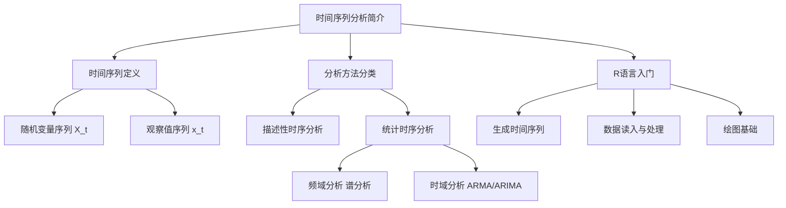
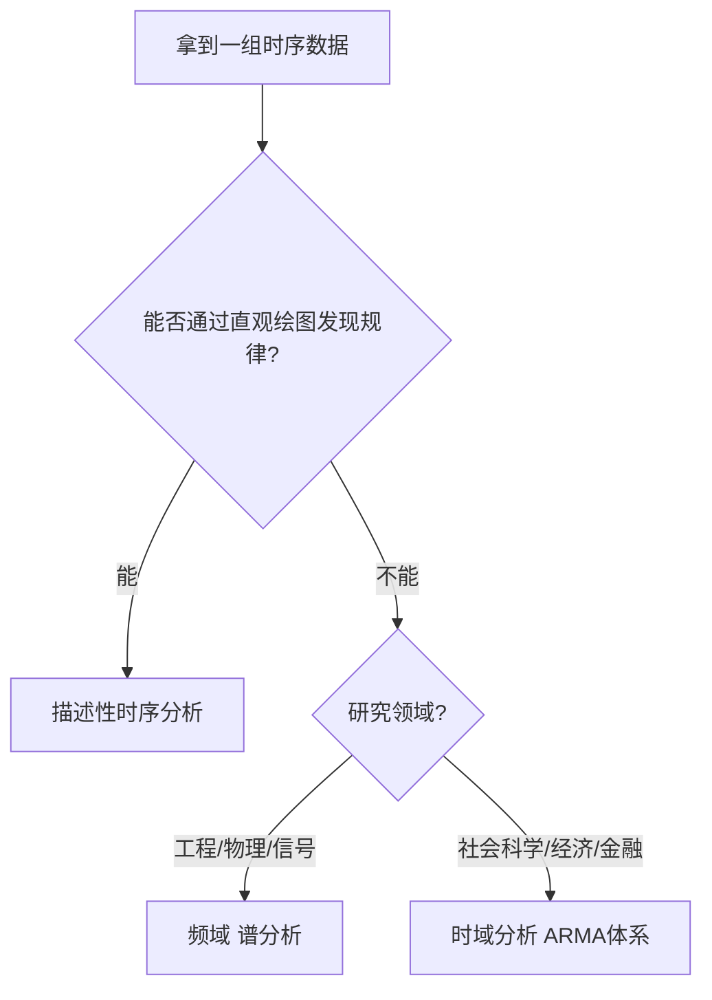

# 第1章 时间序列分析简介 — 章节总结

## 一、章节框架图

## 二、文字知识树

- **时间序列定义**
  - 随机时序 $\{X_t, t \in T\}$：按时间排列的随机变量族
  - 观察值序列 $\{x_t, t=1,\dots,n\}$：随机时序的一个实现
  - 研究目的：由观察值序列推断随机时序的性质
- **分析方法**
  - 描述性时序分析：直观绘图、发现周期规律（尼罗河、太阳黑子）
  - 统计时序分析
    - 频域分析：傅里叶变换、谱分析，用于工程/物理领域
    - 时域分析：[[03_自相关|自相关]]角度揭示规律，本书核心
- **时域分析五步法**
  1. 考察序列特征
  2. 选择拟合模型
  3. 确定模型口径（参数估计）
  4. 检验优化模型
  5. 预测未来走势
- **R[[02_R语言基础|语言基础]]**
  - `ts()` 生成时间序列对象
  - `read.table()` 读入外部数据
  - `plot()` 绘制时序图
  - `library()` 加载程序包

## 三、核心公式清单

| 公式 | 符号解释 | 适用条件 |
|------|----------|----------|
| $\{X_t, t \in T\}$ | 随机时序，$X_t$ 是 $t$ 时刻的随机变量 | 一般定义 |
| $\{x_t, t=1,\dots,n\}$ | 观察值序列，长度为 $n$ 的实现 | 一般定义 |

## 四、[[01_方法选择决策树|方法选择决策树]]

## 五、章节联系

- **本章定位**：全书入门，建立时间序列的基本概念和R工具
- **与第2章关系**：本章介绍"为什么要做预处理"，第2章正式讲授[[02_平稳性|平稳性]][[08_t检验和F检验|检验和]]纯随机性检验
- **与第3章关系**：本章介绍时域分析五步法，第3章详细展开[[KP03_ARMA模型|ARMA]]建模全流程

## 六、自测题

**1. [[01_什么是时间序列|什么是时间序列]]？随机时序与观察值序列有何区别？**

答：时间序列是按时间顺序排列的一组随机变量 $\{X_t, t \in T\}$。随机时序 $\{X_t\}$ 是理论上的随机变量族，观察值序列 $\{x_t\}$ 是该随机时序的一次具体实现（样本）。研究目的是由观察值序列推断随机时序的性质。

**2. 描述性时序分析与统计时序分析的主要区别是什么？**

答：描述性时序分析通过直观数据比较和绘图观测寻找规律，操作简单但主观性强；统计时序分析利用数理统计原理，从序列值内在相关关系出发建模，更准确、可验证。

**3. 时域分析与频域分析的区别？本书为什么选时域？**

答：频域分析借助傅里叶变换从频率角度分解周期波动，理论复杂、结果抽象；时域分析从自相关角度揭示规律，理论基础扎实、步骤规范、结果易解释，是目前社会科学领域的主流方法。

**4. 时域分析的五个基本步骤是什么？**

答：①考察序列特征 → ②选择拟合模型 → ③确定模型口径（参数估计）→ ④检验优化模型 → ⑤利用[[KP05_模型预测|模型预测]]。

**5. R中 `ts()` 函数的 `start` 和 `frequency` 参数分别起什么作用？**

答：`start=c(2005,1)` 指定序列起始时间为2005年1月；`frequency=12` 指定每年12个数据点（月度数据）。frequency=4为季度，=365为日度。

## 本章方法答辩速查

1. **问：拿到一组数据，为什么不能上来就建模，而要先做"考察序列特征"这一步？** 答：时域五步法的第一步就是考察特征——先判断平稳性和纯随机性。如果是白噪声，建模毫无意义；如果非平稳，直接上 ARMA 会产生伪回归；只有"平稳且非白噪声"的序列才值得进 ARMA 流程。这一步把后面的建模方向提前锁定，避免对错误的对象做无效分析。
2. **问：描述性分析、频域分析、时域分析三者是什么关系？本课程为什么选时域？** 答：描述性分析是画直观图找规律，最简单但主观，只能算第一步；频域分析用傅里叶变换把序列拆成不同频率的周期，适合强周期工程信号，但数学复杂、结果抽象；时域分析从自相关出发，用 ARMA/ARIMA 建模，步骤规范、结果可解释，是经济金融等社会科学的主流。本课程走的是时域路线。
3. **问：为什么说我们观测到的序列只是随机过程的"一次实现"？这对建模有什么要求？** 答：每个时刻 $t$ 理论上是一个随机变量 $X_t$，我们记录到的 $x_t$ 只是它抽样出来的一个值；而且时序每个时刻只能观测一次，没法重复抽样。所以必须依赖平稳性假设——让不同时刻的观测共用同一均值和方差，样本才有统计意义；这也是后面所有检验和模型的前提。

---

## 🔗 跨库导航

**🐮 大牛库对应模块：**
[[../../../经济统计学论文从0基础到精通/09_时间序列/01_时间序列是什么|大牛库·01 时序是什么]]

**📖 原书对应章节：**
[[../../../原文件/时间序列分析/王燕_时间序列分析基于R_全书|王燕教材·第1章]]
