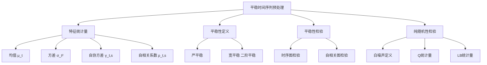
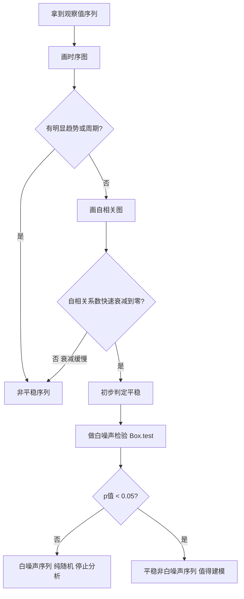

# 第2章 平稳时间序列 — 章节总结

## 一、章节框架图

## 二、文字知识树

- **特征统计量**（描述序列统计特征的低阶矩）
  - 均值 $\mu_t = E(X_t)$：序列在 $t$ 时刻的平均水平
  - 方差 $\sigma_t^2 = D(X_t)$：序列围绕均值的波动程度
  - 自协方差 $\gamma(t,s) = E[(X_t-\mu_t)(X_s-\mu_s)]$：同一事件不同时期的相关程度
  - [[03_自相关|自相关]]系数 $\rho(t,s) = \gamma(t,s)/\sqrt{DX_t \cdot DX_s}$
- **[[02_平稳性|平稳性]]定义**
  - 严平稳：所有有限维分布不随时间平移而改变（条件苛刻，理论意义为主）
  - 宽平稳（二阶平稳）：①二阶矩存在 ②均值为常数 ③自协方差仅依赖时间间隔
  - 关系：严平稳（有二阶矩时）→ 宽平稳；正态序列中宽平稳 → 严平稳
- **平稳序列的统计性质**
  - 常数均值：$EX_t = \mu$
  - 延迟 $k$ 自协方差：$\gamma(k) = \gamma(t, t+k)$，只与间隔 $k$ 有关
  - 延迟 $k$ 自[[01_相关系数|相关系数]]：$\rho_k = \gamma(k)/\gamma(0)$
  - 三大性质：规范性 $\rho_0=1, |\rho_k|\le1$；对称性 $\rho_k = \rho_{-k}$；非负定性
- **平稳性检验（图检验法）**
  - 时序图：序列是否始终在常数附近有界波动（无趋势、无周期）
  - 自相关图：平稳序列的 $\hat\rho_k$ 快速衰减至零（短期相关性）
- **纯随机性检验（白噪声检验）**
  - 白噪声：零均值、同方差、无自相关 $\gamma(k)=0, \forall k\ne0$
  - 原假设 $H_0: \rho_1=\rho_2=\dots=\rho_m=0$
  - Q统计量：$Q = n\sum_{k=1}^m \hat\rho_k^2 \sim \chi^2(m)$
  - LB统计量：$LB = n(n+2)\sum_{k=1}^m \frac{\hat\rho_k^2}{n-k} \sim \chi^2(m)$（小样本更优）
  - p值 > 0.05 → 不能拒绝白噪声 → 序列纯随机 → 停止分析
  - p值 < 0.05 → 拒绝白噪声 → 序列有相关信息 → 值得建模

## 三、核心公式清单

| 公式 | 符号解释 | 适用条件 |
|------|----------|----------|
| $\mu_t = E(X_t)$ | 时刻 $t$ 的均值 | 一阶矩存在 |
| $\sigma_t^2 = E(X_t-\mu_t)^2$ | 时刻 $t$ 的方差 | 二阶矩存在 |
| $\gamma(k) = E[(X_t-\mu)(X_{t+k}-\mu)]$ | 延迟 $k$ 自协方差 | 宽平稳序列 |
| $\rho_k = \gamma(k)/\gamma(0)$ | 延迟 $k$ 自相关系数 | 宽平稳序列 |
| $Q = n\sum_{k=1}^m \hat\rho_k^2 \sim \chi^2(m)$ | Box-Pierce Q统计量 | 大样本白噪声检验 |
| $LB = n(n+2)\sum_{k=1}^m \frac{\hat\rho_k^2}{n-k} \sim \chi^2(m)$ | Ljung-Box统计量 | 小样本白噪声检验 |
| $\hat\gamma(k) = \frac{1}{n-k}\sum_{t=1}^{n-k}(x_t-\bar x)(x_{t+k}-\bar x)$ | 样本自协方差估计 | $0 < k < n$ |

## 四、[[01_方法选择决策树|方法选择决策树]]

## 五、章节联系

- **承上**：第1章介绍了时域分析五步法，本章是第一步"考察序列特征"的具体实现
- **启下**：只有"平稳非白噪声"序列才进入第3章的[[KP03_ARMA模型|ARMA]]建模；非平稳序列留到第4-6章

## 六、自测题

**1. [[KP01_严平稳与宽平稳|严平稳与宽平稳]]的关系是什么？正态序列有什么特殊性？**

答：严平稳条件更强（要求所有有限维分布不变），宽平稳只要求二阶矩平稳。一般情况下，有二阶矩的严平稳序列一定是宽平稳的，但宽平稳推不出严平稳。特殊地，对于正态序列，二阶矩（均值向量+协方差阵）完全决定了分布，因此宽平稳正态序列一定是严平稳的。

**2. 宽平稳的三个条件是什么？**

答：①任取 $t$，$EX_t^2 < \infty$（二阶矩存在）；②任取 $t$，$EX_t = \mu$（均值为常数）；③任取 $t,s,k$，$\gamma(t,s) = \gamma(k, k+s-t)$（自协方差只依赖时间间隔）。

**3. 白噪声序列的定义和性质是什么？为什么白噪声不值得建模？**

答：白噪声满足 $EX_t=\mu$ 为常数，且 $\gamma(k)=0, \forall k\ne0$（即 $t\ne s$ 时协方差为零）。它具有纯随机性（各项无相关）和方差齐性（$DX_t=\sigma^2$）。因为白噪声序列过去的行为对将来没有任何影响，不包含可提取的相关信息，所以不值得建模。

**4. Q统计量和LB统计量的原假设是什么？p值大于0.05意味着什么？**

答：原假设 $H_0: \rho_1=\rho_2=\dots=\rho_m=0$，即序列直到延迟 $m$ 期都没有自相关（白噪声）。若 p值 > 0.05，不能拒绝原假设，即不能拒绝序列为白噪声，应停止分析。

**5. 平稳序列的自相关图有什么特征？非平稳序列呢？**

答：平稳序列的样本自相关系数 $\hat\rho_k$ 随 $k$ 增加快速衰减到零附近（短期相关性）。非平稳序列（如单调趋势）的 $\hat\rho_k$ 衰减缓慢，可能长期为正后长期为负，呈现三角对称性；周期序列的 $\hat\rho_k$ 呈现正弦波动规律。

## 本章方法答辩速查

1. **问：拿到一条新序列，完整的"是否值得建模"判断流程是什么？** 答：三步走：①画时序图，看是否在常数均值附近有界波动、无趋势无周期；②画 [[KP02_自协方差与ACF|ACF]] 图，看 $\hat\rho_k$ 是否快速衰减到 2 倍标准差虚线以内，衰减慢就是非平稳；③做白噪声检验（LB，lag=6 和 lag=12 各一次）。结果分四类：非平稳→差分或分解趋势（后面章节处理）；平稳但白噪声（p>0.05）→没有可提取信息、停止；平稳且非白噪声（p<0.05）→进入第 3 章 ARMA 建模。
2. **问：宽平稳、白噪声、平稳非白噪声这三个概念怎么区分？** 答：宽平稳是"均值方差不随时间变"这个大前提；白噪声是宽平稳中最特殊的一种——不仅平稳，而且任意两期不相关（$\gamma(k)=0,\forall k\ne0$），没有任何记忆；"平稳非白噪声"才是 ARMA 的建模对象，它平稳但存在可提取的自相关结构。一句话：白噪声是平稳序列里"空的"那一类。
3. **问：为什么白噪声检验原假设是"序列为白噪声"，而不是反过来？** 答：检验设计成"默认序列纯随机、需要证据才能拒绝"，是为了把举证责任放在"发现规律"一方——只有当 LB 统计量足够大（p<0.05）、有充分证据证明存在自相关时，才花成本去建模。这样可以避免对纯随机序列过度拟合、制造伪规律。

---

## 🔗 跨库导航

**跨课教材视角：**
[[../../02_计量经济学/12_平稳时间序列/00_章节总结|计量视角·第12章 平稳时序]]｜[[../../05_统计学原理/09_时间序列分析/00_章节总结|统计视角·第9章 时间数列]]

**🐮 大牛库对应模块：**
[[../../../经济统计学论文从0基础到精通/09_时间序列/02_平稳性|大牛库·02 平稳性]]｜[[../../../经济统计学论文从0基础到精通/09_时间序列/03_自相关与ACF|大牛库·03 ACF]]

**📖 原书对应章节：**
[[../../../原文件/时间序列分析/王燕_时间序列分析基于R_全书|王燕教材·第2章 预处理]]
