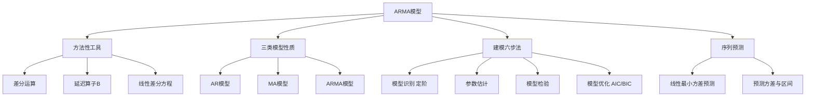

# 第3章 [[KP03_ARMA模型|ARMA]]模型 — 章节总结

## 一、章节框架图



## 二、核心对比表：AR/MA/ARMA的[[KP02_自协方差与ACF|ACF]]与[[KP04_PACF偏自相关|PACF]]模式

| 模型 | [[03_自相关|自相关]]系数ACF | [[KP04_PACF偏自相关|偏自相关]]系数PACF | 平稳条件 | 可逆条件 |
|------|---------------|-----------------|----------|----------|
| AR(p) | 拖尾（指数衰减） | p阶截尾 | 特征根全在单位圆内 | 自动满足 |
| MA(q) | q阶截尾 | 拖尾 | 自动满足 | 系数多项式根在单位圆外 |
| ARMA(p,q) | 拖尾 | 拖尾 | 同AR(p)条件 | 同MA(q)条件 |

## 三、文字知识树

- **方法性工具**
  - 1阶差分：$\nabla x_t = x_t - x_{t-1}$
  - $p$阶差分：$\nabla^p x_t = (1-B)^p x_t$
  - $k$步差分：$\nabla_k x_t = x_t - x_{t-k}$
  - 延迟算子：$B x_t = x_{t-1}$，$B^p x_t = x_{t-p}$

- **AR(p)模型**：$x_t = \phi_1 x_{t-1} + \dots + \phi_p x_{t-p} + \varepsilon_t$
  - 平稳条件：所有特征根 $|\lambda_i| < 1$（单位圆内）
  - AR(1)平稳域：$|\phi_1| < 1$
  - 均值：$\mu = \phi_0 / (1 - \phi_1 - \dots - \phi_p)$
  - ACF拖尾指数衰减；PACF在p阶截尾

- **MA(q)模型**：$x_t = \varepsilon_t - \theta_1 \varepsilon_{t-1} - \dots - \theta_q \varepsilon_{t-q}$
  - 永远平稳（有限阶白噪声线性组合）
  - ACF在q阶截尾；PACF拖尾
  - 可逆条件：$\Theta(B)=0$的根在单位圆外
  - MA(1)可逆：$|\theta_1| < 1$

- **ARMA(p,q)模型**：AR与MA的有机组合
  - [[02_平稳性|平稳性]]由AR部分决定，可逆性由MA部分决定
  - ACF和PACF都拖尾

- **[[KP04_建模六步法|建模六步法]]**
  1. 平稳性检验 → 确认序列平稳非白噪声
  2. 模型识别（定阶）→ 看ACF/PACF拖尾截尾模式
  3. 参数估计 → 矩估计/极大似然/最小二乘
  4. 模型检验 → 残差白噪声检验 + 参数显著性检验
  5. 模型优化 → AIC/BIC最小准则选最优
  6. 预测 → 线性最小方差预测

## 四、核心公式清单

| 公式 | 含义 |
|------|------|
| AR(1): $x_t = \phi_1 x_{t-1} + \varepsilon_t$ | 1阶自回归 |
| AR(1)平稳条件: $|\phi_1| < 1$ | 特征根在单位圆内 |
| AR(1)方差: $\text{Var}(x_t) = \sigma_\varepsilon^2 / (1-\phi_1^2)$ | 平稳AR(1)的方差 |
| AR(1) ACF: $\rho_k = \phi_1^k$ | 指数衰减 |
| MA(1): $x_t = \varepsilon_t - \theta_1 \varepsilon_{t-1}$ | 1阶移动平均 |
| MA(1) ACF: $\rho_1 = -\theta_1/(1+\theta_1^2)$ | 1阶截尾 |
| AIC $= n\ln(\hat\sigma_\varepsilon^2) + 2(p+q+1)$ | 信息量准则 |
| BIC $= n\ln(\hat\sigma_\varepsilon^2) + \ln(n)(p+q+1)$ | 贝叶斯信息量准则 |

## 五、[[01_方法选择决策树|方法选择决策树]]

```mermaid
graph TD
    A[平稳非白噪声序列] --> B[看ACF和PACF]
    B --> C{"ACF特征?"}
    C -->|拖尾| D{"PACF特征?"}
    C -->|q阶截尾| E{MA(q)模型}
    D -->|p阶截尾| F{AR(p)模型}
    D -->|拖尾| G{ARMA(p,q)模型}
    E --> H[arima order c 0 0 q]
    F --> I[arima order c p 0 0]
    G --> J[arima order c p 0 q]
```

## 六、章节联系

- **承上**：第2章预处理后得到"平稳非白噪声"序列，本章给出建模方法
- **启下**：非平稳序列的差分平稳化 → 第5章ARIMA模型；异方差 → GARCH模型

## 七、自测题

**1. AR(1)模型 $x_t = 0.8x_{t-1} + \varepsilon_t$ 是否平稳？为什么？**

答：平稳。AR(1)的平稳充要条件是 $|\phi_1| < 1$，此处 $|0.8| = 0.8 < 1$，特征根 $\lambda = 0.8$ 在单位圆内。

**2. AR(p)模型和MA(q)模型的ACF/PACF截尾拖尾模式分别是什么？**

答：AR(p)：ACF拖尾，PACF的p阶截尾；MA(q)：ACF的q阶截尾，PACF拖尾；ARMA(p,q)：ACF和PACF都拖尾。

**3. 为什么MA模型永远平稳？**

答：MA(q)是白噪声序列 $\varepsilon_t$ 及其 $q$ 个滞后值的有限线性组合。白噪声本身平稳，有限个平稳变量的线性组合仍平稳，因此MA(q)不需要额外的平稳条件。

**4. AIC准则的含义是什么？**

答：AIC = $-2\ln(\text{似然函数}) + 2(\text{参数个数})$，它在拟合精度和参数个数之间做权衡：拟合越好（似然越大）得分越低，但参数越多惩罚越大。选择AIC最小的模型。

**5. 模型检验的两个方面是什么？**

答：①模型显著性检验（残差白噪声检验：残差应为白噪声，说明信息提取充分）；②参数显著性检验（每个参数是否显著非零，不显著的应剔除）。

## 本章方法答辩速查

1. **问：把 ARMA 建模的完整流程从头到尾说一遍。** 答：①平稳性检验，确认序列平稳非白噪声；②看 ACF/PACF 识别模型类型——ACF q 阶截尾选 MA(q)、PACF p 阶截尾选 AR(p)、两者都拖尾选 ARMA(p,q)；③极大似然或条件最小二乘估计参数；④模型检验——残差做 LB 白噪声检验（p>0.05 才算提完信息），且每个参数 t 检验显著（|t|>2）；⑤多个候选模型比 AIC/BIC，取最小；⑥`forecast()` 输出点预测和 95% 区间。任何一步不过关都退回去重新定阶。
2. **问：AR、MA、ARMA 怎么从 ACF/PACF 上一眼区分？** 答：口诀"AR 截 PACF、MA 截 ACF"。AR(p)：ACF 指数衰减拖尾、PACF 在 p 阶截尾；MA(q)：ACF 在 q 阶截尾、PACF 拖尾；ARMA(p,q)：两个图都拖尾、都不截尾。截尾指某阶之后点全部落入 2 倍标准差虚线内。物理含义上，MA 的冲击只影响 q 期所以 ACF 精确截断，AR 通过惯性无限传导所以永不截断。
3. **问：AR 要平稳条件、MA 要可逆条件，这两个条件分别防什么？** 答：AR(p) 的平稳条件（特征根全在单位圆内，AR(1) 即 $|\phi_1|<1$）防序列发散——不满足的话均值方差不存在，模型没法用来预测。MA(q) 的可逆条件（$|\theta_i|$ 在单位圆内）防"一个 ACF 对应多个 MA 参数"——同一个自相关结构可由 $\theta$ 和 $1/\theta$ 两组参数产生，加了可逆约束模型才可唯一识别、才能写成收敛的 AR($\infty$)、预测才稳定。ARMA 则两个条件都要。

---

## 🔗 跨库导航

**跨课教材视角：**
[[../../02_计量经济学/12_平稳时间序列/知识点/KP02_ARMA模型|计量视角·ARMA模型]]

**🐮 大牛库对应模块：**
[[../../经济统计学论文从0基础到精通/09_时间序列/04_ARMA模型|大牛库·04 ARMA]]｜[[../../经济统计学论文从0基础到精通/09_时间序列/05_ARIMA建模流程|大牛库·05 ARIMA流程]]

**📖 原书对应章节：**
[[../../原文件/时间序列分析/王燕_时间序列分析基于R_全书|王燕教材·第3章 ARMA]]
