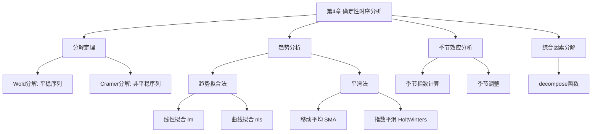
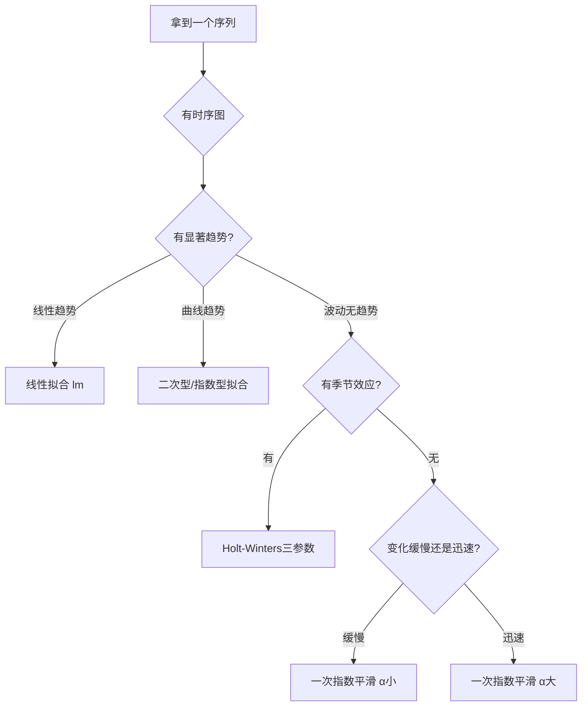

# 第4章 确定性时间序列分析 — 章节总结

## 一、章节框架图

## 二、文字知识树

- **4.1 时间序列的分解**
  - Wold分解定理：任意平稳序列 = 确定性部分 + 白噪声线性组合
  - Cramer分解定理：任意序列 = 多项式趋势 + 平稳残差
- **4.2 确定性因素分解**
  - 四大因素：长期趋势(T)、循环波动(C)、季节变化(S)、随机波动(I)
  - 加法模型 / 乘法模型
- **4.3 趋势分析**
  - 趋势拟合法：线性拟合(lm)、曲线拟合(nls)
  - 平滑法：移动平均(SMA)、一次指数平滑、Holt双参数、Holt-Winters三参数
- **4.4 [[KP03_季节效应分析|季节效应分析]]**
  - 季节指数：周期内各期平均数 / 总平均数
- **4.5 综合分析**
  - decompose()函数：同时提取趋势、季节、随机因素

## 三、核心公式清单

| 公式 | 含义 | 适用条件 |
|------|------|----------|
| $x_t = V_t + \xi_t$ | Wold分解 | 任意离散平稳序列 |
| $x_t = \sum_{j=0}^{d}\beta_j t^j + \Psi(B)a_t$ | Cramer分解 | 任意非平稳序列 |
| $\tilde{x}_t = \alpha x_t + (1-\alpha)\tilde{x}_{t-1}$ | 一次指数平滑 | 无趋势无季节序列 |
| $\hat{x}_T(l) = \tilde{x}_T + l \cdot r_T$ | Holt预测公式 | 有线性趋势无季节 |
| $S_k = \bar{x}_k / \bar{x}$ | 季节指数 | 有固定周期序列 |

## 四、[[01_方法选择决策树|方法选择决策树]]

## 五、章节联系

- **承接**：第2-3章学习了平稳序列的统计特征和[[KP03_ARMA模型|ARMA]]建模，本章处理非平稳序列的确定性信息提取
- **开启**：第5章将学习差分运算和[[KP01_ARIMA模型|ARIMA]]模型，弥补确定性方法对随机信息提取不充分的缺陷

## 六、自测题

**Q1**：Wold分解定理和Cramer分解定理的核心区别是什么？

> A：Wold分解适用于平稳序列，将其分解为确定性部分+白噪声线性组合；Cramer分解将这一思想推广到非平稳序列，分解为多项式趋势+平稳残差。

**Q2**：一次指数平滑预测任意l期的预测值是什么？为什么最好只做1期预测？

> A：$\hat{x}_t(l) = \tilde{x}_t$（常数）。因为一次指数平滑只能预测水平，无法预测趋势变化，多期预测就是一条水平线。

**Q3**：4期移动平均预测$\hat{x}_T(2)$中$x_T$前面的系数是多少？

> A：$\hat{x}_T(1) = (x_T + x_{T-1} + x_{T-2} + x_{T-3})/4$，$\hat{x}_T(2) = (\hat{x}_T(1) + x_T + x_{T-1} + x_{T-2})/4$，展开后$x_T$系数为 $1/4 + 1/16 = 5/16$。

**Q4**：Holt-Winters三参数指数平滑的三个参数$\alpha, \beta, \gamma$分别控制什么？

> A：$\alpha$控制水平部分，$\beta$控制趋势部分，$\gamma$控制季节部分。

**Q5**：季节指数$S_k$大于1和小于1分别意味着什么？

> A：$S_k > 1$表示该期值常高于总平均水平；$S_k < 1$表示该期值常低于总平均水平。

## 本章方法答辩速查

1. **问：本章讲趋势拟合和指数平滑，它们和第 3 章 ARMA 建模是什么关系？什么时候用哪套？** 答：本章是"确定性"路线——先用回归或平滑把趋势、季节这些确定性成分显式提取出来，主打解释和短期外推；ARMA 是"随机"路线，对平稳后的残差建模、提取[[03_自相关|自相关]]。两者不是互斥而是串联：按 Cramer 分解，任何序列都能拆成确定性趋势 + 平稳残差，所以标准做法是先用本章方法提趋势和季节，再对残差做 ARMA（这就是第 5 章的[[KP03_残差自回归|残差自回归]]）。如果趋势形式清楚、只要解释，用拟合；如果要跟上缓慢变化的趋势做滚动预测，用指数平滑。
2. **问：一次指数平滑、Holt、Holt-Winters 怎么按"趋势/季节"两个维度选？** 答：无趋势无季节→一次指数平滑，预测是水平线；有线性趋势无季节→Holt 双参数，预测是斜线 $\hat x_T(l)=\tilde x_T+l\cdot r_T$；既有趋势又有季节周期（月/季度数据）→Holt-Winters 三参数，预测是带斜率的波浪线。选错的典型后果是：对有趋势序列用一次平滑，预测永远是一条水平线、完全错过趋势。
3. **问：季节调整为什么要分加法模型和乘法模型？怎么判断用哪个？** 答：看季节波动幅度是否随序列水平放大。随趋势上升旺季越旺、淡季越淡（波动绝对幅度越来越大）→乘法模型，季节调整用 $x_t/S_k$；波动幅度是常数、不随规模变→加法模型，用 $x_t-S_k$。经济和销量数据大多是乘法模型。季节调整是趋势分析和后续 ARMA 建模前的标准前置步骤，不调会让周期波动污染趋势估计和残差白噪声检验。

---

## 🔗 跨库导航

**跨课教材视角：**
[[../../05_统计学原理/09_时间序列分析/知识点/KP15_长期趋势测定|统计视角·长期趋势测定]]

**🐮 大牛库对应模块：**
[[../../../经济统计学论文从0基础到精通/09_时间序列/05_ARIMA建模流程|大牛库·差分vs趋势]]

**📖 原书对应章节：**
[[../../../原文件/时间序列分析/王燕_时间序列分析基于R_全书|王燕教材·第4章 确定性时序]]
