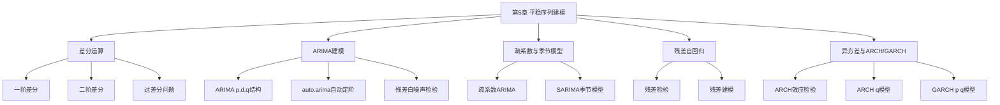
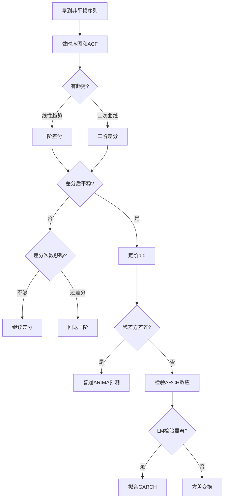

# 第5章 平稳时间序列建模 — 章节总结

## 一、章节框架图

## 二、文字知识树

- **5.1 差分运算**
  - 一阶差分：$\nabla x_t = x_t - x_{t-1}$，提取线性趋势
  - 二阶差分：$\nabla^2 x_t = \nabla x_t - \nabla x_{t-1}$，提取二次曲线趋势
  - 过差分：差分过度导致方差增大、模型失优
- **5.2 [[KP01_ARIMA模型|ARIMA]]模型**
  - 结构：ARIMA(p,d,q) = p阶自回归 + d阶差分 + q阶移动平均
  - [[05_ARIMA建模流程|建模流程]]：差分→定阶→估计→检验→预测
  - 疏系数模型：部分系数为0的ARIMA
- **5.3 [[KP02_季节模型|季节模型]]**
  - SARIMA$(p,d,q)(P,D,Q)_s$：普通ARIMA + 季节[[KP03_ARMA模型|ARMA]]
- **5.4 [[KP03_残差自回归|残差自回归]]**
  - 对提取确定性信息后的残差再做ARMA建模
- **5.5 [[02_异方差|异方差]]**
  - 方差齐性变换（对数/幂变换）
- **5.6 [[KP04_ARCH模型|ARCH]]/[[KP05_GARCH模型|GARCH]]**
  - ARCH(q)：条件异方差 = 残差平方的q阶移动平均
  - GARCH(p,q)：条件异方差 = 残差平方MA + 条件方差AR
  - ARCH效应检验：LM检验、Q检验

## 三、核心公式清单

| 公式 | 含义 | 适用条件 |
|------|------|----------|
| $\nabla x_t = x_t - x_{t-1}$ | 一阶差分 | 提取线性趋势 |
| $\nabla^2 x_t = x_t - 2x_{t-1} + x_{t-2}$ | 二阶差分 | 提取二次趋势 |
| $\Phi(B)\nabla^d x_t = \Theta(B)\varepsilon_t$ | ARIMA定义 | d阶单整序列 |
| $\varepsilon_t = \sqrt{h_t}e_t$ | ARCH/GARCH扰动项 | 异方差序列 |
| $h_t = \omega + \sum_{j=1}^{q}\lambda_j\varepsilon_{t-j}^2$ | ARCH(q)条件方差 | 短期波动率聚集 |
| $h_t = \omega + \sum_{i=1}^{p}\eta_i h_{t-i} + \sum_{j=1}^{q}\lambda_j\varepsilon_{t-j}^2$ | GARCH(p,q)条件方差 | 长期波动率聚集 |

## 四、方法选择决策图

## 五、章节联系

- **承接**：第4章用确定性方法（趋势拟合/指数平滑）提取信息，但对随机信息提取不充分
- **核心创新**：差分运算将非平稳序列转化为平稳序列，再用ARMA建模——ARIMA模型
- **开启**：第6章将扩展到多元时间序列和协整分析

## 六、自测题

**Q1**：ARIMA(p,d,q)中d的含义是什么？如何确定d？

> A：d是差分阶数，即把非平稳序列转化为平稳序列需要的差分次数。通常d=0,1,2，通过观察差分后序列是否平稳（ACF快速衰减）来确定。

**Q2**：什么是过差分？过差分有什么后果？

> A：对已经平稳的序列继续差分称为过差分。后果：①差分后序列方差变大；②可能引入不必要的移动平均结构；③预测精度下降。

**Q3**：ARCH效应的本质是什么？

> A：条件异方差——波动率具有聚集性（大波动后跟着大波动，小波动后跟着小波动）。用残差平方的自相关性来度量。

**Q4**：ARCH(q)和GARCH(p,q)的关系是什么？

> A：ARCH(q)是GARCH(p,q)在p=0时的特例。GARCH在ARCH基础上增加了条件方差的自回归项，能用更少的参数拟合长期波动率聚集。

**Q5**：auto.arima()函数自动完成了哪些工作？

> A：自动选择差分次数d、自动定阶p和q、自动估计参数、自动检验残差白噪声。基于AIC/BIC最小化。

## 本章方法答辩速查

1. **问：什么时候用 ARIMA，什么时候才需要 GARCH？两者是不是二选一？** 答：不是二选一，它们管的是序列的两个不同维度。ARIMA 建的是"条件均值"——预测下一期涨跌的水平值，并且假设残差方差恒定。如果你建完均值模型后对残差做 LM 检验、发现残差平方显著自相关（波动率聚集），说明还有条件异方差没处理，这时才在 ARIMA/回归的均值模型之上叠加 GARCH 来建"条件方差"。典型流程是：先 ARIMA 把水平提干净，残差过了白噪声检验但平方不白噪声，再上 GARCH(1,1)。
2. **问：ARIMA、SARIMA、残差自回归分别处理什么类型的非平稳序列？** 答：ARIMA(p,d,q) 处理有普通趋势、差分 d 次后平稳的序列；SARIMA(p,d,q)(P,D,Q)_s 在 ARIMA 基础上再加季节差分和季节 ARMA，处理"既增长又有固定季节周期"的月度/季度数据（看 ACF 是否在滞后 12、24 阶有峰值）；残差自回归则是先用回归把确定性趋势显式拟出来（保留系数解释性），再对回归残差建 ARMA。选择关键是看序列非平稳的来源是纯趋势、还是趋势加季节。
3. **问：GARCH(1,1) 里 $\eta_1+\lambda_1<1$ 这个条件为什么重要？** 答：它是 GARCH 平稳的条件，保证无条件方差 $\omega/(1-\eta_1-\lambda_1)$ 有限。$\eta_1+\lambda_1$ 叫波动率持续性，越接近 1，一次大波动引发的高方差持续越久才衰减（金融数据常在 0.95 以上）；等于 1 就是 IGARCH，波动冲击永不衰减、无条件方差无穷。参数上还要求 $\omega>0$、$\eta_1\ge0$、$\lambda_1\ge0$，保证条件方差 $h_t$ 永不为负。

---

## 🔗 跨库导航

**跨课教材视角：**
[[../../02_计量经济学/13_单位根与协整/知识点/KP01_单位根检验ADF|计量视角·ADF单位根]]

**🐮 大牛库对应模块：**
[[../../../经济统计学论文从0基础到精通/09_时间序列/05_ARIMA建模流程|大牛库·05 ARIMA流程]]｜[[../../../经济统计学论文从0基础到精通/09_时间序列/08_GARCH模型|大牛库·08 GARCH]]

**📖 原书对应章节：**
[[../../../原文件/时间序列分析/王燕_时间序列分析基于R_全书|王燕教材·第5章 ARIMA与异方差]]
