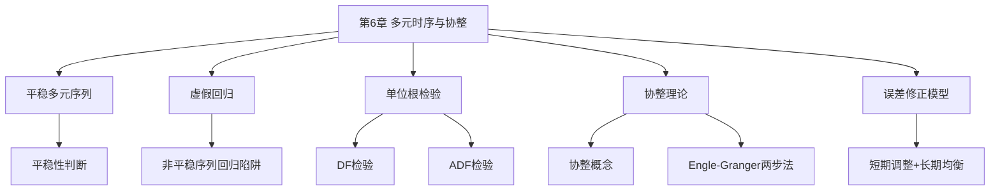
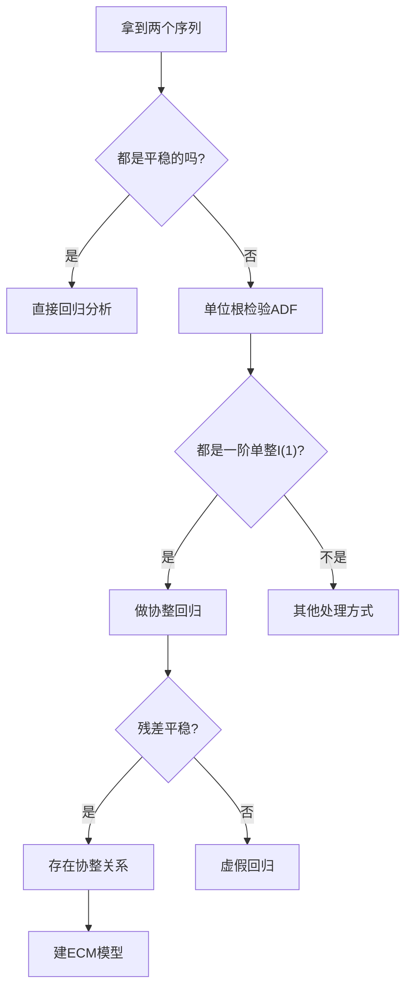

# 第6章 多元时间序列分析与协整 — 章节总结

## 一、章节框架图

## 二、文字知识树

- **6.1 平稳多元序列**
  - 多元时间序列的[[02_平稳性|平稳性]]定义
  - 平稳多元序列可以直接做回归分析
- **6.2 [[KP01_虚假回归|虚假回归]]**
  - 两个独立的非平稳序列回归→R²很高但毫无关系
  - 原因：非平稳序列的趋势被误判为因果关系
- **6.3 [[KP01_单位根检验ADF|单位根检验]]**
  - DF检验：三种类型（无常数/有常数/有趋势）
  - [[KP02_DF与ADF检验|ADF]]检验：加滞后差分项解决[[03_自相关|自相关]]
  - 原假设：序列有单位根（非平稳）
- **6.4 协整**
  - 两个非平稳序列的线性组合可能是平稳的
  - 直觉：两个喝醉的人手拉手，各自随机游走但距离稳定
- **6.5 误差修正模型[[KP03_协整与ECM|ECM]]**
  - Engle-Granger两步法
  - 短期调整 + 长期均衡

## 三、核心公式清单

| 公式 | 含义 | 适用条件 |
|------|------|----------|
| $y_t = \alpha + \beta x_t + \varepsilon_t$ | 简单回归 | 平稳序列 |
| $x_t = x_{t-1} + \varepsilon_t$ | 随机游走（单位根） | 非平稳序列 |
| $\Delta x_t = \alpha + \beta t + \gamma x_{t-1} + \varepsilon_t$ | ADF检验回归式 | 单位根检验 |
| $\varepsilon_t = y_t - \alpha - \beta x_t$ | 协整回归残差 | 协整检验 |
| $\Delta y_t = \beta \Delta x_t + \gamma(y_{t-1} - \alpha - \beta x_{t-1}) + \varepsilon_t$ | ECM误差修正模型 | 协整序列 |

## 四、决策流程图

## 五、章节联系

- **承接**：第5章单变量[[KP01_ARIMA模型|ARIMA]]处理单个非平稳序列
- **核心创新**：多个非平稳序列之间可能有长期均衡关系（协整）
- **应用**：经济学中的购买力平价、利率期限结构、股市与宏观经济关系

## 六、自测题

**Q1**：什么是虚假回归？为什么会出现？

> A：两个独立的随机游走序列做回归，R²很高但t值显著实际上毫无关系。原因是非平稳序列的共同趋势被误判为因果关系。

**Q2**：DF[[08_t检验和F检验|检验和]]ADF检验的原假设是什么？p<0.05意味着什么？

> A：原假设是"序列有单位根（非平稳）"。p<0.05拒绝原假设→序列平稳。

**Q3**：协整的直觉是什么？

> A：两个喝醉的人手拉手走路——各自随机游走（非平稳），但两人之间的距离（线性组合）保持稳定（平稳）。

**Q4**：Engle-Granger两步法是什么？

> A：第一步，用OLS估计长期均衡关系$y_t = \alpha + \beta x_t + \varepsilon_t$；第二步，检验残差$\varepsilon_t$是否平稳，若平稳则存在协整，再建误差修正模型ECM。

**Q5**：ECM模型中误差修正项的系数代表什么？

> A：代表偏离长期均衡的调整速度。系数为负表示会自动回调到均衡水平。

## 本章方法答辩速查

1. **问：面对两个非平稳序列，正确的分析决策路径是什么？** 答：先各自做 ADF 单位根检验：若都是 I(0)（平稳），直接回归即可；若都是 I(1)（同阶单整），就做 Engle-Granger 协整检验——先 OLS 回归 $y_t=\alpha+\beta x_t$，再对残差做 ADF。残差平稳（p<0.05）说明存在协整关系，可以合法回归并建 ECM；残差不平稳，说明两个序列只是碰巧都有趋势，这个回归就是虚假回归，正确做法是差分后回归、只研究短期变化量关系。一个 I(0) 一个 I(1) 则不能协整。
2. **问：协整和误差修正模型（ECM）是什么关系？** 答：协整是"两个非平稳序列之间存在长期均衡关系"这个事实；ECM 是把这个事实写成模型的形式。协整回归 $y_t=\alpha+\beta x_t$ 刻画长期均衡 $\beta$；ECM $\Delta y_t=\beta\Delta x_t+\gamma\hat\varepsilon_{t-1}+u_t$ 在此基础上加一个误差修正项 $\hat\varepsilon_{t-1}=y_{t-1}-\alpha-\beta x_{t-1}$，系数 $\gamma$ 必须为负，代表短期偏离均衡后下一期自动回调的力度和速度。一句话：协整发现长期关系，ECM 同时刻画短期波动和长期回调。
3. **问：ADF 检验和协整检验都要验"残差平稳"，它们有什么区别？** 答：ADF 检验原序列是否有单位根、即是否 I(1)，用的是 MacKinnon 临界值；协整检验是在 OLS 协整回归之后，对回归残差做单位根检验，但因为残差是估计出来的、自由度和分布都变了，要用更严格的协整专用临界值（不能直接套用普通 ADF 的 p 值）。两者方向一致（都是看平稳与否），但后者本质上是"检验两个 I(1) 序列的线性组合是否降到 I(0)"，这正是协整的定义。

---

## 🔗 跨库导航

**跨课教材视角：**
[[../../02_计量经济学/13_单位根与协整/00_章节总结|计量视角·第13章 单位根与协整]]｜[[../../02_计量经济学/12_平稳时间序列/知识点/KP01_VAR模型|计量视角·VAR模型]]

**🐮 大牛库对应模块：**
[[../../../经济统计学论文从0基础到精通/09_时间序列/06_ADF单位根检验|大牛库·06 ADF检验]]｜[[../../../经济统计学论文从0基础到精通/09_时间序列/07_协整与误差修正ECM|大牛库·07 协整ECM]]

**📖 原书对应章节：**
[[../../../原文件/时间序列分析/王燕_时间序列分析基于R_全书|王燕教材·第6章 协整]]
