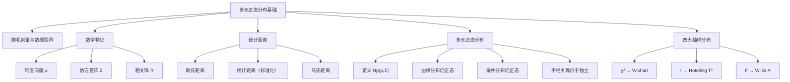
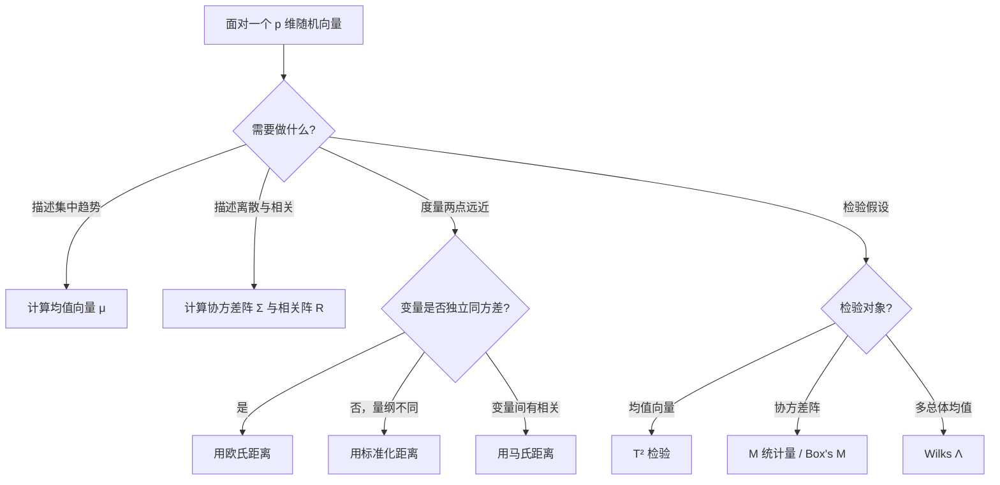

# 第1章 [[KP03_多元正态分布|多元正态分布]] · 章节总结

> 本章是整个多元统计分析的理论基石。一元统计推广到多元统计的核心工具是**均值向量**、**协方差阵**、**马氏距离**与**多元正态分布**，而抽样分布则由 χ²/t/F 推广为 Wishart/T²/Wilks Λ。

## 一、章节框架图

## 二、文字知识树

- 1.1 多元分布基本概念
  - 随机向量 X = (X₁,…,Xₚ)'，n 次观测形成 n×p 数据阵 X
  - 分布函数 F(x) 与密度 f(x)
  - 独立性：联合分布 = 边缘分布乘积
- 1.2 [[KP02_统计距离|统计距离]]
  - 欧氏距离：与量纲有关，不考虑变量相关性
  - 统计距离：按方差加权（除以 S_ii），与量纲无关
  - 马氏距离：d² = (x-μ)'Σ⁻¹(x-μ)，同时克服量纲与相关性问题
- 1.3 多元[[07_正态分布|正态分布]]
  - 密度：f(x) = (2π)^(-p/2)|Σ|^(-1/2) exp[-½(x-μ)'Σ⁻¹(x-μ)]
  - 性质：线性变换仍正态；协方差对角⇒各分量独立；边缘分布正态但反之不真
  - 条件分布：给定 X⁽²⁾ 时 X⁽¹⁾ 仍正态，均值与协方差由式(1.26)(1.27)给出
- 1.4 参数估计
  - μ̂ = X̄（样本均值向量）
  - Σ̂ = L/(n-1)（无偏样本协方差阵），其中 L = Σ(X_(i)-X̄)(X_(i)-X̄)'
- 1.5 抽样分布
  - χ² 分布：E=n, D=2n，可加性，Cochran 定理
  - Wishart 分布 W_p(n,Σ)：χ² 的多维推广，L ~ W_p(n-1,Σ)
  - Hotelling T²：n(X̄-μ)'S⁻¹(X̄-μ) ~ T²(p,n-1)，可化为 F
  - Wilks Λ：|W₁|/|W₁+W₂|，多元方差分析的核心统计量

## 三、核心公式清单

| 公式 | 含义 | 符号解释 | 适用条件 |
|------|------|----------|----------|
| μ = E(X) | 均值向量 | μ_i = E(X_i) | 各分量期望存在 |
| Σ = E[(X-μ)(X-μ)'] | 协方差阵 | σ_ij = cov(X_i,X_j) | 方差存在，对称半正定 |
| R = (r_ij) | 相关阵 | r_ij = σ_ij/(√σ_ii√σ_jj) | 各分量方差>0 |
| d_M²(x,y) = (x-y)'Σ⁻¹(x-y) | 马氏距离 | Σ⁻¹ 为协方差阵逆 | Σ 正定 |
| f(x) = (2π)^(-p/2)\|Σ\|^(-1/2) exp[-½(x-μ)'Σ⁻¹(x-μ)] | 多元正态密度 | Σ>0 | X ~ N_p(μ,Σ) |
| d² = (X-μ)'Σ⁻¹(X-μ) ~ χ²(p) | 马氏距离平方的分布 | — | X ~ N_p(μ,Σ) |
| n(X̄-μ)'S⁻¹(X̄-μ) ~ T²(p,n-1) | 单样本 T² | S = L/(n-1) | 样本来自 N_p(μ,Σ) |
| Λ = \|W₁\|/\|W₁+W₂\| | Wilks Λ | W₁~W_p(n₁,Σ), W₂~W_p(n₂,Σ) | 独立同分布 |

## 四、四大抽样分布速查表

| 一元统计 | 多元推广 | 符号 | 主要用途 |
|----------|----------|------|----------|
| χ²(n) | Wishart 分布 | W ~ W_p(n,Σ) | 描述样本离差阵 L 的分布 |
| t(n) | Hotelling T² | T² ~ T²(p,n) | [[KP01_均值向量检验|均值向量检验]]（单样本、两样本） |
| F(m,n) | Wilks Λ | Λ ~ Λ(p,n₁,n₂) | [[KP03_多总体MANOVA|多总体]]均值检验（[[KP03_多总体MANOVA|MANOVA]]） |
| — | (由 T² 化 F) | (n-p+1)/(pn)·T² ~ F(p,n-p+1) | T² 检验查 F 表 |

**关键换算关系：**
- T²(p,n) → F：[(n-p+1)/(pn)]·T² ~ F(p, n-p+1)
- Λ(p,n₁,n₂) 当 p=1 或 n₂=1,2 时可精确化为 F
- 一般情形：Bartlett 近似 V = -(n₁+n₂-(p+n₂+1)/2)lnΛ ~ χ²(pn₂)

## 五、[[01_方法选择决策树|方法选择决策树]]

## 六、章节联系

- **前接**：概率论与数理统计（一元正态、χ²/t/F 分布）、线性代数（矩阵运算、二次型、特征值）
- **本章核心地位**：第2章均值/协方差检验直接使用 T²、Wilks Λ；第3章[[04_聚类分析|聚类分析]]使用马氏距离；第4章判别分析以马氏距离判别为基础
- **后续**：主成分分析、因子分析均建立在 Σ 的特征值分解上

## 七、自测题

1. **为什么协方差阵一定是对称半正定的？**
   答：Σ = E[(X-μ)(X-μ)']，其(i,j)元 = cov(X_i,X_j) = cov(X_j,X_i)，故对称；对任意常向量 a，a'Σa = D(a'X) ≥ 0，故半正定。

2. **马氏距离与欧氏距离的本质区别是什么？**
   答：欧氏距离 d² = (x-y)'(x-y) 不考虑量纲与变量相关性；马氏距离 d²_M = (x-y)'Σ⁻¹(x-y) 通过 Σ⁻¹ 同时消除了量纲影响（各分量方差归一）和变量间相关性（协方差项消去），且对一切线性变换不变。

3. **若 X ~ N_p(μ,Σ) 且 Σ 为对角阵，为什么 X 的各分量相互独立？**
   答：多元正态分布中"不相关"等价于"独立"。Σ 对角意味着 cov(X_i,X_j)=0（i≠j），即各分量不相关，故相互独立。

4. **样本协方差阵 L/(n-1) 为什么比 L/n 更常用？**
   答：L/n 是极大似然估计但有偏；L/(n-1) 是无偏估计。当 n 较大时两者差异不大，n 较小时常用无偏估计。

5. **T² 统计量与一元 t² 是什么关系？**
   答：一元 t² = n(x̄-μ₀)'(S²)⁻¹(x̄-μ₀) ~ F(1,n-1)；多元 T² = n(X̄-μ₀)'S⁻¹(X̄-μ₀) ~ T²(p,n-1)。当 p=1 时 T² 退化为 t²。

6. **Wilks Λ 统计量的直观含义是什么？**
   答：Λ = |组内离差阵| / |总离差阵|。Λ 越小说明组间差异越大（组内方差占总方差比例小），越倾向于拒绝"多总体均值相等"的原假设。

7. **条件分布中为什么 Σ₁₁·₂ ≤ Σ₁₁？**
   答：Σ₁₁·₂ = Σ₁₁ - Σ₁₂Σ₂₂⁻¹Σ₂₁，而 Σ₁₂Σ₂₂⁻¹Σ₂₁ 是半正定矩阵，故减去后方差阵减小。物理含义：已知 X⁽²⁾ 后，X⁽¹⁾ 的不确定性降低了。

## 本章方法答辩速查

1. **问：本章的马氏距离为什么是后续所有方法的基础？** 答：距离判别用马氏距离归类，T² 检验本质是 n 倍马氏距离平方，Ward 法基于标准化后的欧氏距离，聚类的相似性度量也从距离出发。不掌握马氏距离，第 2~4 章全部无法理解。
2. **问：一元 t 检验和多元 T² 检验是什么关系？p=1 时会怎样？** 答：p=1 时 T²=n(x̄-μ₀)²/s²=t²，退化为一元 t²~F(1,n-1)。p>1 时 T² 把 p 个指标打包检验，避免多重 t 检验导致的 α 膨胀（p=10 时整体错误率约 40%）。
3. **问：为什么所有多元检验都要求正态假定？实际严重违反怎么办？** 答：T²、Wilks Λ 的抽样分布（Wishart 导出）严格依赖多元正态。实际中 n 大时中心极限定理可补救，p 值近似可用；小样本严重偏离正态时应考虑非参数方法或稳健估计。

---

## 🔗 跨库导航

- 🐮 **大牛库配套：** [[../../../经济统计学论文从0基础到精通/01_基础数学/07_正态分布|大牛库·单变量正态分布基础]]
- 📖 **原书对应：** [[../../../原文件/多元统计分析/何晓群_多元统计分析_全书|何晓群《多元统计分析》第1章]]
- ➡️ **下一章方法：** [[../02_均值向量与协方差阵检验/00_章节总结|第2章 均值向量与协方差阵检验]]
