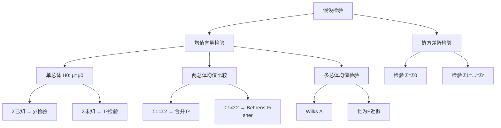
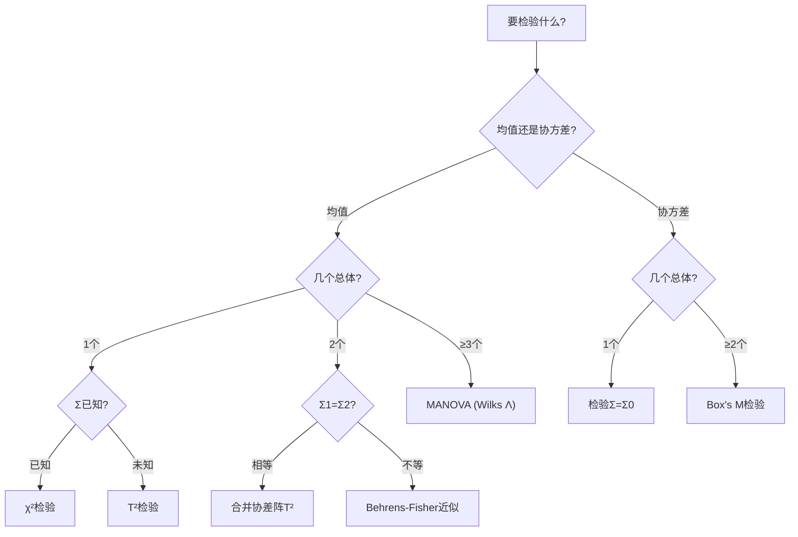

# 第2章 [[KP01_均值向量与协方差阵|均值向量与协方差阵]]检验 · 章节总结

> 本章把一元统计的 z/t/F/χ² 检验推广到多维：单总体均值检验用 T²，[[KP02_两总体均值比较|两总体均值比较]]用 T²，[[KP03_多总体MANOVA|多总体]]均值比较用 Wilks Λ（[[KP03_多总体MANOVA|MANOVA]]），[[KP04_协方差阵检验|协方差阵检验]]用 M 统计量。

## 一、章节框架图

## 二、文字知识树

- 2.1 [[KP01_均值向量检验|均值向量检验]]
  - 一元回顾：σ²已知用 z，σ²未知用 t
  - 单总体：Σ已知用 χ²₀ = n(X̄-μ₀)'Σ⁻¹(X̄-μ₀) ~ χ²(p)；Σ未知用 T² ~ T²(p,n-1)
  - 两总体协差阵相等：T² = n₁n₂/(n₁+n₂)·(X̄-Ȳ)'Ŝ⁻¹(X̄-Ȳ) ~ T²(p,n₁+n₂-2)
  - 两总体协差阵不等：Behrens-Fisher 问题，近似 F
  - 多总体：组间离差阵 B + 组内离差阵 E，W=B+E，用 Wilks Λ
- 2.2 协方差阵检验
  - 检验 Σ=Σ₀：Box's M 统计量
  - 检验多组 Σ₁=…=Σ_r：Box's M 检验
- 2.3 上机实现
  - [[05_SPSS操作指引|SPSS]]: Analyze → General Linear Model → Multivariate
  - 例2-1：河北、江苏、浙江三省经济发展水平比较

## 三、核心公式清单

| 检验问题 | 统计量 | 分布 | 拒绝域 |
|----------|--------|------|--------|
| 单总体 μ=μ₀，Σ已知 | χ²₀ = n(X̄-μ₀)'Σ⁻¹(X̄-μ₀) | χ²(p) | χ²₀ > χ²_p(α) |
| 单总体 μ=μ₀，Σ未知 | T² = n(X̄-μ₀)'S⁻¹(X̄-μ₀) | T²(p,n-1) | T² > T²_{p,n-1}(α) |
| 两总体 μ₁=μ₂，Σ相等 | T² = n₁n₂/(n₁+n₂)·(X̄-Ȳ)'Ŝ⁻¹(X̄-Ȳ) | T²(p,n₁+n₂-2) | 化为F检验 |
| 多总体 μ₁=…=μ_r | Λ = \|E\|/\|B+E\| | Λ(p,r-1,n-r) | Λ 过小拒绝 |
| Σ=Σ₀ | M = (n-1)[ln\|Σ₀\|-p-ln\|Ŝ\|+tr(ŜΣ₀⁻¹)] | 近似 bF(f₁,f₂) | M 过大拒绝 |
| Σ₁=…=Σ_r | M = (n-r)ln\|L/(n-r)\| - Σ(nᵢ-1)ln\|Lᵢ/(nᵢ-1)\| | 近似 bF(f₁,f₂) | M 过大拒绝 |

**T² 化 F 的关键换算：**
- 单样本：[(n-p)/(n-1)p]·T² ~ F(p, n-p)
- 两样本：[(n₁+n₂-p-1)/((n₁+n₂-2)p)]·T² ~ F(p, n₁+n₂-p-1)

## 四、[[01_方法选择决策树|方法选择决策树]]

## 五、章节联系

- **前接**：第1章的多元正态分布、T² 分布、Wilks Λ 分布。
- **本章地位**：是"从描述到推断"的转折，后续判别分析、主成分分析都建立在均值/协方差的估计与检验上。
- **后续**：第4章判别分析首先要检验各组均值是否有显著差异。

## 六、自测题

1. **为什么不能用多个一元 t 检验代替多元 T² 检验？**
   答：多重检验问题。做 p 个 t 检验，整体犯第一类错误的概率会膨胀到 1-(1-α)^p。T² 检验把 p 个指标作为整体同时检验，控制了整体 α。

2. **Wilks Λ 统计量的取值范围和直观含义？**
   答：0 ≤ Λ ≤ 1。Λ = |E|/|W| = 组内方差 / 总方差。Λ 越小说明组间差异越大，越拒绝原假设。

3. **两总体协方差阵不相等时怎么办？**
   答：这是 Behrens-Fisher 问题。用 S* = S₁/n₁ + S₂/n₂ 代替合并协差阵，自由度 f 由近似公式确定，用 F 分布近似。

4. **Box's M 检验的原假设是什么？**
   答：各组协方差阵相等。Sig. > 0.05 则认为协方差阵相等，可以用线性判别；否则用二次判别。

5. **多元检验显著后为什么还要做一元检验？**
   答：多元检验告诉你"整体有差异"，一元检验告诉你"差异具体在哪个指标上"。两者联合使用信息更全。

## 本章方法答辩速查

1. **问：本章检验方法和第 4 章判别分析怎么衔接？** 答：判别分析前必须先检验各组均值是否有显著差异（两样本 T²/MANOVA）和协差阵是否相等（Box's M）。均值不显著→两类根本分不开，判别无意义；协差阵不等→用二次判别 qda，相等→用线性判别 lda。
2. **问：Wilks Λ 和一元 F 统计量直觉上有什么对应？** 答：一元 F=组间均方/组内均方；Wilks Λ=|组内离差阵|/|总离差阵|。Λ 小=组内占比小=组间差异大，和 F 大等价。p=1 时 Λ 精确化为 F。
3. **问：为什么不能用多个一元 t 检验代替多元 T²？** 答：多重检验导致 α 膨胀。做 p 个 t 检验整体第一类错误率=1-(1-α)^p，远大于 α=0.05。T² 把 p 个指标打包成整体检验，控制整体 α。显著后再做一元 t（配合 Bonferroni 校正）定位差异指标。

---

## 🔗 跨库导航

- 🐮 **大牛库配套：** [[../../../经济统计学论文从0基础到精通/03_相关与回归/08_t检验和F检验|大牛库·t检验与F检验直觉]]
- 📖 **原书对应：** [[../../../原文件/多元统计分析/何晓群_多元统计分析_全书|何晓群《多元统计分析》第2章]]
- ⬅️ **上一章方法：** [[../01_多元正态分布/00_章节总结|第1章 多元正态分布]]
- ➡️ **下一章方法：** [[../03_聚类分析/00_章节总结|第3章 聚类分析]]
