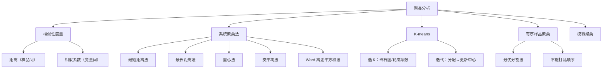
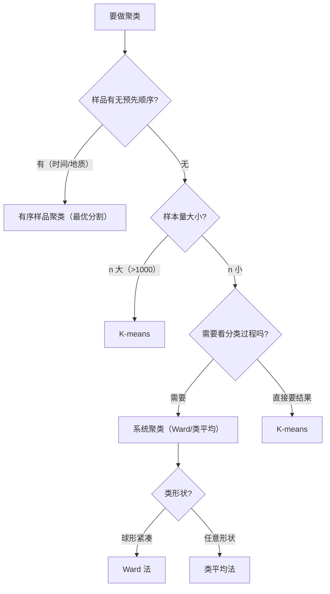

# 第3章 [[04_聚类分析|聚类分析]] · 章节总结

> 聚类分析是"物以类聚"——事先不知道分几类，让数据自己说话。核心是：先定义"像不像"（距离/相似系数），再选择聚类算法把样品自动分组。

## 一、章节框架图

## 二、文字知识树

- 3.1 [[KP01_相似性度量|相似性度量]]
  - 样品间距离：明氏距离（欧氏、曼哈顿、切比雪夫）、马氏距离、兰氏距离
  - 变量间相似系数：夹角余弦、皮尔逊[[01_相关系数|相关系数]]
  - 量纲不同时先[[KP11_标准化_ZScore|标准化]]
- 3.2 [[KP02_系统聚类法|系统聚类法]]
  - 步骤：各自成类 → 合并最近两类 → 更新距离 → 直到全部成一类
  - 五种方法：最短/最长/重心/类平均/Ward
  - 树状图（谱系图）读分类
- 3.3 分类数确定
  - 看树状图跳跃高度
  - 统计量：SPRS/RS/SPRS/半偏 R²/伪 F/伪 t²
  - 陡坡检验（scree plot）
- 3.4 K-means
  - 预先指定 K，迭代优化
  - 优点：计算快，大样本适用
  - 缺点：需先定 K，对初值敏感，只能处理球形类
- 3.5 [[KP04_有序样品聚类|有序样品聚类]]
  - 样品顺序不能打乱（如时间序列、地质剖面）
  - 最优分割法 Fisher 算法
- 3.6 模糊聚类
  - 隶属度 0~1，不是硬分类
  - 适合边界模糊的情形

## 三、核心公式清单

| 度量 | 公式 | 用途 |
|------|------|------|
| 明氏距离 | d_q(x,y) = [Σ\|x_k-y_k\|^q]^(1/q) | 样品间距离通用式 |
| 欧氏距离 | q=2 时 | 最常用 |
| 马氏距离 | (x-y)'Σ⁻¹(x-y) | 考虑变量相关性 |
| 夹角余弦 | cos α = x'y/(\|x\|\|y\|) | 变量相似系数 |
| 相关系数 | r_xy = Σ(x-x̄)(y-ȳ)/√(Σ(x-x̄)²Σ(y-ȳ)²) | 变量线性相关 |
| Ward 距离 | D²_GM = \|G\|·\|H\|/(\|G\|+\|H\|\|·\|\|x̄_G-x̄_H\|² | 离差平方和增量 |

## 四、五种系统聚类法对比

| 方法 | 类间距离定义 | 优点 | 缺点 |
|------|-------------|------|------|
| 最短距离法 | 两类最近样品距离 | 简单 | 容易链式连接，类细长 |
| 最长距离法 | 两类最远样品距离 | 不链式 | 受极端值影响 |
| 重心法 | 两类重心距离 | 有物理意义 | 距离单调，树状图可能逆转 |
| 类平均法 | 两类所有样品对距离平均 | 利用信息多 | 计算量大 |
| Ward 法 | 离差平方和增量 | 类内紧凑，常用 | 倾向于产生小类 |

## 五、方法选择决策图

## 六、章节联系

- **前接**：第1章的距离概念（欧氏、马氏）。
- **本章地位**：无监督学习核心方法之一，与[[05_判别分析|判别分析]]（有监督）互补。
- **后续**：第4章判别分析用聚类结果作为已知类别再建判别函数。

## 七、自测题

1. **为什么聚类前通常要标准化？**
   答：变量量纲不同时，大方差变量主导距离。标准化后各变量方差=1，距离公平。

2. **最短距离法为什么容易产生"链式"效果？**
   答：它只看两类最近的一个点，只要两个类各有一个点靠近就合并，容易把细长的一串连起来。

3. **K-means 与系统聚类的主要区别？**
   答：系统聚类不需预设 K，结果树状图可读，但 n 大时慢；K-means 需预设 K，计算快，但结果依赖初值。

4. **Ward 法的原理是什么？**
   答：每次合并使类内离差平方和增量最小，倾向于产生类内紧凑、大小相近的类。

5. **有序样品聚类为什么不能打乱顺序？**
   答：如时间序列、地质剖面，相邻样品天然连续，打乱顺序就失去意义。

## 本章方法答辩速查

1. **问：聚类分析和判别分析怎么配合使用？** 答：聚类是无标签探索（不知道分几类），判别是有标签预测。实践流程：先聚类探索出 K 类→贴标签→训练判别函数→给新样品分类。但聚类标签本身可能不准，判别误判率要用交叉验证估计。
2. **问：系统聚类和 K-means 怎么选？** 答：n<200、要看完整分类过程、类形状不规则→系统聚类（Ward 法）；n>1000、类近似球形、只要快速结果→K-means。K-means 需预设 K（肘部法则选），系统聚类不需预设但 n 大时 O(n²) 算不动。
3. **问：Ward 法和 K-means 的目标函数有什么联系？** 答：Ward 法每次合并使类内离差平方和 SSE 增量最小；K-means 迭代优化 J=Σ 类内 SSE 最小。两者目标一致，都是让类内紧凑。Ward 法的结果常作为 K-means 初始中心的参考。

---

## 🔗 跨库导航

- 📚 **综合评价中的应用：** [[../../01_综合评价/06_常规综合评价方法/00_章节总结|综合评价教材·06常规方法（聚类用于分类评价）]]
- 🐮 **大牛库配套：** [[../../../经济统计学论文从0基础到精通/08_降维与分类/04_聚类分析|大牛库·聚类分析(K-means/层次聚类)]]
- 📖 **原书对应：** [[../../../原文件/多元统计分析/何晓群_多元统计分析_全书|何晓群《多元统计分析》第3章]]
- ⬅️ **上一章方法：** [[../02_均值向量与协方差阵检验/00_章节总结|第2章 均值检验]]
- ➡️ **下一章方法：** [[../04_判别分析/00_章节总结|第4章 判别分析（聚类无监督 vs 判别有监督）]]
