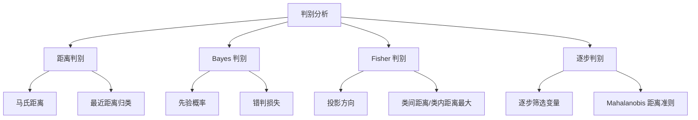
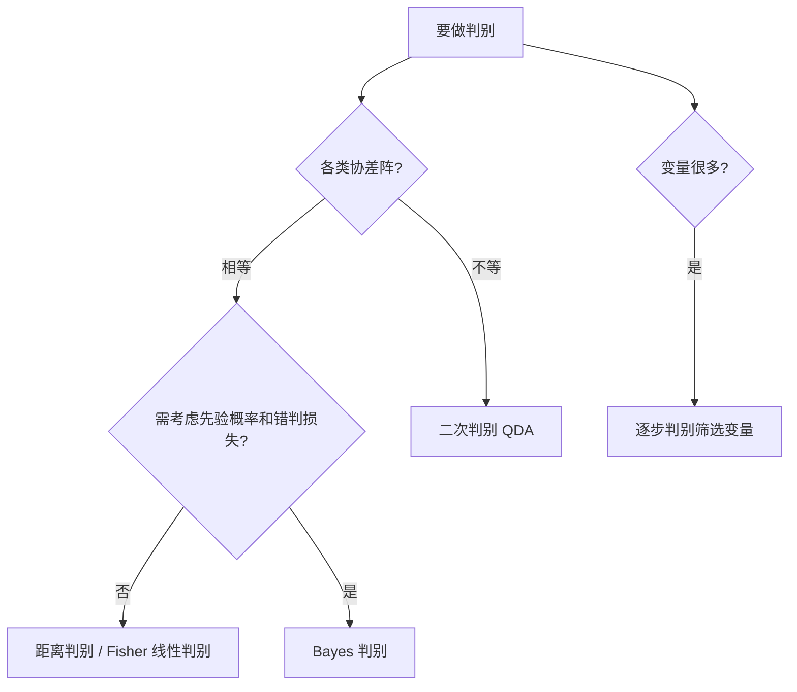

# 第4章 [[05_判别分析|判别分析]] · 章节总结

> 聚类是"物以类聚"（无标签），判别是"对号入座"（有标签）。判别分析用已知类别的样品训练规则，给新样品分类。

## 一、章节框架图

## 二、文字知识树

- 4.1 [[KP01_距离判别|距离判别]]
  - 两总体：算新样品到各总体马氏距离，归最近类
  - [[KP03_多总体MANOVA|多总体]]：推广到 k 类
  - 协差阵相等：合并 S_p；不等：分别算
- 4.2 Bayes 判别
  - 考虑先验概率 q_i 和错判损失 L(j|i)
  - 后验概率最大准则
  - 适合各类大小悬殊、错判代价不同的情形
- 4.3 Fisher 判别
  - 投影思想：找方向 a 使类间距离最大、类内距离最小
  - 线性判别函数 y = a'x
  - 两总体：中点 m 分界
  - 多总体：最多 min(p, k-1) 个判别函数
  - 与 [[KP04_PCA与FA对比|PCA]] 区别：Fisher 是判别导向，PCA 是方差导向
- 4.4 逐步判别
  - 变量筛选：引入最显著变量，剔除不显著变量
  - 类似逐步回归
  - [[05_SPSS操作指引|SPSS]]: Analyze → Classify → Discriminant

## 三、核心公式清单

| 方法 | 判别规则 | 适用条件 |
|------|----------|----------|
| 距离判别 | 归 d²_M 最小的类 | 各类多元正态 |
| Bayes 判别 | 归后验概率 P(G_i\|x) 最大的类 | 有先验概率 |
| Fisher 判别 | y=a'x，与中点 m 比较 | 协差阵相等 |
| 逐步判别 | 逐个引入/剔除变量 | 变量多需筛选 |

**Fisher 判别方向：**
$$a \propto S_p^{-1}(\bar{x}_1 - \bar{x}_2)$$

**两总体分界点：**
$$m = \frac{1}{2}(\bar{x}_1 + \bar{x}_2)' S_p^{-1}(\bar{x}_1 - \bar{x}_2)$$

## 四、方法选择决策图

## 五、聚类 vs 判别对比

| 维度 | [[04_聚类分析|聚类分析]] | 判别分析 |
|------|----------|----------|
| 标签 | 无标签 | 有标签 |
| 目标 | 物以类聚，发现结构 | 对号入座，预测新样品 |
| 方法 | 系统聚类、K-means | 距离、Bayes、Fisher |
| 阶段 | 探索性 | 验证/预测性 |

## 六、章节联系

- **前接**：第1章马氏距离、第2章均值检验、第3章聚类结果（作为已知类别）。
- **本章地位**：有监督学习的核心方法。
- **后续**：分类回归树、Logistic 回归等都是判别思想的延伸。

## 七、自测题

1. **距离判别与 Fisher 判别的区别？**
   答：距离判别直接算马氏距离归类；Fisher 先投影到一维再看投影值与中点的关系。协差阵相等时两者等价。

2. **Fisher 判别与[[02_主成分分析PCA|主成分分析]]的区别？**
   答：Fisher 投影方向最大化"类间/类内"比（判别导向）；PCA 投影方向最大化方差（方差导向）。PCA 不管类别。

3. **Bayes 判别比距离判别多考虑了什么？**
   答：先验概率 q_i 和错判损失 L(j|i)。某类先验概率小，要离它更远才判它。

4. **逐步判别解决什么问题？**
   答：变量太多时筛选重要变量，类似逐步回归，避免共线性和过拟合。

5. **回判误判率为什么通常偏小？**
   答：用训练集自己评估自己，规则就是从这些样品学的，回判自然偏好。真实误判率要用测试集交叉验证。

## 本章方法答辩速查

1. **问：距离判别、Bayes 判别、Fisher 判别怎么选？** 答：先做 Box's M：协差阵不等→qda（二次判别，Bayes 族）；协差阵相等且需考虑先验概率/错判代价→Bayes(lda)；相等且各类均衡、错判代价相同→距离判别或 Fisher（两总体等协差阵时两者等价）。需要可视化分类方向用 Fisher。
2. **问：回判误判率为什么不能当真？怎么得到真实误判率？** 答：回判用训练集自评，规则就是从这些样品学的，自然偏好。真实误判率要用留出测试集或留一交叉验证（LOO）估计，通常比回判率高 5~15 个百分点。
3. **问：判别分析和 Logistic 回归都能做两类分类，本质区别？** 答：判别分析要求各组多元正态且协差阵相等，用马氏距离/后验概率；Logistic 回归不要求这些，用 Logit 变换建模概率。当数据不满足正态假定时，Logistic 更稳健。

---

## 🔗 跨库导航

- 🐮 **大牛库配套：** [[../../../经济统计学论文从0基础到精通/08_降维与分类/05_判别分析|大牛库·Fisher判别与ST预警]]
- 📖 **原书对应：** [[../../../原文件/多元统计分析/何晓群_多元统计分析_全书|何晓群《多元统计分析》第4章]]
- ⬅️ **上一章方法：** [[../03_聚类分析/00_章节总结|第3章 聚类分析（无监督分堆）]]
- ➡️ **下一章方法：** [[../05_主成分分析/00_章节总结|第5章 主成分分析]]
