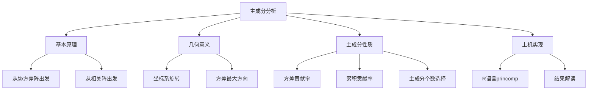
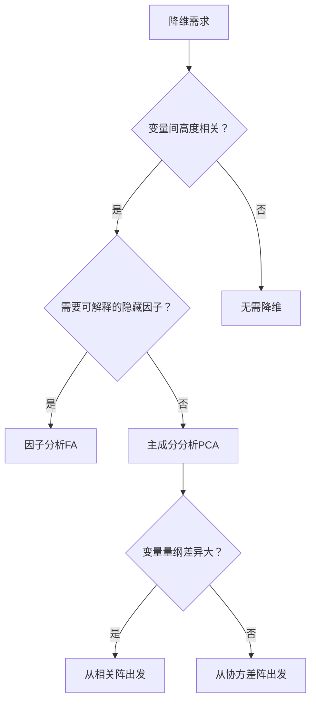

# 第5章 [[02_主成分分析PCA|主成分分析]] · 章节总结

## 一、章节框架图

## 二、文字知识树

- **主成分分析（[[KP03_PCA与因子分析对比|PCA]]）**
  - [[KP01_PCA基本原理|基本原理]]
    - 从协方差阵 Σ 出发：求 Σ 的特征值与特征向量
    - 从相关阵 R 出发：[[KP11_标准化_ZScore|标准化]]后求 R 的特征值与特征向量
    - 本质：正交变换，将 p 个相关变量压缩为 k 个不相关综合指标
  - 几何意义
    - 对原坐标系作旋转，使新坐标轴沿样本点方差最大的方向
    - 第一主成分 = 数据分布最"散"的方向
  - 主成分性质
    - 各主成分互不相关
    - 第 i 主成分方差 = 第 i 大特征值 λ_i
    - 总方差不变：Σλ_i = p（从相关阵出发）或 Σσ_ii（从协方差阵出发）
    - 方差贡献率 = λ_i / Σλ_j
    - 累积贡献率 = Σ_{j=1}^{k} λ_j / Σλ_j
  - 主成分个数选择
    - 累积贡献率 > 80%
    - Kaiser准则：特征值 > 1（从相关阵出发时）
    - 碎石图拐点法
  - 上机实现
    - R：`princomp()`（从相关阵用 `cor=TRUE`）
    - 输出：标准差、特征值、载荷矩阵、主成分得分

## 三、核心公式清单

| 公式 | 符号解释 | 适用条件 |
|------|----------|----------|
| $Y_i = a_i' X$ | $a_i$ 为 Σ 的第 i 大特征值对应的单位特征向量 | 总体协方差阵已知 |
| $\text{Var}(Y_i) = \lambda_i$ | $\lambda_i$ 为 Σ 的第 i 大特征值 | 主成分方差等于对应特征值 |
| $\sum_{i=1}^{p}\text{Var}(Y_i) = \sum_{i=1}^{p}\text{Var}(X_i)$ | 总方差守恒 | 正交变换不改变总方差 |
| 方差贡献率 $= \lambda_i / \sum_{j=1}^{p}\lambda_j$ | 衡量第 i 主成分提取的信息比例 | 从相关阵出发时分母=p |
| 累积贡献率 $= \sum_{j=1}^{k}\lambda_j / \sum_{j=1}^{p}\lambda_j$ | 衡量前 k 个主成分合计提取的信息 | 通常取 >80% |
| 样本主成分 $S$（或 $R$）的特征分解 | 用样本协差阵/相关阵估计总体 | 样本量 n > p |

## 四、[[01_方法选择决策树|方法选择决策树]]

## 五、章节联系

- **前接**：第3章统计量与抽样分布（协方差阵、相关阵的概念）、第4章分布特征
- **后接**：第6章[[KP03_PCA与因子分析对比|因子分析]]（PCA是FA的基础方法之一，主成分法估计载荷矩阵直接来自PCA）
- **横向**：第7章[[KP01_对应分析|对应分析]]（R型因子分析是PCA的特例）、第8章[[KP01_典型相关分析|典型相关分析]]（CCA可视为两组变量的PCA）

## 六、自测题

**1. 主成分分析的几何本质是什么？**
答：对原 p 维坐标系作正交旋转，使新坐标轴沿样本点方差最大的方向，从而用较少的新坐标保留尽可能多的原始信息。

**2. 从协方差阵出发与从相关阵出发有何区别？何时用后者？**
答：从协方差阵出发时，大方差变量会主导主成分；从相关阵出发相当于先标准化，各变量等权。当变量量纲差异大（如身高cm与体重kg）时，必须从相关阵出发。

**3. 方差贡献率与累积贡献率的区别？**
答：方差贡献率 = 单个特征值 / 总特征值和，衡量第 i 主成分的信息占比；累积贡献率 = 前 k 个特征值之和 / 总特征值和，衡量前 k 个主成分合计保留的信息比例。

**4. 如何选择主成分个数？**
答：三种常用准则：(1) 累积贡献率 > 80%；(2) Kaiser准则：特征值 > 1（从相关阵出发时）；(3) 碎石图在"肘部"位置截断。

**5. 主成分之间是否相关？**
答：不相关。主成分是协方差阵（或相关阵）不同特征值对应的特征向量的线性组合，正交性保证了 Cov(Y_i, Y_j) = 0（i≠j）。

**6. PCA能解决什么问题？不能解决什么问题？**
答：能解决高维数据降维、多重共线性、综合评价排序；不能直接解释因子的实际含义（主成分是原变量的线性组合，不是隐藏变量），也不能处理非线性结构。

## 本章方法答辩速查

1. **问：PCA 和第 6 章因子分析、第 8 章典型相关分析有什么联系？** 答：PCA 是整个降维方法的根基——FA 的主成分法估计直接用 PCA 结果；CCA 可视为"两组变量的 PCA"（找两组线性组合使相关最大）；MDS 古典解=PCA 主成分得分。
2. **问：主成分个数怎么定？三个准则冲突怎么办？** 答：(1)累积贡献率>80%；(2)Kaiser 准则特征值>1（仅从相关阵出发）；(3)碎石图肘部。冲突时优先看累积贡献率，结合碎石图拐点和实际含义。体质例子取 2~3 个。
3. **问：为什么综合评价时用第一主成分要谨慎？** 答：第一主成分是所有变量的混合（载荷往往同号），它代表"总体水平"，但不区分维度结构。若各变量方向不一致（有的越大越好、有的越小越好），要先同向化再算，否则综合分会失真。

---

## 🔗 跨库导航

- 📚 **同方法另一教材视角：** [[../../01_综合评价/09_主成分分析/00_章节总结|综合评价教材·主成分分析（13KP·应用导向）]]
- 🐮 **大牛库配套：** [[../../../经济统计学论文从0基础到精通/08_降维与分类/02_主成分分析PCA|大牛库·PCA手算推导与Python验证]]
- 📖 **原书对应：** [[../../../原文件/多元统计分析/何晓群_多元统计分析_全书|何晓群《多元统计分析》第5章]]
- ➡️ **下一章方法：** [[../06_因子分析/00_章节总结|第6章 因子分析（PCA是FA载荷估计的基础）]]
- ⬅️ **上一章方法：** [[../04_判别分析/00_章节总结|第4章 判别分析]]
