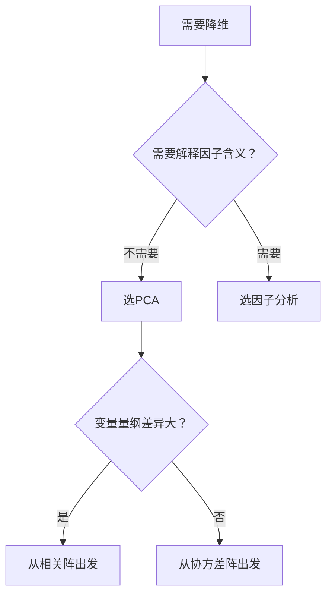

# KP01 [[02_主成分分析PCA|主成分分析]]基本原理

<div style="text-align:right;margin:10px 0;"><a href="../../../../exam.html" target="_blank" style="display:inline-block;padding:6px 16px;background:#2563eb;color:#fff;border-radius:6px;text-decoration:none;font-size:14px;">📝 开始做题</a></div>


## 1. 是什么

**定义**：主成分分析（Principal Component Analysis, PCA）是通过正交变换，将一组具有相关性的变量转换为少数几个不相关的综合指标（主成分），使得这些综合指标尽可能多地保留原始变量的信息。

**直觉类比**：假设你要测量一个人的"体质"，测了身高、体重、肺活量、握力、台阶试验等几十项指标。这些指标之间高度相关——高的人往往也重、肺活量大。PCA 相当于把这几十项指标"压缩"成 3 个综合分：第一分主要抓"高矮胖瘦"（体格大小），第二分抓"心肺耐力"，第三分抓"肌肉力量"。每个新分是原指标的加权平均，且三个新分互不相关。

**解决什么问题**：
- 高维数据降维：p 个变量 → k 个综合指标（k << p）
- 消除[[KP02_多重共线性|多重共线性]]：主成分之间不相关
- 综合评价：用第一主成分得分对样本排序

## 2. 怎么用

### 完整步骤

1. 由样本数据计算协方差阵 S（或[[KP11_标准化_ZScore|标准化]]后计算相关阵 R）
2. 对 S（或 R）作特征分解：求特征值 λ₁ ≥ λ₂ ≥ … ≥ λₚ 和对应单位正交特征向量 a₁, a₂, …, aₚ
3. 第 i 主成分：Y_i = a_i' X
4. 按累积贡献率准则确定主成分个数 k
5. 计算各样本的主成分得分：Ŷ_ik = a_i' (x_k - x̄)

### 核心公式

**从协方差阵出发**：

$$Y_i = \boldsymbol{a}_i' \boldsymbol{X}, \quad \text{Var}(Y_i) = \lambda_i, \quad \text{Cov}(Y_i, Y_j) = 0 \ (i \neq j)$$

其中：
- $\boldsymbol{X} = (X_1, X_2, \ldots, X_p)'$ 为原始随机向量
- $\boldsymbol{a}_i$ 为总体协方差阵 $\boldsymbol{\Sigma}$ 的第 i 大特征值 $\lambda_i$ 对应的单位特征向量
- $\lambda_i$ 满足 $\boldsymbol{\Sigma} \boldsymbol{a}_i = \lambda_i \boldsymbol{a}_i$

**总方差守恒**：

$$\sum_{i=1}^{p} \text{Var}(Y_i) = \sum_{i=1}^{p} \lambda_i = \sum_{i=1}^{p} \sigma_{ii} = \sum_{i=1}^{p} \text{Var}(X_i)$$

#### 【三问】为什么主成分是协方差阵的特征向量？为什么"最大方差方向"这么重要？

- **怎么来的（直觉推导）**：问题——找一个单位方向 $\boldsymbol{a}_1$（$\|\boldsymbol{a}_1\|=1$），让原变量在这个方向上的投影 $Y_1 = \boldsymbol{a}_1' \boldsymbol{X}$ 的方差 $\text{Var}(Y_1) = \boldsymbol{a}_1' \boldsymbol{\Sigma} \boldsymbol{a}_1$ 最大。这是一个**带约束的优化问题**：$\max_{\boldsymbol{a}} \boldsymbol{a}'\boldsymbol{\Sigma}\boldsymbol{a}$ s.t. $\boldsymbol{a}'\boldsymbol{a}=1$。用拉格朗日乘子法：$L = \boldsymbol{a}'\boldsymbol{\Sigma}\boldsymbol{a} - \lambda(\boldsymbol{a}'\boldsymbol{a}-1)$，对 $\boldsymbol{a}$ 求导并令为0，得到 $\boldsymbol{\Sigma}\boldsymbol{a} = \lambda\boldsymbol{a}$——这正是特征值方程！所以使方差最大的方向，就是协方差阵最大特征值对应的特征向量。第二主成分就是"与第一主成分正交的方向中方差最大的"，依此类推。总方差守恒是因为正交变换不改变总能量（就像旋转坐标系，散点图的"总散布"不变，只是换了个角度看）。
- **为什么用它**：解决"高维数据里信息都往哪儿集中"的问题。p 个变量往往高度相关（身高和体重、数学和物理成绩），真正的"独立信息维度"远少于 p。PCA 把这些相关变量旋转到新坐标系，让第一主成分抓住最大的方差（最重要的信息），第二主成分抓住次大的（次重要的）……后面的主成分方差很小，基本是噪声。丢掉后面的主成分，就等于"扔掉噪声、保留信号"，实现降维。
- **知识为什么存在**：1901 年 Pearson 提出 PCA 雏形，1933 年 Hotelling 完善。在没有计算机的年代，面对几十个变量的综合评价问题（体质、经济、教育），人们不知道怎么"抓主要矛盾"。PCA 用一个清晰的数学原则（方差最大化）把高维数据压缩成少数几个综合指标，成为多元统计里使用最广的降维方法。今天机器学习里图像压缩、特征提取、人脸识别、推荐系统的 embedding，底层都有 PCA 的思想（或其非线性版本 kernel PCA、t-SNE）。

### R 代码

```r
# 目的：对体质指标数据作主成分分析（从相关阵出发）
# 读取数据
health <- read.csv("health.csv", header = TRUE)

# 目的：从相关阵出发（变量量纲不同，必须标准化）
# cor = TRUE 表示基于相关阵 R 作 PCA
pc <- princomp(health, cor = TRUE)

# 目的：查看主成分标准差、特征值、载荷
summary(pc)          # 方差贡献率与累积贡献率
loadings(pc)         # 载荷矩阵（特征向量）
pc$scores            # 各样本主成分得分

# 目的：画碎石图判断主成分个数
screeplot(pc, type = "lines", main = "碎石图")
```

**输出解读**：
- `Importance of components` 行给出标准差、方差贡献率、累积贡献率
- `loadings` 列给出每个原变量在各主成分上的权重（即特征向量分量）
- 累积贡献率 > 80% 时对应的主成分个数即为保留个数

### 计算演示（简单数字）

设 2 个变量 $X_1, X_2$ 的协方差阵为：

$$\boldsymbol{\Sigma} = \begin{bmatrix} 2 & 1 \\ 1 & 2 \end{bmatrix}$$

**第一步：求特征值**

$$|\boldsymbol{\Sigma} - \lambda \boldsymbol{I}| = (2-\lambda)^2 - 1 = \lambda^2 - 4\lambda + 3 = 0$$

解得：$\lambda_1 = 3, \lambda_2 = 1$

**第二步：求特征向量**

- $\lambda_1 = 3$：$(\boldsymbol{\Sigma} - 3\boldsymbol{I})\boldsymbol{a} = 0$ → $\begin{bmatrix}-1 & 1 \\ 1 & -1\end{bmatrix}\boldsymbol{a} = 0$ → $\boldsymbol{a}_1 = (1/\sqrt{2}, 1/\sqrt{2})'$
- $\lambda_2 = 1$：$\boldsymbol{a}_2 = (1/\sqrt{2}, -1/\sqrt{2})'$

**第三步：主成分表达式**

$$Y_1 = \frac{1}{\sqrt{2}}X_1 + \frac{1}{\sqrt{2}}X_2, \quad \text{Var}(Y_1) = 3$$

$$Y_2 = \frac{1}{\sqrt{2}}X_1 - \frac{1}{\sqrt{2}}X_2, \quad \text{Var}(Y_2) = 1$$

**第四步：方差贡献率**

- 第一主成分贡献率 = 3/(3+1) = 75%
- 第二主成分贡献率 = 1/(3+1) = 25%
- 累积贡献率 = 100%

## 3. 什么时候用

**适用场景**：
- 多个变量间存在较强的线性相关关系
- 需要将高维数据压缩为低维综合指标
- 需要对样本进行综合评价或排序
- 回归分析中存在严重多重共线性，想用主成分回归

**数据条件**：
- 样本量 n 应大于变量个数 p（通常 n ≥ 5p）
- 变量间需有一定相关性（若完全独立则 PCA 无意义）
- 连续型变量为主

**前提假设**：
- 变量间关系为线性（PCA 只能捕捉线性结构）
- 大方差的维度具有重要意义（若噪声方差大于信号，PCA 会把噪声当主成分）

## 4. 什么时候不能用 / 易错点

**不适用场景**：
- 变量间相关性极弱（PCA 压缩效果差）
- 非线性结构数据（如流形数据，需用 Kernel PCA）
- 分类变量为主的数据

**常见错误做法**：
- ❌ 从协方差阵出发但变量量纲差异大（如身高 cm 与体重 kg），导致大方差变量主导主成分
- ❌ 把主成分当成"隐藏因子"来解释（主成分是原变量的线性组合，不是不可观测的因子）
- ❌ 主成分个数取太多（失去降维意义）或太少（丢失信息）
- ❌ 用第一主成分得分作综合评价时，未注意各变量方向是否一致

**违反假设的后果**：
- 变量间非线性相关时，PCA 提取的主成分不能有效代表数据结构
- 量纲不统一时，主成分结果完全由方差大的变量主导，失去实际意义

## 5. 与相似方法对比表

| 方法 | 原理 | 适用数据 | 优点 | 缺点 | 什么时候选它 |
|------|------|----------|------|------|-------------|
| 主成分分析 PCA | 正交变换使方差最大 | 连续变量、线性相关 | 简单、无模型假设、降维明确 | 主成分解释性差、只抓方差 | 需要降维或综合评价，不要求因子可解释 |
| [[KP03_PCA与因子分析对比|因子分析]] FA | 建立隐藏[[KP01_因子模型|因子模型]] X=AF+ε | 连续变量、有隐藏结构假设 | 因子可旋转、可解释、区分共同与特殊方差 | 需要指定因子个数、估计方法选择影响结果 | 需要识别背后的隐藏因子（如"能力""态度"） |
| [[04_聚类分析|聚类分析]] | 样本间距离分组 | 无标签数据 | 发现自然分组 | 不涉及变量降维 | 需要对样本分类而非变量压缩 |

## 6. 为什么用这个不用那个

**决策逻辑**：



**被排除的方法会出什么问题**：
- 若选因子分析但实际只需降维：因子估计引入额外假设（如正交因子模型），增加复杂度但无额外收益
- 若选 PCA 但需要解释因子：主成分是原变量的线性组合，没有隐藏因子的概念，无法通过旋转获得清晰的因子含义

## 7. 完整例子

### 书中原例（5 项体质指标）

对 30 名中学生测量 5 项体质指标：X₁=肺活量，X₂=握力，X₃=背力，X₄=立定跳远，X₅=台阶试验得分。从相关阵出发求得特征值：

| 主成分 | 特征值 | 方差贡献率 | 累积贡献率 |
|--------|--------|-----------|-----------|
| 1 | 2.75 | 55.0% | 55.0% |
| 2 | 1.02 | 20.4% | 75.4% |
| 3 | 0.63 | 12.6% | 88.0% |
| 4 | 0.35 | 7.0% | 95.0% |
| 5 | 0.25 | 5.0% | 100% |

按累积贡献率 > 80% 准则，取前 3 个主成分。

第一主成分载荷：(0.78, 0.82, 0.75, 0.68, 0.32)，主要反映"体格大小"综合能力。

### 小白生活实例（学生成绩综合评价）

某班 5 名学生 3 科成绩：

| 学生 | 数学 | 语文 | 英语 |
|------|------|------|------|
| A | 90 | 70 | 80 |
| B | 60 | 90 | 70 |
| C | 80 | 80 | 80 |
| D | 70 | 60 | 90 |
| E | 85 | 75 | 85 |

PCA 想找出一个"综合学习能力分"，使它对这 5 名学生的区分度最大。标准化后求相关阵的特征值，第一主成分主要抓"总体水平高低"，第二主成分抓"文科 vs 理科倾向"。

## 答辩常问（带标准答案）

1. **问：为什么主成分方向一定是协方差阵的特征向量？** 答：目标是找单位方向 a 使 Var(a'X)=a'Σa 最大。用拉格朗日乘子法在约束 a'a=1 下求极值，对 a 求导令为零得到 Σa=λa——这正是特征值方程。所以方差最大方向=最大特征值对应特征向量，第二主成分=与第一正交方向中方差最大的，依此类推。
2. **问：总方差守恒是什么意思？丢了主成分真的不丢信息吗？** 答：Σλ_i=Σσ_ii，即 p 个主成分的方差之和等于原 p 个变量的方差之和。正交变换只是旋转坐标系，不改变数据的总散布，只是把信息重新分配——前几个主成分占大部分信息，后几个接近噪声。丢掉后面的等于扔掉噪声，保留信号。
3. **问：什么时候必须从相关阵 R 出发而不是协方差阵 S？** 答：变量量纲差异大时（身高 cm vs 体重 kg），大方差变量会主导 PCA。从 R 出发相当于先标准化（各变量方差=1），各变量等权。判断标准：量纲一致用 S，量纲不同用 R，R 中 princomp(..., cor=TRUE)。

## 8. 速记卡

- **PCA 本质**：正交旋转坐标系，找方差最大的方向
- **关键数字**：特征值 = 主成分方差；特征向量 = 主成分权重
- **选择准则**：累积贡献率 > 80% 或 Kaiser 准则（特征值 > 1）
- **从相关阵出发**：变量量纲不统一时必须用
- **一句话口诀**：方差大者为第一，正交不相关，降维不丢总方差


---

## 🔗 相关知识点

**同章关联：** [[KP02_PCA性质与选择|PCA性质与选择]]｜[[KP03_PCA与因子分析对比|PCA vs 因子分析]]

**跨教材视角：** [[../../../01_综合评价/09_主成分分析/知识点/KP01_主成分分析的概念与基本思想|综合评价视角·PCA概念与基本思想]]｜[[../../../01_综合评价/09_主成分分析/知识点/KP02_主成分分析的数学原理|综合评价视角·PCA数学原理]]｜[[../../../01_综合评价/09_主成分分析/00_章节总结|综合评价·09主成分分析章节]]

**🐮 大牛库深入：** [[../../../../经济统计学论文从0基础到精通/08_降维与分类/02_主成分分析PCA|大牛库·PCA手算推导与Python验证]]

**📖 原书原文：** [[../../../../原文件/多元统计分析/何晓群_多元统计分析_全书|何晓群《多元统计分析》第5章]]
