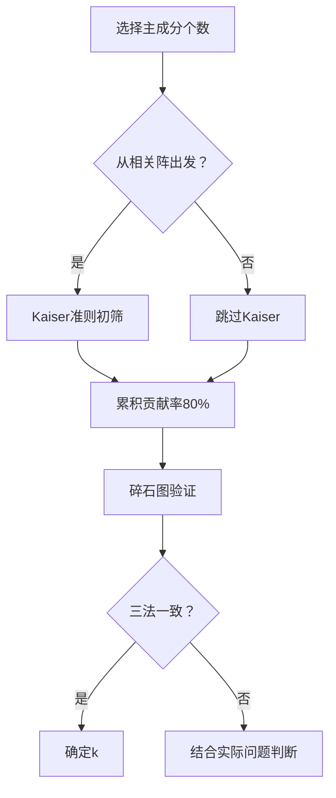

# KP02 主成分性质与个数选择

<div style="text-align:right;margin:10px 0;"><a href="../../../../exam.html" target="_blank" style="display:inline-block;padding:6px 16px;background:#2563eb;color:#fff;border-radius:6px;text-decoration:none;font-size:14px;">📝 开始做题</a></div>


## 1. 是什么

**定义**：主成分的性质描述了各主成分之间的统计关系及其与原始变量的联系；主成分个数选择则是决定保留多少个主成分才能在"降维"与"保留信息"之间取得平衡。

**直觉类比**：就像拍照时缩小分辨率——主成分个数太少（如只保留1个），照片模糊看不清细节；太多（如保留全部p个），等于没降维。我们要找一个"刚好能看清主要内容"的分辨率。

**解决什么问题**：
- 主成分之间是否相关？
- 每个主成分代表多少信息？
- 到底该保留几个主成分？

## 2. 怎么用

### 主成分的核心性质

**性质1：各主成分互不相关**

$$\text{Cov}(Y_i, Y_j) = 0, \quad i \neq j$$

因为特征向量两两正交，且 $\boldsymbol{Y} = \boldsymbol{A}'\boldsymbol{X}$，所以 $\text{Var}(\boldsymbol{Y}) = \boldsymbol{A}'\boldsymbol{\Sigma}\boldsymbol{A} = \boldsymbol{\Lambda}$（对角阵）。

**性质2：第 i 主成分的方差等于第 i 特征值**

$$\text{Var}(Y_i) = \lambda_i$$

**性质3：总方差守恒**

$$\sum_{i=1}^{p} \text{Var}(Y_i) = \sum_{i=1}^{p} \lambda_i = \sum_{i=1}^{p} \text{Var}(X_i)$$

正交变换不改变总方差，只是重新分配。

**性质4：主成分与原始变量的协方差**

$$\text{Cov}(X_j, Y_i) = a_{ji} \lambda_i$$

即原变量 X_j 与主成分 Y_i 的协方差等于该变量在 Y_i 上的载荷乘以 λ_i。

### 主成分个数选择的三大准则

**准则1：累积贡献率法**

$$\frac{\sum_{j=1}^{k} \lambda_j}{\sum_{j=1}^{p} \lambda_j} \geq 80\%$$

取满足条件的最小 k。

**准则2：Kaiser 准则（特征值 > 1）**

仅当从相关阵出发时使用：保留特征值大于 1 的主成分。原理：每个特征值 = 该主成分的方差，而每个原变量[[KP11_标准化_ZScore|标准化]]后方差为 1，若主成分方差 < 1，说明它还不如一个原变量携带的信息多。

**准则3：碎石图拐点法**

将特征值按从大到小排列，画折线图，在"肘部"（曲线由陡变缓的拐点）处截断。

### R 代码

```r
# 目的：判断主成分个数
pc <- princomp(health, cor = TRUE)

# 准则1：累积贡献率
# 直接看 summary(pc) 的 Cumulative Proportion 行
summary(pc)

# 准则2：Kaiser 准则
# 特征值 = 主成分标准差的平方
eigenvalues <- pc$sdev^2
eigenvalues[eigenvalues > 1]   # 输出特征值 > 1 的个数

# 准则3：碎石图
screeplot(pc, type = "b", main = "碎石图")
abline(h = 1, lty = 2, col = "red")  # 画特征值=1的参考线
```

**输出解读**：
- `summary(pc)` 的 `Cumulative Proportion` 列：第一个超过 0.8 的位置即 k
- `eigenvalues > 1`：数一下有几个 TRUE
- 碎石图：找折线拐弯的位置

### 计算演示

沿用 KP01 的协方差阵例子：λ₁ = 3, λ₂ = 1，总方差 = 4。

- 累积贡献率法：第一主成分 75%，第二主成分 100%。若阈值 80%，需保留 2 个（即全部）。
- Kaiser 准则（从相关阵出发时）：λ₁ = 3 > 1 保留，λ₂ = 1 = 1 保留（临界值）。

再举 5 变量例子：特征值 = (2.75, 1.02, 0.63, 0.35, 0.25)，总 = 5。

| 主成分 | 特征值 | 贡献率 | 累积贡献率 | Kaiser(>1) |
|--------|--------|--------|-----------|------------|
| 1 | 2.75 | 55.0% | 55.0% | ✓ |
| 2 | 1.02 | 20.4% | 75.4% | ✓ |
| 3 | 0.63 | 12.6% | 88.0% | ✗ |
| 4 | 0.35 | 7.0% | 95.0% | ✗ |
| 5 | 0.25 | 5.0% | 100% | ✗ |

- 累积贡献率 80% 准则：k = 3（88.0%）
- Kaiser 准则：k = 2（特征值 > 1）
- 两个准则不一致时，需结合碎石图和实际问题判断。

## 3. 什么时候用

**适用场景**：
- 任何 PCA 分析都需要决定保留几个主成分
- 综合评价中主成分得分的计算
- 主成分回归中自变量[[KP05_评价标准值xi0的选择|的选择]]

**数据条件**：
- 样本量足够大时，特征值估计稳定
- 变量数 p 较大时，降维效果才明显

## 4. 什么时候不能用 / 易错点

**常见错误**：
- ❌ 盲目使用累积贡献率 80%：对噪声大的数据，80% 可能需要太多主成分；对结构化很强的数据，50% 就够了
- ❌ Kaiser 准则用于从协方差阵出发的情况：特征值 > 1 只在标准化后（相关阵）有意义，协方差阵出发时特征值的尺度取决于变量量纲
- ❌ 碎石图只看一次就下结论：不同人对"肘部"位置判断可能不同
- ❌ 保留太多主成分：失去降维的初衷

**准则冲突时怎么办**：
- 若累积贡献率法与 Kaiser 法结果不同，优先参考累积贡献率法
- 结合碎石图：若曲线在 k 处有明显拐点，取 k
- 结合实际问题：若主成分有明确的实际含义，即使累积贡献率略低于 80% 也可考虑

## 5. 与相似方法对比表

| 方法 | 原理 | 适用场景 | 优点 | 缺点 | 什么时候选它 |
|------|------|----------|------|------|-------------|
| 累积贡献率法 | 信息保留比例阈值 | 通用 | 直观、信息保留明确 | 阈值 80% 是经验值 | 大多数情况首选 |
| Kaiser 准则 | 特征值 > 1 | 从相关阵出发 | 简单、客观 | 对 p 大时偏宽松 | 快速初步筛选 |
| 碎石图法 | 特征值分布的拐点 | 特征值分布有明显结构 | 图形直观 | 主观性较强 | 辅助验证 |

## 6. 为什么用这个不用那个

**决策逻辑**：



## 7. 完整例子

### 书中原例（5 项体质指标）

特征值 = (2.75, 1.02, 0.63, 0.35, 0.25)。

- 累积贡献率 80%：k = 3
- Kaiser（>1）：k = 2
- 碎石图：前两个特征值之间下降较陡，第二、三之间变缓，肘部在 k = 2 或 3。

综合判断：取 k = 2 或 3。若用于综合评价排序，第一主成分（55%）已足够；若用于进一步分析（如聚类、回归），取 3 个更稳妥。

### 小白生活实例（手机性能跑分）

测了 10 项手机性能指标（CPU、GPU、内存、存储、屏幕、电池、相机、重量、厚度、价格），PCA 后特征值 = (3.2, 1.8, 1.1, 0.8, 0.6, 0.5, 0.4, 0.3, 0.2, 0.1)。

- 累积贡献率：前 3 个 = (3.2+1.8+1.1)/10 = 61%；前 4 个 = 69%；前 5 个 = 75%
- Kaiser：前 3 个 > 1
- 碎石图：第 3→4 有明显拐点

结论：取 3 个主成分——第一"硬件性能"、第二"屏幕体验"、第三"轻薄程度"。

## 答辩常问（带标准答案）

1. **问：Kaiser 准则"特征值>1"为什么只在从相关阵出发时才有意义？** 答：从相关阵出发时每个标准化变量方差=1，若主成分方差 λ<1，说明它还不如一个原变量携带的信息多。从协方差阵出发时特征值尺度取决于量纲，>1 没有比较基准。
2. **问：三个选主成分个数的准则冲突了怎么办？** 答：累积贡献率 80%、Kaiser(λ>1)、碎石图肘部三者可能不一致。一般优先看累积贡献率；若碎石图在 k 处有明显拐点取 k；若主成分有明确实际含义，即使累积贡献率略低于 80% 也可保留。书中体质例子：累积法取 3 个(88%)，Kaiser 取 2 个，综合判断取 2~3 个。
3. **问：主成分之间为什么不相关？这有什么用？** 答：不同特征值对应的特征向量正交，Cov(Y_i,Y_j)=a_i'Σa_j=λ_j a_i'a_j=0（i≠j 时 a_i'a_j=0）。这正是 PCA 能消除[[KP02_多重共线性|多重共线性]]的原因——主成分回归中用主成分做自变量，彼此不相关，回归系数稳定。

## 8. 速记卡

- **三准则**：累积贡献率 > 80%、Kaiser 特征值 > 1、碎石图拐点
- **总方差守恒**：Σλᵢ = 总方差，PCA 不丢信息只重新分配
- **互不相关**：主成分之间 Cov = 0，这是降维后消除共线性的关键
- **一句话口诀**：方差大者先保留，八折原则定个数，Kaiser 辅助看碎石


---

## 🔗 相关知识点

**同章关联：** [[KP01_PCA基本原理|PCA基本原理]]｜[[KP03_PCA与因子分析对比|PCA vs 因子分析]]

**跨教材视角：** [[../../../01_综合评价/09_主成分分析/知识点/KP01_主成分分析的概念与基本思想|综合评价视角·PCA概念与基本思想]]｜[[../../../01_综合评价/09_主成分分析/知识点/KP02_主成分分析的数学原理|综合评价视角·PCA数学原理]]｜[[../../../01_综合评价/09_主成分分析/00_章节总结|综合评价·09主成分分析章节]]

**🐮 大牛库深入：** [[../../../../经济统计学论文从0基础到精通/08_降维与分类/02_主成分分析PCA|大牛库·PCA手算推导与Python验证]]

**📖 原书原文：** [[../../../../原文件/多元统计分析/何晓群_多元统计分析_全书#5.1 主成分分析的基本原理|何晓群《多元统计分析》第5章]]
